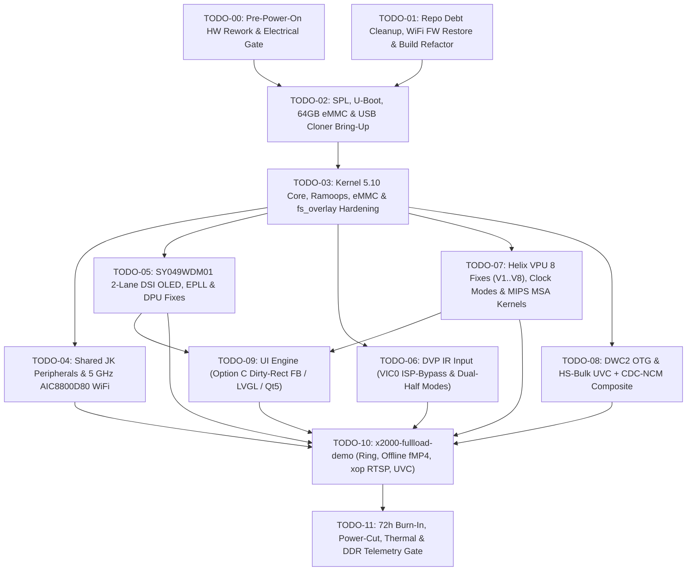
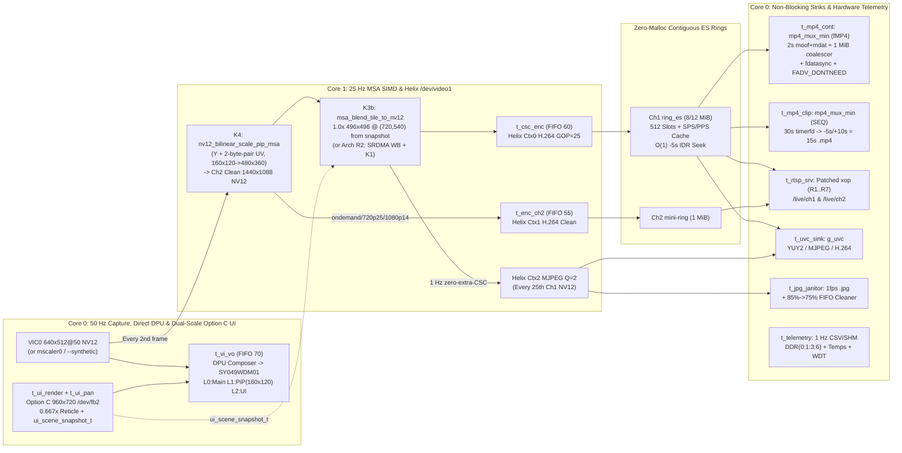

# Ingenic X2000 Mini-Lite Porting & Full-Load Verification Playbook

> **Playbook Scope**: End-to-end, self-contained engineering specification and sequential LLM coding playbook to port the Hi3556V200 `Mini-Lite` thermal-imaging product baseline onto the Ingenic **X2000 (`A-PCB-MB-TSIN01` V1.0)** 64 GB eMMC platform and execute full-load stability, thermal, and power-cut validation per [`docs/target/x2000评估验证，仿真跑全负载场景.md`](file:///hdd/System/Hi3556v200/dandelion-linux-x86_64-ubuntu18/_Workspace_/ingenic/docs/target/x2000评估验证，仿真跑全负载场景.md).

## Document Control & Canonical Baselines

| Parameter | Verified Canonical Value |
| :--- | :--- |
| **Target SDK Repository** | `/hdd/System/Hi3556v200/dandelion-linux-x86_64-ubuntu18/_Workspace_/ingenic` (`master` @ `5e7f32b2e08e1a15f77acb20137356eff3d1c2e3`; remote `git@github.com:SwordofMorning/Ingenic_X2000.git`; baseline tag `vendor/20240407` @ `15d32c5ed`; Linux `5.10.186` + `uboot-x2000`) |
| **Reference SDK Repository** | `/hdd/System/Hi3556v200/dandelion-linux-x86_64-ubuntu18/_Workspace_/Hi3559V200_SDK_V2.0.1.0` (`master_mini` @ `8f4be410d3d7a82e225f43822d0d2a4c3078e286`, PR#1–#21; Linux `4.19.90` + `u-boot-2020.01`) |
| **External App Repository (`mini-lite`)** | `git@10.42.0.252:outdoors/mini-lite.git` (branch `development`, baseline `9b78f6ab0dee14beeff6509e1386b8a230c05aa6`; referenced by repo-relative paths e.g. `component/RtspServer/src/src/xop/RtspConnection.cpp`) |
| **External UI Repository (`mini-lite-ui`)** | `git@10.42.0.252:outdoors/mini-lite-ui.git` (branch `main`, baseline `ac18ba6718e7dc0203b16a2fa75df95b7d4a2dd0`; referenced by repo-relative paths e.g. `MainGui/resource/funcwidget/reticle/reticle_<1..6>_<1|2|4>_<1..5>.png`) |
| **Target Hardware Assembly** | Core board **`A-PCB-MB-TSIN01` V1.0** (`X2000` dual-core XBurst2 @ 1.2 GHz, `128 MiB` SiP LPDDR3 — pin-compatible with `X2000E` `256 MiB` LPDDR2 & `X2000H` `512 MiB` LPDDR3; FORESEE `64 GB` eMMC 5.1 `FEMDNN064G-C9A61` / `FEMDRW064G-88A19`) mated to 4 shared `JK` daughterboards: **`A-PCB-JK-THG-CNT_VA`** (power/B2B/`ICM-20948`/`MS1836S`), **`A-PCB-JK-THG02-OLED`** (`SY049WDM01` + `TPS65132`), **`A-PCB-JK-THG02-USB_VA`** (`BQ25798` + Type-C + dual 2S battery dividers + LRF `CON11`), **`A-PCB-JK-THG02-WIFI`** (`BL-M8800DS2` `AIC8800D80` SDIO + 4 keys `SW1–SW4`) |
| **Toolchain Rules** | 1) **Linux 5.10.186, `module_driver`, Buildroot, `x2000-fullload-demo`**: **`mips-gcc930-glibc228`** (`toolchains/mips-gcc930-glibc228`, flags `-EL -march=mips32r5 -mabi=32 -mnan=2008 -mfp64 -mmsa -D_FILE_OFFSET_BITS=64`).<br>2) **U-Boot / SPL ONLY**: **`mips-gcc720-glibc229`** (`toolchains/mips-gcc720-glibc229`).<br>3) **ABI Trap**: Never run vendor `h264e-nl-server` (built against `GLIBC_2.29`) on `glibc 2.28` rootfs — use in-kernel `CONFIG_INGENIC_HELIX_H264E_RC_IN_KERNEL=y` instead. |
| **Locked Naming Invariants** | Product: **`x2000_minilite`** (`products/x2000_minilite.conf`); U-Boot targets: **`x2000_mb_tsin01_xImage_mmc0`** (Falcon) & **`x2000_mb_tsin01_uImage_mmc0`** (rescue); U-Boot header: `configs/uboot/x2000_minilite/include/configs/x2000_mb_tsin01.h`; GPT table (`<2048 B`!): `configs/uboot/x2000_minilite/board/ingenic/x2000_base/mb_tsin01/partitions.tab`; Kernel defconfig: `configs/kernel/x2000_minilite/arch/mips/configs/x2000_mb_tsin01_emmc_defconfig`; DTS: `configs/kernel/x2000_minilite/module_drivers/dts/x2000_mb_tsin01.dts`; SDK defconfig: `configs/build/x2000_minilite/configs/x2000_minilite_emmc_defconfig`; Buildroot defconfig: `configs/build/x2000_minilite/configs/buildroot/buildroot_x2000_minilite_defconfig`; Rootfs overlays: `fs_overlay/common` + `fs_overlay/x2000_minilite`. |

---

## Section 0: Executive Architecture Decisions, Capability Matrix & Master Session Dependency Graph

### 0.1 Key Architectural Decisions (Locked Across All Sessions)

1. **Composition & DDR Architecture — `Arch R1` (Primary Default) vs `Arch R2` (`SRDMA` Writeback Fallback)**:
   - **Silicon Constraint**: X2000 integrates a 16-bit LPDDR3-1500 bus (`3,000 MB/s` theoretical, **`~1,650–1,950 MB/s` sustainable real-world ceiling** under concurrent DPU/VIC/Helix/CPU arbitration) and `MB-TSIN01` schematic populates **`128 MiB` SiP LPDDR3 (`X2000`)**.
   - **`Arch R1` (Primary Default — `959–1,075 MB/s` DDR @ `960×720` DPU, `1,156–1,292 MB/s` @ `1440×1080` DPU; fits `128 MiB` `RMEM_MB=32`)**: DPU runs **Direct `COMPOSER_DISPLAY`** (`L0` `640×512 NV12` scaled, `L1` zero-copy stride-offset proportional `3.0×` `160×120` PiP crop centered at `(240,196)` — with `--pip-crop=160x120|160x128` option — `L2` `/dev/fb2` `ARGB8888` ping-pong using `sy049_lcdc_data.fb_fmt = fb_fmt_ARGB8888`, `jzfb.c:L421` `alpha < 255`, `LAYER0/1_FRAMES=0` with `jzfb.c` zero-frame guard, and **no `CMD_enable_cfg` on `/dev/fb2`** so `yoffset` ping-pong works with hardware per-pixel alpha). Clean Ch2 `1440×1080 NV12` is built by 2-core MIPS 128-bit MSA `nv12_bilinear_scale_pip_msa` (`~3.8 ms`, dual-writing Ch1+Ch2); UI-composited Ch1/Ch3 `1440×1080 NV12` is built on Core 1 by rendering native `1.0×` UI (`496×496` reticle at `(720,540)`) from an immutable `< 2 KiB` mutex-published `ui_scene_snapshot_t` into L2-cached `tile_scratch_enc` and blending via `K3b` (`msa_blend_tile_to_nv12`, `<1.9 ms`) — guaranteeing **0 boresight shift** against `960×720` `/dev/fb2`, **0 cross-core `/dev/fb2` race**, and zero DPU writeback DDR overhead.
   - **`Arch R2` (Literal Spec Benchmark Fallback — `--vo-readback=srdma`)**: DPU runs `SRDMA_DISPLAY` (`soc_fb_layer_mixer.ko fb_is_srdma=1`, `srdma_frames=3`, `DC_WB_FORMAT_8888=0` / `DC_WB_FORMAT_888=6` 32bpp `BGRA`/`BGRX` or `RGB565`) with all `soc_fb` / `fb_layer_mixer` / `jz_mipi_dsi` fixes, followed by 2-core MSA `bgrx_to_nv12_msa` (`~4.0 ms`). Uses `1,888–1,958 MB/s` at full `1440×1080` `BGRA`/`BGRX` (tight against 16-bit LPDDR3 ceiling) or **`1,496–1,566 MB/s` (`~1,521 MB/s` nominal)** with `1440×1080` `RGB565` WB (`2×25+1` fps; lower at `960×720` WB, which requires upscaling for `1440×1080` Helix). On `128 MiB` `X2000` (`RMEM_MB=40`, `mem=88M@0x0 rmem=40M@0x5800000`), `Arch R2` fits **`960×720` 32bpp `SRDMA` (`29.47 MiB <= 40 MiB`)**, **`1280×720` 32bpp `SRDMA` (`33.87 MiB <= 40 MiB`)**, or **`1440×1080` `RGB565` WB (`37.06 MiB <= 40 MiB`)**; full `1440×1080` dual-channel 32bpp `SRDMA` (`+17.80 MiB` → **`45.96 MiB > 40 MiB`**) requires `X2000E`/`X2000H` (`RMEM_MB >= 48`).
   - **Mandatory XBurst2 SMP Cache Law (`arch/mips/mm/c-r4k.c:L891-L896`)**: **`/dev/rmem_manager`** maps `CCA=0` (cached, 10× faster than `CCA=2` uncached), and XBurst2 `r4k_blast_dcache()` is **local-core only** (no hardware SMP D-cache coherency across cores). **Every MSA worker thread MUST execute `unsigned long args[3] = { (unsigned long)va, (unsigned long)size, rmem_cache_mem_to_dev }; ioctl(rmem_fd, CMD_RMEM_CACHE, args)`** (or `rmem_cache_sync()` from `<libhardware2/rmem.h>`, after patching `rmem_dev.c:L178` to use `copy_from_user()`) **on its own CPU core** before handing buffers to DPU/Helix DMA.

2. **Micro-OLED Display (`SY049WDM01`) — `Option A1` 2-Lane MIPI-DSI + `1.5×` Hardware Scaler**:
   - **Silicon & Connector Reality**: X2000 silicon & `jz_mipi_dsi.c:L147` cap MIPI-DSI at **2 Data Lanes** (zero VESA-DSC), and `MB-TSIN01` `CON7` is a 21-pin 2-lane FPC (requiring a 21p-to-45p adapter to `THG02-OLED` `CON2`). Meanwhile, `SY049WDM01` RX caps at **`1.0 Gbps/lane`** RGB24 (`90 Hz` max panel scan rate per `SY-SPEC-045P` p.5–6) and locks its internal charge pump to **$f_H = 74.88\text{ kHz}$** (`P12:0xC2 = 0x0392 = 914` cycles of `68.45 MHz` osc; wrong $f_H$ triggers `P10[0xB608]` UVLO white-flash at `t = 1.5 s` and shutdown at `30 s`). Native `1440×1080@50Hz` (`VTOTAL=1498`, `pclk=117.443 MHz`) requires `1,409 Mbps/L` net (`1,691 Mbps/L` at `6/5` Burst) — **41–69% over spec on 2 lanes**.
   - **Locked Resolution (`Option A1` Primary & Datasheet-Verified Fallback)**: Program `SY049WDM01` over **100% I2C1 (`PC23/PC24`, `0x4E`, ZERO DSI DCS!)** to **2-Lane (`0x6B00=0x0002`, after reading `CMD2 Page 0 0xB100` and RMW-clearing bits `[1:0]` or XOR-compensating `(b100 & 0x3) ^ 0x2`)** + **`SCACTRL 0x6900=0x0002` (`1.5×` HW upscaler)** + post-scaler `reg_80` (module-param selectable) + `TPS65132WRVCR` (`0x3E`) **`+5.4V / -5.4V`** (factory default, reinforced via I2C; never `-6.0V`), with `CLK_DIVIDER_ROUND_CLOSEST` patched onto `CLK_DIV_LCD` (`clk-x2000.c:L134`) so `DIV_ROUND_UP` never drops `pclk` by `-12.5%`:
     - **`A1-960p50` (Primary)**: `960×720@50Hz` → `1440×1080` (`2A00..01=0x00A0`, `HTOTAL=1088`, `VTOTAL_in=998`, **`EPLL=380 MHz / 7 = 54.286 MHz`**, ceiling-safe **`.pixclock=54285715`**, **`.byte_clock=97500`**, `f_H_in=49.89 kHz → f_H_out=74.84 kHz`, **`651.4 Mbps/L` net / `780.0 Mbps/L` `1.2×` Burst `<= 1.0 Gbps/L`**; cuts UI FB `rmem` by 55.6%). *(Never run `VTOTAL_in=1498` under `1.5×` scaling — `1.5 × 74.90 = 112.35 kHz` violates `SY049WDM01`'s `90 Hz` max scan rate!)*
     - **`A1-1280p50` *(Datasheet-Verified Fallback)***: `1280×720@50Hz` → `1920×1080` (`2A00..01=0x0000`, literal `SY-SPEC-045P` p.5 example with 160 px DPU pillar-box on each side, **`EPLL=632 MHz / 9 = 70.222 MHz`**, **`.pixclock=70222223`**, **`.byte_clock=115000`**, `f_H_in=49.87 kHz → f_H_out=74.81 kHz`, **`842.7 Mbps/L` net / `920.0 Mbps/L` `1.09×` Burst `<= 1.0 Gbps/L`**).
     - **`Option A2` (`1.33×`, `0x6900=0x0001`)**: `1080×810@50Hz` (`HTOTAL=1208`, `VTOTAL=1124`, `f_H_out=74.83 kHz`, `pclk=67.80 MHz` via `EPLL=339 MHz / 5` → **`813.6 Mbps/L` net / `976.3 Mbps/L` `1.2×` Burst**).
   - **Mandatory Active-Video `VPG` & Post-`SLPOUT` Lockout**: Keep `DSI_DPI_CFG_POL` `VSYNC_ACTIVE_LOW=1, HSYNC_ACTIVE_LOW=1`; enable DesignWare DSI Video Pattern Generator (`VPG_EN=1, VPG_MODE=0` RGB color-bar timing generator, `dw-mipi-dsi.c:L93-94`) + set `jzfb.vpg_active = 1` on every `enable_fb()` / `jz_dsi_video_cfg()` while keeping panel emission muted (`P11:0xC000=0x0000`) so continuous `HSYNC/VSYNC` clocks `SY049WDM01` across both cold boot and standby resume without flashing color bars; inside `lcdc_tft_pan_display()`, whenever `jzfb.vpg_active` is set, clear `VPG_EN=0` + `jzfb.vpg_active=0` before `dpu_start_*()` and unmute `P11:0xC000=0x00FF` (Page 11 already pre-selected — **ZERO `0xF001` page switches for `>= 1600 ms` post-`SLPOUT`**).

3. **Video Input (`VI`) — `VIC0` ISP-Bypass Hardware `UYVY→NV12` DMA**:
   - X2000 Tiziano ISP rejects YUV422 inputs and legacy CIM lacks NV12 output. Use **`soc_camera.ko` `VIC0` ISP-bypass DMA (`/dev/vic0`)** (`MD_X2000_510_CAMERA_VIC0_ISP_DISABLE=y`, `DVP_YUV422=3` — NEVER `DVP_YUV422_8BIT=6`, `Base_mode=6` HW `UYVY→NV12` at `24.58 MB/s`, `div_isp=300 MHz`, `FRAME_NUMS=5` → `vic_channel_mem.c:L334` allocates `5+1 = 6` frames = `2.81 MiB`, porting the `5e7f32b2e` mutex-around-wait fix + `stream_off` predicate fix to `vic_channel_mem.c`). Supports 4 modes covering both `640×512` pure YUV and dual-half `1280×512` (`AD + YUV`) without 4:2:0 AD corruption or byte-order scrambling.

4. **Video Encoding (`VPU`) — Helix H.264 + JPEG Only (`RC_IN_KERNEL=y`) & 4 Throughput Modes**:
   - **Hardware Reality**: X2000 `Helix` (`/dev/video1`, built-in `CONFIG_INGENIC_HELIX=y`) supports **H.264 Encode + JPEG Encode/Decode ONLY (ZERO H.265/HEVC silicon!)**, executing per-frame serially on an ordered workqueue (`helix_drv.c:L337-L353`). Apply all **8 Helix/VB2 fixes (`V1..V8`, including `V8` `h264e_encode_headers()` `CKSEG1ADDR` + `iob()` SMP cache-coherency fix)** alongside `CONFIG_INGENIC_HELIX_H264E_RC_IN_KERNEL=y`, `1440×1088` 4 KB-aligned NV12 planes for JPEG `mb_height=68`, `videobuf2-dma-contig-ingenic.c:L636,L656` `+ offset` & `L152` `_for_cpu`, and `helix_ops.c:L851,L1279-1280`.
   - **Throughput Budget (`div_ahb0 = 300 MHz` = `244,800 MBs/s` vs `1440×1088` = `6,120 MBs/frame` → `40.0 fps` aggregate max)**:
     - **`Mode B1` (Recommended Default @ `300 MHz` Stock Clock)**: Ch1 `1440×1080@25` always-on (`153,000 MBs/s`) + Ch3 `1fps` JPEG (`6,120 MBs/s`) + Ch2 on-demand `960×720@25` (`67,500 MBs/s`, total `226,620 MBs/s = 92.6%`) OR on-demand **`1440×1080@14`** (`85,680 MBs/s`, total **`244,800 MBs/s = 100.0%` in-spec**; note `25+15+1 = 250,920 MBs/s = 102.5%` exceeds `300 MHz` ceiling — drop Ch2 to `14 fps` for in-spec operation!).
     - **`Mode B2` (`300 MHz` Dual-Always-On)**: Ch1 `1440×1080@20` + Ch2 `1440×1080@19` + Ch3 `1fps` JPEG (`244,800 MBs/s = 100.0%` in-spec, or `19+19+1 = 238,680 MBs/s = 97.5%` for margin; `20+20+1 = 250,920 MBs/s = 102.5%` raw).
     - **`Mode B3` (`300 MHz` Single-Channel High-FPS)**: Ch1 `1440×1080@40` (`244,800 MBs/s = 100.0%`).
     - **`Mode A` (Lab Overdrive `AHB0 = 375 MHz` via U-Boot `CONFIG_SYS_AHB0_FREQ`)**: `306,000 MBs/s` → achieves literal **`2× 1440×1080@25 + 1fps JPEG` (`312,120` → `24+24+1`)** or **`1× 1440×1080@50`** (requires `+70°C` thermal qualification).

5. **UI Layer — `Option C` Boresight-Accurate Dual-Scale Dirty-Rect FB Engine (Primary)**:
   - Stock Qt 5.12.7 `QLinuxFbScreen` (`qlinuxfbscreen.cpp:L367-L420`) hardcodes `yoffset=0`, never calls `FBIOPAN_DISPLAY`, triple-copies `6.22 MiB`/frame, saturates DDR, and OOMs on `128 MiB` `X2000`.
   - Use **`Option C` (`ui_fb_compositor`)** for full-load verification & `128 MiB`: canonical logical coordinates are `1440×1080` (`(720,540)` boresight center, `496×496` reticle). `t_ui_render` publishes an immutable `< 2 KiB` `ui_scene_snapshot_t` under mutex: Core 0 renders `0.6667×` (`330×330` reticle at `(480,360)`) into double-buffered `960×720` `/dev/fb2` (`yres_virtual=2×yres`, sparse opaque spans + `prev_dirty[back]` MSA zero-erase + `--stress-fill-pct=0..100` DDR sweep knob), while Core 1 renders native `1.0×` (`496×496` at `(720,540)`) directly into L2-cached `tile_scratch_enc` and blends onto `1440×1080` `ch1_buf` NV12 via `K3b` — guaranteeing **0 boresight shift** and **0 cross-core `/dev/fb2` race**. For full production GUI, migrate to **`Option A` (`vendor/third_party/lvgl/` v8.3.9 + MSA)**; reserve **`Option B` (patched Qt 5.12.7)** strictly for `>=256 MiB` `X2000E/H`.

6. **USB Gadget — HS-Bulk UVC (`YUY2/MJPEG/H.264`) + `CDC-NCM` (`WINNCM`) Composite**:
   - DWC2 pure peripheral (`EXT_ID_PIN=n`, `EXT_VBUS_DETECT=n`, `device-using-dma=<1>` Buffer DMA, `g-tx-fifo-size = <16 16 16 256 256 256 512 640>` so `F4 = 256w = 1024 B` double-buffers `UVC Bulk`) + 6-file `f_uvc` patch (HS Bulk capped at `16 KB × 16`, `alt0`-only with `get_alt()`/`set_alt()`/`bind()` Bulk fixes, Windows ZLP + `req->length` fix at `uvc_video.c:L67,L80-81`, `YUY2 640×512@50` + `MJPEG 1440×1080@25` w/ `DHT` + `Frame-Based H.264 1440×1080@25`) + `CDC-NCM` (`WINNCM` IF 0+1 first, `uvc.0` IF 2+3 second, complete `S85USB` frame attributes, `usb_mtp` MS OS 1.0 `"MTP"` patch, background UDC re-arm removing the 12 s boot stall, persistent UVC daemon for `bind_deactivated`).

7. **Storage & Power-Cut Defense — 8 MiB-Aligned 64 GB GPT + RO SquashFS A/B + Offline `fMP4`**:
   - Unified 10-entry 8 MiB-aligned GPT (`FEMDNN064G-C9A61`, `59,680 MiB`) matching `x2000_base_common.h` natively (`p1 kernel`, `p2 rootfs` RO SquashFS, `p3 kernel2`, `p4 rootfs2` RO SquashFS, `p5 ota`, `p6 app` RO `ext4`, `p7 factory` RO `ext4`, `p8 config` RW `ext4`, `p9 userdata` `57.46 GiB` RW `ext4` with `524,288` inodes). Byte-bounded dirty writeback (`2 MiB`/`6 MiB`) + 100% offline C11 ISO-BMFF 5-min **`fMP4`** (`src/mp4_mux_min.{h,c}`, `moof+mdat` per 2 s GOP, or pre-vendored `minimp4.h`) + `1 MiB` coalesced `fdatasync` + `POSIX_FADV_DONTNEED`.

8. **CVBS (`MS1836S`) Hardware Gap**:
   - `MS1836S` on `JK-THG-CNT_VA` accepts **HDMI TMDS only** (and its I2C net is orphaned). Ingenic X2000 has **no native HDMI TX** (`CON5.40..54` are 3.3V parallel LCD pins). Drive **`PC07 (MS1836_EN) = 0`** in SPL & kernel to keep `MS1836S` powered OFF (`>350 mA` saved); CVBS output requires a hardware bridge on PCB Rev B.

---

### 0.2 Line-by-Line Requirement vs X2000 Hardware Reality Matrix

Mapping every single requirement in [`docs/target/x2000评估验证，仿真跑全负载场景.md`](file:///hdd/System/Hi3556v200/dandelion-linux-x86_64-ubuntu18/_Workspace_/ingenic/docs/target/x2000评估验证，仿真跑全负载场景.md) (L1–L72) against verified X2000 silicon and `A-PCB-MB-TSIN01` PCB reality:

| Spec Ref (`L#`) | Requirement Summary | X2000 Silicon / `MB-TSIN01` Reality | Showstoppers & Gaps Identified | Locked Engineering Resolution | Target Session |
| :--- | :--- | :--- | :--- | :--- | :---: |
| **一.1 (`L5`)** | VI DVP `640×512@50fps` `UYVY` capture | `CON4` wires 12-bit 1.8V DVP (`PA00..14`, `CPM_EXCLK_DS[30]=1`) into `VIC0`. | Tiziano ISP rejects YUV422; legacy CIM lacks NV12; `vic_channel_mem.c:L653` holds mutex across wait; `DVP_YUV422_8BIT=6` corrupts `vic.c:L638`. | **`VIC0` ISP-bypass DMA** (`/dev/vic0`, `DVP_YUV422=3`, `Base_mode=6` HW `UYVY→NV12`, `300 MHz` ISP clk, `FRAME_NUMS=5` → 6 frames `2.81 MiB`, port mutex + `stream_off` wait fixes). | `TODO-06` |
| **一.2 (`L7`)** | VO MIPI-DSI `1440×1080@50Hz` RGB24 | X2000 DSI TX is **2-lane max** (`jz_mipi_dsi.c:L147`, no DSC); `CON7` is 21p vs `OLED CON2` 45p. | Native `1440×1080@50` (`f_H=74.90 kHz` req) needs `1.41–1.69 Gbps/L` > `SY049` `1.0 Gbps/L` max; `DIV_ROUND_UP` drops `div_lcd` `-12.5%`; zero HSYNC during `SLPOUT`; 1600 ms lockout. | 21p→45p FPC adapter + **`Option A1-960p50`** 2-lane (`6B00=2`) `1.5×` scaler (`960×720@50→1440×1080`, `EPLL=380 MHz/7=54.286 MHz`, `CLK_DIVIDER_ROUND_CLOSEST`, `.pixclock=54285715`, `780.0 Mbps/L` `1.2×` Burst) + **`A1-1280p50`** datasheet fallback (`632 MHz/9`, `920.0 Mbps/L`) + `VPG_EN=1` + 100% I2C1 `0x4E` init. | `TODO-00`, `TODO-05` |
| **一.2a (`L9`)** | Video Layer 1: `640×512 → 1440×1080` | DPU `RDMA`/`Composer` has 2 HW scalers (`L0`, `L1`), supporting NV12 up to `2048×2048`. | Stock `fb_layer_mixer.c:L189,206` flushes `sizeof(ptr)=4B` instead of descriptor struct; `LAYER0/1_FRAMES=0` panics `jzfb.c:L404,911,1278`; BT.601 CSC regs uninitialized. | Apply DPU/mixer/jzfb patches (incl. zero-frame guard, `fb_fmt_ARGB8888`, `fb_layer_mixer.h:L4` fix); bind `L0` to zero-copy `VIC0` `640×512 NV12` scaled to `960×720` (or `1280×720`/`1440×1080`). | `TODO-05` |
| **一.2b (`L11`)** | Video Layer 2 PiP: proportional `3.0×` zoom centered top | DPU `L1` second HW scaler supports sub-rect stride-offset crop directly on `L0`'s NV12 buffer! | Literal `160×128` (`5:4`) → `480×360` (`4:3`) introduces `6.7%` vertical squish; clean encode path needs PiP too. | Display: zero-copy `L1` proportional **`160×120` crop at `(240,196)`** → `320×240@(320,0)` in `960×720` (`480×360@(480,0)` post-`1.5×`, with `--pip-crop=160x120\|160x128`). Encode Ch2: 2-core MSA `nv12_bilinear_scale_pip_msa` (`~3.8 ms`). | `TODO-05`, `TODO-07`, `TODO-10` |
| **一.2c (`L13`)** | Graphics Layer 1: ping-pong `1440×1080` `ARGB8888` FB by Qt | `/dev/fb2` (`L2`) supports double-buffered `ARGB8888` ping-pong (`yres_virtual=2×yres`, NO `CMD_enable_cfg`!). | Stock Qt 5.12.7 `QLinuxFbScreen` tears (`yoffset=0`), triple-copies `6.22 MiB`, saturates DDR, and **OOMs on 128 MiB `X2000`**; 1:1 `960×720` → `1440×1080` copy shifts boresight! | **`Option C`** dual-scale `ui_scene_snapshot_t` (`0.6667×` on `960×720` `/dev/fb2`, native `1.0×` on `1440×1080` `ch1_buf` → 0 boresight shift, 0 cross-core race) primary; **`Option A`** (`LVGL v8.3.9`) for product UI; patched Qt only on `>=256 MiB`. | `TODO-09` |
| **一.2d (`L15`)** | VO internal YUV→ARGB + 3-layer mix to RGB24 | DPU `COMPOSER_DISPLAY` blends `L0+L1+L2` in HW; `SRDMA_DISPLAY` (`fb_is_srdma=1`) writes back 32bpp `BGRA`/`BGRX` (`DC_WB_FORMAT_8888=0` / `DC_WB_FORMAT_888=6`) or `RGB565`. | Full-res `1440×1080` `SRDMA` 32bpp uses `1,888–1,958 MB/s` DDR and `45.96 MiB` `rmem` (`> 40 MiB` on `128 MiB` `X2000`!). | **`Arch R1`** (Direct Composer + dual-scale MSA sparse-UI blend to NV12, `959–1,075 MB/s`, `RMEM_MB=32`) primary; **`Arch R2`** (`--vo-readback=srdma`, `RMEM_MB=40` for `960p`/`1280p` 32bpp or `1440p` `RGB565` `~1,521 MB/s`; `X2000E/H` `>=48M` for `1440p` 32bpp). | `TODO-05`, `TODO-07`, `TODO-10` |
| **二.1 (`L19`)** | Dynamic graphics + large reticle PNGs moving randomly | CPU is dual-core XBurst2 @ 1.2 GHz w/ 128-bit MIPS MSA SIMD (`-mmsa`). | Full-screen software clear/blit at 50 Hz wastes `>600 MB/s` DDR. | Precomputed sparse opaque-span blitter for all 90 `mini-lite-ui` `496×496` reticle PNGs + `prev_dirty[back]` MSA erase + `--stress-fill-pct` sweep. | `TODO-09` |
| **三 (`L21`)** | VPU max capability (`1080p30` nominal), H.264/H.265 | Helix `/dev/video1` (`CONFIG_INGENIC_HELIX=y`) is **H.264 + JPEG ONLY**; `div_ahb0=300 MHz` yields `244,800 MBs/s` (`40.0 fps` @ `1440×1088`). | **ZERO H.265/HEVC silicon**; `RC_NETLINK` fails (`glibc 2.29` mismatch); `2×25 + 1 = 51 fps` (`312k MBs/s`) exceeds `300 MHz` ceiling by `27.5%`; `h264e_encode_headers` KSEG0 SMP race. | **H.264 only** + `RC_IN_KERNEL=y` + **8 VB2/Helix fixes (`V1..V8`)**; run **`Mode B1`** (`300 MHz`, Ch1 `25fps` + Ch2 on-demand `960×720@25` `92.6%` / `1440×1080@14` `100.0%` + Ch3 `1fps`), `Mode B2` (`20+19+1` fps `100.0%`), or **`Mode A`** (`AHB0=375 MHz`). | `TODO-07` |
| **三.1 (`L23`)** | Ch1 (with UI) `1440×1080@25fps`, MSA RGB→NV12 → VPU | Dual-core MSA `bgrx_to_nv12_msa` (`~4.0 ms`) or `msa_blend_tile_to_nv12` (`<1.9 ms`). | Stock `vendor/libmedia/.../msa_convert.c:L97-133` has `p0` row-duplication bug, GCC 7.2-only intrinsics, `width%16` overflow, and lacks per-core `CMD_RMEM_CACHE`. | Custom GCC 9.3 `-mmsa` kernels (`K1–K4`) + mandatory per-core `CMD_RMEM_CACHE` (`args[3]={va,size,rmem_cache_mem_to_dev}` / `rmem_cache_sync()` on `/dev/rmem_manager`) + `1440×1088` 4 KB-aligned Y/UV buffers. | `TODO-07`, `TODO-10` |
| **三.2 (`L25`)** | Ch1 rolling 5 s in-memory ES ring buffer | `5 s × 12 Mbps = 7.5 MiB` (fits in `8 MiB` contiguous ring on `128 MiB` RAM; `12 MiB` on `>=256 MiB`). | Legacy `mini-lite` `ringbuf.c:L62` has byte-swap bug and splits NAL headers across wrap boundaries. | Zero-malloc contiguous-frame `ring_es.{h,c}` (`8/12 MiB` arena, 512-slot index, SPS/PPS cache, O(1) `-5.0 s` IDR lookback). | `TODO-10` |
| **三.3 (`L27`)** | Ch2 (clean, no UI) `1440×1080@25fps` NV12 → VPU | Second Helix V4L2 instance (`Ctx1`) shares serialized workqueue (`helix_drv.c:L474`) with `Ctx0`. | Simultaneous `1440×1080@25` on Ch1+Ch2 exceeds stock `300 MHz` VPU clock (see `L21`). | Build clean NV12 via 2-core MSA `K4` (`~3.8 ms`); support `--ch2-mode=ondemand\|720p25\|1080p14\|always` (`Mode B1/B2/A`). | `TODO-07`, `TODO-10` |
| **三.4 (`L29`)** | Ch3 `1fps` UI frame → MSA → VPU MJPEG → eMMC `.jpg` | Helix `Ctx2` hardware JPEG encoder (`V4L2_PIX_FMT_JPEG`) reuses every 25th Ch1 NV12 frame (0 extra CSC!). | `helix_jpeg_enc.c:L224-238` reads `68` MB rows (`1088` px) → overreads `1080`-row buffer; missing `DHT 0xFFC4` breaks some viewers; `snap.c:L347` `drop_caches` stalls IO. | Allocate `1440×1088` NV12 + verify built-in `DHT 0xFFC4` + async `emmc_writer` `.tmp`→`rename` (no `drop_caches`). | `TODO-07`, `TODO-10` |
| **四.1 (`L33`)** | RTSP on-demand RTP streaming of Ch1/Ch2 H.264 | 5 GHz `AIC8800D80` (`BL-M8800DS2` on `MSC1` 1.8V) + `CDC-NCM` USB networking. | `wireless/aicsemi` fw was pruned by `prune_vendor.sh:L56`; `mini-lite` ARM `thirdparty/rtsp` won't run on MIPS; `xop::RtspServer` has 7 MIPS32 signed-char/UAF/double-close bugs. | Restore `wireless/aicsemi` (`rsync --exclude='.git'`) + copy all 15 `*8800d80*` fw files + fix 4 AIC8800 Makefiles + port `mini-lite` `component/RtspServer` (`xop`) with all 7 MIPS32/safety patches + instant `FORCE_KEY_FRAME`. | `TODO-01`, `TODO-04`, `TODO-10` |
| **四.2–3 (`L35,37`)** | Continuous MP4 recording + every 30 s save `-5 s/+10 s` = 15 s `.mp4` to eMMC | `64 GB` (`59,680 MiB`) `FEMDNN064G-C9A61` on 8-bit `MSC0` (`93.75 MHz` HS200 ≈ `85 MB/s` or `46.875 MHz` DDR52). | `64 MiB` volatile eMMC cache loses un-flushed MP4 `moov` on power cut; stock `ext4`/`vm.dirty` defaults cause page-cache OOM & writeback stalls; `mini-lite` `rec.c` blocks VENC. | 8 MiB-aligned `ext4` `/userdata` (`57.46 GiB`, `524k` inodes) + 100% offline C11 `src/mp4_mux_min.{h,c}` (or pre-vendored `minimp4.h`) 5-min **`fMP4`** (`moof+mdat` / 2 s GOP) + 30 s `timerfd` clip writer + `1 MiB` coalesced `fdatasync` + `POSIX_FADV_DONTNEED` + `85%→75%` FIFO janitor. | `TODO-02`, `TODO-03`, `TODO-10` |
| **四.4 (`L39`)** | UVC output of encoded YUV / RGB / H.264 | DWC2 USB 2.0 HS pure peripheral (`3,576`-word SPRAM TX FIFO, Buffer DMA; `F4=256w` double-buffered Bulk). | HS Isoch caps at `24.58 MB/s` (`640×512×2×50 = 32.77 MB/s` YUY2 overflows!); uncompressed `1440×1080@25` RGB24 (`116.6 MB/s`) exceeds USB 2.0 HS (`~42 MB/s`), so **RGB stream is substituted by `MJPEG`**; stock `f_uvc` lacks Bulk/H.264/ZLP; `S70USB` stalls boot 12 s. | 6-file `f_uvc` patch (HS Bulk capped `16 KB×16` `38–42 MB/s`, `alt0`-only w/ `get_alt/set_alt/bind` fixes, Windows ZLP + `req->length` fix, `YUY2 640×512@50` + **`MJPEG 1440×1080@25` (UVC RGB substitute)** + `H.264 1440×1080@25`) + `CDC-NCM` composite + `usb_mtp` MS OS 1.0 patch. | `TODO-08`, `TODO-10` |
| **五.1–5 (`L43-51`)** | Long-run stability, high/low temp boot/run, 0 frame drops, CPU/DDR monitor | Hardware DDR monitor (`0x134F0088`, `"0:1:3:6"`); `ingenic-wdt`; `ramoops`. | **Zero on-SoC CPU thermal sensor**; `FEMDNN064G-C9A61` rated **`-25°C`** (NOT `-40°C`!); `SY049WDM01` rated **`-20°C`**; `EMMC_RST` unwired (passive RC); `ddr_bandwidth_monitor.c:L444` & `ingenic_wdt.c:L133,L166-178` broken. | Patch `ddr_bandwidth_monitor.c` & `ingenic_wdt.c` (`L133` `drvdata->timeout != new_timeout`, keep `L288=0`); read board temps via `BQ25798` (`tdie_decic`) + `ICM-20948` (`temperature`) + `SY049` (`P12:BF02`); execute 5-stage 72h + 20× power-cut + `-20°C/+70°C` chamber gate; flag `-40°C` BOM SKU swap. | `TODO-00`, `TODO-03`, `TODO-11` |
| **Legacy Ref (`L55-59`)** | Dual-half `1280×512` (`640×512` AD + `640×512` YUV) & `>40fps` `1280×1024` UV corruption | `VIC0` supports `Base_mode=3` (lossless YUV422) and HW `HFB_NUM` H-crop; `CIM` supports `CROP_SITE` (`cam_bus_num=2`). | Feeding dual-half `1280×512` into `Base_mode=6` (NV12 4:2:0) **destroys 16-bit AD rows**; `hal/vic.c:L418` scrambles Mode 2 AD bytes; `1280×1024@>40fps` ISP/MScaler UV corruption caused by AHB0/MScaler FIFO overrun + unaligned UV + Helix `300 MHz` >40fps limit. | Document all 4 safe `VIC0`/`CIM` modes (`Mode 1/2/3A/3B`, incl. Mode 2 identity byte order & Mode 3A `HFB_NUM`/Mode 3B `cam_bus_num=2`) + `VIC0→DDR NV12` bypass eliminating MScaler UV FIFO underrun. | `TODO-06`, `TODO-07` |
| **Full-Load Alt (`L63-72`)** | `50fps` VI→VO full-res + OSD + `50fps` VO→MSA→VPU MP4 + WiFi RTSP | `1440×1080@50` H.264 needs `306,000 MBs/s` vs `244,800 MBs/s` @ `300 MHz` (`Mode B3` = `40fps` max @ `300 MHz`; `Mode A` `375 MHz` = `50fps`). | Simultaneous `1440×1080@50` `SRDMA` + `50fps` H.264 exceeds both `300 MHz` VPU and 16-bit LPDDR3 margin unless using `Arch R1` + `Mode A` (`375 MHz`) or `960×720@50` (`135,000 MBs/s` — fits `300 MHz` effortlessly!). | Support CLI matrix `--arch=r1\|r2`, `--vo-mode=960p50\|1280p50\|1080x810p50\|1440p50`, `--enc-fps=25\|40\|50` to benchmark both stock `300 MHz` and `375 MHz` ceilings empirically. | `TODO-07`, `TODO-10`, `TODO-11` |

---

### 0.3 Master Session Dependency Graph & Execution Index (`TODO-00` .. `TODO-11`)



> **Parallelism Note**: `TODO-00` (bench hardware rework) and `TODO-01` (repo/build refactor) execute in parallel. Once `TODO-03` boots cleanly on `MB-TSIN01` (or immediately on Darwin EVB for software bring-up), **`TODO-04`, `TODO-05`, `TODO-06`, `TODO-07`, and `TODO-08`** can proceed in parallel across independent driver/subsystem files before converging into `TODO-09` and `TODO-10`.

| Session ID | Exact Title | Core Goal | Prerequisites | Key Deliverables / Artifacts | Hard Acceptance Gate |
| :---: | :--- | :--- | :---: | :--- | :--- |
| **`TODO-00`** | Pre-Power-On Hardware Rework & Bench Electrical Verification Gate | Eliminate all P0 silicon-damage voltage faults (`1.35V→1.20V`, `4.27V→1.8V` RTC, `Q1/U2` 1.8V SDIO shoot-through, 1.8V IMU) and fabricate OLED FPC adapter before applying power. | None | Reworked `MB-TSIN01` + `CNT` + `USB` PCBA (`RF-01`..`RF-16`), 21p→45p OLED FPC adapter (all 7 GND pins), crossed UART3 dongle, Rev B ECO list. | Multimeter verifies `VCC_1V2=1.20V±2%`, `F3<=1.82V` (`CON5.25 ~3.27V` running / `4.27V` while `SW4` held), `VDDIO_SD=1.80V`, `ICM-20948` SDA/SCL `1.80V`, `BT1` off-current **`< 50 µA`**. |
| **`TODO-01`** | Repository Debt Cleanup, WiFi Firmware Restore & Build/Packaging System Refactor | Clean `sdk_patch` debt, product-scope `configs/build/` & `fs_overlay/darwin_v211/`, restore `wireless/aicsemi` (`rsync --exclude='.git'`), pre-populate offline `dl/`, fix `pack_images.sh`, refactor `build.sh`. | None | Clean `vendor/`, restored `vendor/wireless/aicsemi/`, `configs/build/{common,darwin_v211}`, `fs_overlay/darwin_v211`, `products/x2000_minilite.conf`, refactored `build.sh` & `scripts/pack_images.sh`, fixed `.gitignore:L21`. | Offline `./build.sh -p x2000_minilite check` passes; `unsquashfs -ll` confirms `/bin/busybox 4755`, `/tmp 1777`, zero `THIS_IS_NOT_YOUR_ROOT_FILESYSTEM`. |
| **`TODO-02`** | SPL, U-Boot, 64GB eMMC (`FEMDNN064G-C9A61`) & USB Cloner Bring-Up | Port Falcon & rescue U-Boot to `MSC0` 8-bit 64 GB eMMC, apply all 7 SPL/U-Boot/MMC patches (incl. `MSCCDR_EXCK_E` & `RTC_HWFCR`), build 8 MiB-aligned 10-entry GPT, flash via USB Cloner. | `TODO-00`, `TODO-01` | `boards.cfg`, `x2000_mb_tsin01.h` (`CONFIG_PARTITION_UUIDS`, `0x82000000`, `#ifndef CONFIG_SPL_BUILD`), `536 B` `partitions.tab`, 7 U-Boot/SPL patches, `u-boot-with-spl-mbr-gpt.bin`, Cloner `.cfg`/POLICY. | USB Cloner (`0xA108:0xEAEF`) flashes cleanly w/ `write_back_chk`; `UART3` prints SPL→Linux entry in `<250 ms` (`PB28` rescue shell has valid `bootargs`/`bootcmd` & `part list mmc 0`). |
| **`TODO-03`** | Kernel 5.10 Core, Memory/Ramoops, 64GB eMMC `sdhci-ingenic`, `fs_overlay` & PR#21 System Hardening | Boot hardened RO SquashFS Linux 5.10.186 on 64 GB eMMC with unified `reserved_mem`/`ramoops`, fixed `sdhci-ingenic`/`wdt`/`ddr_mon`, `S10ko` exact load order, and PR#21 init chain. | `TODO-02` | `x2000_mb_tsin01.dts` (3-cell GPIOs, `&watchdog`, no `chosen/bootargs`), `x2000_mb_tsin01_emmc_defconfig`, `sdhci-ingenic`/`wdt`/`ddr_mon` patches, `fs_overlay/x2000_minilite` (`S00–S99`, `xOTA`). | Boots RO `/` (`p2`), RO `/app` (`p6`), RO `/manufacturer` (`p7`), RW `/config` (`p8`), RW `/userdata` (`p9` `57.46 GiB`); `ramoops` survives panic; `wdt` programs timeout & clean stop. |
| **`TODO-04`** | Shared JK Peripherals & 5 GHz `AIC8800D80` WiFi Porting | Port `BQ25798`+patched `SADC`, `ICM-20948`+`AK09916`, 4 keys+`reset.c` hibernate fix, `RTC`+`rtc_test`, `UART2/3/9`, `MS1836S` off, and 5 GHz `AIC8800D80` WiFi (15 fw files). | `TODO-03` | Ported `BQ25798.c`, `ingenic_adc_aux.c` export, `icm20948.c`, `gpio_keys.c`, `reset.c` patch, `rtc-ingenic.c` CRC8 + `rtc_test`, fixed `aic8800D80` Makefiles + `S60WiFi`. | `bat_test`, `icm20948_test` (0 idle IRQs/s, `temperature` attr), `btn_test` (10s+3s poweroff + clean `PE31` release), `rtc_test`, and 5 GHz `iperf3 >= 20 Mbps` pass. |
| **`TODO-05`** | SEEYA `SY049WDM01` 2-Lane MIPI-DSI OLED, `EPLL` Clocking & DPU 3-Layer + Writeback Fixes | Bring up `SY049WDM01` on 2-lane DSI (`Option A1-960p50` + `A1-1280p50` fallback + `CLK_DIVIDER_ROUND_CLOSEST`), lock `f_H=74.88 kHz` & 1600 ms guard, and fix all DPU/mixer/jzfb/DSI bugs. | `TODO-03` | `clk-x2000.c`/`clk-pll-v1.c` patches, `lcd_sy049wdm01_data.c`, `soc_fb`/`fb_layer_mixer`/`jz_mipi_dsi` patches (incl. `VPG_EN`, `ARGB8888`, zero-frame guard). | At `+1700 ms` post-`SLPOUT`: `P00[0x0A00]==0x009C`, `P00[0x0500]==0`, `P10[0xB608]∈[0x88,0x97]`, `P13[0x6600/0x6800]` clean; 0 `tft_underrun_count` for 10 min @ 50 Hz. |
| **`TODO-06`** | DVP Infrared Sensor Input (`VIC0` ISP-Bypass `NV12` & Dual-Half `1280×512` AD+YUV Modes) | Capture `640×512@50fps` `UYVY→NV12` zero-copy via `VIC0` ISP-bypass DMA and support lossless/cropped `1280×512` dual-half AD+YUV modes. | `TODO-03` | `planck640_dvp.c` (`sensor_planck640_dvp.ko`), `vic_channel_mem.c` mutex + `stream_off` fixes, `hal/vic.c` Mode 2/3A fixes, Mode 1/2/3A/3B capture harness. | Sustained `50.0 fps` on `/dev/vic0` with 0 FIFO overflow (`show_frm_cnt`), valid NV12 luma/chroma, and bit-exact 16-bit AD half in Mode 2. |
| **`TODO-07`** | Helix VPU (H.264 + MJPEG) 8 Kernel/VB2 Fixes (`V1..V8`), Clock/Throughput Modes & MIPS 128-Bit MSA SIMD Kernels | Patch all **8 Helix/VB2 bugs (`V1..V8`, incl. `V8` `h264e_encode_headers` SMP fix)** with `RC_IN_KERNEL=y`, validate `Mode B1/B2/B3/A` throughput, and build GCC 9.3 `-mmsa` kernels (`K1–K4`) + per-core `rmem_cache_sync()`. | `TODO-03` | 8 Helix/VB2 kernel patches (`V1..V8`), `csc_msa.{h,c}` (`bgrx_to_nv12`, `rgb24_to_nv12`, `sparse_ui_blend`, `nv12_scale_pip`), DDR BW test. | Dual-ctx H.264 + JPEG encodes clean bitstreams (valid `DHT`, zero SMP header corruption, zero UV smear, `<=16 Mbps` CBR); MSA `K3<1.9 ms`, `K4<3.8 ms`, `K1<4.0 ms`. |
| **`TODO-08`** | USB OTG (`dwc2`) & Windows 10/11 25H2 HS-Bulk UVC (`YUY2`/`MJPEG`/`H.264`) + `CDC-NCM` Composite | Configure DWC2 pure peripheral Buffer DMA (`F4=256w`), apply complete 6-file `f_uvc` HS-Bulk + Frame-Based H.264 + `usb_mtp` MS OS 1.0 patches, and deploy non-blocking `S85USB` NCM+UVC composite. | `TODO-03` | 6-file `f_uvc` + `usb_mtp` patches, complete `S85USB` composite script (`WINNCM` + `uvc.0` + `MTP` alt), `uvc_hal.c` fixes. | Win11 25H2 binds driverless `NCM` (`169.254.9.168/16`) + `UVC` (`YUY2 640×512@50`, `MJPEG/H.264 1440×1080@25`); 0 ms unplugged boot stall. |
| **`TODO-09`** | UI Layer Implementation — Option C Dual-Scale Direct Dirty-Rect FB Engine vs LVGL v8.3.9 vs Qt 5.12.7 | Build boresight-accurate zero-tear dirty-rect `/dev/fb2` UI engine (`Option C`) rendering real `mini-lite-ui` reticles + OSD with `--stress-fill-pct` sweep; document LVGL/Qt5 paths. | `TODO-05`, `TODO-07` | `ui_fb_compositor.{h,c}` + `ui_scene_snapshot_t` + extracted `mini-lite-ui` 90 reticle PNGs + subsetted `Alibaba PuHuiTi` TTF; `LVGL` & patched `Qt5` recipes. | Zero tearing on 50 Hz reticle pan, 0 boresight shift in recorded Ch1 video, `<14%` CPU & `<25 MB/s` DDR @ 50 Hz (`--stress-fill-pct=0`), linear sweep to 100%, RSS `<=4 MiB`. |
| **`TODO-10`** | Standalone `x2000-fullload-demo` Media, 5s GOP Ring, Offline fMP4/MP4 Muxer, Patched `xop` RTSP & UVC Integration | Integrate 9-thread real-time pipeline (`VIC0`+`DPU`+`MSA`+`Helix`+`UI`+`ring_es`+offline `mp4_mux_min`+patched `xop::RtspServer`+`UVC`+`1fps JPG`) supporting `Arch R1/R2` & `--synthetic`. | `TODO-04`..`TODO-09` | `apps/x2000-fullload-demo/`, `toolchain-x2000-mipsel.cmake`, `ring_es`, `mp4_mux_min`, `mp4_recorder`, `emmc_writer`, 7 `xop` patches, `uvc_sink`. | Simultaneous 50 fps display + 25 fps Ch1 fMP4 + 30 s `-5s/+10s` clips + 1 fps JPG + dual RTSP + UVC with 0 dropped frames & page cache `<2 MiB`. |
| **`TODO-11`** | Full-Load 72h Burn-In, Power-Cut Resilience, High/Low-Temp (-20°C ~ +70°C) & Hardware DDR Telemetry Gate | Qualify system under 5-stage acceptance protocol: EVB `--synthetic`, DDR ceiling sweep, 72h `TSIN01` burn-in, 20× battery-pull power-cut, and thermal chamber. | `TODO-10` | `telemetry.{h,c}` (`ddr_mon "0:1:3:6"` + 1 Hz CSV + OSD using verified sysfs paths), 5-stage burn-in scripts & sign-off report. | 72h: 0 `tft_underrun`, 0 `vic0` overflow (`show_frm_cnt`), 0 OOM/WDT reset; 20/20 power-cut `fMP4` playable & `e2fsck <2 s`; `-20°C/+70°C` cold-boot pass. |

---

## Section 1: Reference Baseline — Hi3556V200 `master_mini` (`8f4be410d`) PR#1–#21 Sync Matrix

### 1.1 High-Signal Engineering Lessons from `master_mini` (`PR#1`–`PR#21`, Especially Oct–Nov 2026 `PR#14`–`#21`)

All 27 commits (`301a54834` → `8f4be410d`) in `/hdd/System/Hi3556v200/dandelion-linux-x86_64-ubuntu18/_Workspace_/Hi3559V200_SDK_V2.0.1.0` (`master_mini`) encode field-proven solutions to real hardware and system failures on the shared `JK` daughterboards. Every `PR#7`–`#21` milestone that directly shapes the X2000 port is summarized below:

- **`PR#7` (`6f13a8c60`) & `PR#9` (`ff8ef1fd6`) — 3-Domain A/B OTA + `AIC8800D80` 0V Gating**: Introduced dual-copy IEEE CRC32 `misc_info_t` (`1032 B`, v`0x00020001`), superblock-last raw atomic flashing in `xOTA` (`.simg` was explicitly rejected in `PR#9` and added later in `PR#18`), two-stage boot confirmation (`S30ota` + 60 s PID check in `S99ota_confirm`), `/manufacturer/dropbear` key persistence, and `0V` default power-gating for `AIC8800D80` WiFi (`aicwf_dbg_level=LOGERROR`).
- **`PR#10` (`ffa1026c9`), `PR#11` (`036459333`), `PR#20` (`60534cb66`) — SEEYA `SY049WDM01` Laws**: Proved **100% I2C register control (`0x4E`, 4-byte BE, zero DSI DCS)**; solved the `t = 1.5 s` white-flash / `30 s` shutdown across all panel lots via **$f_H = 74.90\text{ kHz}$** (`P12:0xC2 = 0x0392 = 914` cycles of `68.45 MHz` osc → `1440p50_fix` `VFP=377, VTOTAL=1498`); proved the **1600 ms post-`SLPOUT` Page-11 lockout** (zero `0xF001` switch); synchronized `P00:3600=0x03` + `P13:C101/C400..05` + `P16:B001/B600..05` for **180° eyepiece hardware rotation**.
- **`PR#13` (`a54cf5cbf`) & `PR#16` (`a6c66551c`) — Dual-2S `BQ25798` + 4-Layer 5% SOC + RTC SMB2 Sync**: Discovered `REG13[5]=1` (`750 kHz` override mandatory for `L2=2.2 µH`), `REG14[7]=1` (`SFET_PRESENT`), `REG28=0xF8` (plug-only IRQ, eliminating idle I2C storms), atomic bulk regmap I/O, 4-layer online-$R_{\text{ESR}}$ + polarization + coulomb/OCV + 5%-step Schmitt SOC engine (`16340` `880–950 mΩ` + `18650` `220 mΩ`), `~15 µA` ADC-off shutdown (`REG2E=0x00`, NOT ship mode), release-gated `KEY_PWR` shutdown, and `rtc_test` zero-config **Windows SMB2 Negotiate (TCP/445)** + SNTP + HTTP time sync over USB Ethernet.
- **`PR#14` (`723e9e5b7`) & `PR#15` (`0740768ca`) — Memory Tuning, IMU & Buttons**: Added `S05zram` (`24 MiB` disk / `12 MiB` RAM cap, `page-cluster=0`, `swappiness=40`), `CMA=4 MiB`, `S90haveged` (`~3.8 MiB` RAM reclaim), `ICM-20948` internal `I2C_SLV0` `AK09916@0x0C` (`my=-my, mz=-mz`) + 150-IRQ/100 ms storm guard, and tunable `gpio_keys` repeat + combo suppression.
- **`PR#17` (`7b93c9736`), `PR#18` (`fd8324f46`) & `PR#19` (`28c5c3e7a`) — CVBS, U-Boot BIOS, `.simg` OTA & CDC-ACM**:
  - `PR#17`: Added `MS1836S` CVBS driver + `cvbs_test` and fixed `dsi_test` resource release leak.
  - `PR#18`: Added **U-Boot BIOS** (self-test & abnormal-state recovery), **U-Boot low-battery boot gate (`BAT_BOOT_MIN_MV`)**, expanded `/app` & `/resource` to `256 MiB`, added unmounted **`refactory`** recovery partition, added **`.simg` (`0xED26FF3A`) Android sparse image support to `xOTA`**, and set power-button `1 s` long-press + **2-stage `10 s` (`emergency_sync + kernel_power_off`) + `3 s` (`pm_power_off`) hang-proof forced power-off** + instant OLED blanking on reboot/poweroff.
  - `PR#19`: Added **U-Boot USB CDC-ACM virtual serial console** and BIOS self-test refinements.
- **`PR#20` (`60534cb66`) — Windows 10/11 Composite USB Gadget Fixes**: Five mandatory rules for driverless Windows `usbccgp.sys`: (1) distinct PID per mode, (2) bare two-digit hex `ef`/`04`/`01` on RNDIS IAD (no `"0x"` prefix!), (3) network interface bound **FIRST** (`IF 0+1`), (4) `os_desc/c.1` symlink (`MSFT100`, `0xcd`), (5) `uMTP-Responder` FunctionFS V2 MS OS 1.0 `"MTP"` Extended Compat ID patch.
- **`PR#21` (`8f4be410d`, 2026-11-24 — 54-File Production Hardening)**:
  1. **Power-Cut-Immune Read-Only Partitions + Volatile `/tmp`**: Mounted `/` (`ro` in `bootargs`), `/app`, `/resource`, `/manufacturer` (`e2fsck -p` + `ro,noatime`) read-only; mounted `8 MiB` `tmpfs` (`nosuid,nodev`) on `/tmp` with build-time symlinks (`/run`, `/var/run`, `/var/lock`, `/var/log`, `/etc/{mtab,dropbear,umtprd,TZ,resolv.conf}` → `/tmp/*`); guarded blank formatting via 4096 B `is_blank_device()`; pruned all compiled binaries out of `fs_overlay`.
  2. **`ramoops` Persistent Crash Blackbox & U-Boot Fixes**: Reserved `256 KiB` uncached/uncompressed `ramoops` (`2×64K dmesg`, `64K console`, `64K pmsg`, `'DBGC'` `0x43474244` rings) + `CONFIG_PANIC_ON_OOPS=y` + `CONFIG_PANIC_TIMEOUT=3` + `S30ota` crash archiver (retaining latest 16) + U-Boot OSB5 OLED viewer; lowered `BAT_BOOT_MIN_MV` to `6500 mV`, capped `DDR PBIT <= 56 MiB`, fixed **`GPIO6_DIR 0x88`** overwrite, and fixed FLCS 9-axis overflow/yaw/tilt/compass math.
  3. **Fast-Boot & Real-Time Kernel**: `CONFIG_KERNEL_LZ4=y` (on ARM Hi3556; note X2000 XBurst2 `zcompressed` uses `CONFIG_KERNEL_GZIP=y`!), `CONFIG_CRYPTO_LZ4=y` (`zram0` → `lz4`), `CONFIG_PREEMPT_VOLUNTARY=y`, `CONFIG_HIGH_RES_TIMERS=y`, `CONFIG_NO_HZ_IDLE=y`, `# CONFIG_CMA_DEBUG is not set`, `i2c0` bumped `100→400 kHz`, added `dtsi` `serial2..4` aliases & `i2c_bus0..7` IRQs, added **`VO DMA` guard** during `SY049` `SLPOUT` wake, stripped unused `BT/SCSI/SOUND/USB_HOST/AIC8800_BTLPM`.
  4. **Userspace Latency, Idle Load & Security**: Renamed `S95app→S82app` & `S70USB→S85USB` so media app boots ahead of USB; replaced `sleep 1/2` with `50 ms` polling; gated `haveged` on `entropy_avail < 256`; added `icm20948` `open_count==0` hardware IRQ masking (`0 idle IRQs/s`); lowered default OLED brightness `1000→500 (0x01F4)` + fast `SLPOUT` standby wake; clean `SIGTERM` `'V'` magic-close on `watchdog`; locked `nobody` (`!`, `/sbin/nologin`), `chmod 600 /etc/shadow`, ELF strip, and `init.d` whitelist gate.

### 1.2 Critical Doc-vs-Code & Porting Traps (DO NOT Copy Blindly to X2000!)

1. **`CONFIG_MEDIA_SUPPORT=n` Trap (PR#14)**: `master_mini` disabled `CONFIG_MEDIA_SUPPORT`, which dropped `CONFIG_VIDEO_DEV` and **silently stripped `CONFIG_USB_F_UVC` and `CONFIG_USB_CONFIGFS_F_UVC` out of `.config`** despite stale `=y` lines remaining in `hi3556v200_emmc_smp_defconfig:L1956,L1974` (and `build.sh:L174` deleted `/usb_tools`). **On X2000, `CONFIG_MEDIA_SUPPORT=y` and `CONFIG_VIDEO_DEV=y` are MANDATORY** for `VIC0`, `Helix`, and `f_uvc`!
2. **Hi3556 U-Boot `sleep N` = Milliseconds Hack (`cmd/misc.c:L24`)**: `master_mini` U-Boot hacked `sleep N` to call `udelay(N * 1000)` (ms). Standard X2000 U-Boot `sleep N` sleeps **`N` full seconds** — copying `sleep 1` into X2000 `bootcmd` adds 1–2 full seconds of dead boot delay!
3. **`configfs.c` Sleep-in-Atomic Bug (`8a0fc04ab`, `L1473–L1667`, `L1598 → L1655`)**: `master_mini`'s `/dev/my_usb` disconnect-debounce patch calls `msleep(delay_ms)` at **`L1655`** from the **`L1598`** path (whereas only `L1636` checks `!in_interrupt()`), risking an atomic-sleep kernel panic if UDC disconnects from IRQ context. Do NOT port verbatim; use V4L2 UVC events + `/sys/class/udc/*/state`.
4. **Stale Docs vs `HEAD` (`8f4be410d`)**: `docs/mini_sys_guide.tex` froze at PR#20 (before PR#21's `S82app`/`S85USB` reorder, RO mounts, `ramoops`, `LZ4`, `6500 mV` `BAT_BOOT_MIN_MV`, `500` brightness); `device/README.md:L49,L59` still claims `32 MB` zram (code is `24M/12M`) and claims `S90haveged` starts `haveged` (code **kills** `haveged` to reclaim `3.8 MiB`).
5. **Untuned VM Writeback on `master_mini`**: `master_mini` left `/proc/sys/vm/dirty_*` at Linux defaults (`20%/10%/500cs/3000cs`) and `vfat` on `/userdata`. For X2000 continuous dual-MP4 recording on `64 GB` eMMC (`64 MiB` volatile cache), **MUST** use `ext4` + byte-bounded `vm.dirty_background_bytes=2097152` (`2 MiB`) and `vm.dirty_bytes=6291456` (`6 MiB`).

### 1.3 Complete `[A]` / `[B]` / `[C]` Porting Classification Matrix (`P01`–`P20`)

> **Legend**: **`[A]`** Direct POSIX/shell/ConfigFS copy (path parameterization only) · **`[B]`** Driver/DTS/U-Boot adaptation to X2000 peripherals (strip Hi3556 `ioremap`s) · **`[C]`** Full architectural replacement (HiSilicon BootROM/VDP/MPP → Ingenic X2000 SPL/DPU/VIC0/Helix).

| ID | Subsystem / Component | `master_mini` Reference Paths (`8f4be410d`) | Class | Concrete Ingenic X2000 Porting Action | Target |
| :---: | :--- | :--- | :---: | :--- | :---: |
| **P01** | Build layering, volatile `/tmp` symlinks, ELF strip, bloat prune, `init.d` gate | `build.sh:L87-L494`, `osdrv/Makefile:L366-L378` | **`[A]`** | Port `/tmp` symlink map, `nobody` `/sbin/nologin`, `shadow 0600`, `makedevs` & `init.d` whitelist into `build.sh` & `scripts/pack_images.sh`. | `TODO-01`, `TODO-03` |
| **P02** | `runtime_3dparty` (`dropbear`/`openssh`, `umtprd`, `xota`, `module_test`) + BusyBox fragment | `runtime_3dparty/*`, `open_source/busybox/apply_fragment.sh` | **`[A]`** | Cross-compile with `mips-gcc930-glibc228`; patch `vendor/third_party/usb_mtp/src/usb_gadget.c` with FFS V2 MS OS 1.0 `"MTP"` Extended Compat ID (`PR#20`) & enable BusyBox `WATCHDOG/UDHCPD/BLKID/NTPD`. | `TODO-01`, `TODO-03`, `TODO-08` |
| **P03** | `xOTA` (`misc_info_t`, dual-copy CRC32, superblock-last flasher) + `S30ota`/`S99ota_confirm` | `runtime_3dparty/src/xota/*`, `S30ota`, `S99ota_confirm` | **`[A]`** (`[B]`) | Reuse C/shell logic; map `p5 ota` `+4 MiB` for `misc_info_t`, preserve `0x4480` `burned_ddr_id` on `xboot` update, update `S30ota` module checks. | `TODO-02`, `TODO-03` |
| **P04** | Read-only system mounts (`e2fsck -p` + `ro,noatime`), blank-only init, `remount_rw/ro` | `fs_overlay/etc/init.d/S20mount`, `fs_overlay/etc/fstab` | **`[A]`** | Direct port: `/` RO SquashFS (`p2`/`p4`), `/app` RO `ext4` (`p6`), `/manufacturer` RO `ext4` (`p7`), `/config` RW `ext4` (`p8`), `/userdata` RW `ext4` (`p9`, `524k` inodes). | `TODO-03` |
| **P05** | SysV Init & Daemons (`inittab`, `rcS`, `rcK`, `S00devs`, `S01udev`, `S50*`, `S80network`, `S82app`, `S90haveged`) | `fs_overlay/etc/{inittab,init.d/*}` | **`[A]`** | Direct copy; switch `ttyAMA0/1` → `ttyS3` (Debug) / `ttyS2` (IR); keep `S82app` ahead of `S85USB`, `50 ms` polling, `S90haveged` `3.8 MiB` reclaim, LIFO `rcK`. | `TODO-03` |
| **P06** | `S05zram` (`lz4`, `24M/12M`, `page-cluster=0`, `swappiness=40`) + Kernel/VM tuning | `S05zram`, `S00devs`, `hi3556v200_emmc_smp_defconfig` | **`[A]`+`[B]`** | Copy `S05zram`; enable `ZRAM`, `CRYPTO_LZ4`, `KERNEL_GZIP` (XBurst2 `xImage`), `PREEMPT_VOLUNTARY`, `HIGH_RES_TIMERS`, `NO_HZ_IDLE`, `CMA=4M`; add `dirty_background_bytes=2M`/`dirty_bytes=6M`; **keep `MEDIA_SUPPORT=y`**. | `TODO-03` |
| **P07** | `S85USB` Composite ConfigFS (`WINNCM`/`RNDIS` bare `ef/04/01`, `os_desc`, `umtprd`) | `fs_overlay/etc/init.d/S85USB`, `uMTP-Responder/*` | **`[A]`+`[B]`** | Port ConfigFS rules & `usb_mtp` MS OS 1.0 patch; make **CDC-NCM (`IF 0+1`) + HS-Bulk UVC (`IF 2+3`)** default on DWC2 peripheral (`F4=256w`), complete UVC frame attrs, background UDC bind (0 ms unplugged stall). | `TODO-08` |
| **P08** | Kernel `configfs.c` `/dev/my_usb` disconnect debounce | `drivers/usb/gadget/configfs.c:L1473-L1667` | **`[B]`** *(skip/fix)* | Skip (use V4L2 UVC events + `/sys/class/udc/*/state`); if ever ported, guard `L1598 → msleep()` at `L1655` with `!in_interrupt()`. | `TODO-08` |
| **P09** | `ramoops` Crash Blackbox (`'DBGC'`) + `S30ota` Pstore Archiver + Blackbox Parser | `hi3556v200-mini.dts:L35-L49`, `S30ota:L26-L64`, `mini_bios_bit.c:L1467-L1797` | **`[B]`+`[A]`** | Reserve `ramoops@057c0000` (`256 KiB` uncompressed, `# CONFIG_PSTORE_DEFLATE_COMPRESS is not set`) in X2000 DTS; copy `S30ota` archiver (store in `/config/log/crash_*.log`) & `'DBGC'` ring parser. | `TODO-03`, `TODO-11` |
| **P10** | Hardware Watchdog Handover + Clean `SIGTERM` `'V'` Close | `ab_boot.c`, `sp805_wdt.c`, `S30ota:L18-L24,L195-L206` | **`[B]`+`[A]`** | Patch `ingenic_wdt.c:L133,L166-178` (`drvdata->timeout != new_timeout`, keep `L288=0`, remove premature `L168` enable, clear in `stop()`); copy `S30ota` `watchdog -t 10 -T 45` + `SIGTERM` stop. | `TODO-03`, `TODO-11` |
| **P11** | U-Boot `ab_boot`, `mini_boot_guard`, BIOS MFD, USB CDC-ACM | `u-boot/cmd/{ab_boot,mini_bios*}.c`, `f_acm.c` | **`[B]`** (`[A]`) | Use native X2000 Falcon SPL `CONFIG_SPL_OS_OTA_BOOT` (`"ota:kernel2"`) + `PB28` rescue shell; optional Phase-2 port of BIOS/BIT onto X2000 DPU/DWC2. | `TODO-02` |
| **P12** | SEEYA `SY049WDM01` I2C `0x4E` Init, $f_H=74.90\text{ kHz}$, `1600 ms` Guard, `rot180`, `brt=500` | `drivers/video/sy049_dsi/sy049_dsi.c`, `dsi_test.c` | **`[B]`+`[C]`** | Reuse exact I2C `0x4E` hex sequence, `1600 ms` Page-11 lockout, `rot180` `P13/P16`, `brt=500`, sysfs ABI (`[B]`); adapt to X2000 2-lane DSI + `Option A1` `1.5×` scaler + `VPG_EN=1` + DPU (`[C]`). | `TODO-05` |
| **P13** | DVP Infrared Sensor (`640×512@50fps` UYVY / Dual-Half AD+YUV + IR UART) | `interdrv/sysconfig/sys_config.c`, `S10ko`, `load_mpp.sh` | **`[B]`+`[C]`** | Wire `UART2` (`PD30/31`, `/dev/ttyS2`, `115200 8N1`, `[B]`); replace HiSi VI/VPSS (`[C]`) with X2000 `VIC0` ISP-bypass DMA (`PA00..14` 1.8V). | `TODO-06` |
| **P14** | `BQ25798` Dual-2S Charger + 4-Layer 5% SOC + SADC Divider + Power-Off | `drivers/i2c/charger/BQ25798.c`, `hisi-reboot.c`, `bat_test.c` | **`[B]`+`[A]`** | Strip 5 HiSi `ioremap`s; bind `i2c-gpio` `PC10/11@0x6B`, `PC12` IRQ, `PC14` CE (`GPIO_ACTIVE_HIGH` matching `!enable`), `REG13[5]=1`, `REG14[7]=1`, swapped `SADC_AUX1`(int)/`AUX0`(ext) via patched `ingenic_sadc_read_mv()`, `bat_test`. | `TODO-04` |
| **P15** | `ICM-20948` 9-Axis IMU + Internal `AK09916` + PR#21 `open_count` IRQ Gate | `drivers/misc/icm20948/icm20948.{c,h}`, `icm20948_test.c` | **`[B]`+`[A]`** | Strip HiSi `ioremap`s; bind `i2c5_pc` (`PC27/28@0x68` after `CNT Q6/Q7` rework) + `PE05` IRQ (1.8V); keep `SLV0 AK09916`, `my=-my,mz=-mz`, 0-FD IRQ gate, `temperature` attr, `icm20948_test`. | `TODO-04` |
| **P16** | `MS1836S` CVBS GPIO Driver & Video Pipeline | `drivers/video/ms1836s/ms1836s.c`, `cvbs_test.c` | **`[B]`+`[C]`** | **HW BLOCKED on `MB-TSIN01` V1.0** (X2000 has no HDMI TX): hold `PC07 (MS1836_EN) = 0`, `PB00/PB07 = 0` to save `>350 mA`. | `TODO-02`, `TODO-04` |
| **P17** | 4-Button `gpio_keys` (1s Repeat, Combo Suppression, 10s+3s Forced Power-Off) | `drivers/input/keyboard/gpio_keys.c`, `btn_test.c` | **`[B]`+`[A]`** | Port extensions to X2000 `gpio_keys` (node `gpio_keys`, `autorepeat;`, `PB28` UP, `PB29` DOWN, `PE25` MENU input-only, `PE31` POWER) + patch `reset.c:L116` `jz_hibernate()` to wait `PE31` release; copy `btn_test`. | `TODO-04` |
| **P18** | RTC Driver & `rtc_test` Multi-Source (SMB2/SNTP/HTTP) Sync Daemon | `drivers/rtc/rtc-hibvt.c`, `rtc_test.c`, `S80network` | **`[B]`+`[A]`** | Use patched X2000 `rtc-ingenic.c` (`/dev/rtc0` + `0xA5`/CRC8 `RTC_HSPR` replacing `HSPR_RTCV` + cached `RTC_HWRSR`); adapt `rtc_test` (`[A]`, preserving Windows SMB2 TCP/445 sync) to `/dev/rtc0`. | `TODO-04` |
| **P19** | `AIC8800D80` (`BL-M8800DS2`) 5 GHz SDIO WiFi + 0V Gating + `S60WiFi` | `drivers/net/wireless/aic8800/`, `himci.c`, `S60WiFi` | **`[B]`+`[A]`** | Restore `vendor/wireless/aicsemi/` (`rsync --exclude='.git'`) + copy all **15** `*8800d80*` fw files from `Hi3559V200_SDK_V2.0.1.0` (`original_bsp` has 10); fix 4 `aic8800D80` Makefiles (`BTLPM=n`); sequence `PB01` 3.3V → 20 ms → `PE02` 1.8V on `MSC1`; port `S60WiFi`. | `TODO-01`, `TODO-04` |
| **P20** | HiSilicon BootROM `.reg`, `sys_config.ko`, `load_mpp.sh`, MPP `.ko`s & `uvc_app` | `device/*.bin`, `interdrv/*`, `mpp/*`, `load_mpp.sh` | **`[C]`** | Do NOT port; replace with X2000 SPL, `/dev/rmem_manager`, `soc_camera`/`soc_fb`/`fb_layer_mixer`, `Helix` V4L2, MSA kernels, and `x2000-fullload-demo`. | `TODO-02`..`TODO-10` |

---

## Section 2: Master Hardware, Pinmux, DDR Memory & 64GB eMMC Reference Tables

### 2.1 GPIO Bank `VDDIO` Voltage Domains (`CPM_EXCLK_DS` `0xB00000E0`) & `BOOT_SEL[2:0]` Dual-NMOS Strapping

#### A. X2000 GPIO Bank Voltage Domains (`A-PCB-MB-TSIN01.pdf` P4–P6 & `pinctrl-ingenic.c:L1869-L1895`)

| GPIO Bank / Range | X2000 Power Balls | `MB-TSIN01` Rail | Electrical Voltage | Hardware Reset Pull | Required `CPM_EXCLK_DS` (`0xB00000E0`) & DTS Setting |
| :--- | :--- | :--- | :---: | :--- | :--- |
| **`PA00..PA17`** (`CIM/VIC`) | `M6 (VDDIO33_CIM)`, `N6 (VDDIO18_CIM)` | `R6=0Ω` → **`VCC_1V8`** (`R7` DNS) | **1.80 V** | `PA00..11,16..17` PU; `PA12..15` PD | **`BIT30 = 1`** (`ingenic,gpa_voltage = <GPIO_VOLTAGE_1V8>;`) |
| `PB00..PB31` (`LCD/UART9`) | `H13, N13 (VDDIO33_0/1)` | **`VCC_3V3`** | **3.30 V** | `PB00..12` PD; `PB13..31` PU | Fixed 3.3 V |
| `PC00..PC28` (`UART3/I2C1/I2C5`) | `H13, N13 (VDDIO33_0/1)` | **`VCC_3V3`** | **3.30 V** | `PC00,PC20` PD; others PU | Fixed 3.3 V |
| `PD00..05,08..13,17..26,30..31` | `G6, H6 (VDDIO)`, `J13, N12 (VDDIO18)` | **`VCC_1V8`** | **1.80 V** | All `1.8V_PU` | Fixed 1.8 V (`MSC0`, `MSC1`, `UART2`, IR CTRL) |
| **`PE00..PE05`** (`MSC2` / MINI 1.8V) | `N9 (VDDIO33_SD)`, `N8 (VDDIO18_SD)` | **`VDDIO_SD`** (`Q1` 3.3V / `U2` 1.8V via `PC00 VSD18_EN`) | **MINI: MUST BE 1.80 V (`PC00=1`)!**<br>*(EXT: 3.3V/1.8V SD)* | Int PU tracking `VDDIO_SD` | **MINI: `PC00=1` + `BIT31 = 1` (`ingenic,gpe_msc_voltage = <GPIO_VOLTAGE_1V8>;`)!** *(MUST **depopulate `MB Q1` (`CJ3139K`)** AND rework `MB R8` to `VCC_3V3` PU — or replace `R8 <= 2.2 kΩ` PU if `Q1` is retained — so `PC00`'s `27–48 kΩ` POR/Cloner internal PD cannot turn `Q1 (3.3V)` ON alongside `U2 (1.8V)`!)* |
| `PE16..PE21` (`SFC0` → `CON8`) | `H13, N13 (VDDIO33_0/1)` | **`VCC_3V3`** | **3.30 V** | `3.3V_PU` | Fixed 3.3 V *(XLSX EXT R55 wrongly says 1.8V!)* |
| `PE22..PE27` (`LCD_RST/EFUSE/BOOT_SEL`) | `G6, H6, J13, N12` | **`VCC_1V8`** | **1.80 V** | `1.8V_PD` | Fixed 1.8 V |
| `PE31 (WKUP_N)`, `G3 (PPRST_N)`, `F3 (PWRON)` | `F1 (VDDIO_RTC)`, `H3 (VDD_RTC)` | **`VDDIORTC` (1.80 V)** | **1.80 V** | Ext `R169 4.7K` PU / `U11 SGM811` | Fixed 1.8 V *(XLSX MINI/EXT wrongly say 3.3V!)* |

#### B. `BOOT_SEL[2:0]` Dual-NMOS Hardware Strapping & `PE25` `KEY_MENU` Rule (`A-PCB-MB-TSIN01.pdf` P5, `X2000_DS_v1.40.pdf` p.45 Table 3-13)

- **Dual-NMOS Circuit**: `PE27 (K2, BOOTSEL_1V8_2)` is permanently pulled HIGH (`R157 = 4.7kΩ` to `VCC_1V8`). `KEY_1V8_MENU` (`CON5.49 ↔ CON1.51` → `SW2` MENU to GND, pulled HIGH by `MB R184=10kΩ` to `1V8` + `CNT R22=4.7kΩ` to `3V3`) drives N-MOS **`Q8` (`RYM002N05T2CL`)** gate; `Q8` drain is **`PE26` (`K4`, `BOOTSEL_1V8_1`, `R183=4.7kΩ` PU to `1V8`)**, which drives N-MOS **`Q3`** gate; `Q3` drain is **`PE25` (`L4`, `BOOTSEL_1V8_0`, `R156=4.7kΩ` PU to `1V8`)**.

| `SW2` (`KEY_MENU`) State at POR | `Q8` (`KEY_MENU` Gate) | `PE27` (`K2`) | `PE26` (`K4`) | `Q3` (`PE26` Gate) | `PE25` (`L4`) | `BOOT_SEL[2:0]` | X2000 BootROM Mode |
| :--- | :---: | :---: | :---: | :---: | :---: | :---: | :--- |
| **Released (Normal Boot)** | ON | `1` | `0` | OFF | `1` | **`3'b101`** | **eMMC 1.8V Boot (`MSC0@PD`, `PD17..26`, UDA `0x4400`)** |
| **Held LOW (USB Burn)** | OFF | `1` | `1` | ON | `0` | **`3'b110`** (`X10`) | **USB 2.0 Device BootROM Cloner (`VID 0xA108 : PID 0xEAEF`)** |

- **MANDATORY RUNTIME DRIVER RULE FOR `PE25`/`PE26`/`PE27`**: After BootROM strapping, configure **`PE25` (`<&gpe 25 GPIO_ACTIVE_LOW INGENIC_GPIO_NOBIAS>`) strictly as `GPIO_IN` with NO internal pull-down and NEVER drive `PE25`/`PE26`/`PE27` as outputs** (driving `PE26` HIGH shorts `Q3` ON; driving `PE25` HIGH fights `Q3` when `SW2` is pressed!).

---

### 2.2 Complete End-to-End Pinmux, Connector Mating Truth Table, I2C Bus Topology & XLSX Errata

> **100-Pin B2B Reversed-End Mating Formula (`MB CON5` `HC-PBB40C-100DP` ↔ `CNT CON1` `HC-PBB40C-100DS`, verified across all 100 pins)**:
> - **Odd pins**: `CON5.(2k-1) <--> CON1.(100 - (2k-1))` (e.g. `CON5.99 ↔ CON1.1`, `CON5.25 ↔ CON1.75`, `CON5.49 ↔ CON1.51`)
> - **Even pins**: `CON5.(2k) <--> CON1.(102 - 2k)` (e.g. `CON5.100 ↔ CON1.2`, `CON5.16 ↔ CON1.86`, `CON5.60 ↔ CON1.42`)
> - **Power rails**: `CON5.99/97/95/93 VCC_5V ↔ CON1.1/3/5/7 SYS_MAIN_PWR (4.27V)`; `CON5.91/89/87 VCC_3V3 ↔ CON1.9/11/13 3V3`; **`CON5.85/83/81 VCC_1V2 ↔ CON1.15/17/19 1V35 (REWORK TO 1.20V!)`**; `CON5.79/77 VCC_1V8 ↔ CON1.21/23 1V8`; `MB CON5` has 24 GND pins vs `CNT CON1` 23 GND pins (`CON5.69 GND ↔ CON1.31 NC`), with **all 23 shared GND pins mating 1-to-1**.

#### A. Master End-to-End Pinmux Table (`PA` / `PB` / `PC` / `PD` / `PE` + Dedicated Balls)

| Port / Pin | Ball(s) | `MB-TSIN01` Net & Passives | `MB` ↔ `JK` Conn.Pin | `JK` Net & Endpoint IC.Pin | X2000 Alt-Func | Bank V | Pull / Active Level | `MINI` vs `EXT` | `darwin_v211` Conflict & Required Action |
| :--- | :--- | :--- | :--- | :--- | :--- | :---: | :--- | :--- | :--- |
| **`PA00..07`** | `R4,R3,R2,R1,P2,P3,P4,N4` | `VIC_D0..7` | `CON4.42,41,44,43,46,45,48,47` | IR FPGA `VI_D0..7` | `FUNC0` (`vic_pa`) | 1.8V | Int `1.8V_PU` | Identical | Enable `VIC0` DVP (`gpa_voltage=1V8`). |
| **`PA08..11`** | `N3,N2,M4,N1` | `VIC_D8..11` | `CON4.52,51,54,53` | IR FPGA `VI_D8..11` | `FUNC0` (`vic_pa_12bit`) | 1.8V | Int `1.8V_PU` | Identical | Enable 12-bit (or 8-bit `PA00..07` for UYVY). |
| **`PA12..14`** | `M2,M1,M3` | `VIC_HS, VS, PCLK` | `CON4.38, 37, 35` | IR FPGA `VI_HS, VI_VS, VI_CLK` | `FUNC0` (`VIC_HS/VS/PCLK`) | 1.8V | Int `1.8V_PD` | Identical | Enable `FUNC0` (`PCLK` ~42–45 MHz @ 50 fps). |
| `PA15,17` | `L2, L3` | `TP8, TP10` (NC) | Unconnected | Test points only | Unused | 1.8V | PD / PU | Unused | Disable `&i2c3` (`PA16/17`) in DTS! |
| `PA16` | `K1` | `KEY_SLEEP` ← **`D9` reversed** | `CON5.47 ↔ CON1.53` (via `D9`) | `KEY_PWR` → `SW4` (`PWR`) | Broken (`D9` blocks LOW!) | 1.8V | `A=KEY_PWR, K=PA16` | Unused | **Do NOT use `PA16`**; read `KEY_POWER` on **`PE31`**! |
| `PB00` | `K15` | `LCD_3V3_D0` | `CON5.64 ↔ CON1.38` | `MS1836S` p.15 `RSTN` (`R42 4.7K` PU) | MINI: `GPIO_OUT` LOW; EXT: `LCD_D0` | 3.3V | Active-LOW | MINI: off; EXT: LCD | Drive LOW/Hi-Z (`MS1836S` off). |
| **`PB01`** | `H16` | `LCD_3V3_D1` | `CON5.15 ↔ CON1.85` | **`WIFI_PWR_EN_3V3`** (`CNT U2 SIP32409 EN`) | MINI: **`GPIO_OUT`**; EXT: `LCD_D1` | 3.3V | `R4 10K` PD; **Active-HIGH** | MINI: **WiFi 3.3V EN** | `darwin_v211` uses `PB14` LOW → move to **`PB01` Active-HIGH**! |
| `PB02,03,05,06,24..27` | `H17,G16,H15,G15,B17,A17,B16,D16` | `LCD_3V3_D2,3,5,6,PCLK,VS,HS,DE` | `CON5.54,48,52,50,44,40,42,46 ↔ CON1.48..62` | `HDMI_TX*` → `U7 MS1836S` (**no HDMI TX!**) | MINI: Unused; EXT: `FUNC1` RGB LCD | 3.3V | PD / PU | MINI: unused; EXT: RGB565 | Disable `GT9XX` (`PB24/25`); keep Hi-Z/LOW in MINI. |
| `PB04` | `J16` | `LCD_3V3_D4` | `CON5.13 ↔ CON1.87` | **`NC` on `CNT_VA`!** | MINI: NC; EXT: `LCD_D4` | 3.3V | Int PD | **XLSX bug**: says `BQ25798_CE`! | **Real `BQ25798_CE` is `PC14`**! Leave `PB04` unused. |
| `PB07` | `J15` | `LCD_3V3_D7` | `CON5.58 ↔ CON1.44` | `MS1836S` p.16 `KEY0` (`R43 4.7K` PU) | MINI: `GPIO_OUT` LOW; EXT: `LCD_D7` | 3.3V | Ext PU | MINI: off; EXT: LCD | Drive LOW/Hi-Z (`MS1836S` off). |
| `PB08..23` | `G18..C17` | `PB_3V3_8..23` | `CON8` (30p header only) | `CON8` expansion only (not on `CON5`) | EXT: `LCD_D8..15` + IMU/SD/LRF/CVBS | 3.3V | `8..12` PD, `13..23` PU | EXT-only | Disable `FW050` (`PB08/09`), `GC2053` (`PB12/18..20`), `BCM` (`PB14`), `I2C2` (`PB22/23`)! |
| **`PB28`** | `D14` | `KEY_3V3_UP` (`R185` DNS) | `CON5.43 ↔ CON1.57` | `KEY_UP` → `WIFI SW1` (`PIC/UP`) | **`GPIO_IN`** (`gpio_keys`) | 3.3V | `R20 4.7K` PU; **Active-LOW** | Identical | Disable `MD_KEYBOARD_ADC`; bind `KEY_UP` + SPL rescue key! |
| **`PB29`** | `D15` | `KEY_3V3_DOWN` (`R186` DNS) | `CON5.45 ↔ CON1.55` | `KEY_DOWN` → `WIFI SW3` (`ZOOM/DOWN`) | **`GPIO_IN`** (`gpio_keys`) | 3.3V | `R21 4.7K` PU; **Active-LOW** | Identical | Bind `KEY_DOWN` (`gpio_keys`). |
| **`PB30/31`** | `C15 / A16` | `UART9_3V3_RXD / TXD` | `CON5.73/12 ↔ CON1.27/90` | `CNT U10 MS4553S` **A2/A1 (`VCCA=1.8V`!)** → LRF `CON11` | `FUNC3` (`uart9_pb`, `/dev/ttyS9`) | **3.3V!** | **3.3V→1.8V `U10` mismatch + `OE` threshold!** | XLSX ball typo `T19/T18` | **Depopulate `CNT U10` + `0Ω` jumpers `p.7↔p.2`, `p.6↔p.3`** (or lift BOTH `U10.8 VCCA` AND `U10.4 OE` to `3V3`, since $V_{IH(\text{OE})}=2.145\text{V}>1.80\text{V}$; `RF-06a`), then enable `&uart9`. |
| **`PC00`** | `P15` | **`VSD18_EN`** | `MB` p.4 `U2.EN` & `Q1.G` | Switches **`VDDIO_SD` (`PE00..05`)**: `0`=3.3V, **`1`=1.8V** | **`GPIO_OUT` HIGH** | 3.3V | `R8 10K` PD + **`PC00` `27–48 kΩ` POR PD!** | MINI: **MUST BE `1` (1.8V)** | **DISABLE `MD_PWM_BACKLIGHT` (`PC00` 50 kHz!)**; **depopulate `MB Q1` (`CJ3139K`) + rework `R8` PU to `3V3`** (or `R8 <= 2.2 kΩ` PU if `Q1` retained, `RF-04`) + drive `PC00=1` & `BIT31=1` in SPL! |
| `PC01..03,06,08,09,13,15,21,22` | `V16..V18` | `PC_3V3_*` | `CON5.8,2,53,10,29,1,27,31,14,75` | NC / DNP (`R76/77` NC) / unused `MS1836` DDC | MINI: Unused; EXT: `RGMAC0` + WiFi | 3.3V | Int PU | EXT: `RGMAC0` | Disable `MAC0`, `GPIO_REGULATOR0` (`PC21`), `DMIC` (`PC21/22`), `APP_test_pwm` (`PC08`)! |
| **`PC04`** | `R11` | `PC_3V3_4` (`R152 33Ω`) | `CON5.51 ↔ CON1.49` | **`BQ25798_QON`** (`USB U6` p.12 `N_QON`) | MINI: `GPIO_IN`/OD-LOW; EXT: `MAC0` | 3.3V | **3.6–3.8V always-on PU!** | EXT: moved `PE16` | Keep `PC04` Hi-Z/input; isolate on Rev B (`RF-09`). |
| **`PC05`** | `U14` | `PC_3V3_5` (`R153 33Ω`) | `CON5.4 ↔ CON1.98` | **`LASER_EN_3V3`** (`USB U14 TMI3258 EN`) | MINI: **`GPIO_OUT`**; EXT: `MAC0` | 3.3V | `R44 10K` PD; **Active-HIGH** | Omitted in XLSX MINI | Disable `MAC0` (was PHY_RST); use `PC05` for LRF 5V EN! |
| **`PC07`** | `T13` | `PC_3V3_7` | `CON5.5 ↔ CON1.95` | **`MS1836_EN`** (`CNT U17.ON` & `U12.EN`) | MINI: **`GPIO_OUT` LOW**; EXT: `MAC0` | 3.3V | No ext PD (int PU turns ON!) | **XLSX bug**: says LRF EN! | Drive **`PC07 = OUTPUT LOW`** in SPL & kernel (`>350 mA` saved)! |
| **`PC10/11`** | `R12 / R13` | `PC_3V3_10/11` (`R198/197=0Ω`) | `CON5.62/60 ↔ CON1.40/42` | **`I2C0_SDA/SCL_3V3` → `BQ25798` (`0x6B`)** | MINI: **`i2c-gpio`** (no HW I2C!); EXT: `MAC0` | 3.3V | `USB R36/35 4.7K` PU to `3V3` | Omitted in XLSX MINI! | Enable `CONFIG_I2C_GPIO=y` (`PC10` SDA / `PC11` SCL, 3-cell `INGENIC_GPIO_NOBIAS`), or move `R197/198→R199/200` onto HW `I2C5`. |
| **`PC12`** | `R15` | `PC_3V3_12` | `CON5.17 ↔ CON1.83` | **`BQ25798_INT_3V3`** (`USB U6` p.21 `N_INT`) | MINI: **`GPIO_IRQ`**; EXT: `PE18` | 3.3V | `R27 10K` PU to `3V3`; Active-LOW | Identical role | Falling-edge IRQ for `bq25798` (`REG28=0xF8`). |
| **`PC14`** | `T12` | `PC_3V3_14` (`R149 33Ω`) | `CON5.21 ↔ CON1.79` | **`BQ25798_CE_3V3`** (`USB U6` p.13 `N_CE`) | MINI: **`GPIO_OUT` LOW**; EXT: `PE17` | 3.3V | `R29 10K` PD vs int PU; HW Active-LOW | **Omitted in XLSX MINI!** | Drive **`PC14 = OUTPUT LOW`** in SPL; in Linux DTS set `ce-gpios = <&gpc 14 GPIO_ACTIVE_HIGH INGENIC_GPIO_NOBIAS>` matching `BQ25798.c` `!enable` / `GPIOD_OUT_HIGH`! |
| **`PC20`** | `V17` | `VCC_5V_IR_EN` (`R123` DNS) | On-board **`D8 LED_RED`** | **`D8` Red Fault LED** (`U7` IR 5V tied ON via `R124=0Ω`) | **`GPIO_OUT`** (Active-LOW LED) | 3.3V | `R187 1K` to `3V3` | Stale XLSX says IR EN | Disable `DMIC` (`PC20`); bind `gpio-leds` fault LED. |
| **`PC23/24`** | `T16 / R16` | `I2C1_3V3_SCL / SDA` → `Q6/Q7` | `CON7.18 / 19` (vs `CON2.3/2`) | `OLED_SCL/SDA` → `TPS65132 (0x3E)` & `SY049 (0x4E)` | **`FUNC2`** (`i2c1_pc`, `/dev/i2c-1`) | 3.3V→**1.8V** | `R63/174` (3V3) + `R62/173` (1V8) `4.7K` | XLSX ball typo `W15/U15` | Disable `DMIC`; enable `&i2c1` (`&i2c1_pc`, `100/400 kHz`)! |
| **`PC25/26`** | `B14 / B15` | `UART3_3V3_RXD / TXD` (`22Ω`) | `CON5.16/71 ↔ CON1.86/29` | **Debug Console** (`USB U1` → `CON5`/`JP1` Type-C) | **`FUNC0`** (`uart3_pc`, `/dev/ttyS3`) | 3.3V | **Double TX/RX swap (`RF-06b`)!** | XLSX ball typo `U18/T17` | **U-Boot `SYS_UART_INDEX=3`**; DTS `&uart3` → **`<&uart3_pc>`**; disable `I2C4`! |
| **`PC27/28`** | `C14 / A15` | `I2C5_3V3_SCL / SDA` | `CON5.11/7 ↔ CON1.89/93` | `R72/71 0Ω` (`Q7/6` NC!) → **`ICM-20948 (0x68)` (1.8V!)** | **`FUNC1`** (`i2c5_pc`, `/dev/i2c-5`) | **3.3V!!** | **0 PU + 1.8V violation (`RF-03`)!** | XLSX ball typo `F18/G18` | **Rework `CNT Q6/Q7`+`R62..65` & remove `R71/72`**; add `i2c5_pc` to `x2000-pinctrl.dtsi`! |
| **`PD00..03`** | `B5,C6,B6,A6` | `PD_1V8_00..03` | `CON4.9, 33, 34, 36` | IR FPGA `CTRL_GPIO2, CMOS_DE, CTRL_GPIO1, DOUT_SYNC` | `GPIO` | 1.8V | Int `1.8V_PU` | Identical | Free from `&uart3` (`<&uart3_pd>` → `<&uart3_pc>`). |
| `PD04/05` | `A7 / B7` | `I2C5_1V8_SCL / SDA` (`4.7K` PU) | `CON4.12 / 14` | IR FPGA `IR_I2C_SCL/SDA` (reserved) | `i2c-gpio` if ever needed | 1.8V | `R146/145 4.7K` PU to `1V8` | XLSX ball typo `T21/R20` | Disable `MD_X2000_510_I2C5_PD` (HW `I2C5` used on `PC27/28`)! |
| **`PD08..13`** | `B2,A2,B3,A3,A4,C4` | `SDIO_1V8_CLK,CMD,D0..3` (`33Ω`) | `CON5.20..30(even) ↔ CON1.82..72` | **`BL-M8800DS2` (`AIC8800D80` 5 GHz WiFi SDIO 1.8V)** | **`FUNC0`** (`msc1_4bit`) | 1.8V | Int `1.8V_PU` (`WIFI R9..13` DNS) | Identical | Built-in `&msc1` (`CONFIG_MMC_SDHCI_INGENIC=y`, `MD_X2000_510_MSC=n`); restore `wireless/aicsemi`! |
| **`PD17..26`** | `D1,B1,C2,C1,D2,D4,D3,E4,A1,C3` | `EMMC_CLK` (`22Ω`), `CMD`, `D0..7` (`47K` PU) | On-board **`U3` (`FEMDNN064G`)** | **64 GB eMMC 5.1 (8-bit, `VCCQ=1.8V`, `VCC=3.3V`)** | **`FUNC0`** (`msc0_8bit`) | 1.8V | `R21..29 47K` PU to `1V8` | Identical | **REMOVE `BCMDHD` (`PD18/19/22/25/26`)!** Built-in `&msc0` (`MD_X2000_510_MSC=n`)! |
| **`PD30/31`** | `B4 / C5` | `UART2_1V8_RXD / TXD` | `CON4.18 / 16` | **IR FPGA `IR_UART_TX / RX`** (`115200 8N1`) | **`FUNC0`** (`uart2_pd`, `/dev/ttyS2`) | 1.8V | Int `1.8V_PU` | XLSX ball typo `R19/R18` | **Remove U-Boot console from `UART2`!** Keep `&uart2` in Linux for IR FPGA! |
| `PE00/01` | `R10 / V10` | `MSC2_CLK / CMD` (`33Ω`) | `CON5.57/67 ↔ CON1.43/33` | MINI: NC; EXT: TF Card `CLK/CMD` | MINI: Unused; EXT: `MSC2` | **`VDDIO_SD`** | Int PU | EXT: SD Card | Unused in MINI. |
| **`PE02`** | `V9` | `MSC2_D0` (`R161 33Ω`) | `CON5.65 ↔ CON1.35` | **`PWR_KEY_1V8` → `BL-M8800DS2` p.12 (`1.8V`!)** | MINI: **`GPIO_OUT`**; EXT: `MSC2` | **`VDDIO_SD` (1.8V!)** | `WIFI R17 10K` PU to `1V8_WIFI`; **Active-HIGH** | MINI: **WiFi EN** | **Requires `RF-04` + `PC00=1` (1.8V)!** Set `WIFI_REG_ON=PE02` Active-HIGH. |
| **`PE03`** | `U9` | `MSC2_D1` (`R162 33Ω`) | `CON5.63 ↔ CON1.37` | **`HOST_WAKE_WF_1V8` → `BL-M8800DS2` p.24 (`1.8V`!)** | MINI: **`GPIO_OUT`**; EXT: `MSC2` | **`VDDIO_SD` (1.8V!)** | `WIFI R21 10K` PD | MINI: Host→WiFi Wake | Requires `RF-04` + `PC00=1` (1.8V). |
| **`PE04`** | `T9` | `MSC2_D2` (`R163 33Ω`) | `CON5.59 ↔ CON1.41` | **`MS4553S_OE_1V8`** (`CNT U10` p.4 `OE`, `1.8V`!) | MINI: **`GPIO_OUT`**; EXT: `MSC2` | **`VDDIO_SD` (1.8V!)** | No ext pull; **Active-HIGH** | MINI: LRF Shifter OE | Requires `RF-04` + `PC00=1` (1.8V); unused if `U10` depopulated per `RF-06a` (if `U10` retained, `OE` must be tied to `3V3`!). |
| **`PE05`** | `R9` | `MSC2_D3` (`R164 33Ω`) | `CON5.61 ↔ CON1.39` | **`20948_INT_1V8`** (`ICM-20948` p.12 `INT1`, **`1.8V`!**) | MINI: **`GPIO_IRQ` (Input!)**; EXT: `PB16` | **`VDDIO_SD` (1.8V!)** | `CNT R26 2.2K` PU to `1V8`; **Active-LOW OD** | XLSX wrongly says `O` & `3.3V` | Requires `RF-04` + `PC00=1` (1.8V); config `ICM-20948` `INT1` open-drain active-low. |
| `PE16..21` | `T10..U12` | `SFC0_CLK,CE,DQ0..3` | `CON8.12..22(even)` | `CON8` only (**NO SPI flash on MB!**) | MINI: Unused; EXT: Charger/WiFi/SPK/IMU | **3.3V** | Int `3.3V_PU` | EXT-only (`PE20` is 3.3V!) | **Guard `CONFIG_JZ_SFC_PE` in U-Boot & disable `CONFIG_INGENIC_SFC` + `&sfc` in DTS!** |
| **`PE22`** | `F4` | `PE_1V8_22` → `R195 0Ω` → **`LCD_RST`** | `CON7.6` (vs `CON2.35`) | **`SY049WDM01` p.29 `RESX`** (`R148` PU fights `R7` PD!) | **`GPIO_OUT`** (Active-LOW reset) | 1.8V | **Remove `MB R148` (`RF-14`)!** | Identical | **NEVER assign `otg_phy drvvbus=PE22`**; OLED reset only! |
| **`PE23`** | `E2` | **`EFUSE_N`** | `MB` p.4 `Q2` P-MOS gate | **`AVDEFUSE`** (`0`=1.8V ON, **`1`=OFF**) | **`GPIO_OUT` HIGH** | 1.8V | Stuff `R9 10K` PU (`RF-13`) | Identical | **DISABLE `MD_X2000_510_UTILS_RTC32K` (`PE23`!)**; drive `PE23=1` in SPL! |
| `PE24` | `E3` | `PE_1V8_24` → **`R147` (DNS!)** | `CON4.7` (`IR_RST_IN`) | Disconnected unless `R147` stuffed | `GPIO_OUT` (NOT MCLK!) | 1.8V | Int `1.8V_PD` | XLSX omits `R147` DNS | Disable `CAMERA_VIC0_MCLK` on `PE24`. |
| **`PE25..27`** | `L4, K4, K2` | `BOOTSEL_1V8_0..2` | `CON5.49 ↔ CON1.51` (`Q8/Q3`) | **`BOOT_SEL[2:0]` + `SW2` `KEY_MENU`** | BootROM strap; **`PE25`=`GPIO_IN`** | 1.8V | `4.7K` PU; **`PE25` Active-LOW** | Identical | `KEY_MENU` on `PE25` (**input only, never output/PD!**). |
| **`PE31`** | `F2` | `RTC_WKUP_N` (`R169 4.7K` PU) | `CON5.47 ↔ CON1.53` | **`KEY_PWR`** → `D4` → `SW4` (`PWR`) | **`RTC WKUP_N` / `GPIO_IN`** | **1.8V** | `R169 4.7K` PU to `VDDIORTC`; **Active-LOW** | XLSX typo `J19`, `3.3V` | Bind `KEY_POWER` to `<&gpe 31 GPIO_ACTIVE_LOW INGENIC_GPIO_NOBIAS>` + release wait in `reset.c`. |
| **MIPI-DSI** | `K17/18,K16/L17,J17/18` | `MIPI_TX_CKP/N, D0P/N, D1P/N` | `CON7.9/8, 15/14, 12/13` | `SY049WDM01` (via 21p→45p adapter!) | **2-Lane MIPI-DSI TX** (silicon max) | 1.8V/0.9V | 100Ω diff | Identical | `Option A1` 2-lane `1.5×` scaler (`960×720@50 → 1440×1080`, fallback `1280×720@50 → 1920×1080`). |
| **USB OTG** | `V3,U4,T5,R6,R7` | `USB_DP,DN,VBUS,ID(4.7K PU),BIAS` | `CON5.34,36,6 ↔ CON1.68,66,96` | `USB JP1` Type-C (`Rd=5.1K` UFP; `VBUS=3.33V`) | USB 2.0 HS Peripheral | 0.9/1.8/3.3V | `USB_ID` fixed HIGH | Identical | `&otg { dr_mode = "peripheral"; device-using-dma = <1>; g-tx-fifo-size = <16 16 16 256 256 256 512 640>; };` (`EXT_ID/VBUS=n`). |
| **SADC** | `T3, V1, T2` | `SADC_AUX0, AUX1, AUX2(0.9V ID)` | `CON5.39/37 ↔ CON1.61/63` | **`AUX0` = Ext 18650!** **`AUX1` = Int 16340!** (`402K/100K`) | SADC CH0, CH1, CH2 | 1.8V | `0.1992×` (`5.020×` inverse) | **SWAPPED vs XLSX!** | Swap `AUX0`/`AUX1` in `BQ25798` via patched `ingenic_sadc_read_mv()` (`>2 ms` spacing, `TODO-04`). |
| **CODEC** | `U8/T8,T7,V6/U6` | `HPOUTP/N, MICBIAS, MICP/N` | `CON5.74,76,72,68,70` | **`NC` on `CNT_VA`** | Unused in MINI; EXT audio | 1.8V | — | EXT-only | Keep `&icodec` / audio disabled in MINI. |
| **RTC Ctrl** | `G3, F3` | `RTC_PPRST_N`, `RTC_PWRON` | `PWR_SEQ0`: `CON5.25 ↔ CON1.75` | `U11 SGM811` / `CNT U1,U4,U11.EN` (`4.27V` held / `~3.27V` run!) | RTC Reset / Power-Off | **1.8V** | **`4.27V` on `F3` (`RF-02`)!** | XLSX typo `K19/J21`, `3.3V` | **MANDATORY `RF-02` N-MOS clamp on `MB R170` (`Gate -> VDDIORTC U8.1 OUT / C85 / C86 / TP5`, NEVER `C169`/`C84`!)** |

#### B. Complete I2C Bus Topology & Slave Address Map

| Linux Bus | X2000 Pins & Alt-Func | Pull-Ups & Level Shifting | Slave Device(s) | 7-Bit Addr | Electrical Verdict & Action |
| :--- | :--- | :--- | :--- | :---: | :--- |
| **`/dev/i2c-1`** (HW `I2C1`) | `PC23` (SCL) / `PC24` (SDA), `FUNC2` (`&i2c1_pc`, `100/400 kHz`) | `MB` p.9 `Q6/Q7` (`RYM002N05T2CL`) + `R63/R174 4.7K` (3.3V) + `R62/R173 4.7K` (1.8V `OLED_VDDI`) | 1) `TPS65132WRVCR` (OLED +/- bias)<br>2) `SEEYA SY049WDM01` (`IM0=1`, `RL_SEL` float) | **`0x3E`**<br>**`0x4E`** | Clean 1.8V bus! `TPS65132WRVCR` factory default is already `±5.4V` (explicitly reinforce via I2C `0x00=0x0E, 0x01=0x0E`; `SY049` `AVEE` operating limit `-5.5V`). Use broadcast `0x4E` (or stuff `OLED R13 4.7K` PD for `0x4C`). |
| **`/dev/i2c-6`** (`i2c-gpio`, as-drawn BOM) | `PC11` (SCL) / `PC10` (SDA) via `MB R197/R198 = 0Ω` | `USB` p.4 `R35/R36 = 4.7KΩ` to `3V3` | `BQ25798RQMR` (Dual-2S NVDC Charger) | **`0x6B`** | Clean 3.3V bus! Enable `CONFIG_I2C_GPIO=y` (`udelay=2` → `~250 kHz`, 3-cell `INGENIC_GPIO_NOBIAS`). *(Optional rework: move `R197/198 → R199/200` to merge onto HW `I2C5`.)* |
| **`/dev/i2c-5`** (HW `I2C5`, PC group) | `PC27` (SCL) / `PC28` (SDA), `FUNC1` (`&i2c5_pc`, `400 kHz`) | **BROKEN AS-DRAWN** (`CNT Q6/Q7` & `R62..65` NC; `R71/R72=0Ω` → 0 pull-ups + 3.3V directly into 1.8V IMU!) | `ICM-20948` (`AD0=0` via `R27 1K`; internal master → `AK09916@0x0C`) | **`0x68`** (`0x0C` int) | **P0 `RF-03`**: `ICM-20948` `VDDIO` Recommended Operating Max = **`1.95 V`** (`VDDIO` Abs Max = `2.5 V`, `SCL/SDA/INT` Abs Max = `VDD + 0.5 = 2.30 V`)! Populate `CNT Q6/Q7` + `R62..R65 (4.7K)` & remove `R71/R72`. Add missing `i2c5_pc` to `x2000-pinctrl.dtsi`! |
| *(Reserved)* | `PD04` (SCL) / `PD05` (SDA) | `MB` p.6 `R146/R145 4.7KΩ` to `VCC_1V8` | IR FPGA `CON4.12/14` (unused; IR uses `UART2`) | — | Shares HW `I2C5` with `PC27/28`; keep disabled (use `i2c-gpio` if ever needed). |
| *(Orphan)* | Unconnected (`CNT` p.5 only) | `R32/R33` NC (floating) | `MS1836S` p.13/14 (`I2C7_SDA/SCL_3V3`) | — | Disconnected orphan net; `MS1836S` kept OFF (`PC07=0`). |

#### C. Complete Errata List of `X2000-MINI软件沟通表.xlsx` & `X2000-EXT软件沟通表.xlsx` (NEVER Trust Blindly!)

1. **All 15 Non-Existent / Wrong BGA Ball Coordinates** *(X2000 BGA uses `A..V` = rows and `1..18` = columns per `X2000_DS_v1.40.pdf` p.15/47 — it has **NO columns 19–21** and **NO row W**!)*:
   - RTC (`MINI R41–43`, `EXT R76–78`): lists `PPRST_N=K19`, `PWRON=J21`, `WKUP_N=J19` → **Actual**: **`G3`, `F3`, `F2`**.
   - `UART2` (`MINI R44–45`, `EXT R79–80`): lists `R18 / R19` → **Actual**: **`C5 (PD31 TX) / B4 (PD30 RX)`**.
   - `UART9` (`MINI R46–47`, `EXT R81–82`): lists `T18 / T19` → **Actual**: **`A16 (PB31 TX) / C15 (PB30 RX)`**.
   - `UART3` (`MINI R48–49`, `EXT R83–84`): lists `T17 / U18` → **Actual**: **`B15 (PC26 TX) / B14 (PC25 RX)`**.
   - `I2C5_1V8` (`MINI R82–83`, `EXT R131–132`): lists `R20 / T21` → **Actual**: **`B7 (PD05 SDA) / A7 (PD04 SCL)`**.
   - `I2C1_3V3` (`MINI R84–85`, `EXT R133–134`): lists `U15 / W15` (collides with `PC08=U15`!) → **Actual**: **`R16 (PC24 SDA) / T16 (PC23 SCL)`**.
   - `I2C5_3V3` (`MINI R86–87`, `EXT R135–136`): lists `G18 / F18` (collides with `PB08/PB09`!) AND swaps SDA/SCL descriptions → **Actual**: **`A15 (PC28 SDA) / C14 (PC27 SCL)`**.
2. **All 5+ Signal-to-Pin, ADC & Voltage-Domain Swaps/Omissions**:
   - **Swap #1 (`BQ25798_CE`)**: MINI R50 assigns `BQ25798_CE` to `PB04` (**unconnected `NC` on `CNT`**); actual pin is **`PC14`** (omitted from XLSX!).
   - **Swap #2 (`LASER_EN` vs `MS1836_EN`)**: MINI R29 assigns `PC07` to LRF Power Enable; actual `PC07` is **`MS1836_EN`**, while real `LASER_EN` is **`PC05`** (omitted from XLSX!).
   - **Swap #3 (`BQ25798` I2C + `PC20` + `PE24`)**: Omits **`PC10/PC11`** (`BQ25798` I2C via `R197/198=0Ω`) entirely; claims `PC20` is IR 5V enable (`R123` DNS; `PC20` is **Red LED `D8`**); omits `R147` DNS on `PE24`.
   - **Swap #4 (`SADC_AUX0/1` Int vs Ext Battery)**: Swaps battery channels — actual **`SADC_AUX0 (T3)` = External 18650 (`VBAT_OUT`)** and **`SADC_AUX1 (V1)` = Internal 16340 (`BAT_IN`)**!
   - **Swap #5 (`EXT` `LCD_VS/HS` & Impossible Bank Voltages / Directions)**: EXT R32/33 swaps `A17` (`LCD_VS`) and `B16` (`LCD_HS`); MINI R32–36 claims `MSC2` (`PE02..05`) mixes 1.8V and 3.3V simultaneously on ONE rail `VDDIO_SD`; MINI/EXT claim RTC (`PE31/F3/G3`) is `3.3V` (actual **`1.8V`**) and EXT R55 claims `PE20` (`SFC0_DQ2`) is `1.8V` (actual **`3.3V`**); inverts I/O directions on `MIPI_TX` (`I`→`O`), `RTC_PWRON` (`I`→`O`), `WKUP_N` (`O`→`I`), `PE05` IMU INT (`O`→`I`).

---

### 2.3 Unified Physical DDR Memory Map (`128 MiB` `X2000` / `256 MiB` `X2000E` / `512 MiB` `X2000H`)

Verified directly against `vendor/bootloader/uboot-x2000/common/spl/spl_auto_args_mem.c:L70-L89` and `vendor/kernel/kernel/module_drivers/dts/x2000_module_base.dts:L15-L24`:

- **CRITICAL MIPS32 X2000 PHYSICAL ADDRESSING RULE**:
  - `0x00000000 .. 0x0FFFFFFF` (`0..256 MiB`): Lowmem (`KSEG0 = 0x80000000..0x8FFFFFFF`, DMA-accessible by DPU/VIC/Helix/MSC/OTG).
  - **`0x10000000 .. 0x1FFFFFFF`**: **MMIO Peripheral Space** (`CPM 0x10000000`, `DPU`, `Helix`, `VIC`, `OTG`) — **NEVER pass `mem=...@0x10000000`!**
  - **`0x30000000 .. 0x3FFFFFFF`**: Upper `256 MiB` DRAM alias on **`512 MiB` `X2000H`** (`spl_auto_args_mem.c:L88`: `add_mem(args_mem, "mem=", 768, real_size-256)` → `mem=256M@0x30000000`, requires `CONFIG_HIGHMEM=y`; keep ALL DMA/`rmem_manager`/`reserved_mem` strictly `< 256 MiB`!).

- **Unified DTS `reserved-memory` (Identical Across 128 / 256 / 512 MiB SKUs — Zero `rmem` Collision!)**:
  Stock `x2000_module_base.dts:L20-L23` places VPU `reserved_mem@0x06000000` (`96..128 MiB`), which **collides head-on with top-of-RAM `rmem=`** on `128 MiB` `X2000`! Relocating `reserved-memory` to **`64..88 MiB` (`0x04000000..0x057FFFFF`)** guarantees it sits cleanly inside `mem=` and strictly below `0x05800000` (`88 MiB`) on **ALL three SKUs** (even under `128 MiB` Arch R2 `RMEM_MB=40`!):
  - **`reserved_mem@04000000`**: `0x04000000 .. 0x057BFFFF` (**`23.75 MiB`**, `0x017c0000`, `compatible = "shared-dma-pool"`, NO `no-map;`, NO `reusable;` → dedicated `dma-coherent` pool, NOT CMA, with valid `struct page` for `dma_alloc_coherent`) — owns `&helix` + `&felix`. Exact verified per-context footprint: Ch1 H.264 (`2.00M EMC + 44K desc + 4.49M 2×ref + 3.00M CAP = 9.54 MiB`) + Ch2 H.264 (`9.54 MiB`) + Ch3 MJPEG (`~1.03–2.50 MiB` w/ `2×512K` CAP) = **`20.11–21.58 MiB <= 23.75 MiB`** (`2.17–3.64 MiB` headroom). *(Note: `V4L2_MEMORY_MMAP` maps `CCA=3` `_CACHE_CACHABLE_NONCOHERENT` in `videobuf2-dma-contig-ingenic.c:L283,L322`; `USERPTR` on `/dev/rmem_manager` maps `CCA=0`.)*
  - **`ramoops@057c0000`**: `0x057C0000 .. 0x057FFFFF` (**`256 KiB`**, `0x00040000`, `no-map; unbuffered;`, `2×64K dmesg` + `64K console` + `64K pmsg`, uncompressed `'DBGC'` `0x43474244` rings matching `master_mini` PR#21; `# CONFIG_PSTORE_DEFLATE_COMPRESS is not set`).

| SoC SKU & SiP DDR | Physical DDR Layout (Exact Hex Ranges) | SPL `RMEM_MB` & Auto-Generated `bootargs` | Net Linux OS RAM & `/dev/rmem_manager` Budget Breakdown |
| :--- | :--- | :--- | :--- |
| **`X2000`** *(128 MiB LPDDR3-1500, `MB-TSIN01` schematic — **Arch R1 Default**)* | • `0x00000000..0x03FFFFFF`: `64.00M` OS Low<br>• `0x04000000..0x057BFFFF`: `23.75M` VPU `reserved_mem`<br>• `0x057C0000..0x057FFFFF`: `256K` `ramoops`<br>• `0x05800000..0x05FFFFFF`: `8.00M` OS High<br>• `0x06000000..0x07FFFFFF`: `32.00M` `/dev/rmem_manager` | **`RMEM_MB=32`**<br>`mem=96M@0x0 rmem=32M@0x6000000` | **OS**: **`72.00 MiB`** (`CMA=4M`, `zram0` LZ4 `24M/12M`, `/tmp` `8M` tmpfs, `8M` ES ring, `x2000-fullload-demo` → **`~26–30 MiB` free!**).<br>**`/dev/rmem_manager` (`32M`)**: `VIC0` (`FRAME_NUMS=5` → `vic_channel_mem.c:L334` allocates `5+1=6` frames × `480 KiB` = **`2.81 MiB`**) + `/dev/fb2` 2×ping-pong `ARGB8888` (`L0/L1=0M` w/ `LAYER0/1_FRAMES=0` + `jzfb.c` guard: **`5.27 MiB`** @ `960×720`, **`7.03 MiB`** @ `1280×720` (`2×1280×720×4=7,372,800 B`), or **`11.87 MiB`** @ `1440×1080`) + Ch1/3 3×`1440×1088` 4K-aligned NV12 (`3×2,355,200 B = 6.74 MiB`; unpadded raw `6.72 MiB`) + Ch2 3× (`6.74 MiB`) = **`21.56 MiB`** (`960×720`), **`23.32 MiB`** (`1280×720`), or **`28.16 MiB`** (`1440×1080`) — all **`<= 32.00 MiB`**! |
| **`X2000`** *(128 MiB — **Arch R2 `SRDMA` Fallback**)* | • `0x00000000..0x03FFFFFF`: `64.00M` OS<br>• `0x04000000..0x057FFFFF`: `24.00M` VPU+`ramoops`<br>• `0x05800000..0x07FFFFFF`: `40.00M` `/dev/rmem_manager` | **`RMEM_MB=40`**<br>`mem=88M@0x0 rmem=40M@0x5800000` | **OS**: **`64.00 MiB`** (0 overlap with `0x04000000..0x057FFFFF`!).<br>**`/dev/rmem_manager` (`40M`)**: Fits `960×720` 32bpp `SRDMA` (`+7.91 MiB` → **`29.47 MiB <= 40M`**), `1280×720` 32bpp `SRDMA` (`+10.55 MiB` → **`33.87 MiB <= 40M`**), or `1440×1080` `RGB565` WB (`+8.90 MiB` → **`37.06 MiB <= 40M`**). Full `1440×1080` dual-channel 32bpp `SRDMA` (`+17.80 MiB` → **`45.96 MiB > 40M`**) requires `X2000E`/`X2000H` (`RMEM_MB >= 48`). |
| **`X2000E`** *(256 MiB LPDDR2-1000, Recommended Pin-Compatible Upgrade)* | • `0x00000000..0x0CFFFFFF` minus `0x04000000..0x057FFFFF`: `184.00M` OS<br>• `0x04000000..0x057FFFFF`: `24.00M` VPU+`ramoops`<br>• `0x0D000000..0x0FFFFFFF`: `48.00M` `/dev/rmem_manager` | **`RMEM_MB=48`**<br>`mem=208M@0x0 rmem=48M@0xd000000` | **OS**: **`184.00 MiB`** (`CONFIG_HIGHMEM=n`; ample headroom for `12M` ES ring, LVGL or patched Qt5). **`/dev/rmem_manager`**: `48.00 MiB` (fits full `1440×1080` 32bpp `Arch R2` `45.96 MiB <= 48M`). |
| **`X2000H`** *(512 MiB LPDDR3-1500, Darwin EVB / High-End SKU)* | • `0x00000000..0x0BFFFFFF` minus `24M`: `168.00M` Lowmem<br>• `0x04000000..0x057FFFFF`: `24.00M` VPU+`ramoops`<br>• `0x0C000000..0x0FFFFFFF`: `64.00M` `/dev/rmem_manager`<br>• `0x30000000..0x3FFFFFFF`: `256.00M` Highmem | **`RMEM_MB=64`** (`CONFIG_HIGHMEM=y`)<br>`mem=192M@0x0 rmem=64M@0xc000000 mem=256M@0x30000000` | **OS**: **`424.00 MiB`** (`168M` lowmem + `256M` highmem; all DMA/`rmem_manager` strictly `<256 MiB`). **`/dev/rmem_manager`**: `64.00 MiB`. |

---

### 2.4 Unified 64GB eMMC (`FEMDNN064G-C9A61`, `59,680 MiB`) Boot Chain & 8 MiB-Aligned 10-Entry GPT Table

#### A. `FEMDNN064G-C9A61` Verified Datasheet Geometry & Electrical Limits
- **Identity & UDA Capacity**: JEDEC eMMC 5.1 (`EXT_CSD_REV[192]=0x08`, `MID=0xD6` FORESEE, `PNM="C9A611"`, FBGA153, pin-identical to schematic symbol `FEMDRW064G-88A19`). **UDA** = **`59,680 MiB` (`58.28 GiB`, `122,224,640` × 512 B sectors = `62,579,015,680` B)**; `BOOT0`/`BOOT1` = `4 MiB` pSLC each (unused by X2000 BootROM); `RPMB` = `16 MiB`; **Volatile Write Cache** (`CACHE_SIZE[252:249]`) = **`64 MiB`** (`BARRIER_SUPPORT[486]=0`, `WR_REL_SET[167]=0x1F`, internal auto-BKOPS permanently ON).
- **FTL Alignment & Timeouts**: `ACC_SIZE[225]` = **`16 KiB` super page** (`stride=4`), `HC_ERASE_GRP_SIZE[224]` = **`512 KiB` erase unit** (`stripe-width=128`), `HC_WP_GRP_SIZE[221]` = `LARGE_UNIT_SIZE` = **`8 MiB` (`16,384` sectors)**, `OPTIMAL_WRITE_SIZE[265]` = `128 KiB`. Timeouts: **`tINIT <= 1,000 ms`** (`<= 3 s` post-partition), Normal Erase `1.5 s`, **Secure Erase `40.5 s`**, `POWER_OFF_LONG` `600 ms`, Power-Drop rule: `VCC`/`VCCQ < 0.5V` for `>= 1 ms`.
- **Hardware Caveats**: (1) **Operating Temp = `-25°C ~ +85°C`** (NOT `-40°C`!); (2) **Pre-SMT IDA pre-programming is FORBIDDEN** (§3.10.3 p.21 — must flash post-SMT via USB Cloner); (3) **`EMMC_DS (H5)` unwired** (`R16=20kΩ` PD) → HS400 impossible; use **8-bit 1.8V HS200 capped at `100 MHz` (`93.75 MHz` actual, `<= 104 MHz` X2000 DS p.12 limit, `~85 MB/s`)** or tuning-free **DDR52 (`46.875 MHz`, `~85 MB/s`)**; (4) **`EMMC_CMD` `R29=47kΩ` PU** → keep `MSC_INIT_CLK = 400 kHz` (never `1 MHz`); (5) **`EMMC_RST (K5)` is passive RC only** (`R15=10kΩ` + `C60=1µF`) → warm reset never pulses `RST_n`, so Linux shutdown/reboot MUST issue `CMD0` idle reset + `POWER_OFF_LONG (0x03)`.

#### B. Exact On-Disk Boot Chain Map (`xboot`: UDA `0x00000000 .. 0x007FFFFF`, `LBA 0 .. 16,383`)

> **X2000 BootROM boots strictly from eMMC User Data Area (UDA) at byte `0x4400` (`LBA 34`) — NEVER from `BOOT0`/`BOOT1` (`EXT_CSD[179]` stays `0x00`)!**

| Byte Offset | 512 B LBA | Size | Exact Contents of `u-boot-with-spl-mbr-gpt.bin` |
| :--- | :---: | :---: | :--- |
| `0x000000–0x0000FF` | `LBA 0` (head) | `256 B` | `"INGE"` `spl_params_fixer` (`APLL=624 MHz`, `MSC0=39 MHz`, TX 135°, `Makefile:L616`) |
| `0x0001B0–0x0001FF` | `LBA 0` (tail) | `80 B` | Standard Protective MBR (`0x1BE..0x1FF`: `0xEE`, `0x55AA`); note `custom_signature = 0` in `partitions.tab` parses as ASCII `'0'` (`0x30 != 0`) at `gpt_creator.c:L515-519`, skipping `L356` so `0x1B0..0x1B7` stays `0x00` (not `"INGE"` + `gpt_header_lba=1`) while Linux/U-Boot read Primary GPT directly from `LBA 1` |
| `0x000200–0x0043FF` | `LBA 1–33` | `16.5 KiB` | Primary GPT Header (`LBA 1`) + 128 GPT Entries (`LBA 2–33`, `gpt_creator.c`) |
| **`0x004400–0x00A3FF`** | **`LBA 34–81`** | **`24 KiB`** | **`u-boot-spl-pad.bin`**: `+0` `"MSPL"`, `+4` block count (`48`), **`+128 (0x4480)` = `burned_ddr_id`** *(Cloner-patched — **MUST preserve bytes `0x4480..0x4483` on OTA `dd`!**)*, `+0x800` SPL entry (`0xb2401800` in TCSM) |
| **`0x00A400–0x06A3FF`** | **`LBA 82–849`** | **`384 KiB`** | **`u-boot.bin`** (`CONFIG_SYS_MMCSD_RAW_MODE_U_BOOT_SECTOR=82`; bypassed in Falcon mode, invoked on `PB28` rescue) |
| **`0x06A400–0x0723FF`** | **`LBA 850–913`** | **`32 KiB`** | Primary U-Boot MMC ENV (`CONFIG_ENV_OFFSET = 0x6A400`, `CONFIG_ENV_SIZE = 0x8000`) |
| `0x072400–0x07A3FF` | `LBA 914–977` | `32 KiB` | Redundant U-Boot MMC ENV (`CONFIG_ENV_OFFSET_REDUND = 0x72400`) |
| `0x07A400–0x7FFFFF` | `LBA 978–16,383` | `~7.52 MiB` | Alignment padding up to `8 MiB` (`p1 kernel` starts cleanly on `LBA 16,384`) |

#### C. Unified 8 MiB-Aligned 10-Entry GPT Table (`PARTITION_NUM=10`: `xboot` + `p1..p9`, `disk_size = 59680m`)

Matches `x2000_base_common.h:L573,L593,L652-L661,L694` natively (`root=/dev/mmcblk0p2`, `root=/dev/mmcblk0p4`, `kernel`, `kernel2`, `ota`, `PARTITION_NUM=10`) AND `FEMDNN064G-C9A61` `8 MiB` (`16,384`-sector) `HC_WP_GRP_SIZE`:

| Node | GPT Name | Start (MiB / Hex) | Start LBA | Size (MiB / Sectors) | End LBA | FS / Format | Mount Point & Exact Runtime Flags |
| :---: | :--- | :--- | :---: | :--- | :---: | :--- | :--- |
| *(raw)* | `xboot` | `0m` (`0x00000000`) | `0` | `8m` (`16,384`) | `16,383` | Raw binary | Unmounted (Fixer + GPT + SPL @ `0x4400` + U-Boot @ `0xA400` + Redund ENV) |
| `p1` | **`kernel`** | `8m` (`0x00800000`) | `16,384` | `16m` (`32,768`) | `49,151` | `EMPTY` (`xImage`) | Unmounted — Slot A kernel (`CONFIG_SPL_OS_NAME="kernel"`) |
| `p2` | **`rootfs`** | `24m` (`0x01800000`) | `49,152` | `128m` (`262,144`) | `311,295` | `LINUX_FS` (`squashfs`) | `/` (**`ro`** via `bootargs`: `-comp lz4` or `lzo`, `-b 131072`) — Slot A |
| `p3` | **`kernel2`** | `152m` (`0x09800000`) | `311,296` | `16m` (`32,768`) | `344,063` | `EMPTY` (`xImage`) | Unmounted — Slot B kernel (`CONFIG_SPL_OS_NAME2="kernel2"`) |
| `p4` | **`rootfs2`** | `168m` (`0x0A800000`) | `344,064` | `128m` (`262,144`) | `606,207` | `LINUX_FS` (`squashfs`) | `/` (**`ro`** via `bootargs` on Slot B boot) — Slot B |
| `p5` | **`ota`** | `296m` (`0x12800000`) | `606,208` | `8m` (`16,384`) | `622,591` | `EMPTY` (raw) | Unmounted — SPL `"ota:kernel"`/`"ota:kernel2"` @ `+0` + `xOTA` dual-copy CRC32 `misc_info_t` @ `+4 MiB` |
| `p6` | **`app`** | `304m` (`0x13000000`) | `622,592` | `256m` (`524,288`) | `1,146,879` | `LINUX_FS` (`ext4`) | `/app` (`e2fsck -p`, **`ro,noatime`**) — `x2000-fullload-demo` / `minilite` + reticle/UI assets |
| `p7` | **`factory`** | `560m` (`0x23000000`) | `1,146,880` | `16m` (`32,768`) | `1,179,647` | `LINUX_FS` (`ext4`) | `/manufacturer` (`/factory` symlink; `e2fsck -p`, **`ro,noatime`**) — SN, MAC, SSH keys, IR NUC (**never wiped**) |
| `p8` | **`config`** | `576m` (`0x24000000`) | `1,179,648` | `256m` (`524,288`) | `1,703,935` | `LINUX_FS` (`ext4`) | `/config` (`e2fsck -p`, **`rw,noatime,data=ordered,barrier=1,commit=5,errors=remount-ro`**) — WiFi/user configs, `/config/log/crash_*.log` (**isolated from video churn!**) |
| `p9` | **`userdata`** | `832m` (`0x34000000`) | `1,703,936` | **`58840m`** (`120,504,320`, **`57.46 GiB`**) | `122,208,255` | `LINUX_FS` (`ext4`) | **`/userdata`** (`/media` & `/mnt/userdata` symlinks; `e2fsck -p`, **`rw,noatime,nodiratime,data=ordered,barrier=1,commit=5,noauto_da_alloc,errors=remount-ro`**, NO `-o discard`!) |
| *(tail)* | *Backup GPT* | `59672m` | `122,208,256` | `8m` (`16,384`) | `122,224,639` | Unallocated | Secondary GPT safety guard (`LBA 122,224,607..122,224,639`; run `sgdisk -e /dev/mmcblk0` on first boot) |

- **Exact `userdata` (`p9`) First-Boot Format & Runtime VM Policy**:
  ```sh
  mkfs.ext4 -F -L userdata -b 4096 -m 1 -N 524288 \
    -O extent,dir_index,has_journal,^64bit,^metadata_csum \
    -E stride=4,stripe-width=128,lazy_itable_init=0,lazy_journal_init=0 /dev/mmcblk0p9
  ```
  - **Volatile `/tmp` & Byte-Bounded Dirty Writeback**: `/tmp` = `8 MiB` `tmpfs` (`nosuid,nodev`) with PR#21 volatile symlinks; `vm.dirty_background_bytes=2097152` (`2 MiB`), `vm.dirty_bytes=6291456` (`6 MiB`), `vm.dirty_writeback_centisecs=100`, `vm.dirty_expire_centisecs=500`, `vm.min_free_kbytes=2048` (`4096` on `512 MiB` `X2000H`). Run periodic `fstrim /userdata` on boot/idle instead of `-o discard`.

---

## Section 3: Sequential Session-by-Session Implementation Playbook

---

### TODO-00: Pre-Power-On Hardware Rework & Bench Electrical Verification Gate

- **Goal**: Eliminate all **P0 silicon-damage voltage hazards** on the mated `A-PCB-MB-TSIN01` + `JK` sub-board stack, fabricate the mandatory 21-pin-to-45-pin OLED FPC adapter, adapt the crossed `UART3` bench dongle, and pass unpowered + powered rail sign-off **before** applying battery/USB power to the X2000 SoC.
- **Prerequisites**: Access to rework bench (hot-air/micro-soldering station, 0402 1% resistors, SOT-323/SOT-23 `RYM002N05T2CL` N-MOSFETs, `RB521S-30L2` Schottky diodes, current-limited bench PSU `8.0 V / 0.5 A` cap, calibrated DMM).
- **Hardware Assemblies Touched**: `A-PCB-JK-THG-CNT_VA`, `A-PCB-MB-TSIN01` (V1.0), `A-PCB-JK-THG02-USB_VA`, `A-PCB-JK-THG02-OLED` (via FPC adapter).

#### 00.1 Mandatory Pre-Power-On Rework Table (`RF-01` .. `RF-16`)

| ID | Sev | Board & RefDes | Root Defect Verified on Schematics | Exact Bench Rework Action |
| :---: | :---: | :--- | :--- | :--- |
| **`RF-01`** | **P0** | `CNT_VA` p.3 **`R66`** (`U11 SY8823QUC`) | `R66=30kΩ / R69=24kΩ` sets `Vout = 0.6×(1+30/24) = 1.35 V` on `CON1.15/17/19 ↔ CON5.85/83/81` (`VCC_1V2` → X2000 LPDDR3 **`VDDMEM_0..8` Abs Max = `1.32 V`**!). | **UNPLUG `MB` FIRST!** Replace `CNT R66` (`30 kΩ`) with **`24.0 kΩ 1%`** (`Vout = 1.20 V`). Verify `CON1.15/17/19 = 1.20 V ± 2%` before mating `MB-TSIN01`. |
| **`RF-02`** | **P0** | `MB-TSIN01` p.5 **`R170`** (`F3 RTC_PWRON`) & p.8 **`C167`** | `CNT R2\|\|R10\|\|R68` (`3.33 kΩ`) pulls `PWR_SEQ0` (`CON1.75 ↔ CON5.25`) up to `SYS_MAIN_PWR` (`4.27 V` while `SW4` held; `~3.27 V` steady-state via `D3`+`CNT R18=10 kΩ`), wired via `R170=0Ω` straight to 1.8V **`F3 RTC_PWRON`** (`VDDIORTC` Abs Max = **`1.98 V`**, `X2000_DS_v1.40.pdf` Table 3-1 p.34!). Meanwhile `MB C167` (p.8) is DNS (`0 ms` `VCC_0V9` ramp delay). | **Remove `MB R170 (0Ω)`** and solder a **common-gate N-MOS clamp (`RYM002N05T2CL`)**: **`Gate` → `VDDIORTC` (`1.80 V` at `MB U8.1 OUT` / `C85` / `C86` / `TP5` — NEVER `C169` or `C84`, which are `4.27 V` `U8.IN = VCC_5V` and would hold the NMOS permanently ON, destroying `F3`!)**, **`Source` → `F3` pad (`RTC_PWRON` + `R171`)**, **`Drain` → `CON5.25` pad (`PWR_SEQ0`)**.<br>*4-State DC Truth*: (1) `SW4` held (`CNT Q1` ON): `CON5.25 = 4.27 V`, `F3 <= 1.82 V` ($V_{GS}\approx 0$, FET OFF); (2) Running steady-state (`SW4` released; `D3` `Vf≈0.27 V` + `CNT R18=10 kΩ` PD loads `3.33 kΩ` PU): **`CON5.25 = ~3.27 V`** (`PWR_SEQ0/EN ≈ 3.00 V`), `F3 = 1.80 V` (FET OFF); (3) Shutdown (`F3→0 V`): $V_{GS}=+1.80\text{ V}$ (FET ON, $R_{DS(on)}\approx 2\Omega$), pulling `CON5.25 ≈ 0.03 V` & breaking `D3` latch cleanly with zero logic inversion; (4) **Cold `BT1` / Hibernate Wake**: with `BT1` installed (`EPDET`, `X2000_PM` p.821), `F3=0 V` holds `CON5.25 ≈ 0.03 V` until **`SW4` (`KEY_POWER`) is held `>= 2.0 s`** to pass `RTC_HWFCR` (`0..2000 ms` uninitialized, explicitly set to `1000 ms` in SPL `board.c` & kernel `reset.c`). *Recommended*: stuff **`MB C167 = 1–4.7 µF`** for `VCC_0V9` ramp delay. |
| **`RF-03`** | **P0** | `CNT_VA` p.4 **`Q6, Q7, R62..R65, R71, R72`** (`ICM-20948` I2C) | `R71/R72=0Ω` (`Q6/Q7` & `R62..65` NC) shorts 3.3V `PC27/PC28` (`I2C5`, **zero pull-ups**) straight to 1.8V `ICM-20948` (`0x68`, **`VDDIO` Recommended Operating Max = `1.95 V`**, `VDDIO` Abs Max = `2.5 V`, `SCL/SDA/INT` Abs Max = `VDD+0.5 = 2.30 V`, `ds-000189` p.13/18!). Meanwhile `BQ25798` (`0x6B`) lands via `MB R197/198=0Ω` on non-I2C `PC10/PC11`. | **Remove `CNT R71` & `R72` (`0Ω`)**; solder **`Q6, Q7` (`RYM002N05T2CL`)** + **`R62, R63, R64, R65` (`4.7 kΩ 1%`)** (restoring clean 3.3V↔1.8V translation on `I2C5`). Keep `MB R197/198` for `i2c-gpio` `BQ25798` on `PC10/11` *(optional: move `MB R197/198` → `R199/200` to share HW `I2C5` with `ICM-20948` — zero address conflict `0x6B` vs `0x68`)*. |
| **`RF-04`** | **P0** | `MB-TSIN01` p.4 **`Q1`** (`CJ3139K`) & **`R8`** (`PC00 VSD18_EN`) | `R8=10 kΩ` PD defaults `VDDIO_SD` (`PE00..PE05`) to **`3.30 V`** at boot, over-volting **4× 1.8V-only endpoints** (`BL-M8800DS2 PWR_KEY`/`HOST_WAKE_WF`, `MS4553S OE`, `ICM-20948 INT1`). **Critically**, merely moving `R8 (10 kΩ)` to `VCC_3V3` STILL causes **`Q1 (3.3 V)` vs `U2 (1.8 V)` shoot-through** during POR & USB Cloner mode, because X2000 `PC00` (`P15`) has an internal pull-down `R_PD = 27 kΩ (min) / 48 kΩ (typ)` (`X2000_DS_v1.40.pdf` p.39 Table 3-9): $V_{PC00,\text{min}} = 3.30 \times 27/37 = 2.41\text{ V} \implies V_{GS}(Q1) = -0.89\text{ V}$ (beyond `CJ3139K` $V_{GS(th)} = -0.35..-1.0\text{ V}$), turning `Q1` ON simultaneously with `U2`! | On `MINI` units, **depopulate `MB Q1` (`CJ3139K` P-MOS)** AND **rework `MB R8` from GND pull-down to `VCC_3V3` pull-up** so `U2 (TPS7A2018 1.8V)` is exclusively selected from $t=0$ with zero `3.3 V` shoot-through! *(Alternative if `Q1` must be retained: replace `R8` with **`<= 2.2 kΩ 1%`** PU to `VCC_3V3` so worst-case $V_{GS}(Q1) = -0.25\text{ V} > -0.35\text{ V}$.)* Pair with SPL `PC00=1` + `CPM_EXCLK_DS[31]=1` in `TODO-02`. |
| **`RF-05`** | **P0** | `MB-TSIN01` p.8 **`BT1`/`D7`/`U8.IN`** | `D7 (RB521S-30L2)` wires `AVDD_BAT` (3V coin cell `BT1`, `1.0 mAh` `MS412FE-FL26`) straight to global **`VCC_5V`** with no blocking diode between `VCC_5V` and `U8.IN` — `BT1` drains immediately into powered-off `VCC_5V`. Also `D7` blocks recharging `BT1`, while `U8 (6.5 µA) + U9 (6.5 µA) + U11 SGM811 (4–10 µA) + X2000 RTC + Schottky` draw `~25–40 µA` continuously (`~1–1.5` days unpowered retention). | **Cut trace** between global `VCC_5V` and `U8.IN`/`EN` (`D7` cathode node), and solder a **`RB521S-30L2` Schottky diode** (`Anode = VCC_5V`, `Cathode = U8.IN + D7 cathode`) so `BT1` powers ONLY `U8`/`U9` (`VDDIORTC`/`VDDRTC`). Verify off-state `BT1` current **`< 50 µA`** (`~25–40 µA` expected); add Rev B recharge path (`3V3` resistor+Schottky) or nano-Iq LDO ECO. |
| **`RF-06a`** | **P1** | `CNT_VA` p.4 **`U10`** (`MS4553S` LRF UART) | X2000 `UART9` (`PB30/PB31`, **3.3V** bank) drives `CNT U10 MS4553S` A-side (`VCCA = 1.8V`), over-volting `U10` A-side! **Note**: Lifting `U10.8 (VCCA)` to `3V3` alone breaks `U10.4 (OE)` driven by `PE04 (1.8 V)` because `MS4553S` requires $V_{IH(\text{OE})} = 0.65 \times V_{CCA} = 2.145\text{ V} > 1.80\text{ V}$! | **Before enabling `&uart9` (LRF)**: **depopulate `CNT U10` (`MS4553S`) and bridge `A1↔B1` (`p.7↔p.2`) & `A2↔B2` (`p.6↔p.3`) with `0Ω` jumpers** (clean 3.3V-to-3.3V pass-through). *(Alternative if keeping `U10`: MUST lift **BOTH** `U10.8 (VCCA)` **AND** `U10.4 (OE)` to `3V3`!)* |
| **`RF-06b`** | **P1** | `MB-TSIN01` p.9 **`DEBUG_UART3`** | Double TX/RX crossover (`PC25 RXD → CON5.16 ↔ CON1.86 → U1 → UART_RX`; `PC26 TXD → CON5.71 ↔ CON1.29 → U1 → UART_TX`), swapping TX/RX vs Hi3556 on `USB CON5` & Type-C `JP1`. | **Bench dongle fix**: Cross TX↔RX on the external USB-UART dongle cable (bidirectional `U1 MS4553S` passes both directions cleanly!). Fix PCB net swap in Rev B. |
| **`RF-06c`** | **P1** | `MB` `SADC_AUX0`/`AUX1` | `SADC_AUX0 (T3)` reads **Ext 18650** (`VBAT_OUT`); `SADC_AUX1 (V1)` reads **Int 16340** (`BAT_IN`) — swapped vs XLSX/Hi3556! | No soldering needed — swap channel mapping in `BQ25798` SADC driver (`TODO-04`). |
| **`RF-07`** | **P0** | `MB CON7` (21p) → `OLED CON2` (45p) | Physical connector mismatch (`FH35C-21S-0.3SHW(50)` 21p 2-lane vs `5035664502` 45p 4-lane). | Fabricate **21p→45p impedance-controlled (100Ω diff) FPC adapter** per Table `00.2` below (connecting all **7** `OLED CON2` GND pins!). |
| **`RF-08`** | **P0** | `MS1836S` & `VCC_5V_IR` | X2000 lacks HDMI TX (`MS1836S` unusable); `VCC_5V` / `VCC_5V_IR` is **`4.27 V`** (`U6 TMI3258`). | No rework; drive `PC07 (MS1836_EN) = 0` in SPL (`TODO-02`) & verify IR FPGA runs at `4.27 V`. |
| **`RF-09`** | **P1** | `USB U6` `N_QON` → `PC04` | `BQ25798 N_QON` internally pulls to `3.6–3.8 V` whenever 2S battery is attached (even when SoC is OFF). | Keep `PC04` input/Hi-Z in SW; add open-drain N-FET/Schottky isolation in Rev B. |
| **`RF-10`** | **P1** | `MB-TSIN01` p.6 **`D9`** (`PA16`) | `D9 (RB521S-30L2)` has `A=KEY_PWR, K=PA16` — blocks active-LOW `SW4` press! | No rework needed — sense `KEY_POWER` exclusively via **`PE31 (RTC_WKUP_N)`** (`TODO-04`). |
| **`RF-11`** | **P1** | `USB_VA` p.4 **`R26`** (`BQ25798 PROG`) | `R26 = 6.04 kΩ` straps POR switching to **`1.5 MHz`**, violating `BQ25798` §10.2.2.2 for **`L2 = 2.2 µH`** (requires **`750 kHz`**!). | Replace `USB R26` (`6.04 kΩ`) with **`8.2 kΩ 1%`** (`2S @ 750 kHz`), AND write `REG13[5]=1` + `REG14[7]=1` in driver (`TODO-04`). |
| **`RF-12`** | **P1** | `OLED` `TPS65132` & `SY049` | `TPS65132W` `ENP/ENN` hardwired to `OLED_VIN` (rises with `VDDI`; factory default is already `±5.4 V`, matching `SY049` `-5.5 V` operating limit / `-6.6 V` Abs Max); `SY049 RL_SEL` floating; `OTP_PWR R16` DNS. | Explicitly reinforce `TPS65132W (0x3E)` at `+5.4V/-5.4V` (`0x00=0x0E, 0x01=0x0E`, `TODO-05`); use `0x4E` (or stuff `OLED R13 4.7kΩ` PD for `0x4C`); optionally stuff `OLED R16 0Ω` to GND. |
| **`RF-13`** | **P1** | `MB-TSIN01` p.4 **`R9`** (`PE23 EFUSE_N`) | `R9` PU is DNS + `PE23` internal PD turns `AVDEFUSE` P-MOS `Q2` ON (`1.8 V`, `1.8 mA` leak) from boot! | Solder **`MB R9 = 10 kΩ 1%`** PU to `VCC_1V8` + drive `PE23=1` in SPL (`TODO-02`) + disable `UTILS_RTC32K`. |
| **`RF-14`** | **P1** | `MB-TSIN01` p.9 **`R148`** (`PE22 LCD_RST`) | `MB R148 (4.7 kΩ PU to 1V8)` fights `OLED R7 (4.7 kΩ PD to GND)` → `RESX` sits at **`0.89 V` mid-rail** before GPIO init! | **Remove `MB R148`** so `OLED R7` cleanly holds `SY049 RESX` LOW (`0 V`) until `PE22` drives HIGH. |
| **`RF-15/16`** | **P1** | `CNT R22`, WIFI FPC, U1 Silkscreen | (a) `CNT R22 (4.7K to 3V3)` leaks `0.10 mA` into `1V8` via `MB R184` (`Q8` protects X2000); (b) verify 20p WIFI FPC (`CON4↔CON1`) has **1-to-1** continuity (`WIFI` p.2 `"1脚对20脚"` pink note!); (c) verify **`U1` silkscreen** (`X2000` `128M` vs `X2000E` `256M` vs `X2000H` `512M`). | Ohm out WIFI FPC pin 1→pin 1 before attaching WIFI board; record exact `U1` chip marking (determines Cloner `.cfg` & `RMEM_MB` in `TODO-02`). |

#### 00.2 Exact 21-Pin `MB CON7` → 45-Pin `OLED CON2` FPC Adapter Pin-Map Table (`RF-07`)

| `MB CON7` Pin (`FH35C-21S`, 0.3 mm) | `MB` Net (X2000 Ball) | `OLED CON2` Pin (`5035664502`, 0.3 mm) | `SY049` `J3` Pin | Routing / Impedance Rule |
| :---: | :--- | :---: | :---: | :--- |
| `1, 2` | `OLED_VDDI` (`1.80 V`) | `44, 45` | `P1, P2 (VDDI)` | Low-impedance power trace (`>= 0.3 mm`) |
| `3, 4` | `OLED_VIN` (`4.27 V`) | `42, 43` | `U5 TPS65132 VIN` | Low-impedance power trace (`>= 0.3 mm`) |
| `6` | `LCD_RST` (`PE22 / F4`, `R148` removed!) | `35` | `29 (RESX)` | Standard 1.8V digital trace |
| `8 / 9` | `DSI_CKN (K18)` / `DSI_CKP (K17)` | `23 / 22` | `5 (CLKN)` / `7 (CLKP)` | **100 Ω diff pair**, length-matched (`±0.2 mm`), GND flanked |
| `12 / 13` | `DSI_D1P (J17)` / `DSI_D1N (J18)` | `21 / 20` | `6 (DATAP1)` / `8 (DATAN1)` | **100 Ω diff pair**, length-matched (`±0.2 mm`), GND flanked |
| `14 / 15` | `DSI_D0N (L17)` / `DSI_D0P (K16)` | `19 / 18` | `11 (DATAN0)` / `13 (DATAP0)` | **100 Ω diff pair**, length-matched (`±0.2 mm`), GND flanked |
| *(NC)* | *(X2000 has only 2 DSI data lanes)* | `24, 25, 26, 27` | `D2N/P, D3P/N` | Leave **unconnected (NC)** on adapter (`SY049 0x6B00=0x0002` disables Lanes 2–3) |
| `18 / 19` | `OLED_SCL (PC23)` / `OLED_SDA (PC24)` | `3 / 2` | `30 (SCL)` / `28 (SDA)` + `U5` | 1.8V I2C1 (4.7 kΩ PU already on `MB-TSIN01` p.9!) |
| `5,7,10,11,16,17,20,21,22,23` | `GND` | **`7, 8, 38, 39, 41, 46, 47`** *(all 7 GND pins!)* | `MVSS / VSS / AVSS` | Solid ground return plane across entire FPC |

#### 00.3 Low-Temperature BOM Caveats & PCB Rev B ECO Checklist
- **Low-Temperature Hardware Floors (MUST Communicate to Product Team Before `-40°C` Qualification)**:
  1. **`FEMDNN064G-C9A61` eMMC**: Operating temp is **`-25°C ~ +85°C`** (Datasheet Table 2 p.8; storage `-40°C ~ +85°C`). If `-40°C` cold-boot/operation is mandatory, swap BOM to a true `-40°C ~ +85°C` industrial FBGA153 eMMC SKU (pin-compatible).
  2. **`SY049WDM01` Micro-OLED**: Operating temp is **`-20°C ~ +70°C`** (storage **`-40°C ~ +80°C`** per `SY-SPEC-045P` p.6, 15). Cold-chamber testing below `-20°C` risks OLED emission/panel damage unless a thermal heater or derated spec is approved.
- **PCB Rev B ECO Checklist (8 Items)**:
  1. Upgrade `U1` BOM from `X2000` (`128 MiB`) → **`X2000E` (`256 MiB`)** or **`X2000H` (`512 MiB`)** (100% pin-compatible drop-in!).
  2. Wire `EMMC_RST` (`U3A K5`) to spare 1.8V GPIO (`PA15`/`PA17` or AND with `RTC_PPRST_N`) and lower `R29` (`EMMC_CMD` PU) `47 kΩ → 10 kΩ`.
  3. Integrate `RF-01` (`CNT R66=24K`), `RF-02` (`F3` common-gate N-MOS with `Gate=VDDIORTC U8.1 OUT` + `MB C167=1–4.7 µF`), `RF-03` (`CNT Q6/Q7+R62..65` & optionally merge `BQ25798` onto `I2C5`), `RF-04` (depopulate `MB Q1` + `MB R8` PU to `3V3`, or `R8 <= 2.2 kΩ` PU), `RF-05` (`U8.IN` Schottky OR-ing + `3V3` recharge resistor/Schottky or nano-Iq LDO for `MS412FE-FL26`), `RF-11` (`USB R26=8.2K`), `RF-13` (`R9=10K`), `RF-14` (delete `R148`).
  4. Fix `MB` p.9 `UART3` TX/RX swap (`RF-06b`), `CNT U10` depopulate/bypass or `VCCA=OE=3.3V` (`RF-06a`), `PC04` `BQ25798_QON` open-drain isolation (`RF-09`), flip/remove `MB D9` (`RF-10`), move `CNT R22` PU to `1V8` (`RF-15`), gate `TPS65132 ENP/ENN` via GPIO `>= 1 ms` after `OLED_VDDI` (`RF-12`), and add DSI/RGB-to-CVBS encoder if analog CVBS is required.

#### 00.4 Known Pitfalls
- **NEVER mate `MB-TSIN01` onto an un-reworked `CNT_VA`**: Applying `1.35 V` (`U11`) to X2000 `VDDMEM` and `4.27 V` to `F3 RTC_PWRON` can instantaneously degrade or short the X2000 SiP LPDDR3 and RTC domain!
- **NEVER wire `RF-02` NMOS Gate to `C169` or `C84`**: On `A-PCB-MB-TSIN01.pdf` p.8, `C169` and `C84` sit on `U8.IN = VCC_5V (4.27 V)`, NOT `U8.1 OUT (1.80 V)`. Always probe **`1.80 V`** on **`U8.1 OUT` / `C85` / `C86` / `TP5`** before soldering the gate lead!
- **NEVER power `MB-TSIN01` with stock `darwin_v211` firmware**: `darwin_v211` toggles `PC00 (VSD18_EN)` at 50 kHz PWM and drives `PE23 (EFUSE_N)` at 32.768 kHz — always enter USB Cloner mode (`SW2` MENU held; if `BT1` is installed, also hold `SW4` `>= 2.0 s`) on first power-on and flash `TODO-02` images!

#### 00.5 Verification Checklist (`TODO-00`)
- [ ] **Unpowered `CNT_VA` + `MB` + `USB` Rework**: `CNT R66=24.0 kΩ`, `MB R170` replaced by common-gate `RYM002N05T2CL` (`G=VDDIORTC` at `MB U8.1 OUT`/`C85`/`C86`/`TP5` — NEVER `C169`/`C84`!, `S=F3`, `D=CON5.25`; optional `MB C167=1–4.7 µF`), `CNT Q6/Q7+R62..65` stuffed & `R71/R72` removed, **`MB Q1` depopulated + `MB R8` pulled to `3V3`** (or `R8 <= 2.2 kΩ` PU if `Q1` retained), `U8.IN` Schottky inserted, `CNT U10` depopulated + `0Ω` jumpers `p.7↔p.2`/`p.6↔p.3` (if LRF used), `USB R26=8.2 kΩ`, `MB R9=10 kΩ`, `MB R148` removed.
- [ ] **Standalone `CNT_VA` Power-On (MB Unplugged!)**: Supply `8.0 V` (`0.5 A` cap) to `PWR_SYS`, pull `PWR_SEQ0/EN` HIGH → measure `CON1.1/3/5/7 = 4.27 V ± 2%`, `CON1.9/11/13 = 3.30 V ± 2%`, **`CON1.15/17/19 = 1.20 V ± 2%`** (NOT `1.35 V`!), `CON1.21/23 = 1.80 V ± 2%`.
- [ ] **Mated Power-On (Holding `SW2` MENU → USB Cloner Mode; if `BT1` Installed, Hold `SW4 >= 2.0 s`)**: Measure `F3 (RTC_PWRON) <= 1.82 V` while **`CON5.25 = 4.27 V` (while `SW4` held) / `~3.27 V` (steady-state running after `SW4` release)**; measure `VDDIO_SD (MB U2.OUT) = 1.80 V ± 2%` (zero `Q1` 3.3V shoot-through!); measure `ICM-20948` `SCL/SDA = 1.80 V ± 2%`; measure `AVDEFUSE (MB Q2.D) = 0.0 V`; measure `LCD_RST (CON7.6) = 0.0 V` with OLED attached; confirm `BT1` off-state current **`< 50 µA`** (`~25–40 µA` expected).
- [ ] **USB Cloner & Harness Sanity**: Host `lsusb` enumerates **`a108:eaef`** (`Ingenic USB BOOT DEVICE`) when powering on with `SW2` MENU held; WIFI 20p FPC verified 1-to-1 pin continuity; 21p→45p OLED FPC continuity (incl. all 7 `OLED CON2` GND pins `7, 8, 38, 39, 41, 46, 47`) & diff-pair isolation verified; `U1` silkscreen (`X2000` / `X2000E` / `X2000H`) recorded.

---

### TODO-01: Repository Debt Cleanup, WiFi Firmware Restore & Build/Packaging System Refactor

- **Goal**: Clean all `sdk_patch` git pollution in `/hdd/System/Hi3556v200/dandelion-linux-x86_64-ubuntu18/_Workspace_/ingenic`, product-scope `configs/build/` & `fs_overlay/darwin_v211/`, restore pruned `wireless/aicsemi` firmware (without `.git`) + X2000 chip manuals + offline Buildroot `dl/` tarballs (including `haveged` & `dropbear`), fix `.gitignore:L21`, create `products/x2000_minilite.conf`, and refactor `build.sh` & `scripts/pack_images.sh` for clean, single-pass, per-product eMMC builds with valid `makedevs` permissions and zero `THIS_IS_NOT_YOUR_ROOT_FILESYSTEM`.
- **Prerequisites**: Access to `_Workspace_/ingenic` (`master` @ `5e7f32b2e`) and local `original_bsp/ingenic/` + `toolchains/{mips-gcc720-glibc229,mips-gcc930-glibc228}`.
- **Exact Files to Create / Modify**:
  - Modify: `.gitignore` (`L21`), `scripts/prune_vendor.sh` (`L56`), `configs/build/common/Config.in` (moved from `configs/build/Config.in`), `build.sh`, `scripts/pack_images.sh`, `vendor/meta/files.sha256`
  - Restore/Clean: `vendor/wireless/aicsemi/` (via `rsync --exclude='.git'` from `original_bsp/ingenic/wireless/aicsemi/`), `docs/soc/X2000_{DS_v1.40,PM_20230711}.pdf`, `vendor/buildroot/buildroot/dl/{hostapd,iw,e2fsprogs,mmc-utils,gptfdisk,dosfstools,util-linux,haveged,dropbear}/`, revert `vendor/factory_test/{.config.in,config.h}`, delete `vendor/buildroot/buildroot/dl/minicom/git/` & `vendor/third_party/awtk/awtk/`
  - Move (product-scope `darwin_v211` & `common`): `configs/build/Config.in` → `configs/build/common/Config.in`, `configs/build/configs` → `configs/build/darwin_v211/configs`, `configs/uboot/{boards.cfg,x2000_base.h,x2000_base_common.h}` → `configs/uboot/darwin_v211/...`, `configs/kernel/x2000_module_base_linux_sfc_nand_defconfig` → `configs/kernel/darwin_v211/arch/mips/configs/`, `configs/module_driver/soc/` → `configs/module_driver/common/soc/`, `fs_overlay/common/etc/init.d/{S60WiFi,S70USB,S80SSH}` & `fs_overlay/common/etc/{ssh,umtprd}` → `fs_overlay/darwin_v211/etc/...`
  - Create: `products/x2000_minilite.conf`

#### 01.1 Step-by-Step Repo Cleanup, Firmware Restore & `.gitignore` Fix

1. **Commit Documentation Reorganization & Clean `sdk_patch` (`833a6b41`) Pollution**:
   *(Note: `_Workspace_/ingenic` starts with 3 pre-staged tracked doc relocations into `docs/old/` plus untracked `docs/{board,target}/`; `git add -A docs/` commits those cleanly alongside zero modified code/config/vendor files.)*
   ```bash
   cd /hdd/System/Hi3556v200/dandelion-linux-x86_64-ubuntu18/_Workspace_/ingenic
   # 1. Stage the existing docs/old move + docs/board + docs/target additions
   git add -A docs/
   # 2. Revert dirty generated factory_test files (hardcoded AHGZ WiFi) back to vendor/20240407
   git checkout vendor/20240407 -- vendor/factory_test/.config.in vendor/factory_test/config.h
   # 3. Remove 143 unpacked minicom git source files & untracked empty awtk dir
   git rm -rf vendor/buildroot/buildroot/dl/minicom/git
   rm -rf vendor/third_party/awtk/awtk
   # 4. Keep vendor/libmedia/libmedia_apps.mk (valid -lmedia_ffmpeg fix) & gwp's 3 camera files!
   ```
2. **Fix `.gitignore:L21` (Un-ignore 35 Buildroot `boot.cmd` Scripts)**:
   In `.gitignore`, immediately after line 21 (`vendor/**/*.cmd`), add:
   ```gitignore
   vendor/**/*.cmd
   !vendor/buildroot/buildroot/board/**/boot.cmd
   ```
3. **Restore `wireless/aicsemi/`, Chip Manuals & Offline Buildroot `dl/` Tarballs**:
   ```bash
   # Restore AIC8800D80 build glue & base firmware deleted by prune_vendor.sh:L56.
   # NEVER use `cp -a`: original_bsp/ingenic/wireless/aicsemi/.git/ exists and cp -a embeds a broken gitlink!
   mkdir -p vendor/wireless/aicsemi
   rsync -a --exclude='.git' original_bsp/ingenic/wireless/aicsemi/ vendor/wireless/aicsemi/
   # Firmware completeness note: original_bsp/.../aic8800d80/firmware/aic_fw/ contains only 10 *8800d80*
   # .bin/.txt files (11 total incl. fw_patch_table_u03.bin), whereas Hi3559V200_SDK_V2.0.1.0/fs_overlay/
   # vendor/etc/firmware/ carries all 15 *8800d80* firmware files (incl. u02_ext0, u04, h_u02, ipc,
   # aic_powerlimit_8800d80.txt). TODO-04 copies all 15 into fs_overlay/x2000_minilite/lib/firmware/aic_fw/!
   # Update scripts/prune_vendor.sh: move wireless/aicsemi from DROP -> KEEP

   # Restore X2000 chip manuals (absent from vendor/doc/.Markdown/)
   mkdir -p docs/soc
   cp -a original_bsp/ingenic/doc/芯片手册/X2000_DS_v1.40.pdf docs/soc/
   cp -a original_bsp/ingenic/doc/芯片手册/X2000_PM_20230711.pdf docs/soc/

   # Cache hostapd & iw already downloaded in Sept 2026 build/ into vendor/buildroot/buildroot/dl/
   mkdir -p vendor/buildroot/buildroot/dl/hostapd vendor/buildroot/buildroot/dl/iw
   cp -a build/buildroot/buildroot/dl/hostapd/hostapd-2.9.tar.gz vendor/buildroot/buildroot/dl/hostapd/
   cp -a build/buildroot/buildroot/dl/iw/iw-5.3.tar.xz vendor/buildroot/buildroot/dl/iw/
   # Also pre-populate e2fsprogs, mmc-utils, gptfdisk, dosfstools, util-linux, haveged, and dropbear
   # tarballs into vendor/buildroot/buildroot/dl/ before disconnecting build host for offline CI verification.
   ```
4. **Product-Scope `configs/build/` + Legacy `darwin_v211` Overlays & Isolate `fs_overlay/common/`**:
   `overlay_tree "$CONFIGS_DIR/build" "$BUILD_DIR/build"` copies strictly `common/` and `$PRODUCT/`, so moving `configs/build/Config.in` → `common/` and `configs/build/configs` → `darwin_v211/configs` is mandatory (otherwise `aic8800d80` is silently dropped and `darwin_v211` breaks!). Likewise, move Darwin's `S60WiFi`, `S70USB`, `S80SSH`, `etc/ssh`, and `etc/umtprd` out of `fs_overlay/common/` so `x2000_minilite`'s `S50sshd` and `S85USB` never collide:
   ```bash
   mkdir -p configs/build/common configs/build/darwin_v211 \
            configs/uboot/darwin_v211/include/configs \
            configs/kernel/darwin_v211/arch/mips/configs \
            configs/module_driver/common \
            fs_overlay/darwin_v211/etc/init.d
   git mv configs/build/Config.in configs/build/common/Config.in
   git mv configs/build/configs   configs/build/darwin_v211/configs
   git mv configs/uboot/boards.cfg configs/uboot/darwin_v211/boards.cfg
   git mv configs/uboot/x2000_base.h configs/uboot/darwin_v211/include/configs/
   git mv configs/uboot/x2000_base_common.h configs/uboot/darwin_v211/include/configs/
   git mv configs/kernel/x2000_module_base_linux_sfc_nand_defconfig \
          configs/kernel/darwin_v211/arch/mips/configs/
   git mv configs/module_driver/soc configs/module_driver/common/soc
   git mv fs_overlay/common/etc/init.d/S60WiFi fs_overlay/darwin_v211/etc/init.d/
   git mv fs_overlay/common/etc/init.d/S70USB  fs_overlay/darwin_v211/etc/init.d/
   git mv fs_overlay/common/etc/init.d/S80SSH  fs_overlay/darwin_v211/etc/init.d/
   git mv fs_overlay/common/etc/ssh           fs_overlay/darwin_v211/etc/
   git mv fs_overlay/common/etc/umtprd        fs_overlay/darwin_v211/etc/
   ```
5. **Restore `aic8800d80` in `configs/build/common/Config.in`**:
   Edit **`configs/build/common/Config.in`** and re-insert `sub_package ../wireless/aicsemi/aic8800d80/Config.in` inside `menu "wireless(无线设备)"` right alongside `sub_package ../wireless/bcm/Config.in`.
   After `vendor/` normalization, regenerate `vendor/meta/files.sha256` cleanly.

#### 01.2 Create `products/x2000_minilite.conf`

```sh
# products/x2000_minilite.conf — Ingenic X2000 Mini-Lite (A-PCB-MB-TSIN01 + 64GB eMMC)
PRODUCT_NAME="X2000 Mini-Lite (MB-TSIN01 64GB eMMC)"
OUTPUT_NAME="x2000_minilite"
CHIP="x2000"            # 128 MiB SiP LPDDR3 (set x2000e for 256M, x2000h for 512M)
MEDIA="emmc"
WIRELESS_DIR="vendor/wireless/aicsemi"

APP_CONFIG="x2000_minilite_emmc_defconfig"
KERNEL_DIR="vendor/kernel/kernel"
KERNEL_CONFIG="x2000_mb_tsin01_emmc_defconfig"
UBOOT_CONFIG="x2000_mb_tsin01_xImage_mmc0"
ROOTFS_CONFIG="buildroot_x2000_minilite_defconfig"

TOOLCHAINS="mips-gcc720-glibc229 mips-gcc930-glibc228"
FS_OVERLAY="fs_overlay/common fs_overlay/x2000_minilite"
OTA="y"
LAYOUT_DOC="docs/target/TODO_X2000_MINILITE_PORTING.md"

# Deterministic factory root shadow hash (override via env for release builds)
ROOT_PASSWORD="${ROOT_PASSWORD:-cdjp123}"
ROOT_PASSWORD_SALT="miniLiteX2000"
```

#### 01.3 Exact `build.sh` Refactor Specification (Fixing All 5 Structural Flaws)

Apply the following exact changes in [`build.sh`](file:///hdd/System/Hi3556v200/dandelion-linux-x86_64-ubuntu18/_Workspace_/ingenic/build.sh):

1. **Per-Product Isolated Build Sandbox**:
   Set `BUILD_DIR="$REPO_ROOT/build/$PRODUCT"` after `load_product` (replacing shared `$REPO_ROOT/build`) and `REL_DIR="$REPO_ROOT/build/release/$OUTPUT_NAME"` so `darwin_v211` and `x2000_minilite` never cross-contaminate `.config` or `output/target`.
2. **Full-Subtree `sync_sources()` (`build.sh:L336-L376`)**:
   Replace the brittle `case "$base"` loop (`L352-L364`) and flat `configs/kernel/` copy (`L344-L348`) with layered subtree mirroring (`common` first, then `$PRODUCT` overriding):
   ```sh
   overlay_tree() {
       local src_base="$1" dst="$2" layer
       for layer in common "$PRODUCT"; do
           if [ -d "$src_base/$layer" ]; then
               info "overlaying ${src_base#$REPO_ROOT/}/$layer -> ${dst#$BUILD_DIR/}"
               mkdir -p "$dst"
               rsync -a "$src_base/$layer/" "$dst/"
           fi
       done
   }
   overlay_tree "$CONFIGS_DIR/build"         "$BUILD_DIR/build"
   overlay_tree "$CONFIGS_DIR/kernel"        "$BUILD_DIR/$(sb_path "$KERNEL_DIR")"
   overlay_tree "$CONFIGS_DIR/uboot"         "$BUILD_DIR/bootloader/uboot-x2000"
   overlay_tree "$CONFIGS_DIR/module_driver" "$BUILD_DIR/module_driver"
   ```
   *(Now `configs/build/common/Config.in`, `configs/build/x2000_minilite/configs/...`, `configs/uboot/x2000_minilite/board/ingenic/x2000_base/mb_tsin01/partitions.tab`, `board.c`, `arch/mips/cpu/xburst2/x2000_v12/clk.c`, `common/spl/spl_jzsdhci.c`, `drivers/mmc/mmc_write.c`, and `configs/kernel/x2000_minilite/module_drivers/dts/x2000_mb_tsin01.dts` + kernel C patches all overlay automatically with zero modifications to `vendor/`!)*
3. **Defconfig Freshness SHA-256 Stamp (Eliminating `vendor/build/cmd_kernel.mk:L14-L19` Stale-`.config` Trap)**:
   Add helper `sync_defconfig_stamp()` invoked inside `ensure_config()` and before `kernel`/`buildroot` builds:
   ```sh
   sync_defconfig_stamp() {
       local defcfg="$1" dotcfg="$2" make_target="$3"
       local stamp="${dotcfg}.defconfig.sha256"
       [ -f "$defcfg" ] || return 0
       local cur; cur="$(sha256sum "$defcfg" | awk '{print $1}')"
       if [ ! -f "$dotcfg" ] || [ ! -f "$stamp" ] || [ "$(cat "$stamp")" != "$cur" ]; then
           info "defconfig changed -> refreshing $make_target"
           rm -f "$dotcfg"
           vendor_make_nosync "$make_target"
           printf '%s\n' "$cur" > "$stamp"
       fi
   }
   ```
   Call with `("$BUILD_DIR/$(sb_path "$KERNEL_DIR")/arch/mips/configs/$KERNEL_CONFIG", "$BUILD_DIR/$(sb_path "$KERNEL_DIR")/.config", "set_kernel_configs")` and similarly for Buildroot (`set_buildroot_configs`).
4. **Eliminate 2× U-Boot & 4× Buildroot Duplicate Builds in `do_all()` (`build.sh:L696-L714`) While Preserving `darwin_v211` NAND Targets**:
   Replace `L707` `vendor_make_nosync all` with explicit single-pass stages (retaining `overlay_bootfs` and `ota_img` conditionally when `MEDIA="nand"` so `darwin_v211` stays 100% functional):
   ```sh
   do_all() {
       sync_sources
       info "phase 0/4: product configuration"
       FORCE_CONFIG=1 ensure_config
       info "phase 1/4: u-boot (1x) + buildroot staging (1x)"
       vendor_make_nosync uboot
       vendor_make_nosync buildroot
       info "phase 2/4: staging dependencies (speexdsp)"
       prebuild_staging_deps
       info "phase 3/4: kernel + apps (single-pass)"
       vendor_make_nosync kernel
       vendor_make_nosync apps
       info "phase 4/4: final buildroot pass (1x), product overlay, image packing"
       vendor_make_nosync buildroot
       fs_overlay_apply
       copy_extra_libs
       pack_images
       if [ "$MEDIA" = "nand" ]; then
           vendor_make_nosync overlay_bootfs
           [ "$OTA" = "y" ] && vendor_make_nosync ota_img
       fi
   }
   ```
5. **Fix `pack_images()` (`L632`), `do_release()` (`L723`, `L729-L749`), `copy_extra_libs()` (`L539`) & `do_check()` (`L798`)**:
   - `pack_images()` (`L632`): copy `rootfs.squashfs rootfs.ext4 app.ext4 factory.ext4 rootfs.ubifs rootfs.ubi`.
   - `do_release()`: at **`build.sh:L723`** change `local rel="$BUILD_DIR/release/$OUTPUT_NAME"` to **`local rel="$REL_DIR"`**; at `L729-L732` add **`u-boot-with-spl-mbr-gpt.bin`**, `app.ext4`, `factory.ext4`, `rootfs.ext4` to the copy list! Replace hardcoded `device/NAND_LAYOUT.md` at `L748` with `${LAYOUT_DOC:-device/NAND_LAYOUT.md}`.
   - `copy_extra_libs()`: iterate every directory in `$FS_OVERLAY` (`for d in $FS_OVERLAY; do ...`).
   - `do_check()`: check `${WIRELESS_DIR:-vendor/wireless/bcm}` instead of hardcoded `vendor/wireless/bcm`.

#### 01.4 Exact `scripts/pack_images.sh` Refactor Specification (Fixing All 4 Rootfs Packing Bugs)

Modify [`scripts/pack_images.sh`](file:///hdd/System/Hi3556v200/dandelion-linux-x86_64-ubuntu18/_Workspace_/ingenic/scripts/pack_images.sh) (`L36-L185`) so it **never mutates `$TARGET` in place**, strips Buildroot's warning file, runs **`makedevs`**, and builds eMMC `ext4` partition images (`app.ext4`, `factory.ext4`):

```sh
# Replace in-place TARGET mutation with clean staging copy inside fakeroot:
STAGE="$BR/output/build/.fs-stage"
DEV_TABLE="$BR/output/build/buildroot-fs/full_devices_table.txt"
rm -rf "$STAGE"
cp -a "$TARGET" "$STAGE"
rm -f "$STAGE/THIS_IS_NOT_YOUR_ROOT_FILESYSTEM" "$STAGE/etc/init.d/S"*module_driver*

# 1) Ownership + mkusers + makedevs (restores 4755 /bin/busybox, 1777 /tmp, 700 /root, 755 /)
chown -h -R 0:0 "$STAGE"
if [ -f "$USERS_TABLE" ]; then
    BR2_CONFIG="$CONFIG" "$BR/support/scripts/mkusers" "$USERS_TABLE" "$STAGE"
fi
if [ -f "$DEV_TABLE" ] && [ -x "$HOST/bin/makedevs" ]; then
    log "applying device/permission table (makedevs)"
    "$HOST/bin/makedevs" -d "$DEV_TABLE" "$STAGE" > /dev/null
fi
# Enforce SSH/DBus/shadow/nobody hardening (PR#21):
[ -d "$STAGE/var/empty" ] && { chown -h 0:0 "$STAGE/var/empty"; chmod 755 "$STAGE/var/empty"; }
[ -f "$STAGE/etc/passwd" ] && sed -i 's|^nobody:\([^:]*\):\([^:]*\):\([^:]*\):\([^:]*\):\([^:]*\):.*|nobody:\1:\2:\3:\4:\5:/sbin/nologin|' "$STAGE/etc/passwd"
# ... run strip + ROOT_PASSWORD_HASH (chmod 600 /etc/shadow) on "$STAGE" ...

# 4) SquashFS RO image (block size 128 KiB aligned to eMMC OPTIMAL_WRITE_SIZE!)
if [ "$(cfg BR2_TARGET_ROOTFS_SQUASHFS)" = "y" ] && [ -x "$HOST/bin/mksquashfs" ]; then
    comp="lzo"
    [ "$(cfg BR2_TARGET_ROOTFS_SQUASHFS4_LZ4)" = "y" ] && comp="lz4"
    [ "$(cfg BR2_TARGET_ROOTFS_SQUASHFS4_XZ)" = "y" ]  && comp="xz"
    log "rootfs.squashfs (-comp $comp -b 131072)"
    "$HOST/bin/mksquashfs" "$STAGE" "$IMAGES/rootfs.squashfs" \
        -noappend -processors "$JOBS" -comp "$comp" -b 131072 > /dev/null
fi

# 6) Optional eMMC RO partition images (app.ext4 256 MiB, factory.ext4 16 MiB)
if [ -x "$HOST/sbin/mkfs.ext4" ]; then
    if [ -n "${APP_STAGE_DIR:-}" ] && [ -d "$APP_STAGE_DIR" ]; then
        rm -f "$IMAGES/app.ext4"
        "$HOST/sbin/mkfs.ext4" -q -F -L app -b 4096 -m 0 -d "$APP_STAGE_DIR" \
            -O extent,dir_index,has_journal,^64bit,^metadata_csum \
            -E stride=4,stripe-width=128 "$IMAGES/app.ext4" 256M
    fi
    if [ -n "${FACTORY_STAGE_DIR:-}" ] && [ -d "$FACTORY_STAGE_DIR" ]; then
        rm -f "$IMAGES/factory.ext4"
        "$HOST/sbin/mkfs.ext4" -q -F -L factory -b 4096 -m 0 -d "$FACTORY_STAGE_DIR" \
            -O extent,dir_index,has_journal,^64bit,^metadata_csum \
            -E stride=4,stripe-width=128 "$IMAGES/factory.ext4" 16M
    fi
fi
rm -rf "$STAGE"
```

#### 01.5 Known Pitfalls
- **Never commit into `vendor/` except planned restoration/cleanup**: After restoring `wireless/aicsemi` (with `--exclude='.git'`) and cleaning `sdk_patch` debris, treat `vendor/` as strictly read-only — all `x2000_minilite` kernel, U-Boot, and `module_driver` changes live in `configs/{build,uboot,kernel,module_driver}/x2000_minilite/`!
- **`vendor/build/Makefile:L62-L69` copies `u-boot-with-spl-mbr-gpt.bin` ONLY when `GPT_CREATOR` exists**: Without fixing `build.sh:L729`, `do_release()` silently outputs **zero** bootloader image for eMMC!
- **Legacy `build/ubinize.cfg` & `build/unsq*.txt` junk**: Moving to `build/$PRODUCT/` cleanly leaves old top-level `build/` artifacts isolated so you can `rm -rf build/` safely once verified.

#### 01.6 Verification Checklist (`TODO-01`)
- [ ] `git status` shows clean `docs/old/` + `docs/board/` + `docs/target/`, zero `vendor/buildroot/buildroot/dl/minicom/git/` files, clean `vendor/factory_test/{.config.in,config.h}`, restored `vendor/wireless/aicsemi/` with **zero `.git` directory inside**, `configs/build/common/Config.in` referencing `aic8800d80`, `configs/build/darwin_v211/configs/` & `fs_overlay/darwin_v211/etc/{init.d/{S60WiFi,S70USB,S80SSH},ssh,umtprd}` cleanly isolated from `common/`, offline `dl/` populated (including `haveged` and `dropbear`), and `sha256sum -c vendor/meta/files.sha256` exits `0`.
- [ ] `git check-ignore vendor/buildroot/buildroot/board/ingenic/x2000/boot.cmd` returns non-zero (no longer ignored by `.gitignore:L21`).
- [ ] `./build.sh -p x2000_minilite check` passes with both toolchains (`mips-gcc720-glibc229` & `mips-gcc930-glibc228`) and `vendor/wireless/aicsemi` verified.
- [ ] `unsquashfs -ll` on a packed `rootfs.squashfs` confirms: (1) NO `/THIS_IS_NOT_YOUR_ROOT_FILESYSTEM`, (2) `/bin/busybox` mode `4755` (`-rwsr-xr-x`), (3) `/tmp` mode `1777` (`drwxrwxrwt`), (4) `/root` mode `0700`, (5) `/etc/shadow` mode `0600` with `$6$miniLiteX2000$...` hash and locked `nobody` (`/sbin/nologin`).
- [ ] Editing a single line in a defconfig triggers `sync_defconfig_stamp()` automatically on the next `./build.sh -p x2000_minilite kernel` without manual `rm .config`.

---

### TODO-02: SPL, U-Boot, 64GB eMMC (`FEMDNN064G-C9A61`) & USB Cloner Bring-Up

- **Goal**: Build and flash both **Falcon fast-boot (`x2000_mb_tsin01_xImage_mmc0`, ~195 ms POR→Linux)** and **interactive rescue (`x2000_mb_tsin01_uImage_mmc0`)** U-Boot/SPL images for `A-PCB-MB-TSIN01` + 64 GB `FEMDNN064G-C9A61` eMMC, applying all **7 mandatory U-Boot/SPL patches**, the `536 B` (`<2048 B`) 10-entry 8 MiB-aligned GPT table, and USB Cloner (`burner_x2000`) flashing.
- **Prerequisites**: `TODO-00` (all pre-power-on electrical reworks verified) & `TODO-01` (`build.sh` full-subtree U-Boot overlay ready).
- **Exact Files to Create / Modify (All under `configs/uboot/x2000_minilite/`, Overlaid onto `vendor/bootloader/uboot-x2000/` at Build Time)**:
  - Create: `configs/uboot/x2000_minilite/boards.cfg` (based on `vendor/bootloader/uboot-x2000/boards.cfg`)
  - Create: `configs/uboot/x2000_minilite/include/configs/x2000_mb_tsin01.h`
  - Create: `configs/uboot/x2000_minilite/include/configs/x2000_base_common.h` (clean vendor copy + `L235` `CONFIG_JZ_SFC_PE` guard)
  - Create: `configs/uboot/x2000_minilite/board/ingenic/x2000_base/mb_tsin01/partitions.tab` (**MUST be `< 2048 B`!**)
  - Create: `configs/uboot/x2000_minilite/board/ingenic/x2000_base/board.c`
  - Create: `configs/uboot/x2000_minilite/common/spl/spl_jzsdhci.c`
  - Create: `configs/uboot/x2000_minilite/drivers/mmc/mmc_write.c`
  - Create: `configs/uboot/x2000_minilite/arch/mips/cpu/xburst2/x2000_v12/clk.c`

#### 02.1 Add Targets to `configs/uboot/x2000_minilite/boards.cfg`

Add these two board rows (default **`RMEM_MB=32`** for `128 MiB` `X2000` `Arch R1` per §2.3; change to `RMEM_MB=40` for `Arch R2` `SRDMA` on `128 MiB`, `RMEM_MB=48` for `256 MiB` `X2000E`, or `RMEM_MB=64` for `512 MiB` `X2000H`):

```text
x2000_mb_tsin01_xImage_mmc0  mips  xburst2  x2000_base  ingenic  x2000_v12  x2000_mb_tsin01:SPL_JZMMC_SUPPORT,ENV_IS_IN_MMC,GPT_CREATOR,JZ_MMC_MSC0,SPL_OS_BOOT,SPL_OS_OTA_BOOT,SPL_PARAMS_FIXER,SYS_UART_INDEX=3,BAUDRATE=115200,RMEM_MB=32,LPJ="11935744",GPT_TABLE_PATH=$(TOPDIR)/board/$(BOARDDIR)/mb_tsin01
x2000_mb_tsin01_uImage_mmc0  mips  xburst2  x2000_base  ingenic  x2000_v12  x2000_mb_tsin01:SPL_JZMMC_SUPPORT,ENV_IS_IN_MMC,GPT_CREATOR,JZ_MMC_MSC0,SPL_PARAMS_FIXER,SYS_UART_INDEX=3,BAUDRATE=115200,RMEM_MB=32,LPJ="11935744",GPT_TABLE_PATH=$(TOPDIR)/board/$(BOARDDIR)/mb_tsin01
```

#### 02.2 Create `configs/uboot/x2000_minilite/include/configs/x2000_mb_tsin01.h`

Verified against `vendor/bootloader/uboot-x2000/include/configs/x2000_base_common.h:L353-L377,L555-L694` and `common/cmd_part.c:L39-L40`:

```c
#ifndef __X2000_MB_TSIN01_H__
#define __X2000_MB_TSIN01_H__

/* RootFS: Read-Only SquashFS on A/B GPT slots (p2=rootfs, p4=rootfs2; matches x2000_base_common.h L573/593/612).
 * Explicitly carry "rootfstype=squashfs ro panic=3" (idempotent with ARG_ROOTFS*_TYPE at L556/L605) and
 * Slot B "lpj=11935744" because x2000_base_common.h:L612 (ARGS_ROOTFS2) omits CONFIG_BOGOMIPS! */
#define CONFIG_ROOTFS_SQUASHFS
#define CONFIG_ROOTFS2_SQUASHFS
#define CONFIG_ROOTFS_DEV               "root=/dev/mmcblk0p2 rootwait rootfstype=squashfs ro panic=3"
#define CONFIG_ROOTFS2_DEV              "root=/dev/mmcblk0p4 rootwait rootfstype=squashfs ro panic=3 lpj=11935744"

/* Keep SPL serial enabled during bring-up; enable CONFIG_ARG_QUIET for sub-250ms production boot */
#define CONFIG_SPL_SERIAL_SUPPORT
/* #define CONFIG_ARG_QUIET */

/* 8-bit SDMA in SPL: safe 400 kHz open-drain init (R29=47k PU) + 93.75 MHz HS200 (<= 104 MHz X2000 DS p.12) */
#define CONFIG_MMC_SDMA
#define CONFIG_SPL_JZ_MSC_BUS_8BIT
#define MSC_INIT_CLK                    (400 * 1000)
#define MSC_WORKING_CLK                 (100 * 1000 * 1000)

/* U-Boot proper 8-bit eMMC + GPT partition lookup (CONFIG_PARTITION_UUIDS required by common/cmd_part.c:L39-40!) */
#define CONFIG_SDHCI_CARD_BUSWIDTH_8BIT
#define CONFIG_PARTITION_UUIDS
#define CONFIG_CMD_PART

/* Base X2000 definitions (defines CONFIG_SPL_BOARD_INIT, CONFIG_ENV_OFFSET=0x6A400, kernel/kernel2/ota, PARTITION_NUM=10) */
#include "x2000_base_common.h"

/* Redundant MMC ENV immediately after primary ENV (0x6A400 + 32 KiB = 0x72400; must be AFTER x2000_base_common.h!) */
#define CONFIG_SYS_REDUNDAND_ENVIRONMENT
#define CONFIG_ENV_OFFSET_REDUND        (CONFIG_ENV_OFFSET + CONFIG_ENV_SIZE)

/* Safe 128 MiB X2000 U-Boot proper load address & heap:
 * - Stock 0x88000000 is OUT OF BOUNDS on 128 MiB!
 * - 0x80a00000 + 8 MiB read overlaps XIMAGE_LOADADDR = 0x80f00000 (zcompressed/Makefile:L15) if xImage > 5 MiB!
 * - 0x82000000 (+32 MiB) sits safely inside 64 MiB OS lowmem with 32 MiB room below reserved_mem@04000000. */
#undef  CONFIG_SYS_LOAD_ADDR
#define CONFIG_SYS_LOAD_ADDR            0x82000000
#undef  CONFIG_SYS_MALLOC_LEN
#define CONFIG_SYS_MALLOC_LEN           (16 * 1024 * 1024)

/* U-Boot proper defaults (guarded by #ifndef CONFIG_SPL_BUILD — NOT #ifndef CONFIG_SPL_OS_BOOT —
 * so PB28 rescue u-boot.bin inside Falcon x2000_mb_tsin01_xImage_mmc0 builds keeps valid bootargs & bootcmd!) */
#ifndef CONFIG_SPL_BUILD
#undef  CONFIG_BOOTDELAY
#define CONFIG_BOOTDELAY                1   /* Set 0 for production */
#define CONFIG_BOOTARGS_AUTO_MODIFY     1
/* Unified DDR maps matching §2.3 (for Arch R2 on 128M, change 128M line to "mem=88M@0x0 rmem=40M@0x5800000") */
#define CONFIG_BOOTARGS_MEM_128M        "mem=96M@0x0 rmem=32M@0x6000000"
#define CONFIG_BOOTARGS_MEM_256M        "mem=208M@0x0 rmem=48M@0xd000000"
#define CONFIG_BOOTARGS_MEM_512M        "mem=192M@0x0 rmem=64M@0xc000000 mem=256M@0x30000000"
#undef  CONFIG_BOOTARGS
#define CONFIG_BOOTARGS                 ARGS_CONSOLE " " ARGS_QUIET " " ARGS_ROOTFS
/* Read 8 MiB (0x4000 sectors) from GPT p1 'kernel' @ 8 MiB (LBA 0x4000) -> 0x82000000 and bootm */
#undef  CONFIG_BOOTCOMMAND
#define CONFIG_BOOTCOMMAND              "mmc dev 0; mmc read 0x82000000 0x4000 0x4000; bootm 0x82000000"
#endif

#endif /* __X2000_MB_TSIN01_H__ */
```

#### 02.3 Create `< 2048 B` GPT Table `configs/uboot/x2000_minilite/board/ingenic/x2000_base/mb_tsin01/partitions.tab`

> **HARD SIZE LIMIT (`tools/ingenic-tools/gpt_creator.c:L145`)**: `static u8 file_buffer[2048] = { 0 };` reads the ENTIRE `partitions.tab` file into a 2048-byte buffer. **Keep this file strictly `< 2048` bytes (target `< 600` bytes; no verbose comments!)** or `gpt_creator` silently truncates `userdata`!

```ini
property:
    disk_size = 59680m
    gpt_header_lba = 512
    custom_signature = 0

partition:
    #name     =  start,   size,  fstype
    xboot     =     0m,     8m,
    kernel    =     8m,    16m,  EMPTY
    rootfs    =    24m,   128m,  LINUX_FS
    kernel2   =   152m,    16m,  EMPTY
    rootfs2   =   168m,   128m,  LINUX_FS
    ota       =   296m,     8m,  EMPTY
    app       =   304m,   256m,  LINUX_FS
    factory   =   560m,    16m,  LINUX_FS
    config    =   576m,   256m,  LINUX_FS
    userdata  =   832m, 58840m,  LINUX_FS
```
*(Exact file size: **`536` bytes** `<< 2048` bytes; 10 entries matching `PARTITION_NUM=10`; every start/size is a multiple of `8 MiB`; leaves `8 MiB` unallocated tail `59672m..59680m` for Secondary GPT. Note on `custom_signature = 0`: `gpt_creator.c:L515-519` parses ASCII `'0'` (`0x30 != 0`), skipping `L356` so MBR bytes `0x1B0..0x1B7` remain `0x00` while standard Protective MBR `0xEE`/`0x55AA` and Primary GPT at `LBA 1` are written cleanly.)*

#### 02.4 All 7 Mandatory U-Boot / SPL Source Patches (Exact File + Line Citations)

1. **Patch 1 — `include/configs/x2000_base_common.h:L235` (Guard Unconditional `CONFIG_JZ_SFC_PE`)**:
   Prevents `gpio_init()` from hijacking `PE16..PE21` (`CON8` / EXT GPIOs) on eMMC boards (and ensure `x2000_base_common.h` starts from clean `vendor/`, NOT Darwin's `ubi.mtd=rootfs` override):
   ```c
   #if defined(CONFIG_SPL_SFC_NOR) || defined(CONFIG_SPL_SFC_NAND)
   #define CONFIG_JZ_SFC_PE
   #endif
   ```

2. **Patch 2 — `board/ingenic/x2000_base/board.c:L23-L89` + `common/spl/spl_jzsdhci.c:L1838-L1850` (Early Safe 1.8V / GPIO Init, `RTC_HWFCR` `1000 ms` Init + `PB28` Rescue Shell)**:
   Executes within `~40 ms` of POR (`spl.c:L198` calls `spl_board_init()` unconditionally since `CONFIG_SPL_BOARD_INIT` is defined at `x2000_base_common.h:L416`). Also explicitly programs **`RTC_HWFCR = HWFCR_WAIT_TIME(1000)`** (`arch/mips/include/asm/arch-x2000_v12/rtc.h:L36,L72`) so cold-`BT1` / hibernate `SW4` wake time is deterministic `1000 ms` instead of uninitialized `0..2000 ms` (`X2000_PM_20230711.pdf` p.816):
   ```c
   /* board/ingenic/x2000_base/board.c (add #include <asm/io.h> and #include <asm/arch/rtc.h>) */
   static void mb_tsin01_rtc_write_reg(unsigned int offset, unsigned int data)
   {
       unsigned int t = 100000;
       while (!(readl(RTC_BASE + RTC_RTCCR) & RTC_RTCCR_WRDY) && --t)
           ;
       writel(RTC_WENR_WENPAT_WRITABLE, RTC_BASE + RTC_WENR);
       t = 100000;
       while (!(readl(RTC_BASE + RTC_RTCCR) & RTC_RTCCR_WRDY) && --t)
           ;
       t = 100000;
       while (!(readl(RTC_BASE + RTC_WENR) & RTC_WENR_WEN) && --t)
           ;
       writel(data, RTC_BASE + offset);
       t = 100000;
       while (!(readl(RTC_BASE + RTC_RTCCR) & RTC_RTCCR_WRDY) && --t)
           ;
   }

   static void mb_tsin01_early_gpio_safe_init(void)
   {
       /* 1. Force VDDIO_SD (PE00..PE05) = 1.8V BEFORE touching PE02..PE05 (pairs with RF-04 Q1 depop + R8 PU!) */
       gpio_direction_output(GPIO_PC(0), 1);  /* PC00 VSD18_EN = 1 -> 1.8V */
       /* 2. Set CPM_EXCLK_DS (0xB00000E0) BIT30 (GPA_CIM=1.8V) | BIT31 (GPE_MSC=1.8V) */
       cpm_outl(cpm_inl(CPM_EXCLK_DS) | (3U << 30), CPM_EXCLK_DS);
       /* 3. Disable AVDEFUSE (PE23 EFUSE_N = 1, active-low P-MOS; fixes RF-13!) */
       gpio_direction_output(GPIO_PE(23), 1);
       /* 4. Hold unused MS1836S powered OFF (PC07 MS1836_EN = 0; saves >350 mA, RF-08!) */
       gpio_direction_output(GPIO_PC(7), 0);
       /* 5. Enable BQ25798 charging (PC14 /CE = 0, active-low) */
       gpio_direction_output(GPIO_PC(14), 0);
       /* 6. Program RTC_HWFCR = 1000 ms (replaces uninitialized 0..2000 ms cold-BT1 hibernate wake filter) */
       mb_tsin01_rtc_write_reg(RTC_HWFCR, HWFCR_WAIT_TIME(1000));
   }

   int board_early_init_f(void)
   {
       mb_tsin01_early_gpio_safe_init();
       return 0;
   }

   #ifdef CONFIG_SPL_BUILD
   void spl_board_init(void)
   {
       mb_tsin01_early_gpio_safe_init();
   }

   /* Hold SW1 UP (PB28, active-low) during POR to drop from Falcon SPL into rescue U-Boot proper! */
   int spl_start_uboot(void)
   {
       gpio_direction_input(GPIO_PB(28));
       udelay(50);
       return (gpio_get_value(GPIO_PB(28)) == 0) ? 1 : 0;
   }
   #endif
   ```
   And wire `spl_start_uboot()` into **`common/spl/spl_jzsdhci.c:L1838-L1850`** inside `spl_mmc_load_image()`:
   ```c
   #if defined(CONFIG_SPL_OS_OTA_BOOT) || defined(CONFIG_SPL_OS_BOOT)
       if (spl_start_uboot()) {
           printf("SPL: PB28 held -> loading rescue u-boot.bin (LBA %d)\n",
                  CONFIG_SYS_MMCSD_RAW_MODE_U_BOOT_SECTOR);
           mmc_load_image_raw(CONFIG_SYS_MMCSD_RAW_MODE_U_BOOT_SECTOR);
           return NULL;
       }
   #endif
   #ifdef CONFIG_SPL_OS_OTA_BOOT
       return (char *)mmc_ota_load_img_from_partition(CONFIG_SPL_OS_NAME);
   #elif defined(CONFIG_SPL_OS_BOOT)
       ...
   ```

3. **Patch 3 — `common/spl/spl_jzsdhci.c:L1127, L1137-L1147` (`CMD1` 1.8V OCR Bit 7 + 2000 ms `tINIT` Timeout)**:
   Stock `timeout=100` + `udelay(1)` aborts in `~15 ms`, violating `FEMDNN064G-C9A61` `tINIT <= 1,000 ms` (especially at `-25°C` or post-power-cut FTL rebuild!), and `0x40ff8000` omits OCR bit 7 (`1.70–1.95 V` VCCQ):
   ```c
   u32 buswidth_arg, buswidth, timeout = 2000; /* 2000 ms >= FEMDNN064G tINIT max (1000 ms) */
   ...
   resp = mmc_cmd(0, 0, 0, MSC_CMDAT_RESPONSE_NONE);
   resp = mmc_cmd(1, 0x40ff8080, 0, MSC_CMDAT_RESPONSE_R3); /* bit 7 = 1.70-1.95V VCCQ */
   while (timeout-- && !(resp[4] & 0x80)) {
       mdelay(1);
       resp = mmc_cmd(1, 0x40ff8080, 0, MSC_CMDAT_RESPONSE_R3);
   }
   ```

4. **Patch 4 — `common/spl/spl_jzsdhci.c:L1170-L1182` (Fix Unsigned `bus_width` Underflow + Set Host Bus Width Immediately)**:
   `bus_width` is unsigned, so `(bus_width - 1) < 0` is always false (`0 - 1 = 0xFFFFFFFF` if 1-bit!), and host transfer width MUST be set right after `CMD13` so 8-bit `CMD21` tuning works when `!card_params`:
   ```c
   buswidth = (bus_width == MSC_BUS_WIDTH_1) ? 0 : (bus_width - 1);
   buswidth_arg = (0x3 << 24) | (183 << 16) | (buswidth << 8) | 0x1;
   resp = mmc_cmd(6, buswidth_arg, 0, MSC_CMDAT_RESPONSE_R1b);
   ... /* existing CMD13 busy wait L1174-L1181 */
   msc_set_xfer_bus_width(bus_width); /* MUST precede HS200 CMD21 128-byte tuning! */
   ```

5. **Patch 5 — `common/spl/spl_jzsdhci.c:L1184-L1216` (Fix Missing `HS_TIMING=1` at 50 MHz & Missing `CMD21` Tuning at `> 52 MHz`)**:
   Stock code checked `#if MSC_WORKING_CLK > 100000000` (skipping both `HS_TIMING=1` at `50 MHz` and `HS200` at `100 MHz`!) and omitted `soc_mmc_execute_tuning()` when `!card_params`:
   ```c
   if (!card_params) {
   #if MSC_WORKING_CLK > 52000000
       msc_set_high_speed_enable(1);
       int reg_value = msc_readw(MSC_HOST_CTRL2_R);
       reg_value &= ~(MSC_UHS_MODE_SEL_MASK | MSC_SIGNALING_EN_BIT);
       reg_value |= (MSC_UHS_MODE_SEL_SDR104 | MSC_SIGNALING_EN_BIT);
       msc_writew(MSC_HOST_CTRL2_R, reg_value);

       int timing_arg = (0x3 << 24) | (185 << 16) | (2 << 8) | 0x1; /* HS200 */
       resp = mmc_cmd(6, timing_arg, 0, MSC_CMDAT_RESPONSE_R1b);
       timeout = 100000;
       do {
           resp = mmc_cmd(13, rca, 0, MSC_CMDAT_RESPONSE_R1);
           status = resp[1] | (resp[2] << 8) | (resp[3] << 16) | (resp[4] << 24);
           if ((status & (0xf << 9)) != (7 << 9)) break;
           udelay(1);
       } while (--timeout);

       soc_mmc_enable_tuning(1);
       msc_clk_switch(1);          /* 100 MHz req -> MPLL/16 = 93.75 MHz (requires Patch 7!) */
       soc_mmc_execute_tuning();   /* Mandatory CMD21 128B tuning block! */
   #elif MSC_WORKING_CLK > 26000000
       int timing_arg = (0x3 << 24) | (185 << 16) | (1 << 8) | 0x1; /* HS52 */
       resp = mmc_cmd(6, timing_arg, 0, MSC_CMDAT_RESPONSE_R1b);
       timeout = 100000;
       do {
           resp = mmc_cmd(13, rca, 0, MSC_CMDAT_RESPONSE_R1);
           status = resp[1] | (resp[2] << 8) | (resp[3] << 16) | (resp[4] << 24);
           if ((status & (0xf << 9)) != (7 << 9)) break;
           udelay(1);
       } while (--timeout);
       msc_set_high_speed_enable(1);
       msc_clk_switch(1);          /* 50 MHz req -> MPLL/32 = 46.875 MHz */
   #else
       msc_clk_switch(1);
   #endif
       return 0;
   }
   ```

6. **Patch 6 — `drivers/mmc/mmc_write.c:L52, L71` (Fix 64 GB eMMC `SECURE_ERASE` 40.5 s Timeout)**:
   Stock `mmc_erase_t()` sends `SECURE_ERASE (0x80000000)` (`40.5 s` timeout on `FEMDNN064G-C9A61`) while `mmc_berase()` waits only `1000` (`1 s`), causing `mmc erase` and Cloner `MMC_ERASE_ALL` to time out:
   ```c
   /* drivers/mmc/mmc_write.c:L52 */
   cmd.cmdarg = 0x00000000; /* Normal Erase (1.5 s max vs SECURE_ERASE 40.5 s!) */
   /* drivers/mmc/mmc_write.c:L71 */
   int timeout = 30000;
   ```

7. **Patch 7 — `arch/mips/cpu/xburst2/x2000_v12/clk.c:L273-L278` (Clear `MSCCDR BIT(21)` `MSCCDR_EXCK_E` Above `400 kHz`)**:
   Stock `clk_set_rate()` sets `MSCCDR_EXCK_E` (`BIT(21)`) on `CPM_MSC0CDR` during `400 kHz` open-drain init (`rate <= CONFIG_SYS_EXTAL/4`), but **never clears `BIT(21)`** when switching up to `50/100 MHz` (`msc_clk_switch(1)`):
   ```c
   /* arch/mips/cpu/xburst2/x2000_v12/clk.c:L272-L284 */
   if ((clk_id == MSC0) || (clk_id == MSC1) || (clk_id == MSC2)) {
       if (rate > (CONFIG_SYS_EXTAL / 4)) {
           unsigned int tmp = cpm_inl(CPM_MSC0CDR) & ~MSCCDR_EXCK_E;
           cpm_outl(tmp, CPM_MSC0CDR);
           regval = readl(reg) & ~MSCCDR_EXCK_E;
           regval = (regval & (~MSCCDR_MPCS_MASK)) | cgusetting[clk_id].sel_val;
       } else {
           unsigned int tmp = cpm_inl(CPM_MSC0CDR) | MSCCDR_EXCK_E;
           cpm_outl(tmp, CPM_MSC0CDR);
           regval = readl(reg);
           regval = (regval & (~MSCCDR_MPCS_MASK)) | MSCCDR_MPCS_EXCLK;
           pll_rate = CONFIG_SYS_EXTAL;
       }
       /* ... existing ratio / cdr calculation L285-L287 ... */
   }
   ```

#### 02.5 USB Cloner (`burner_x2000`) Flashing Spec, `burned_ddr_id` Rule & Boot Budget

1. **Enter USB Cloner Mode**: Power OFF → hold **`SW2` (`KEY_MENU`)** (`BOOT_SEL[2:0] = 3'b110`) → attach Type-C USB → power ON *(note: when coin cell **`BT1`** is installed, `EPDET` requires holding **`SW4` (`KEY_POWER`) `>= 2.0 s`** to pass `RTC_HWFCR` `0..2000 ms` before `CON5.25` latches!)* → release `SW2` after `1 s` → verify host sees **`0xA108:0xEAEF`**.
2. **Board `.cfg` Selection (External `burner_x2000` Host Package — MUST Match Physical `U1` Silkscreen from `TODO-00`!)**:
   *(Note: These `x2000{,e,h}_mmc0_lpddr*_linux.cfg` files ship inside the external Ingenic `burner_x2000` USB Cloner host package, NOT inside `_Workspace_/ingenic/`.)*
   - `128 MiB` **`X2000`** (`W63AH6NKB_BI` LPDDR3, schematic default): **`x2000_mmc0_lpddr3_linux.cfg`**
   - `256 MiB` **`X2000E`** (`W97BV6MK` LPDDR2): **`x2000e_mmc0_lpddr2_linux.cfg`**
   - `512 MiB` **`X2000H`** (`NK6CL256M16DKX_H1` LPDDR3): **`x2000h_mmc0_lpddr3_linux.cfg`**
3. **Mandatory Cloner Settings**:
   - Medium: **`MMC0`** (`use_mmc0 = 1`).
   - **Erase Setting**: **OFF** or **`MMC_ERASE_PART` `0x0..0x100000` ONLY** — NEVER enable `MMC_ERASE_ALL` on an unpatched `burner_x2000` binary!
   - **Debug Tab**: Enable **`write_back_chk`** (CRC32 readback). Set offline merge **`Info offset = 0x4400`** (NOT `0x5800`!).
   - **Image Format**: **RAW images ONLY** (`cloner_moudle_mmc.c` has no Android `.simg` sparse decoder).
4. **Cloner `POLICY` Table (Exact Raw Byte Offsets Matching §2.4 10-Entry GPT)**:

| # | Policy Label | Medium / Ops | Byte Offset (Hex) | Image File | Notes |
| :---: | :--- | :--- | :---: | :--- | :--- |
| 1 | `xboot` | `MMC0` (`RAW`) | **`0x00000000`** | `u-boot-with-spl-mbr-gpt.bin` | Writes Fixer + MBR + Primary GPT + SPL@`0x4400` + U-Boot@`0xA400`; **patches `burned_ddr_id` @ `0x4480`!** |
| 2 | `kernel` | `MMC0` (`RAW`) | **`0x00800000`** | `xImage` | Slot A kernel (`mmcblk0p1`) |
| 3 | `rootfs` | `MMC0` (`RAW`) | **`0x01800000`** | `rootfs.squashfs` | Slot A RO SquashFS (`mmcblk0p2`) |
| 4 | `kernel2` | `MMC0` (`RAW`) | **`0x09800000`** | `xImage` | Slot B backup kernel (`mmcblk0p3`) |
| 5 | `rootfs2` | `MMC0` (`RAW`) | **`0x0A800000`** | `rootfs.squashfs` | Slot B backup RO SquashFS (`mmcblk0p4`) |
| 6 | `ota` | `MMC0` (`RAW`) | **`0x12800000`** | `ota_blank.bin` (4 KiB `0x00`) | Default boots Slot A (`mmcblk0p5`) |
| 7 | `app` | `MMC0` (`RAW`) | **`0x13000000`** | `app.ext4` | RO `/app` (`mmcblk0p6`) |
| 8 | `factory` | `MMC0` (`RAW`) | **`0x23000000`** | `factory.ext4` *(optional)* | RO `/manufacturer` (`mmcblk0p7`; or initialized on first boot) |
| 9–10 | `config` / `userdata` | — | `0x24000000` / `0x34000000` | *(Unburned in factory)* | Formatted on first boot by `S20mount` (`is_blank_device()` guard) — never burn `57.46 GiB` over USB! |

5. **CRITICAL OTA BOOTLOADER PRESERVATION RULE (`burned_ddr_id @ 0x4480`)**:
   Because `x2000_base_common.h` compiles all 3 SiP DDR profiles (`128M`/`256M`/`512M`), `ddr_innophy.c:L545-L572` reads **`burned_ddr_id`** from eMMC byte offset **`0x4480..0x4483`** (`CONFIG_SPL_TEXT_BASE + 128`), which USB Cloner patches during factory burn. **If Linux OTA updates `xboot` via `dd` without copying the existing 4 bytes at `0x4480..0x4483` into the new image first, `ddr_innophy.c` falls through to `512 MiB` Nanya LPDDR3 and bricks `128 MiB` `X2000` / `256 MiB` `X2000E` units!**
6. **Sub-250 ms Falcon Boot Budget (`x2000_mb_tsin01_xImage_mmc0`)**:
   POR + `C60` RC + BootROM (`"INGE"` 39 MHz SPL load, `~35 ms`) + SPL PLL/LPDDR3 DQS calib (`~45 ms`) + 8-bit `93.75 MHz` HS200 init & `CMD21` tuning (`~35 ms`) + SDMA `5 MiB` `xImage` read (`~75 ms`) + jump (`~5 ms`) = **`~195 ms` POR→Linux entry** (vs `~750 ms` stock U-Boot proper).

#### 02.6 Known Pitfalls
- **NEVER set `MSC_WORKING_CLK = 200 MHz` (`BOOT_FAST_FIXED`)**: `MPLL=1500 MHz` gives `187.5 MHz`, overclocking X2000's `104 MHz` silicon rating (**`X2000_DS_v1.40.pdf` p.12**), and `BOOT_FAST_FIXED` sets `MSC_INIT_CLK = 1 MHz` which breaks `R29=47 kΩ` open-drain `CMD` rise time!
- **NEVER use `CONFIG_SYS_UART_INDEX=2` (`darwin_v211` default)**: `UART2` (`PD30/PD31`) is wired straight to the **IR FPGA** — U-Boot banners at 3 Mbps will corrupt IR core communication! Always verify `SYS_UART_INDEX=3` (`PC25/PC26`).
- **Thermal HS200 Fallback**: If `-25°C / +85°C` thermal testing ever flags `CMD21` HS200 tuning sensitivity, drop `MSC_WORKING_CLK` to `(50 * 1000 * 1000)` (`46.875 MHz` HS52, tuning-free, adds only `~35 ms` to kernel load).

#### 02.7 Verification Checklist (`TODO-02`)
- [ ] `./build.sh -p x2000_minilite uboot` builds `u-boot-with-spl-mbr-gpt.bin` cleanly with `mips-gcc720-glibc229` and zero warnings (verifying `CONFIG_PARTITION_UUIDS` + `CONFIG_CMD_PART` compile cleanly); verify `wc -c configs/uboot/x2000_minilite/board/ingenic/x2000_base/mb_tsin01/partitions.tab` is **`536` bytes** (`< 2048` bytes).
- [ ] Inspect generated `build/x2000_minilite/bootloader/uboot-x2000/common/spl/spl_gpt_tab_data.h`: all 9 GPT partitions (`kernel`..`userdata`) match §2.4 LBA offsets exactly (`kernel` LBA `16384`, `userdata` LBA `1703936..122208255`).
- [ ] Flash `u-boot-with-spl-mbr-gpt.bin` @ `0x0` via USB Cloner (`write_back_chk` enabled) with matching external `burner_x2000` DDR `.cfg`; power-cycle with `SW2` released (hold `SW4 >= 2.0 s` if `BT1` installed) and capture `UART3` (`115200 8N1`, crossed bench cable).
- [ ] Verify SPL boots via `MSC0` 8-bit `93.75 MHz` (`MSCCDR_EXCK_E` cleared), prints exact DDR size (`128M`/`256M`/`512M`) and exact auto-generated `bootargs` (`mem=96M@0x0 rmem=32M@0x6000000 ... root=/dev/mmcblk0p2 rootwait rootfstype=squashfs ro panic=3 ... lpj=11935744`, and equivalent Slot B `root=/dev/mmcblk0p4 ... panic=3 lpj=11935744`), and reaches kernel entry in **`< 250 ms`**.
- [ ] Hold `SW1` (`PB28` `KEY_UP`) at POR → verify `SPL: PB28 held -> loading rescue u-boot.bin (LBA 82)` drops cleanly into interactive `x2000_base# ` shell with **non-empty `printenv bootargs` & `printenv bootcmd` (`0x82000000`)**; run `mmc dev 0; mmc info; part list mmc 0` and verify `58.2 GiB` (`FEMDNN064G`), `8-bit`, and all 9 GPT entries (`p1 kernel`..`p9 userdata`).
- [ ] Confirm DMM voltage sanity under running SPL/U-Boot: `PC00=3.3V` (`VDDIO_SD=1.80V`), `PE23=1.80V` (`AVDEFUSE=0V`), `PC07=0V` (`MS1836S` OFF), `PC14=0V` (`BQ25798` `/CE` active), `CON5.25 ~3.27 V` steady-state (`F3 <= 1.82 V`).

---

### TODO-03: Kernel 5.10 Core, Memory/Ramoops, 64GB eMMC `sdhci-ingenic`, `fs_overlay` & PR#21 System Hardening

#### Goal
Establish a collision-free Linux `5.10.186` kernel, unified 128/256/512 MiB physical DDR + `ramoops` blackbox map, bug-fixed 64 GB `FEMDNN064G-C9A61` eMMC (`MSC0`) + SDIO (`MSC1`) driver stack, power-cut-resilient `fs_overlay/x2000_minilite` init chain, hardware watchdog, `/dev/rmem_manager` ioctl hardening, DDR bandwidth monitor, and A/B `xOTA` tooling for `A-PCB-MB-TSIN01` (`x2000_minilite`).

#### Prerequisites
- `TODO-01` & `TODO-02` completed: `products/x2000_minilite.conf`, product-scoped `configs/build/common/Config.in` & `configs/build/x2000_minilite/`, isolated `fs_overlay/darwin_v211/` (so `fs_overlay/common/` carries zero `S60WiFi`/`S70USB`/`S80SSH` collisions), U-Boot target `x2000_mb_tsin01_xImage_mmc0` (`SYS_UART_INDEX=3`, SPL driving `PC00=HIGH` for `VDDIO_SD=1.8V`, `CONFIG_JZ_SFC_PE` gated under `#if defined(CONFIG_SPL_SFC_NOR) || defined(CONFIG_SPL_SFC_NAND)`, `CONFIG_PARTITION_UUIDS` before `CONFIG_CMD_PART`), and 8 MiB-aligned `configs/uboot/x2000_minilite/board/ingenic/x2000_base/mb_tsin01/partitions.tab` (`< 2048` bytes, `disk_size = 59680m`).
- Target SDK baseline: `/hdd/System/Hi3556v200/dandelion-linux-x86_64-ubuntu18/_Workspace_/ingenic/` (`master`, `5e7f32b2e08e1a15f77acb20137356eff3d1c2e3`). Reference SDK: `/hdd/System/Hi3556v200/dandelion-linux-x86_64-ubuntu18/_Workspace_/Hi3559V200_SDK_V2.0.1.0/` (`master_mini`, `8f4be410d3d7a82e225f43822d0d2a4c3078e286`).

#### Exact Files to Create / Modify
- **Create**: `configs/kernel/x2000_minilite/arch/mips/configs/x2000_mb_tsin01_emmc_defconfig` (cloned from `configs/kernel/x2000_module_base_linux_sfc_nand_defconfig`)
- **Create**: `configs/kernel/x2000_minilite/module_drivers/dts/x2000_mb_tsin01.dts`
- **Create/Modify** (under `configs/kernel/x2000_minilite/` overlay onto `vendor/kernel/kernel/`):
  - `module_drivers/dts/x2000-pinctrl.dtsi` (add `i2c5_pc` right after `i2c5_pd` at `L140`)
  - `module_drivers/drivers/mmc/host/sdhci-ingenic.c` (`L87-L94`, `L130-L143`, `probe()` + `.shutdown`/reboot hook)
  - `module_drivers/drivers/watchdog/ingenic_wdt.c` (`L133`, `L166-L170`, `L178`; preserve `L288` `drvdata->timeout = 0;`)
  - `arch/mips/xburst2/common/cpu_ddr_test/ddr_bandwidth_monitor.c` (`L444-L445`) & `arch/mips/xburst2/common/cpu_ddr_test/Makefile` (trim to `ddr_bandwidth_monitor.o ddr_config.o` under `CONFIG_XBURST2_CPU_TEST=y`)
- **Create/Modify** (under `configs/module_driver/x2000_minilite/` overlay onto `vendor/module_driver/`):
  - `drivers/rmem_manager/rmem_dev.c` (`L177-L207`, `copy_from_user()` for `CMD_RMEM_CACHE` / `CMD_RMEM_RECT_CACHE`)
- **Create**: `configs/build/x2000_minilite/configs/x2000_minilite_emmc_defconfig` & `configs/build/x2000_minilite/configs/buildroot/buildroot_x2000_minilite_defconfig`
- **Create**: `fs_overlay/x2000_minilite/etc/{inittab,fstab}` + `etc/init.d/{rcS,rcK,S00devs,S01udev,S05zram,S10ko,S20mount,S30ota,S50sshd,S60WiFi,S82app,S85USB,S90haveged,S99ota_confirm}` + `xOTA` binary ported from `Hi3559V200_SDK_V2.0.1.0/runtime_3dparty/src/xota/`

#### Exact Code / Config / Register Specifications

##### 1. Strict In-Kernel (`xImage`) vs `module_driver` (`.ko`) Ownership Table
Ingenic Darwin 5.10 ships duplicate controllers in `vendor/kernel/kernel/` and `vendor/module_driver/soc/x2000_510/`. Enabling both for any single peripheral causes immediate IRQ/MMIO resource collisions. Enforce this split:

| Subsystem | Active Driver Owner | Disabled Counterpart (MANDATORY) | Rationale |
| :--- | :--- | :--- | :--- |
| **eMMC (`MSC0`) & WiFi SDIO (`MSC1`)** | **In-Kernel** `CONFIG_MMC_SDHCI_INGENIC=y` (`sdhci-ingenic.c`) | `# MD_X2000_510_MSC is not set`<br>`# MD_X2000_510_MSC0 is not set`<br>`# MD_X2000_510_MSC1 is not set` | Must be built-in to mount `/dev/mmcblk0p2` before `.ko` exist; exports `ingenic_mmc_manual_detect()` & `ingenic_mmc_clk_ctrl()` (`L353, L382`) for `AIC8800D80`. |
| **I2C (`i2c1`, `i2c5`, `i2c-gpio`)** | **In-Kernel** `CONFIG_I2C_INGENIC=y` + `CONFIG_I2C_GPIO=y` | `# MD_X2000_510_I2C is not set`<br>`# MD_I2C_GPIO is not set` | Early DT binding for `bq25798@6b` (`PC11/10`), `icm20948@68` (`PC27/28`), and `i2c_get_adapter(1)` (`PC23/24`) for `SY049WDM01` + `TPS65132`. |
| **SADC (`AUX0..5`)** | **In-Kernel** `CONFIG_MFD_INGENIC_SADC_V13=y` + `AUX=y` (patched `TODO-04`) | `# MD_X2000_510_ADC is not set`<br>`# MD_KEYBOARD_ADC is not set` | Early-boot battery ADC reads via exported `ingenic_sadc_read_mv(ch)` in built-in `bq25798_charger.c`; prevents `MD_KEYBOARD_ADC` SADC contention. |
| **Watchdog (`0x10002000`)** | **In-Kernel** `CONFIG_INGENIC_WDT=y` (`/dev/watchdog`) | `# MD_X2000_510_WATCHDOG is not set` | Standard Linux WDT ABI for BusyBox `watchdog -t 10 -T 45`; avoids `0x10002000` double-claim. |
| **Buttons & Fault LED** | **In-Kernel** `CONFIG_KEYBOARD_GPIO=y` + `CONFIG_LEDS_GPIO=y` | `# MD_KEYBOARD_GPIO is not set`<br>`# MD_PWM_BACKLIGHT is not set` | `master_mini` 10s+3s force-off keys; disabling `MD_PWM_BACKLIGHT` stops destructive 50 kHz PWM on `PC00` (`VSD18_EN`). |
| **RTC (`0x10003000`)** | **In-Kernel** `CONFIG_RTC_DRV_INGENIC=y` (`rtc-ingenic.c`) | — | `/dev/rtc0` + `RTC_HSPR` CRC8 NVRAM + `hisi_rtc` sysfs compat. |
| **USB OTG (`dwc2`) + Gadget** | **In-Kernel** `CONFIG_USB_DWC2_PERIPHERAL=y` + `CONFIG_USB_CONFIGFS_*=y` | `# CONFIG_USB_DWC2_HOST/DUAL_ROLE/EXT_*` | Pure UFP Buffer DMA (`device-using-dma=<1>`) + ConfigFS NCM/RNDIS/UVC/FFS. |
| **VPU (`Helix` / `Felix`)** | **In-Kernel** `CONFIG_VIDEO_INGENIC_VCODEC=y` + `CONFIG_INGENIC_HELIX=y` (`/dev/video1`) | `# CONFIG_INGENIC_HELIX_H264E_RC_NETLINK` | `CONFIG_INGENIC_HELIX=y` (must be built-in — no `EXPORT_SYMBOL` for `=m`) + `RC_IN_KERNEL=y` (no broken glibc 2.29 daemon). |
| **SFC Flash Controller** | **Disabled** (`# CONFIG_INGENIC_SFC is not set` & `&sfc { status = "disabled"; }`) | — | Board uses eMMC (`MSC0`) only; disabling SFC protects `PE16..PE21` (`CON8` debug header). |
| **RMEM Pool (`/dev/rmem_manager`)** | **`module_driver`** `utils.ko` + `rmem_manager.ko` (`MD_RMEM_MANAGER=y`) | — | Shared physical contiguous pool (`CCA=0`) for DPU, `VIC0`, and MSA; must receive `rmem_start=`/`rmem_size=` from `S10ko`. |
| **Display (`DPU` + `DSI` + `SY049`)** | **`module_driver`** `soc_fb_layer_mixer.ko` + `soc_rotator.ko` + `soc_fb.ko` + `lcd_sy049wdm01.ko` | `# CONFIG_FB_INGENIC is not set`<br>`# MD_X2000_LCD_FW050 is not set` | Integrates directly with `rmem_manager`, `SRDMA`, and `libhardware2`; `soc_fb.ko` depends on `soc_rotator.ko`. |
| **DVP Capture (`VIC0` + `Planck640`)** | **`module_driver`** `soc_camera.ko` (`/dev/vic0`) + `sensor_planck640_dvp.ko` | `# CONFIG_VIDEO_INGENIC_ISP is not set` | Hardware DVP `UYVY->NV12` (`Base_mode=6`) zero-copy into `rmem_manager`. |
| **5 GHz WiFi (`AIC8800D80`)** | **`module_driver`** `aic8800_bsp.ko` + `aic8800_fdrv.ko` (`MD_AIC8800D80=y`) | `# MD_BCMDHD_1_363_125_19 is not set` | Dual-band Wi-Fi 6 SDIO (`aic8800_btlpm.ko` disabled). |

##### 2. Complete Kconfig Deltas (`x2000_mb_tsin01_emmc_defconfig`, `x2000_minilite_emmc_defconfig`, `buildroot_x2000_minilite_defconfig`)
- **`configs/kernel/x2000_minilite/arch/mips/configs/x2000_mb_tsin01_emmc_defconfig`** (delta vs `x2000_module_base_linux_sfc_nand_defconfig`):
```kconfig
# --- Board DTB & Bootloader Command-Line Handoff (MANDATORY!) ---
CONFIG_DT_X2000_MODULE_BASE_DTS_FILE="x2000_mb_tsin01.dts"  # Overrides stock "x2000_module_base.dts" (L241)!
CONFIG_MIPS_CMDLINE_FROM_BOOTLOADER=y                       # Receive SPL mem=/rmem=/lpj= & A/B root= via arcs_cmdline
# CONFIG_MIPS_CMDLINE_FROM_DTB is not set                   # NEVER let empty/static DT chosen/bootargs override SPL!

# --- CPU MSA SIMD, Kernel Compression, Preemption & Timers (PR#21 Parity) ---
CONFIG_CPU_HAS_MSA=y               # Mandatory 128-bit MIPS MSA register context switch!
CONFIG_PREEMPT_VOLUNTARY=y
CONFIG_NO_HZ_IDLE=y
CONFIG_HIGH_RES_TIMERS=y
CONFIG_KERNEL_GZIP=y               # MACH_XBURST2 only selects HAVE_KERNEL_GZIP; zcompressed/Makefile hardcodes gzip -v9f
# CONFIG_HIGHMEM=y                 # Enable ONLY for 512 MiB X2000H SKU (mem=256M@0x30000000)

# --- 64 GB eMMC, GPT, RO SquashFS & JBD2 Ext4 (Disable Unused SFC NAND/NOR) ---
# CONFIG_INGENIC_SFC is not set    # Disable inherited SFC controller (protects PE16..PE21 CON8!)
CONFIG_MMC=y
CONFIG_MMC_BLOCK=y
CONFIG_MMC_BLOCK_MINORS=32
CONFIG_MMC_SDHCI=y
CONFIG_MMC_SDHCI_PLTFM=y
CONFIG_MMC_SDHCI_INGENIC=y
CONFIG_MMC_INDEX_MATCH_CONTROLLER=y
CONFIG_EFI_PARTITION=y
CONFIG_EXT4_FS=y
CONFIG_EXT4_USE_FOR_EXT2=y
CONFIG_SQUASHFS=y
CONFIG_SQUASHFS_LZ4=y
CONFIG_SQUASHFS_LZO=y
CONFIG_OVERLAY_FS=y

# --- Memory, ZRAM LZ4 & Raw Uncompressed Crash Blackbox (pstore/ramoops) ---
CONFIG_CMA=y
CONFIG_CMA_SIZE_MBYTES=4           # Shrink from 16 MiB -> saves 12 MiB on 128 MiB X2000!
# CONFIG_CMA_DEBUG is not set
CONFIG_ZSMALLOC=y
CONFIG_ZRAM=y                      # S05zram writes "lz4" to /sys/block/zram0/comp_algorithm at runtime
CONFIG_CRYPTO_LZ4=y
CONFIG_PSTORE=y
CONFIG_PSTORE_RAM=y
CONFIG_PSTORE_CONSOLE=y
CONFIG_PSTORE_PMSG=y
# CONFIG_PSTORE_DEFLATE_COMPRESS is not set  # Mandatory: default =y breaks raw 'DBGC' (0x43474244) U-Boot blackbox!
CONFIG_PANIC_ON_OOPS=y
CONFIG_PANIC_ON_OOPS_VALUE=1
CONFIG_PANIC_TIMEOUT=3

# --- Peripherals, Watchdog, DDR Telemetry & Built-In Helix VPU RC ---
CONFIG_I2C=y
CONFIG_I2C_CHARDEV=y
CONFIG_I2C_INGENIC=y
CONFIG_I2C_GPIO=y
CONFIG_REGMAP_I2C=y
CONFIG_POWER_SUPPLY=y
CONFIG_CHARGER_BQ25798=y
CONFIG_IMU_ICM20948=y
CONFIG_MFD_INGENIC_SADC_V13=y
CONFIG_MFD_INGENIC_SADC_AUX=y
CONFIG_KEYBOARD_GPIO=y
CONFIG_LEDS_CLASS=y
CONFIG_LEDS_GPIO=y
CONFIG_WATCHDOG=y
CONFIG_WATCHDOG_CORE=y
CONFIG_INGENIC_WDT=y
CONFIG_PERF_EVENTS=y
CONFIG_DEBUG_FS=y
CONFIG_XBURST2_CPU_TEST=y          # Trim cpu_ddr_test/Makefile to ddr_bandwidth_monitor.o + ddr_config.o!
CONFIG_VIDEO_INGENIC_VCODEC=y
CONFIG_INGENIC_HELIX=y             # MUST be =y (not =m: kernel RC symbols are not EXPORT_SYMBOL'd)
CONFIG_INGENIC_HELIX_H264E_RC_IN_KERNEL=y
# CONFIG_INGENIC_HELIX_H264E_RC_NETLINK is not set

# --- USB OTG Pure Peripheral + ConfigFS Composite + Mandatory MEDIA_SUPPORT ---
CONFIG_USB_DWC2=y
CONFIG_USB_DWC2_PERIPHERAL=y
# CONFIG_USB_DWC2_HOST is not set
# CONFIG_USB_DWC2_DUAL_ROLE is not set
# CONFIG_USB_DWC2_EXT_ID_PIN is not set
# CONFIG_USB_DWC2_EXT_VBUS_DETECT is not set
CONFIG_USB_GADGET=y
CONFIG_USB_LIBCOMPOSITE=y
CONFIG_USB_CONFIGFS=y
CONFIG_USB_CONFIGFS_NCM=y
CONFIG_USB_CONFIGFS_RNDIS=y
CONFIG_USB_CONFIGFS_ACM=y
CONFIG_USB_CONFIGFS_F_FS=y
CONFIG_USB_CONFIGFS_F_UVC=y
# CRITICAL TRAP (master_mini #14 723e9e5b7): NEVER set CONFIG_MEDIA_SUPPORT=n!
# Disabling MEDIA_SUPPORT drops VIDEO_DEV and silently strips CONFIG_USB_CONFIGFS_F_UVC
# AND CONFIG_VIDEO_INGENIC_VCODEC from .config despite stale =y lines!
CONFIG_MEDIA_SUPPORT=y
CONFIG_VIDEO_DEV=y
CONFIG_VIDEO_V4L2=y
CONFIG_VIDEOBUF2_CORE=y
CONFIG_VIDEOBUF2_V4L2=y
CONFIG_VIDEOBUF2_VMALLOC=y
# Disable conflicting in-kernel video/display/unused bloat
# CONFIG_FB_INGENIC is not set
# CONFIG_VIDEO_INGENIC_ISP is not set
# CONFIG_BT is not set
# CONFIG_SOUND is not set
# CONFIG_NETWORK_FILESYSTEMS is not set
```
- **`configs/build/x2000_minilite/configs/x2000_minilite_emmc_defconfig`** (delta vs `vot_x2000_ingenic_board_defconfig`):
```ini
# Disable conflicting or silicon-damaging out-of-tree modules
# MD_PWM_BACKLIGHT is not set
# MD_KEYBOARD_ADC is not set
# MD_KEYBOARD_GPIO is not set
# MD_X2000_510_MSC is not set
# MD_X2000_510_MSC0 is not set
# MD_X2000_510_MSC1 is not set
# MD_X2000_510_I2C is not set
# MD_I2C_GPIO is not set
# MD_X2000_510_ADC is not set
# MD_X2000_510_WATCHDOG is not set
# MD_X2000_510_UTILS_RTC32K is not set
# MD_BCMDHD_1_363_125_19 is not set
# MD_X2000_LCD_FW050 is not set
# APP_usb_mtp_server is not set

# Active X2000-MINILITE modules (Arch R1 default; enable MD_X2000_510_FB_MIXER_ENABLE=y for Arch R2)
MD_RMEM_MANAGER=y
MD_X2000_510_FB=y
MD_X2000_510_FB_PAN_DISPLAY_SYNC=y
MD_X2000_510_FB_LAYER_MIXER=y
MD_X2000_510_FB_LAYER0_ENABLE=y
MD_X2000_510_FB_LAYER0_FRAMES=0
MD_X2000_510_FB_LAYER0_ALPHA=255
MD_X2000_510_FB_LAYER1_ENABLE=y
MD_X2000_510_FB_LAYER1_FRAMES=0
MD_X2000_510_FB_LAYER1_ALPHA=255
MD_X2000_510_FB_LAYER2_ENABLE=y
MD_X2000_510_FB_LAYER2_FRAMES=2
MD_X2000_510_FB_LAYER2_ALPHA=255
# MD_X2000_510_FB_MIXER_ENABLE is not set  # Arch R2: set MD_X2000_510_FB_MIXER_ENABLE=y + MD_X2000_510_FB_SRDMA_FRAMES=3 (fb.mk:L45 auto-passes srdma_enable=1)
MD_X2000_LCD_SY049WDM01=y
MD_X2000_510_CAMERA_VIC=y
MD_X2000_510_CAMERA_VIC0=y
MD_X2000_510_CAMERA_VIC0_ISP_DISABLE=y
# MD_X2000_510_CAMERA_VIC0_ISP_ENABLE is not set
MD_X2000_510_CAMERA_VIC0_FRAME_NUMS=5
# MD_X2000_510_CAMERA_VIC1 is not set
MD_X2000_CAMERA_PLANCK640_DVP=y
MD_AIC8800D80=y
```
- **`configs/build/x2000_minilite/configs/buildroot/buildroot_x2000_minilite_defconfig`**:
```ini
BR2_PACKAGE_E2FSPROGS=y            # Builds e2fsck automatically (no separate E2FSPROGS_E2FSCK symbol)
BR2_PACKAGE_E2FSPROGS_RESIZE2FS=y
BR2_PACKAGE_HOST_E2FSPROGS=y
BR2_PACKAGE_GPTFDISK=y
BR2_PACKAGE_GPTFDISK_SGDISK=y
BR2_PACKAGE_MMC_UTILS=y
BR2_PACKAGE_HAVEGED=y
BR2_PACKAGE_I2C_TOOLS=y
BR2_PACKAGE_HOSTAPD=y
BR2_PACKAGE_WPA_SUPPLICANT=y
BR2_PACKAGE_WPA_SUPPLICANT_NL80211=y
BR2_PACKAGE_DROPBEAR=y             # Preferred on 128 MiB X2000 (~1.2 MiB RSS vs ~5 MiB OpenSSH)
```

##### 3. Unified Physical DDR Memory Map & Complete Board DTS (`x2000_mb_tsin01.dts`)
**MIPS32 X2000 Addressing Law** (`vendor/bootloader/uboot-x2000/common/spl/spl_auto_args_mem.c:L70-L89`): Physical `0x00000000..0x0FFFFFFF` (`0..256 MiB`) is lowmem (`KSEG0`). Physical `0x10000000..0x1FFFFFFF` is **MMIO peripheral space** (`CPM`, `DPU`, `Helix`, `VIC`, `OTG`) — **NEVER** pass `mem=...@0x10000000`! On 512 MiB `X2000H`, the upper 256 MiB sits at **`0x30000000..0x3FFFFFFF`** (`mem=256M@0x30000000`, `CONFIG_HIGHMEM=y`). Placing DTS `reserved-memory` at **`0x04000000..0x057FFFFF` (`64..88 MiB`)** is 100% collision-free across ALL 3 SKUs:

| SKU / DDR Size | SPL `RMEM_MB` & Auto `bootargs` | Linux OS Net RAM | VPU `reserved_mem` (`dma-coherent`) | `ramoops` (`'DBGC'`) | `/dev/rmem_manager` (`RMEM`) |
| :--- | :--- | :--- | :--- | :--- | :--- |
| **`X2000` (`128 MiB`, Arch R1 Default)** | `RMEM_MB=32`: `mem=96M@0x0 rmem=32M@0x6000000` | `72.00 MiB` (`0..64M` + `88..96M`) | `23.75 MiB` (`0x04000000`) | `256 KiB` (`0x057C0000`) | `32.00 MiB` (`0x06000000`; `21.56 MiB` @ `960×720`, `23.32 MiB` @ `1280×720`, `28.16 MiB` @ `1440×1080`) |
| **`X2000` (`128 MiB`, Arch R2 `SRDMA` WB)** | `RMEM_MB=40`: `mem=88M@0x0 rmem=40M@0x5800000` | `64.00 MiB` (`0..64M`) | `23.75 MiB` (`0x04000000`) | `256 KiB` (`0x057C0000`) | `40.00 MiB` (`0x05800000`; fits `960×720` 32bpp `29.47M`, `1280×720` 32bpp `33.87M`, or `1440×1080` RGB565 `37.06M`) |
| **`X2000E` (`256 MiB`, Pin-Compat Upgrade)** | `RMEM_MB=48`: `mem=208M@0x0 rmem=48M@0xd000000` | `184.00 MiB` | `23.75 MiB` (`0x04000000`) | `256 KiB` (`0x057C0000`) | `48.00 MiB` (`0x0D000000`; fits full `1440×1080` 32bpp `SRDMA` `45.96 MiB`) |
| **`X2000H` (`512 MiB`, EVB / High-End)** | `RMEM_MB=64`: `mem=192M@0x0 rmem=64M@0xc000000 mem=256M@0x30000000` | `168M` low + `256M` high (`424M`) | `23.75 MiB` (`0x04000000`) | `256 KiB` (`0x057C0000`) | `64.00 MiB` (`0x0C000000`) |

First add `i2c5_pc` to `configs/kernel/x2000_minilite/module_drivers/dts/x2000-pinctrl.dtsi` inside `i2c5_pin` right after `i2c5_pd` (`L140`):
```dts
	i2c5_pc: i2c5-pc {
		ingenic,pinmux = <&gpc 27 28>;
		ingenic,pinmux-funcsel = <PINCTL_FUNCTION1>;
	};
```
Then create `configs/kernel/x2000_minilite/module_drivers/dts/x2000_mb_tsin01.dts` (verified clean with `cpp` + `dtc` against `vendor/kernel/kernel/module_drivers/dts/x2000.dtsi`):
```dts
/dts-v1/;
#include <dt-bindings/input/input.h>
#include <dt-bindings/gpio/gpio.h>
#include <dt-bindings/interrupt-controller/irq.h>
#include "x2000.dtsi"

/ {
	compatible = "ingenic,x2000_mb_tsin01", "ingenic,x2000";
	model = "JK X2000-MINILITE Thermal Scope (A-PCB-MB-TSIN01)";

	/*
	 * Do NOT define chosen { bootargs = ...; }; here!
	 * With CONFIG_MIPS_CMDLINE_FROM_BOOTLOADER=y, SPL CONFIG_SPL_AUTO_PROBE_ARGS_MEM
	 * injects exact mem=/rmem=/lpj= and A/B root=/dev/mmcblk0p2|p4 via arcs_cmdline.
	 */

	reserved-memory {
		#address-cells = <1>;
		#size-cells = <1>;
		ranges;

		/* 23.75 MiB VPU dma-coherent shared-dma-pool (0x04000000..0x057BFFFF; NO reusable, NO no-map -> NOT CMA) */
		reserved_memory: reserved_mem@04000000 {
			compatible = "shared-dma-pool";
			reg = <0x04000000 0x017c0000>;
		};

		/* 256 KiB crash blackbox (0x057C0000..0x057FFFFF): uncompressed 'DBGC' (0x43474244) rings matching PR#21 */
		ramoops@057c0000 {
			compatible = "ramoops";
			no-map;
			unbuffered;
			reg = <0x057c0000 0x00040000>;
			record-size = <0x00010000>;  /* 2 x 64 KiB dmesg oops */
			console-size = <0x00010000>; /* 64 KiB kernel console */
			pmsg-size = <0x00010000>;    /* 64 KiB /dev/pmsg0 */
		};
	};

	/* Stock BOM (R197/R198) routes BQ25798 I2C (CON5.60/62) to non-I2C GPIOs PC11(SCL)/PC10(SDA) */
	i2c_bq25798: i2c-gpio-bq25798 {
		compatible = "i2c-gpio";
		sda-gpios = <&gpc 10 (GPIO_ACTIVE_HIGH | GPIO_OPEN_DRAIN) INGENIC_GPIO_NOBIAS>;
		scl-gpios = <&gpc 11 (GPIO_ACTIVE_HIGH | GPIO_OPEN_DRAIN) INGENIC_GPIO_NOBIAS>;
		i2c-gpio,delay-us = <2>;
		#address-cells = <1>;
		#size-cells = <0>;

		bq25798: charger@6b {
			compatible = "ti,bq25798";
			reg = <0x6b>;
			interrupt-parent = <&gpc>;
			interrupts = <12 IRQ_TYPE_EDGE_FALLING>; /* PC12 = BQ25798_INT_3V3 */
			ce-gpios = <&gpc 14 GPIO_ACTIVE_HIGH INGENIC_GPIO_NOBIAS>; /* PC14 = CON5.21; matches BQ25798.c !enable & GPIOD_OUT_HIGH */
			qon-gpios = <&gpc 4 GPIO_ACTIVE_LOW INGENIC_GPIO_NOBIAS>;  /* PC04 = BQ25798_QON */
			ti,int-bat-adc-channel = <1>;            /* SWAPPED: SADC_AUX1 (V1) = Internal 2S 16340 */
			ti,ext-bat-adc-channel = <0>;            /* SWAPPED: SADC_AUX0 (T3) = External 2S 18650 */
			ti,adc-div-num = <502>;                  /* 402k + 100k = 5.02x */
			ti,adc-div-den = <100>;
		};
	};

	gpio_keys: gpio_keys {
		compatible = "gpio-keys";
		autorepeat;
		long-press-ms = <1000>;
		power-long-press-ms = <1000>;
		power-force-off-ms = <10000>;
		key-up    { label = "KEY_UP";    linux,code = <KEY_UP>;    gpios = <&gpb 28 GPIO_ACTIVE_LOW INGENIC_GPIO_NOBIAS>; debounce-interval = <20>; };
		key-down  { label = "KEY_DOWN";  linux,code = <KEY_DOWN>;  gpios = <&gpb 29 GPIO_ACTIVE_LOW INGENIC_GPIO_NOBIAS>; debounce-interval = <20>; };
		key-menu  { label = "KEY_MENU";  linux,code = <KEY_MENU>;  gpios = <&gpe 25 GPIO_ACTIVE_LOW INGENIC_GPIO_NOBIAS>; debounce-interval = <20>; };
		key-power { label = "KEY_POWER"; linux,code = <KEY_POWER>; gpios = <&gpe 31 GPIO_ACTIVE_LOW INGENIC_GPIO_NOBIAS>; debounce-interval = <20>; gpio-key,wakeup; };
	};

	leds {
		compatible = "gpio-leds";
		fault_red: fault-red { label = "fault-red"; gpios = <&gpc 20 GPIO_ACTIVE_LOW INGENIC_GPIO_NOBIAS>; default-state = "off"; };
	};
};

&pinctrl {
	/* Sets CPM_EXCLK_DS (0xB00000E0): BIT30=1 (1.8V GPA for DVP CON4) & BIT31=1 (1.8V GPE[0:5] VDDIO_SD) */
	ingenic,gpa_voltage = <GPIO_VOLTAGE_1V8>;
	ingenic,gpe_msc_voltage = <GPIO_VOLTAGE_1V8>;
};

&gpc {
	vsd18-en-hog      { gpio-hog; gpios = <0 GPIO_ACTIVE_HIGH INGENIC_GPIO_NOBIAS>; output-high; line-name = "VSD18_EN"; };
	ms1836-en-off-hog { gpio-hog; gpios = <7 GPIO_ACTIVE_HIGH INGENIC_GPIO_NOBIAS>; output-low;  line-name = "MS1836_EN_OFF"; };
};
&gpb {
	ms1836-ctrl-off-hog { gpio-hog; gpios = <0 GPIO_ACTIVE_HIGH INGENIC_GPIO_NOBIAS>, <7 GPIO_ACTIVE_HIGH INGENIC_GPIO_NOBIAS>; output-low; line-name = "MS1836_RSTN_KEY0_OFF"; };
};

&i2c1 { status = "okay"; pinctrl-names = "default"; pinctrl-0 = <&i2c1_pc>; clock-frequency = <400000>; }; /* PC23/24: SY049(0x4E) + TPS65132(0x3E); 100kHz conservative option */
&i2c5 {
	status = "okay"; pinctrl-names = "default"; pinctrl-0 = <&i2c5_pc>; clock-frequency = <400000>; /* PC27/28 (keep PD04/05 Hi-Z!) */
	icm20948@68 { compatible = "invensense,icm20948"; reg = <0x68>; interrupt-parent = <&gpe>; interrupts = <5 IRQ_TYPE_EDGE_FALLING>; };
};

&uart2    { status = "okay"; pinctrl-names = "default"; pinctrl-0 = <&uart2_pd>; }; /* /dev/ttyS2: Planck640 IR */
&uart3    { status = "okay"; pinctrl-names = "default"; pinctrl-0 = <&uart3_pc>; }; /* /dev/ttyS3: Debug Console */
&uart9    { status = "okay"; pinctrl-names = "default"; pinctrl-0 = <&uart9_pb>; }; /* /dev/ttyS9: Laser Rangefinder */
&sadc     { status = "okay"; };
&watchdog { status = "okay"; };
&helix    { status = "okay"; memory-region = <&reserved_memory>; };
&felix    { status = "okay"; memory-region = <&reserved_memory>; };

/* Explicitly disable unused peripherals left enabled in x2000.dtsi (protects PE16..21 CON8 and unused pinmuxes) */
&sfc    { status = "disabled"; };
&i2c3   { status = "disabled"; };
&i2c4   { status = "disabled"; };
&uart0  { status = "disabled"; };
&uart1  { status = "disabled"; };
&icodec { status = "disabled"; };

&msc0 {
	status = "okay"; pinctrl-names = "default"; pinctrl-0 = <&msc0_8bit>; /* PD17..26 8-bit 1.8V eMMC */
	bus-width = <8>; non-removable; cap-mmc-highspeed; mmc-ddr-1_8v;
	mmc-hs200-1_8v; max-frequency = <100000000>; /* 100MHz HS200; drop mmc-hs200-1_8v + 52MHz for DDR52 fallback */
	no-sd; no-sdio; enable_autocmd12; ingenic,rst-gpios = <0>; /* NEVER set cap-mmc-hw-reset (EMMC_RST is RC-only!) */
};

&msc1 {
	status = "okay"; pinctrl-names = "default"; pinctrl-0 = <&msc1_4bit>; /* PD8..13 4-bit 1.8V SDIO AIC8800D80 */
	bus-width = <4>; non-removable; cap-sd-highspeed; cap-sdio-irq; keep-power-in-suspend;
	max-frequency = <50000000>; ingenic,sdio_clk = <1>; no-mmc; no-sd; ingenic,rst-gpios = <0>;
};

&otg_phy { status = "okay"; }; /* Hardware T5 VBUS & R6 ID wired; NO external-vbus-detect */
&otg {
	status = "okay"; dr_mode = "peripheral"; device-using-dma = <1>; /* Buffer DMA (fixes DDMA UVC drop/panic!) */
	g-rx-fifo-size = <1096>; g-np-tx-fifo-size = <512>; g-tx-fifo-size = <16 16 16 256 256 256 512 640>;
};
```
*(Note: every GPIO controller `gpa..gpe` in `x2000.dtsi` declares `#gpio-cells = <3>`, so omitting the 3rd `INGENIC_GPIO_NOBIAS` cell on `i2c-gpio`, `bq25798`, or `gpio-hog` causes `pinctrl-ingenic.c:L680` to reject the node with `-EINVAL`. Naming the keypad node `gpio_keys: gpio_keys` with an underscore ensures `/sys/devices/platform/gpio_keys/` ABI parity with `mini-lite`.)*

##### 4. Exact Kernel & `rmem_manager` C Patches (`sdhci-ingenic.c`, `ingenic_wdt.c`, `ddr_bandwidth_monitor.c`, `rmem_dev.c`)
- **Patch A — `vendor/kernel/kernel/module_drivers/drivers/mmc/host/sdhci-ingenic.c`**:
  1. **`L87-L94` (Bitwise `&` on `MMC_TIMING_*` Enum Bug)**: Replace `host->mmc->ios.timing & MMC_TIMING_*` with exact equality checks:
  ```c
  static void sdhci_ingenic_en_msc_tuning(struct sdhci_host *host, unsigned int cpm_msc)
  {
      unsigned char t = host->mmc->ios.timing;
      if (t == MMC_TIMING_UHS_SDR50 || t == MMC_TIMING_UHS_SDR104 ||
          t == MMC_TIMING_MMC_HS200 || t == MMC_TIMING_MMC_HS400)
          *(volatile unsigned int *)cpm_msc &= ~(0x1 << 20);
  }
  ```
  2. **`probe()` + `L130-L143` (`clk_get` Ref Leak & Hardcoded `0xB0000068`)**: Cache `sdhci_ing->clk_mux = devm_clk_get(&pdev->dev, clkname)` once in `sdhci_ingenic_probe()`, and use per-host `cpm_msc` while **clearing** `BIT(21)` above `400 kHz`. **CRITICAL**: In Linux `5.10.186` (`drivers/mmc/host/sdhci.c:L2294-L2463`), `sdhci_set_ios()` calls `host->ops->set_clock()` in sleepable process context **without holding `host->lock`** — **NEVER** unlock or relock `host->lock` inside `sdhci_ingenic_set_clock()` (doing so corrupts lock state, returns with `host->lock` held and IRQs disabled, and instantly deadlocks `MSC0` boot enumeration!):
  ```c
  sdhci_set_clock(host, clock);
  if (clock > 400000) {
      *(volatile unsigned int *)cpm_msc &= ~(1 << 21);
      clk_set_parent(sdhci_ing->clk_mux, sdhci_ing->clk_mpll);
  } else {
      clk_set_parent(sdhci_ing->clk_mux, sdhci_ing->clk_ext);
      *(volatile unsigned int *)cpm_msc |= (1 << 21);
  }
  clk_set_rate(sdhci_ing->clk_cgu, clock);
  ```
  3. **`.shutdown` / Reboot Notifier for RC-Only `EMMC_RST` (`K5`)**: `FEMDNN064G-C9A61` has RC-only `EMMC_RST` (`EXT_CSD[162]=0x00`), so a warm reboot leaves eMMC stuck in HS200/8-bit/1.8V while X2000 BootROM expects 1-bit/400 kHz Idle. Register a `reboot_notifier` (or `.shutdown` on `sdhci_ingenic_driver`) for `msc0` (`pdev->id == 0`):
  ```c
  /* On SYS_POWER_OFF: mmc_claim_host -> mmc_flush_cache(card) -> mmc_poweroff_notify(card, EXT_CSD_POWER_OFF_LONG) */
  /* On SYS_RESTART:   mmc_claim_host -> mmc_flush_cache(card) -> mmc_set_clock(mmc, 400000) ->
   *                   mmc_set_bus_width(mmc, MMC_BUS_WIDTH_1) -> mmc_go_idle(mmc) [CMD0 arg 0x00000000] */
  ```
- **Patch B — `vendor/kernel/kernel/module_drivers/drivers/watchdog/ingenic_wdt.c` (`L133`, `L166-L170`, `L178`, `L288`)**:
  In stock `ingenic_wdt.c`, `L133` checks `if (drvdata->timeout != wdt_dev->timeout)` instead of `!= new_timeout`. Because `drivers/watchdog/watchdog_dev.c:L386` invokes `wdd->ops->set_timeout(wdd, new_timeout)` *before* updating `wdd->timeout`, initializing `drvdata->timeout` to `15` at `L288` makes BOTH `ingenic_wdt_start()` and every `WDIOC_SETTIMEOUT` (`watchdog -t 10 -T 45`) a permanent no-op (`15 != 15` is false!). Apply this exact 4-point fix (keeping `L288` `drvdata->timeout = 0;` untouched!):
  ```diff
  --- a/vendor/kernel/kernel/module_drivers/drivers/watchdog/ingenic_wdt.c
  +++ b/configs/kernel/x2000_minilite/module_drivers/drivers/watchdog/ingenic_wdt.c
  @@ -130,7 +130,7 @@ static int ingenic_wdt_set_timeout(struc
   	unsigned int timeout_value;
   	short clock_div = INGENIC_WDT_CLOCK_DIV_1;
   
  -	if(drvdata->timeout != wdt_dev->timeout){
  +	if (drvdata->timeout != new_timeout) {
   
   		writeb(0x0, drvdata->base + INGENIC_REG_WDT_COUNTER_ENABLE);
   		rtc_clk_rate = clk_get_rate(drvdata->wdt_clk);
  @@ -165,16 +165,15 @@ static int ingenic_wdt_start(struct watc
   {
   	struct ingenic_wdt_drvdata *drvdata = watchdog_get_drvdata(wdt_dev);
   	writel(INGENIC_WDT_TIMER_FLAG,drvdata->base + INGENIC_REG_WDT_TIMER_FLAG_CLR);
  -	writeb(0x1, drvdata->base + INGENIC_REG_WDT_COUNTER_ENABLE);
  -	//ingenic_wdt_set_timeout(wdt_dev, wdt_dev->timeout);
  -
  -	return 0;
  +	/* Program WDT_TDR/TCSR and enable counter atomically (L157); remove premature L168 enable */
  +	return ingenic_wdt_set_timeout(wdt_dev, wdt_dev->timeout);
   }
   
   static int ingenic_wdt_stop(struct watchdog_device *wdt_dev)
   {
   	struct ingenic_wdt_drvdata *drvdata = watchdog_get_drvdata(wdt_dev);
   	writeb(0x0, drvdata->base + INGENIC_REG_WDT_COUNTER_ENABLE);
  +	drvdata->timeout = 0; /* Prevents spurious resume() restart (L212) and forces reprogram on next start() */
   	return 0;
   }
   
  ```
  *(Default timeout = `15 s`, max `2047 s` at `32.768 kHz / 1024 = 32 Hz`; `L288` MUST stay `drvdata->timeout = 0;` so `open("/dev/watchdog")` programs `WDT_TDR` immediately even without an explicit `WDIOC_SETTIMEOUT`.)*
- **Patch C — `vendor/kernel/kernel/arch/mips/xburst2/common/cpu_ddr_test/ddr_bandwidth_monitor.c` (`L444-L445`) & `Makefile`**:
  Trim `arch/mips/xburst2/common/cpu_ddr_test/Makefile` to `obj-y := ddr_bandwidth_monitor.o ddr_config.o` (excluding the 8 legacy CPU test `.o` files pulled in by `CONFIG_XBURST2_CPU_TEST=y`) and replace the broken 4.x timer init at `L444-L445`:
  ```c
  - init_timers();
  - ddr->timer.function = ddr_stat_timer_handler;
  + timer_setup(&ddr->timer, ddr_stat_timer_handler, 0);
  ```
  Hardware master IDs (`0x134F0088`, `DDR_CMONC0=0x13012050`): `0=gmac&msc`, `1=vpu&isp` (omitted by default!), `3=dpu&cim`, `5=ahb2&audio&apb`, `6=cpu`.
- **Patch D — `vendor/module_driver/drivers/rmem_manager/rmem_dev.c` (`L177-L207`, `/dev/rmem_manager` Cache Sync Safety)**:
  The miscdevice node registered at `rmem_dev.c:L256-L260` is **`/dev/rmem_manager`**. Stock `L178` dereferences raw userspace pointer `(unsigned long *)arg` directly without `copy_from_user()`, and passing a scalar flag instead of a 3-element array causes an instant kernel oops. Patch `CMD_RMEM_CACHE` (`L177-L194`, and apply the same `copy_from_user()` guard to `CMD_RMEM_RECT_CACHE` at `L196-L207`):
  ```c
  case CMD_RMEM_CACHE: {
      unsigned long array[3];
      void *mem;
      int size;
      enum rmem_cache_type type;
      if (copy_from_user(array, (void __user *)arg, sizeof(array)))
          return -EFAULT;
      mem  = (void *)array[0];
      size = (int)array[1];
      type = (enum rmem_cache_type)array[2]; /* 0 = rmem_cache_dev_to_mem, 1 = rmem_cache_mem_to_dev */
      if (type == rmem_cache_dev_to_mem)
          dma_cache_inv((unsigned long)mem, size);
      else
          dma_cache_wback((unsigned long)mem, size);
      break;
  }
  ```
  Userspace callers MUST open `/dev/rmem_manager` and pass `unsigned long args[3] = { (unsigned long)va, (unsigned long)size, rmem_cache_mem_to_dev }; ioctl(fd, CMD_RMEM_CACHE, args);` (or call `rmem_cache_sync()` from `<libhardware2/rmem.h>`).

##### 5. Complete `fs_overlay/x2000_minilite` Init Chain, Power-Cut Tuning & `xOTA` Port
Mirror `Hi3559V200_SDK_V2.0.1.0/fs_overlay/` (`8f4be410d`) onto `ingenic/fs_overlay/x2000_minilite/`:
1. **`etc/inittab`, `etc/fstab`, `etc/init.d/rcS`, `etc/init.d/rcK`**: `fstab` mounts `proc`, `sysfs`, `devpts`, `configfs` (`/sys/kernel/config`), `pstore` (`/sys/fs/pstore`), `debugfs` (`/sys/kernel/debug`). `rcK` stops `S99..S00` in strict LIFO order, runs `sync; swapoff -a; umount -a -r` (so `S30ota stop` disarms WDT cleanly and `mmc_shutdown()` issues `POWER_OFF_LONG`).
2. **`S00devs`**: Mounts **`8 MiB` `tmpfs` on `/tmp`** (`mode=1777,nosuid,nodev`), creates RO-rootfs volatile symlinks (`/var/run -> /tmp`, `/var/log -> /tmp`, `/etc/resolv.conf -> /tmp/resolv.conf`, `/etc/dropbear -> /tmp/dropbear`), sets `randomize_va_space=2`, and applies **byte-bounded VM writeback** (eliminating default 10%/20% dirty bursts that stall Helix rings and drop video on power cut):
   ```sh
   echo 2097152 > /proc/sys/vm/dirty_background_bytes  # 2 MiB smooth background flush
   echo 6291456 > /proc/sys/vm/dirty_bytes             # 6 MiB hard cap (128M X2000; 8388608 on 512M X2000H)
   echo 100     > /proc/sys/vm/dirty_writeback_centisecs
   echo 500     > /proc/sys/vm/dirty_expire_centisecs  # matches ext4 commit=5
   echo 100     > /proc/sys/vm/vfs_cache_pressure      # reclaim 1fps .jpg inode churn
   echo 2048    > /proc/sys/vm/min_free_kbytes         # 2 MiB DMA reserve (4096 on 512M X2000H)
   ```
3. **`S01udev` + `S90haveged`**: `S01udev` starts `haveged` if `entropy_avail < 256` (prevents cold-boot 0-byte SSH/TLS key stall); `S90haveged` terminates `haveged` post-boot, reclaiming **`~3.8 MiB` RAM**.
4. **`S05zram`**: Configures `/dev/zram0` with `comp_algorithm=lz4`, `disksize=24M`, `mem_limit=12M`, `vm.page-cluster=0`, `vm.swappiness=40` (`mkswap` + `swapon`).
5. **`S10ko`**: `rmem_manager.ko` does **not** parse `/proc/cmdline` (`rmem_manager_data.c:L27-L31, L301-L329`), and both `rmem_manager.ko` and `soc_fb.ko` depend on `utils.ko` (`__assert`) and `soc_rotator.ko` (`rotator_*`). Parse `rmem=<N>M@<addr>` from `/proc/cmdline` first, then `insmod` in strict dependency order (do NOT load `aic8800_*.ko` here; WiFi stays 0V OFF at boot until `S60WiFi`):
   ```sh
   #!/bin/sh
   rmem_start=0; rmem_size=0
   for tok in $(cat /proc/cmdline); do
       case "$tok" in
           rmem=*M@*)
               v=${tok#rmem=}; rmem_mb=${v%M@*}
               rmem_start=$(( ${v#*M@} + 0 ))
               rmem_size=$(( rmem_mb * 1048576 ))
               break ;;
       esac
   done
   [ "$rmem_size" -gt 0 ] || { echo "S10ko: FATAL missing rmem= in /proc/cmdline" >&2; exit 1; }
   # vendor/module_driver/Makefile:L76-79 installs .ko files to /module_driver/ (NOT /lib/modules!)
   # and copies MD_INIT_START_FILE (S11module_driver_default) to /etc/init.d/ — strip S*module_driver*
   # in pack_images.sh (TODO-01 §01.4) so S11module_driver_default never double-loads modules after S10ko!
   MOD=/module_driver
   insmod "$MOD/utils.ko"
   insmod "$MOD/rmem_manager.ko" rmem_start="$rmem_start" rmem_size="$rmem_size"
   # Arch R1 (COMPOSER_DISPLAY): no params; Arch R2 (SRDMA_DISPLAY) MUST pass: fb_is_srdma=1
   insmod "$MOD/soc_fb_layer_mixer.ko"
   insmod "$MOD/soc_rotator.ko"
   # Arch R2 (SRDMA_DISPLAY): change mixer_enable=1 srdma_enable=1 srdma_frames=3
   insmod "$MOD/soc_fb.ko" pan_display_sync=1 layer0_enable=1 layer0_frames=0 layer0_alpha=255 \
       layer1_enable=1 layer1_frames=0 layer1_alpha=255 \
       layer2_enable=1 layer2_frames=2 layer2_alpha=255 mixer_enable=0 srdma_enable=0
   insmod "$MOD/lcd_sy049wdm01.ko"
   # CRITICAL (hal/vic.c:L1335, camera.mk:L18-23): bare insmod leaves drv->is_finish=0 -> panic()!
   # Requires TODO-06 camera_gpio.c:L206,L240 (if (gpio < 0) return 0;) so vic0_mclk_io=-1 skips PE24.
   insmod "$MOD/soc_camera.ko" reset_user_frame_when_stream_on=0 \
       vic0_is_enable=1 vic0_is_isp_enable=0 vic0_mclk_io=-1 vic0_frame_nums=5
   insmod "$MOD/sensor_planck640_dvp.ko" cam_bus_num=0 width=640 height=512 dma_mode=6 yuv_order=3 isp_clk_rate=300000000
   ```
6. **`S20mount`** (aligned 100% to 64 GB GPT `p6..p9`):
   - First-boot tail guard: run `sgdisk -e /dev/mmcblk0` once (marker `/config/.gpt_relocated`) to place Secondary GPT at LBA `122,224,639`.
   - `p6` -> `/app`: `e2fsck -p` then `mount -t ext4 -o ro,noatime /dev/mmcblk0p6 /app`.
   - `p7` -> `/manufacturer` (+ symlink `/factory -> /manufacturer`): `e2fsck -p` then `mount -t ext4 -o ro,noatime /dev/mmcblk0p7 /manufacturer` (remount `rw` strictly for atomic SN/MAC/SSH-key writes, then `sync && mount -o remount,ro`).
   - `p8` -> `/config` (`256 MiB`, isolated from video churn): `e2fsck -p` then `mount -t ext4 -o rw,noatime,data=ordered,barrier=1,commit=5,errors=remount-ro /dev/mmcblk0p8 /config`.
   - `p9` -> `/userdata` (`57.46 GiB`, + symlinks `/media -> /userdata`, `/mnt/userdata -> /userdata`): `e2fsck -p` then `mount -t ext4 -o rw,noatime,nodiratime,data=ordered,barrier=1,commit=5,noauto_da_alloc,errors=remount-ro /dev/mmcblk0p9 /userdata`.
   - **Auto-format safety guard (`is_blank_device()`)**: Only if `mount` fails AND `dd if=$dev bs=512 count=8` returns exact `4096` bytes that are all `0x00` or all `0xFF`, format `p9` with:
     ```sh
     mkfs.ext4 -F -L userdata -b 4096 -m 1 -N 524288 \
       -O extent,dir_index,has_journal,^64bit,^metadata_csum \
       -E stride=4,stripe-width=128,lazy_itable_init=0,lazy_journal_init=0 /dev/mmcblk0p9
     ```
     Refuse auto-mkfs on corrupted non-blank superblocks (`e2fsck -y` or flag `/tmp/ab_mount_failed`).
7. **`S30ota`, `S50sshd`/`dropbear`, `S82app`, `S85USB`, `S99ota_confirm` & `xOTA`**:
   - **`S30ota`**: Archives `/sys/fs/pstore/{dmesg,console,pmsg}-ramoops-*` to **`/config/log/crash_<YYYYMMDD_HHMMSS>.log`** (rotates newest 16 files, removes `dmesg-ramoops-*` after `sync`), stamps `[boot]` into `/dev/pmsg0`, validates Stage-1 slot health, then starts **`watchdog -t 10 -T 45 /dev/watchdog`**. `S30ota stop` sends `SIGTERM` to `watchdog` (BusyBox `watchdog` writes magic `'V'` before `close()` so `ingenic_wdt_stop()` cleanly disarms WDT and clears `drvdata->timeout = 0` during reboot/shutdown without triggering a spurious reset!).
   - **`S50sshd`/`dropbear`**: Persists host keys in `/manufacturer/ssh` (or `/manufacturer/dropbear`) symlinked into `/tmp`, verifying non-zero key size.
   - **`S82app`** launches `/app/rcS` (which starts `x2000-fullload-demo` or `minilite`) **before `S85USB`** (which runs UDC bind asynchronously so boot never stalls).
   - **`S99ota_confirm`**: Waits 60 s for steady application heartbeat, then invokes `xOTA --confirm` (or triggers atomic rollback on unconfirmed slot failure).
   - **`xOTA` Port (`p5` `/dev/mmcblk0p5`, `8 MiB`)**: Dual-layer layout on `p5`: offset **`+0`** carries SPL's ASCII `"ota:kernel"` / `"ota:kernel2"` selector (`CONFIG_SPL_OS_OTA_BOOT`), and offset **`+4 MiB` (`LBA +8192`)** carries `master_mini`'s dual-copy IEEE CRC32 `misc_info_t` (`sizeof == 1032`, primary `+4 MiB`, backup `+4 MiB + 4 KiB`). Always commit **backup first, then primary**, update offset `+0` atomically after CRC-verified metadata write, and preserve bytes `0x4480..0x4483` (`burned_ddr_id`) if ever updating `xboot`.

#### Known Pitfalls
1. **`FEMDNN064G-C9A61` Temperature Rating**: Datasheet Table 2 (p.8) specifies operating temperature **`Tc = -25°C ~ +85°C`** (storage `-40°C ~ +85°C`) — NOT `-40°C` industrial grade. Flag cold-start qualification below `-25°C` to hardware team.
2. **Stock `reserved_mem@0x6000000` & Wrong DTS Selection**: Cloning `x2000_module_base_linux_sfc_nand_defconfig` without setting `CONFIG_DT_X2000_MODULE_BASE_DTS_FILE="x2000_mb_tsin01.dts"` silently embeds stock `x2000_module_base.dts`, whose `reserved_mem@0x6000000` (`32 MiB`) overlaps 100% with SPL `rmem=` on 128 MiB `X2000` and enables `3.3 V` `gpe_msc_voltage` + SFC NAND! Always place `reserved_mem@04000000` (`23.75 MiB` `dma-coherent` `shared-dma-pool`, not CMA) + `ramoops@057c0000` (`256 KiB`).
3. **`ramoops` `ecc-size` & `PSTORE_DEFLATE_COMPRESS` Incompatibility**: Omit `ecc-size` in DTS `ramoops@057c0000` AND disable `# CONFIG_PSTORE_DEFLATE_COMPRESS is not set` (otherwise Linux defaults to zlib deflate, breaking U-Boot's raw `'DBGC'` `0x43474244` persistent RAM ring parser).
4. **Stock `S60WiFi` / `S70USB` / `S80SSH` / `S21mount_ubifs` Leftovers**: Verify `TODO-01` relocated `fs_overlay/common/etc/init.d/{S60WiFi,S70USB,S80SSH}` and `etc/{ssh,umtprd}` into `fs_overlay/darwin_v211/` so zero legacy init scripts collide with `fs_overlay/x2000_minilite/`.

#### Verification Checklist
- [ ] `cat /proc/iomem` & `cat /proc/cmdline` confirm SPL `arcs_cmdline` (`mem=`, `rmem=`, `lpj=`, `root=`) arrived intact, with zero overlap between `mem=`, `reserved_mem@04000000`, `ramoops@057c0000`, and `rmem=`; `devmem 0x100000e0 32` shows BIT30=`1` and BIT31=`1`.
- [ ] `lsmod` confirms `utils`, `rmem_manager`, `soc_fb_layer_mixer`, `soc_rotator`, `soc_fb`, `lcd_sy049wdm01`, `soc_camera`, `sensor_planck640_dvp` all loaded with zero unknown symbols; `/dev/rmem_manager` exists and `dmesg | grep rmem` reports the full `32 MiB` (or `40 MiB`) physical range (NOT `"no remem set"`).
- [ ] `cat /sys/kernel/debug/mmc0/ios` reports `8 bits`, `1.80 V`, `HS200` (`100 MHz`) or `DDR52` (`52 MHz`) with zero `dmesg` lock/deadlock warnings or CRC errors across 20 warm reboots (`CMD0` hook verified).
- [ ] `df -h` & `mount` confirm `/` RO `squashfs` (`p2`), `/app` RO (`p6`), `/manufacturer` RO (`p7`), `/config` RW (`p8`), `/userdata` RW (`p9`, `57.46 GiB`, `df -i` >= `524,288` inodes).
- [ ] Trigger `echo c > /proc/sysrq-trigger`; confirm auto-reboot in 3 s and uncompressed `/config/log/crash_*.log` populated on next boot.
- [ ] Kill `watchdog` via `killall -KILL watchdog`; confirm hardware WDT resets SoC in `45 s` (`WDIOC_SETTIMEOUT` verified). Run `reboot`; confirm `S30ota stop` writes `'V'` cleanly with zero spurious WDT reset.
- [ ] Run DDR monitor (`echo "0:1:3:6" > /sys/kernel/debug/ddr/monitors; echo 750000000 > /sys/kernel/debug/ddr/periods; echo 1 > /sys/kernel/debug/ddr/output; echo 1 > /sys/kernel/debug/ddr/run`); confirm per-master occupancy logs in `dmesg` without timer oops.
- [ ] Perform `>= 20` sudden battery pulls during active writes to `/userdata`; confirm `e2fsck -p` recovers `/config` & `/userdata` in `< 2 s` and RO `/` is untouched.

---

### TODO-04: Shared JK Peripherals & 5 GHz `AIC8800D80` WiFi Porting

#### Goal
Port all shared JK-THG daughterboard peripherals from `Hi3559V200_SDK_V2.0.1.0` (`master_mini`, Linux 4.19) to X2000 Linux `5.10.186` with full userspace ABI compatibility for `mini-lite` (`git@10.42.0.252:outdoors/mini-lite.git`, `development`, `9b78f6ab0`): `BQ25798` + patched/swapped X2000 `SADC`, `ICM-20948` + `AK09916`, 4 GPIO keys + 10s+3s forced power-off + `jz_hibernate()` release fix, internal RTC + `rtc_test`, UARTs/LRF/`MS1836S` hold-off, and 5 GHz `AIC8800D80` (`BL-M8800DS2`) SDIO WiFi.

#### Prerequisites
- `TODO-00` & `TODO-03` completed (pre-power-on `RF-01..RF-14` hardware reworks verified; built-in `I2C_INGENIC`, `I2C_GPIO`, `MFD_INGENIC_SADC_V13`, `KEYBOARD_GPIO`, `LEDS_GPIO`, `RTC_DRV_INGENIC`, `MSC1` SDIO, `PC00=HIGH` `VDDIO_SD=1.8V`).
- **Debug Cable Note (`RF-06b`)**: `MB-TSIN01 CON5.16` (`PC25 RXD`) and `CON5.71` (`PC26 TXD`) are TX/RX-inverted relative to Hi3556 `TAC01`; cross TX/RX on the external USB-UART debug adapter.

#### Exact Files to Create / Modify
- **Create/Modify** (under `configs/kernel/x2000_minilite/` overlay onto `vendor/kernel/kernel/`):
  - `module_drivers/drivers/mfd/ingenic_adc_v13.c` (`L455`) & `module_drivers/drivers/mfd/ingenic_adc_aux.c` (`L123-L165`, `L183-L207`, `L304-L333`) + `include/linux/mfd/ingenic_adc.h` (export `ingenic_sadc_read_mv()`)
  - `drivers/power/supply/bq25798_charger.c` & `bq25798_charger.h` (ported from `Hi3559V200_SDK_V2.0.1.0/open_source/linux/linux-4.19.y/drivers/i2c/charger/{BQ25798.c,bq25798_charger.h}`) + `drivers/power/supply/{Kconfig,Makefile}`
  - `drivers/misc/icm20948/icm20948.{c,h}` (ported from `Hi3559V200_SDK_V2.0.1.0/.../drivers/misc/icm20948/`) + `drivers/misc/{Kconfig,Makefile}`
  - `drivers/input/keyboard/gpio_keys.c` + `arch/mips/xburst2/soc-x2000/reset.c` (`L116-L146`)
  - `module_drivers/drivers/rtc/rtc-ingenic.c` (`L46-L53`, `L408-L441`)
- **Create/Modify** (under `configs/module_driver/x2000_minilite/devices/wireless/aic8800D80/`):
  - `Makefile:L28`, `aic8800_bsp/Makefile:L105`, `aic8800_btlpm/Makefile:L73`, `aic8800_fdrv/Makefile:L71,L339,L343` + `aic8800_bsp/aic_wlan_power_control.c` (`L13-L110`)
- **Copy**: All **15** `*8800d80*` firmware files from `Hi3559V200_SDK_V2.0.1.0/fs_overlay/vendor/etc/firmware/` -> `fs_overlay/x2000_minilite/lib/firmware/aic_fw/`
- **Create**: `fs_overlay/x2000_minilite/etc/init.d/S60WiFi` + cross-compiled `bat_test`, `icm20948_test`, `btn_test`, `rtc_test` (from `Hi3559V200_SDK_V2.0.1.0/runtime_3dparty/src/module_test/`)

#### Exact Code / Config / Register Specifications

##### 1. `BQ25798` Dual-2S Charger & Patched/Swapped X2000 `SADC` Gauge
- **Hardware Wiring (`MB-TSIN01` CON5 <-> `CNT_VA` CON1: odd `N_mb+N_cnt=100`, even `N_mb+N_cnt=102`)**:
  - I2C `0x6B`: Stock BOM stuffs `R197/R198 (0Ω)` routing `SCL/SDA` to `PC11 (R13)` / `PC10 (R12)` (no HW I2C mux -> bind over `i2c-gpio` from `TODO-03`; optional HW ECO: remove `R197/R198` & stuff `R199/R200` to share `i2c5` after `Q6/Q7` rework).
  - GPIOs: `INT = PC12` (`IRQ_TYPE_EDGE_FALLING`), **`CE = PC14`** (`CON5.21`, physical active-LOW; Excel R50 wrongly says `PB04` which is NC!), `QON = PC04` (active-LOW). **CRITICAL Polarity Alignment**: `BQ25798.c:L1419-L1427, L3079` requests `devm_gpiod_get(dev, "ce", GPIOD_OUT_HIGH)` and writes `gpiod_set_value_cansleep(bq->ce_gpio, !enable)`. Therefore DTS (`TODO-03`) MUST declare **`ce-gpios = <&gpc 14 GPIO_ACTIVE_HIGH INGENIC_GPIO_NOBIAS>;`** (never `GPIO_ACTIVE_LOW`, which double-inverts `/CE` and disables charging!).
  - **Swapped SADC Channels** (`USB_VA` `402kΩ/100kΩ` = `5.02×` divider, `1.8 V` ref, 10-bit `0..1023`):
    - **`SADC_AUX1` (ball `V1`, `CON5.37 <-> CNT.63`)** = **Internal 2S 16340** (`BAT_IN`, 650 mAh, 8.4 V full).
    - **`SADC_AUX0` (ball `T3`, `CON5.39 <-> CNT.61`)** = **External 2S 18650** (`VBAT_OUT`).
- **Mandatory In-Kernel `ingenic_adc_v13.c` + `ingenic_adc_aux.c` Patch (4 Bugs Fixed + Exported API)**:
  Stock in-kernel `ingenic_adc_v13.c` / `ingenic_adc_aux.c` has zero exported kernel read API, powers down `SADC` on probe, has a stack UAF on `mdev.name`, tests unsigned `< 0`, and already returns millivolts (not raw counts!). Patch both files before calling from `bq25798_charger.c`:
  1. **`ingenic_adc_v13.c:L455` (Power Up `SADC_ENA` in Probe)**: Stock writes `writew(0x8000, adc->base + INGENIC_REG_ADC_ENABLE);` (setting `BIT(15)=1` = powered DOWN until a userspace char-dev `open()`). Replace with `writew(0x0000, adc->base + INGENIC_REG_ADC_ENABLE); msleep(2);` (clear `BIT(15)`) and ensure `ingenic_adc_aux_release()` (`L189-L194`) does NOT set `BIT(15)` while kernel consumers are active.
  2. **`ingenic_adc_aux.c:L304-L305` (Stack `aux_name` Use-After-Free)**: Replace stack `char aux_name[20]; sprintf(aux_name, ...); ingenic_adc_aux->mdev.name = aux_name;` with heap-managed **`ingenic_adc_aux->mdev.name = devm_kasprintf(&pdev->dev, GFP_KERNEL, "ingenic_adc_aux_%d", pdev->id);`** (checking `!mdev.name` -> `-ENOMEM`).
  3. **`ingenic_adc_aux.c:L125-L126, L149, L152, L199` (Unsigned `< 0` Error Check Bug)**: Change `unsigned long tmp;` -> **`long tmp;`** and `unsigned int sadc_volt = 0;` -> **`int sadc_volt = 0;`** (and `L199` `unsigned int sadc_val` -> `int sadc_val`) so `tmp == -ERESTARTSYS` (`L145`) and `sadc_volt < 0` (`L152`) actually detect timeouts/errors instead of silently wrapping unsigned!
  4. **Export `int ingenic_sadc_read_mv(int ch)` + `> 2 ms` Inter-Channel Spacing**: Register each probed channel in `static struct ingenic_adc_aux *g_sadc_aux[6];` inside `ingenic_adc_aux_probe()`, guard reads with `static DEFINE_MUTEX(sadc_read_lock);`, enforce **`usleep_range(2500, 3500)`** between consecutive conversions (mandatory X2000 SADC hardware errata per `vendor/module_driver/soc/x2000_510/adc/adc.c:L28-L30`), call `ingenic_adc_aux_sample_volt(ch, g_sadc_aux[ch])`, and `EXPORT_SYMBOL_GPL(ingenic_sadc_read_mv);`.
  5. **NO Double Scaling in `BQ25798`**: Because `ingenic_adc_aux_sample_volt()` (`L162`: `sadc_volt = sadc_volt * VREF_ADC / AUXCONST;` with `VREF_ADC=1800, AUXCONST=1024`) **already returns millivolts (`0..1800 mV`)**, compute battery voltage in `bq25798_charger.c` strictly as:
     ```c
     int v_adc_mv = ingenic_sadc_read_mv(ch);          /* Already scaled 0..1800 mV (L162)! */
     int v_bat_mv = (v_adc_mv * 502 + 50) / 100;       /* 402k + 100k = 5.02x divider; NEVER re-scale *1800/1024! */
     ```
     *(Applying `* 1800 / 1024` a second time would falsely inflate battery voltage by `1.76×`!)*
- **Porting Steps from `BQ25798.c` (`3,305` LoC)**:
  1. Strip all HiSi `devm_ioremap(HI_IOCFG*)` / `bq25798_ensure_pinmux()` blocks and call sites (`L57-L63`, `L224-L228`, `L627-L662`, `L1414-L1425`, **`L1439`**, `L3071-L3076`). Linux 5.10 already provides `power_supply_desc.usb_types`.
  2. Enforce exact 2S register init (`bq25798_mini_2s_init`):
     - **`REG0A = 0x63` FIRST** (`CELL=2S`, `TRECHG=1024ms`, `VRECHG=200mV` — must precede voltage threshold writes!).
     - **`REG13 |= 0x20` (`PWM_FREQ = 750 kHz`)**: Mandatory because `USB_VA` p.4 `PROG R26=6.04kΩ` straps 1.5 MHz while inductor `L2=2.2 µH` requires 750 kHz (`RF-11`)! Also serves as POR self-heal sentinel.
     - **`REG14 |= 0xA0` (`SFET_PRESENT=1` for ship-FET `Q9`, `EN_IBAT=1`)**, `REG18 |= 0x01` (`TS_IGNORE=1`), `REG10 = 0xA8` (`VAC_OVP=12V`, `WD_RST=1`, `WATCHDOG=0`), `REG11 = 0x40`, `REG12 = 0x00` (`PFM_FWD_DIS` bit 4 set `1` only during active charging).
     - Thresholds: `REG00=0x12` (`VSYSMIN=7000mV`), `REG01..02=0x03,0x48` (`VREG=8400mV`), `REG03..04=0x00,0x2D` (`ICHG=450mA`), `REG05=0x2E` (`VINDPM=4600mV` USB; `0x3C=6000mV` Ext 2S `VAC2`), `REG06..07=0x00,0x64` (`IINDPM=1000mA` USB / `>=1300mA` Ext), `REG08=0xC3` (`IPRECHG=120mA`), `REG09=0x06` (`ITERM=240mA` nominal -> ~45mA actual), `REG0E=0x7D` (`TOPOFF_TMR=15min`).
     - **IRQ Storm Masking**: `REG28 = 0xF8` (unmasks ONLY VBUS/AC1/AC2 plug/unplug; mask to `0xFF` for 1000 ms cooldown inside IRQ handler), `REG29..2D = 0xFF`, `REG2F=0x04`, `REG30=0xC0`, `REG2E=0x80` (15-bit continuous ADC).
  3. Preserve verbatim the **4-layer 5%-step SoC engine** (13-pt Int 16340 OCV `{8360:100%,...,6000:0%}`, 12-pt Ext 18650 OCV `{8340:100%,...,6000:0%}`, online $R_{\text{ESR}}$ `950/880 mΩ`, polarization $\tau=30/45\text{s}$, 650 mAh Coulomb+OCV fusion capped at `+0.02%/s`, 5%-step monotonic Schmitt quantizer, `capacity_policy=prefer_ext`).
  4. **~15 µA Shutdown (`bq25798_shutdown`)**: On `SYSTEM_POWER_OFF` with no external power, clear `REG12[4]=0` (`PFM_FWD_DIS=0`) and write **`REG2E = 0x00`** (ADC OFF -> ~15 µA quiescent; do **NOT** auto-enter ship mode unless user explicitly writes `ship_mode` -> `REG11[2:1]=BIT(2)`).
  5. Preserve `/sys/devices/platform/bq25798/*` (`status`, `tdie_decic`, `usb_present`, `int_bat_present`, `ext_bat_present`, `active_source`, `charge_status`, `capacity_policy`, `ship_mode` — note there is no `ts_pct` attr since `TS_IGNORE=1`), `/sys/class/power_supply/bq25798-{charger,battery}/*`, `/dev/charge_status`, and `bat_test`.

##### 2. `ICM-20948` + `AK09916` 9-Axis IMU
- Port `icm20948.{c,h}` from `Hi3559V200_SDK_V2.0.1.0/.../drivers/misc/icm20948/`:
  - Strip HiSi `HI_MISC_BASE` / `HI_IOCFG0_BASE` ioremap & `icm20948_ensure_pinmux()` (`L70-L71`, `L129-L144`, `L1746-L1747`).
  - Bind to `&i2c5` (`i2c5_pc`, `PC27/PC28`, 400 kHz, addr `0x68` with `AD0=GND` after `RF-03` `Q6/Q7` rework) + `INT1 = PE05` (`IRQ_TYPE_EDGE_FALLING`, 1.8V rail!).
  - Preserve internal I2C Master (`USER_CTRL=0x20`, `I2C_MST_CTRL=0x17` 345.6 kHz) reading `AK09916 @ 0x0C` (`WIA1=0x48, WIA2=0x09`, `SLV0` continuous 9-byte shadow read `0x10..0x18`) with axis negation **`my = -my; mz = -mz;`**.
  - **Preserve PR#21 0-IRQ/s Idle Gating (`L90-L91, L426-L441, L1366-L1393`)**: Hardware `INT_ENABLE`/`INT_ENABLE_1` gated strictly by `want_irq = (open_count > 0) || irq_force_sysfs` so idle IMU emits **0 IRQs/s** (with runaway storm cutoff at `>150` IRQs / 100 ms).
  - Expose `/dev/icm20948` (18 ioctls magic `'I'`), **`/sys/class/imu_sensor/icm20948/{accel_fs,gyro_fs,temperature}`** (`icm20948.c:L983` `DEVICE_ATTR_RO(temperature)`, outputting millidegrees Celsius — NOT `temp_mdegc`!), and Mahony AHRS CLI `icm20948_test` (matching `mini-lite` `sensor_icm20948.cpp`).

##### 3. 4 Tactile Keys + 10s+3s Forced Power-Off + `reset.c` `jz_hibernate()` Fix
- **Hardware Mapping (`MB-TSIN01` + `THG02-WIFI`, no rotary encoder)**:
  - `SW1` `KEY_UP (103)` = **`PB28`** (GPIO 60, active-LOW)
  - `SW3` `KEY_DOWN (108)` = **`PB29`** (GPIO 61, active-LOW)
  - `SW2` `KEY_MENU (139)` = **`PE25`** (GPIO 153, `BOOTSEL0`, active-LOW; held at power-on flips `BOOTSEL[2:0]` `101 -> 110` USB Cloner!)
  - `SW4` `KEY_POWER (116)` = **`PE31`** (GPIO 159, `RTC_WKUP_N`, active-LOW; never use `PA16` due to reversed `D9`)
- **Port `master_mini` `gpio_keys.c` Extensions onto 5.10 `drivers/input/keyboard/gpio_keys.c`**:
  - No HiSi PMC MMIO polling needed (`PE31` is a native GPIO IRQ). DTS node MUST be named **`gpio_keys: gpio_keys`** (underscore -> `/sys/devices/platform/gpio_keys/`) and include **`autorepeat;`** (`gpio_keys.c:L1352, L1451`). Note that `long-press-ms`, `power-long-press-ms`, and `power-force-off-ms` are hardcoded defaults in `master_mini` `gpio_keys.c:L1445-L1447` — add `device_property_read_u32()` parsing during porting if DT overrides are desired.
  - Port: 1000 ms autorepeat (`rep_period_ms=100`), multi-key combo repeat suppression (`pressed_cnt != 1`), all **10 custom sysfs attrs** under `/sys/devices/platform/gpio_keys/` (`long_press_ms`, `power_long_press_ms`, `power_force_off_ms`, `rep_period_ms`, `autorepeat`, `debounce_ms`, **`power_poll_ms`** (`L876`), `event_dev`, `key_state`, `status`), and **2-stage forced power-off**: at `>= 10000 ms` hold, Stage 1 queues `emergency_sync(); kernel_power_off();` on `system_highpri_wq`; if shutdown hangs for `+3000 ms` (13 s total), Stage 2 executes `local_irq_disable(); pm_power_off();` directly in timer context.
- **CRITICAL `arch/mips/xburst2/soc-x2000/reset.c:L116-L146` (`jz_hibernate()`) Patch & `RTC_HWFCR` Init**:
  Stock `jz_hibernate()` programs `RTC_HWFCR = HWFCR_WAIT_TIME(1000)` (`L122`) and writes `RTC_HCR = 0x1` (`L137`, driving `F3 RTC_PWRON` LOW via `RF-02` N-MOS clamp) immediately. If the user is still holding `SW4` (`PE31 == 0`) at 10 s forced shutdown, `HWFCR_WAIT_TIME(1000)` immediately re-wakes X2000! Patch `jz_hibernate()` right after `local_irq_disable();` (`L120`):
  ```c
  /* Wait for KEY_POWER (PE31 / RTC_WKUP_N, active-LOW) release before cutting power (max 5s guard) */
  {
      int wait_ms = 0;
      while (!(readl((void __iomem *)CKSEG1ADDR(0x10010400)) & BIT(31)) && wait_ms < 5000) {
          mdelay(10);
          wait_ms += 10;
      }
  }
  ```
  *(Note: `0x10010400` is X2000 Port E `PXPIN` register = `GPIO_IOBASE(0x10010000) + 4*0x100`; verify bit 31 reads `0` pressed / `1` released. Also pull `PE22` `LCD_RST` LOW before `RTC_HCR=1` to blank OLED cleanly. On cold `BT1` attachment before first boot, `RTC_HWFCR` resets to an indeterminate `0..2000 ms`, so user must hold `SW4` `>= 2.0 s` to wake until SPL/`rtc-ingenic.c` locks `RTC_HWFCR = HWFCR_WAIT_TIME(1000)`!)*
- **`mini-lite` Userspace Adaptation (`misc_utils.c`)**: Replace HiSi `/dev/mem` `0x12090000`/`0x12090008` PMU reads with `/sys/devices/platform/gpio_keys/key_state` + `/sys/devices/platform/hisi_rtc/wakeup_source`, and replace `100e0000.hidwc3_0/link_state` with `/sys/class/udc/13500000.otg/state`.

##### 4. Internal RTC (`rtc-ingenic.c`), `rtc_test`, UARTs, LRF & `MS1836S`
- **`vendor/kernel/kernel/module_drivers/drivers/rtc/rtc-ingenic.c` (`0x10003000`)**:
  - Retain X2000's 50-year epoch offset (`L262-L274`, shifting Y2038 -> ~2088), and update **`default_tm` (`L46-L53`)** from `2020-03-01 12:00:00` to **`2026-01-01 00:00:00`** (uncalibrated floor `1767225600`).
  - **CRITICAL Replace Stock `HSPR_RTCV` (`0x52544356`) Check (`L408-L436`) & Cache `RTC_HWRSR` Before `L440`**:
    Stock `ingenic_rtc_enable()` (`L408-L436`) checks `if ((hspr != HSPR_RTCV) || (rgr_1hz != RTC_FREQ_DIVIDER))` and **wipes `RTC_RTCSR` back to `default_tm` and overwrites `RTC_HSPR` with `0x52544356` on EVERY boot** if our `0xA5`+CRC8 NVRAM is stored in `RTC_HSPR`! Replace `L408-L436` so it validates `((hspr >> 24) == 0xA5) && crc8_ok(hspr)` (only resetting `RTC_RTCSR` to `2026-01-01` and initializing default `0xA5` NVRAM on true power-loss/CRC mismatch), unconditionally enforces **`ingenic_rtc_writel(rtc, RTC_HWFCR, HWFCR_WAIT_TIME(1000));`** (replacing stock `L422`'s `100 ms`), AND **caches `rtc->boot_hwrsr = ingenic_rtc_readl(rtc, RTC_HWRSR);` immediately BEFORE `L440` (`ingenic_rtc_writel(rtc, RTC_HWRSR, 0);`)** so `/sys/devices/platform/hisi_rtc/wakeup_source` reports the real boot wakeup cause instead of always `0`!
  - Register `/sys/devices/platform/hisi_rtc/` compat attributes (`epoch_sec`, `epoch_ms`, `sync_epoch_sec`, `auto_calibrate` forced `0` on boot -> `-EPERM` on `sync_epoch_sec` until enabled, `local_time`, `posix_tz`, `tz_offset_min`, `wake_alarm_sec` -> `RTC_RTCSAR`, `wakeup_source` -> cached `boot_hwrsr`, `status`).
  - Pack battery-backed NVRAM into X2000's 32-bit **`RTC_HSPR`** scratchpad: `[magic:8 = 0xA5][flags:4 (time_valid)][tz_offset_min:12 (signed -720..+840)][crc8:8 (poly 0x07)]`. (X2000 lacks an on-SoC temp sensor -> omit crystal temp-comp.)
  - Port `rtc_test -D` (started on USB NCM/RNDIS & WiFi link-up) to sync UTC automatically via Windows **SMB2 `NEGOTIATE` `SystemTime` on TCP port 445**, SNTP UDP/123, or HTTP `Date` header within 2 s when `auto_calibrate == 1`.
- **UARTs, LRF & `MS1836S`**:
  - `UART2` (`/dev/ttyS2`, `PD31` TX / `PD30` RX, 115200 8N1): Planck640 IR control (replaces HiSi `/dev/ttyAMA1`; optional udev symlink `/dev/ttyAMA1 -> ttyS2`).
  - `UART3` (`/dev/ttyS3`, `PC26` TX / `PC25` RX, 115200 8N1): U-Boot & Linux debug console.
  - `UART9` (`/dev/ttyS9`, `PB31` TX / `PB30` RX, 115200 8N1): Laser Rangefinder (`mini-lite` `app/minilite/modules/distance_measure/src/distance_measure.c`): **`LASER_EN_3V3 = PC05` (GPIO 69)** (NOT `PC07`!), `MS4553S_OE_1V8 = PE04` (GPIO 132). **HW Prerequisite (`RF-06a`)**: `PB30/31` are 3.3 V feeding `CNT_VA U10 (MS4553S)` `VCCA=1.8 V`; **depopulate `CNT U10` and bridge `A1<->B1` (`p.7<->p.2`) & `A2<->B2` (`p.6<->p.3`) with `0Ω` jumpers** (if instead lifting `U10.8 VCCA` to `3V3`, you MUST ALSO pull `U10.4 OE` to `3V3` because $V_{IH(\text{OE})} = 0.65 \times 3.3 = 2.145\text{ V} > 1.80\text{ V}$ of `PE04`!).
  - **`MS1836S` HDMI-to-CVBS**: X2000 has **NO HDMI TX** (`CON5.40..54` route 3.3V parallel RGB LCD into `CNT_VA` HDMI TMDS lines). Hold **`PC07=0, PB00=0, PB07=0`** via DTS hogs (`TODO-03`) for zero backfeed and keep parallel LCD pins Hi-Z.

##### 5. `AIC8800D80` (`BL-M8800DS2`) 5 GHz SDIO WiFi Porting
- **Hardware**: `BL-M8800DS2` (`VID=0xC8A1, DID=0x0082`) on `MSC1` (`PD8..PD13` 4-bit 1.8V SDIO), `WIFI_PWR_EN_3V3 = PB01` (`H16`, GPIO 33), `PWR_KEY_1V8 = PE02` (`V9`, GPIO 130), `HOST_WAKE_WF_1V8 = PE03` (`U9`, GPIO 131).
- **Mandatory Makefile Fixes (`vendor/module_driver/devices/wireless/aic8800D80/`)**:
  1. `Makefile:L28`, `aic8800_bsp/Makefile:L105`, `aic8800_btlpm/Makefile:L73`, `aic8800_fdrv/Makefile:L339`: Remove hardcoded `KBUILD_EXTRA_SYMBOLS += $(DRIVERS_DIR)/soc/x2600_510/msc/Module.symvers` (`MSC1` is built-in `sdhci-ingenic.c`!).
  2. **`aic8800_fdrv/Makefile:L343`**: Fix lowercase typo **`$(make)` -> `$(MAKE)`** (otherwise recursive kbuild fails with command-not-found!).
  3. Set **`CONFIG_AIC8800_BTLPM_SUPPORT := n`** (in top `Makefile:L3`) and **`CONFIG_USB_BT := n`** (in `aic8800_fdrv/Makefile:L71`; skip `aic8800_btlpm.ko` — BT UART is unrouted, and note no `CONFIG_SDIO_BT` symbol exists in the tree).
  4. Keep `CONFIG_USE_5G := y`, `CONFIG_USE_FW_REQUEST := n`, `CONFIG_AIC_FW_PATH = "/lib/firmware/aic_fw"`.
- **Fix `aic8800_bsp/aic_wlan_power_control.c` (`L13-L110`)**:
  1. Replace **ALL** `jzmmc_*` declarations and call sites (**`L13-L14`**, **`L54`**, **`L75`** `jzmmc_clk_ctrl`, **`L87`** `jzmmc_manual_detect`) with built-in **`ingenic_mmc_manual_detect(wlan_mmc_num, on)`** & **`ingenic_mmc_clk_ctrl(wlan_mmc_num, on)`** exported by `sdhci-ingenic.c:L353, L382`.
  2. Fix the `is_inited` state machine bug (`L26` sets `is_inited = -1` and never sets `1`, breaking even the **1st** `aic_wlan_power_on()` call after `aic_wlan_init()` as well as subsequent power cycles!): set **`is_inited = 1;`** before `return 0;` at `L46`, AND set **`is_inited = 0;`** inside `aic_wlan_deinit()` (`L49-L57`, alongside freeing `gpio_wlan_pwr_en`).
  3. Add `gpio_wlan_pwr_en` (`PB01`, `GPIO_PB(1)`) alongside `gpio_wlan_reg_on` (`PE02`, `GPIO_PE(2)`) and enforce clean power sequencing + `/sys/module/aic8800_bsp/parameters/wifi_power` (or platform sysfs):
     - **Power-On**: `PE02=0, PB01=0` -> `msleep(50)` discharge -> `PB01=1` (3.3V ON) -> **`msleep(20)`** -> `PE02=0` `10 ms` -> `PE02=1` (1.8V EN) -> `msleep(50)` -> `ingenic_mmc_manual_detect(1, 1)`.
     - **Power-Off**: `ingenic_mmc_manual_detect(1, 0)` -> `PE02=0` -> `msleep(10)` -> `PB01=0` (0V).
- **Restore All 15 Firmware Files**: Copy all **15** `*8800d80*` `.bin`/`.txt` files (`fmacfw_8800d80_u02.bin`, `fmacfw_8800d80_h_u02.bin`, `fw_patch_8800d80_u02.bin`, `fw_patch_8800d80_u04.bin`, `fw_patch_table_*`, `fw_adid_*`, `lmacfw_rf_*`, `aic_userconfig_8800d80.txt`, `aic_powerlimit_8800d80.txt`) strictly from **`Hi3559V200_SDK_V2.0.1.0/fs_overlay/vendor/etc/firmware/`** into `fs_overlay/x2000_minilite/lib/firmware/aic_fw/` (`original_bsp/ingenic/wireless/aicsemi/` only contains 10 files).
- **`S60WiFi`**: Boot `start` is a **0V no-op** (WiFi stays powered off for battery life). Subcommands `ap5g` (default RTSP mode: **5 GHz `channel=36`, `hw_mode=a`, `ieee80211n=1`, `ieee80211ac=1`, VHT40/80**, `192.168.100.1`), `ap2g`, `connect`, `scan`, `stop` toggle `PB01/PE02`, load `aic8800_bsp.ko` + `aic8800_fdrv.ko`, and invoke native MIPS Buildroot `hostapd`, `wpa_supplicant`, and BusyBox `udhcpd`.

#### Known Pitfalls
1. **Excel Pinout Errors**: `X2000-MINI软件沟通表.xlsx` contains wrong BGA balls (`I2C1` `W15/U15`, `UART2` `R18/19`, `UART3` `T17/U18`, `BQ25798_CE` `PB04`, `LASER_EN` `PC07`, swapped `SADC_AUX0/1`). Always obey §2.2 + `CON5<->CON1` mating.
2. **SADC `< 2 ms` Inter-Channel Read Glitch & Double-Scaling Trap**: Reading `AUX0` immediately after `AUX1` without `> 2 ms` spacing returns corrupt voltages from the previous channel (`adc.c:L28-L30`), and re-multiplying `ingenic_sadc_read_mv()` by `1800 / 1024` inflates battery voltage `1.76×`.
3. **Copying ARM Binaries from `Hi3559V200`**: Never copy `hostapd`/`wpa_supplicant`/`bat_test` ARM binaries from `Hi3559V200_SDK_V2.0.1.0`; cross-compile all C test tools with `mips-linux-gnu-gcc` and use X2000 Buildroot `hostapd`/`wpa_supplicant`.

#### Verification Checklist
- [ ] Pre-power-on multimeter/scope check: `CNT_VA` `Q6/Q7` populated (`R71/R72` removed), `VDDIO_SD` (`GPE[0:5]`) = `1.80V ± 5%`, `PC07=PB00=PB07=0V`, `CNT U10` bypassed (`RF-06a`) if LRF is populated.
- [ ] `i2cdetect` detects `0x6B` (`BQ25798` on `i2c-gpio`), `0x68` (`ICM-20948` on `i2c-5`), `0x3E`/`0x4E` (`TPS65132`/`SY049` on `i2c-1`).
- [ ] `bat_test` & `/sys/devices/platform/bq25798/status`: `ingenic_sadc_read_mv()` returns accurate `~1673 mV` (`8.40 V` after `5.02×` divider, zero `1.76×` inflation); removing internal 16340 drops `AUX1` (not `AUX0`); toggling charge enable drives physical `PC14=LOW` (charging ON); `REG13[5]==1` (750 kHz), `REG14[7]==1`; `tdie_decic` reads ambient + self-heat (`~250-450`).
- [ ] `icm20948_test`: with `/dev/icm20948` closed, `/proc/interrupts` shows **`0` IRQ/s** on `PE05`; opened shows live 9-axis accel/gyro/AK09916 mag (`|a| ≈ 1.0 g`) and `/sys/class/imu_sensor/icm20948/temperature`.
- [ ] `evtest` verifies all 4 keys (`PB28/PB29/PE25/PE31`) and `/sys/devices/platform/gpio_keys/` exposes all 10 custom attributes including `power_poll_ms`; holding `KEY_POWER` 10 s powers off cleanly and stays OFF even while finger remains held for 2 s (`jz_hibernate()` `PE31` release wait verified).
- [ ] `rtc_test`: UTC persists across power cycle via `RTC_HSPR` `0xA5`+CRC8 (NOT wiped by `HSPR_RTCV`), `wakeup_source` reports valid cached `RTC_HWRSR`, and enabling `auto_calibrate=1` over USB NCM/RNDIS syncs Windows host time via SMB2 TCP/445 within `< 2 s`.
- [ ] `/etc/init.d/S60WiFi ap5g` brings up 5 GHz `ch36` `802.11ac` AP, sustains `>= 20 Mbps` `iperf3` throughput, and survives 10× `stop -> ap5g` cycles (`is_inited` & `ingenic_mmc_*` fixes verified) returning to `0V` on `stop`.

---

### TODO-05: SEEYA `SY049WDM01` 2-Lane MIPI-DSI OLED, `EPLL` Clocking & DPU 3-Layer + Writeback Fixes

#### Goal
Bring up the SEEYA `SY049WDM01` 0.49" Micro-OLED over X2000's **2-lane** MIPI-DSI (`CON7` -> 21p-to-45p FPC -> `THG02-OLED CON2`), strictly respecting `SY049WDM01`'s `1.0 Gbps/lane` D-PHY RX ceiling, `90 Hz` max panel scan rate, and `f_H = 74.88 kHz` internal charge-pump lock law, synthesize exact pixel clocks via `EPLL` + `CLK_DIVIDER_ROUND_CLOSEST`, maintain continuous HSYNC across `SLPOUT/DISPON` via DSI `VPG_EN`, and apply all **6 mandatory fixes** to `soc_fb.ko` / `soc_fb_layer_mixer.ko` / `jz_mipi_dsi.c` supporting both **Arch R1** (`COMPOSER_DISPLAY`, 3-layer) and **Arch R2** (`SRDMA_DISPLAY` + Writeback).

#### Prerequisites
- `TODO-00` & `TODO-03` completed (`&i2c1` on `PC23/PC24` at `400 kHz` or `100 kHz`, `CONFIG_FB_INGENIC` disabled, `MD_X2000_510_FB=y`, `MD_X2000_510_FB_LAYER_MIXER=y`, `MD_RMEM_MANAGER=y`).
- **Hardware Harness & BOM (`RF-07`, `RF-12`, `RF-14`)**: 21p-to-45p FPC adapter bridging `MB-TSIN01 CON7` (2-lane `K17/K18`, `K16/L17`, `J17/J18`, grounding all 7 `OLED CON2` GND pins `7, 8, 38, 39, 41, 46, 47`) to `JK-THG02-OLED CON2`; `MB R148` removed so `PE22` (`LCD_RST`, `CON7.6`) cleanly holds `RESX` LOW until GPIO init; `SY049` addressed via broadcast `0x4E` (or populate `OLED R13` PD for `0x4C`).

#### Exact Files to Create / Modify
- **Create/Modify** (under `configs/kernel/x2000_minilite/`):
  - `module_drivers/drivers/clk/ingenic-v2/clk-x2000.c` (`L29-L35` zero-terminated `EPLL` `PLL_RATE` table + **`L134` `CLK_DIVIDER_ROUND_CLOSEST`** on `CLK_DIV_LCD` + `mux_lcd` parent)
  - `module_drivers/drivers/clk/ingenic-v2/clk-pll-v1.c` (**`L161`** `pll->rate_count = len;`)
- **Create**: `configs/module_driver/x2000_minilite/devices/lcd/x2000/lcd_sy049wdm01/{lcd_sy049wdm01_data.c,Makefile,Config.in}` + `configs/module_driver/x2000_minilite/package/devices/lcd/x2000/lcd_sy049wdm01/lcd_sy049wdm01.mk` (and register `MD_X2000_LCD_SY049WDM01` in `package/devices/lcd/{lcd.mk,Config.in}`)
- **Create/Modify** (all 6 vendor DPU/DSI fixes in `configs/module_driver/x2000_minilite/soc/x2000_510/`):
  - `fb_layer_mixer/fb_layer_mixer.h` (**`L4`** `"../fb/lcdc_data.h"`), `mipi_dsi/jz_mipi_dsi.h` (**`L4`** `"../fb/lcdc_data.h"`), `fb/lcd_gpio.c` (**`L5`** `"lcdc_data.h"`), `fb_layer_mixer/fb_layer_mixer.c` (`L152-L153`, `L189`, `L206`, `L443`, `L457`, `L495`, **`L498`**) & `fb_layer_mixer/dpu_hal.c` (`L130-L147`, `L170`, `LAY0/1_CSC_*`)
  - `mipi_dsi/jz_mipi_dsi.c` (`L192-L195`) & `mipi_dsi/jz_mipi_dsi_hal.c` (`L327-L340` D-PHY step table awareness, **`L562` `VPG_EN = 1`**; keep `L524-L525` active-low `1`!)
  - `fb/jzfb.c` (`L404-L407`, **`L421`**, `L692-L739` `jzfb.vpg_active = 1`, **`L793` clear `VPG_EN = 0` & unmute when `jzfb.vpg_active`**, **`L843` & `L854` `if (fbdev->user.fb_mem)`**, `L896-L912`, `L952`, `L1092-L1190` incl. **`L1156`**, `L1264-L1292`, `FBIO_WAITFORVSYNC`, `CMD_get_wb_index`) & `fb/lcdc.c` (`LAY0/1_CSC_*`) & `fb/lcdc_data.h` (`L4-L12`, `L205-L208`)

#### Exact Code / Config / Register Specifications

##### 1. 2-Lane MIPI-DSI Bandwidth & `f_H = 74.88 kHz` (`P12:0xC2 = 914`) Analysis & Mode Table
X2000 silicon physically has **ONLY 2 MIPI-DSI data lanes** (`jz_mipi_dsi.c:L147`) and **no VESA-DSC**, while `SY049WDM01` (`SY-SPEC-045P` V1.3 p.5/p.6/p.45) caps D-PHY RX at **`1.0 Gbps/lane` (`UI >= 1.0 ns`)** and max panel scan rate at **`90 Hz`**, accepts **24-bit RGB888 ONLY** (`3A00h=0x77`), and locks its internal `ELVDD/ELVSS` charge pump (`P12 0xC200..06 = {C1,03,92,00,0D,00,E4}`, `0x0392 = 914` cycles of `68.45 MHz` osc) to output horizontal scan rate **$f_{H,\text{out}} \approx 74.88\text{ kHz}$** (otherwise `P10[0xB608]` collapses to `0x0004` UVLO at `t = 1.5 s`!).
- **Line-Rate Law**: $\text{Net Rate} = 12 \times pclk$ (`24 bpp / 2 lanes`). Because `SY049WDM01` is RAMless (line-buffer scaler), `SCACTRL (0x6900)` generates `k` output gate-scan lines per input line ($f_{H,\text{out}} = k \cdot f_{H,\text{in}}$). *(Note: NEVER drive `VTOTAL_in = 1498 @ 50 Hz` with `1.5×` `SCACTRL=2` — that forces $f_{H,\text{out}} = 1.5 \times 74.90 = 112.35\text{ kHz}$, violating the `90 Hz` max panel scan spec!)*

| Mode | `SCACTRL 0x6900` & Canvas -> Panel | `HA/HS/HBP/HFP` (`HTOT`) | `VA/VS/VBP/VFP` (`VTOT`) | $f_{H,\text{in}} \to f_{H,\text{out}}$ | `EPLL / div` (`pclk`) | 2-Lane Net / Burst (`byte_clock`) | vs `1.0 Gbps/L` | Verdict |
| :--- | :--- | :--- | :--- | :---: | :---: | :---: | :---: | :--- |
| **`Option A1-960p50`** *(Primary Default)* | `0x0002` (`1.5×`): `960×720@50` -> `1440×1080` (`2A00..01=0x00A0`) | `960/32/32/64` (`1088`) | `720/4/24/250` (`998`) | `49.89 -> 74.84 kHz` | `380M / 7` (`54.286 MHz`, `.pixclock=54285715`) | **`651.4` / `780.0 Mbps/L`** (`97500 kHz`, `1.20×`) | **PASS (-22%)** | **PRIMARY DEFAULT** (4-divisible both axes; cuts `/dev/fb2` RAM 55.6% to `5.27 MiB`) |
| **`Option A1-1280p50`** *(Datasheet-Verified Fallback)* | `0x0002` (`1.5×`): `1280×720@50` -> `1920×1080` (`2A00..01=0x0000`, 160 px DPU pillar-box each side) | `1280/32/32/64` (`1408`) | `720/4/24/250` (`998`) | `49.87 -> 74.81 kHz` | `632M / 9` (`70.222 MHz`, `.pixclock=70222223`) | **`842.7` / `920.0 Mbps/L`** (`115000 kHz`, `1.09×`) | **PASS (-8%)** | **GUARANTEED FALLBACK** matching literal `SY-SPEC-045P` p.5 `1280×720->1920×1080` |
| **`Option A2`** *(Secondary)* | `0x0001` (`1.33×`): `1080×810@50` -> `1440×1080` (`2A00..01=0x00A0`) | `1080/32/32/64` (`1208`) | `810/4/24/286` (`1124`) | `56.13 -> 74.83 kHz` | `339M / 5` (`67.800 MHz`, `.pixclock=67800000`) | **`813.6` / `976.3 Mbps/L`** (`122500 kHz` `1.2×` or `112500 kHz` `1.11×`) | **PASS (-2%..-10%)** | Sharper UI; `1.2×` fits under `1.0 Gbps/L`; requires post-scaler `reg_80` (`1440×1080`) since `810 % 4 != 0` |
| **`Option B`** *(Lab OC Only)* | `0x0000` (`1:1`): `1440×1080@50` (`1440p50_fix`) | `1440/32/32/64` (`1568`) | `1080/5/36/377` (`1498`) | `74.83 kHz` | `352M / 3` (`117.333 MHz`, `.pixclock=117333334`) | `1408` / `1480 Mbps/L` (`1.05×`) | **FAIL (+48%)** | **LAB ONLY** — high `-20~+70°C` operating / `-40~+80°C` storage eye-closure risk without SeeYA waiver |

- **Bit-Decoded Post-Scaler `reg_80[0..5]` & `reg_81[0..6]` (`sy049_dsi.c:L109-L170`, `SY-SPEC-045P` p.5/p.37-38)**:
  - `SY-SPEC-045P` p.5 (`1.33×`: `1440×810 -> 1920×1080`, where `810` is NOT divisible by 4 while output `1080 = 270×4` IS) and `CASET`/`RASET` (`0 <= XS*1.5 + NC*4 <= 1944`) establish that `NC[8:0] = W_out / 4` and `NL[8:0] = H_out / 4` in `reg_80` (`0x8000..05`) specify **post-scaler output coordinates** by default:
    - `0x8000` (`reg_80[0]`): `0x01` full-width `1920` panel mode, `0x00` partial/sub-window (`1440` centered via `2A00..01=0x00A0` where `0xA0 * 1.5 = 240 px`).
    - `0x8001` & `0x8002` (`reg_80[1..2]`): `NC[7:0]` (duplicated); `0x8003`: `NL[7:0]`; `0x8004`: `0x00`; `0x8005`: `(NC[8] << 5) | (NC[8] << 4) | (NL[8] << 0)`:
      - **`1440×1080` post-scaler (`Option A1-960p50` & `Option A2` default, `NC=0x168, NL=0x10E`)**: **`{0x00, 0x68, 0x68, 0x0E, 0x00, 0x31}`**
      - **`1920×1080` post-scaler (`Option A1-1280p50` default, `NC=0x1E0, NL=0x10E`)**: **`{0x01, 0xE0, 0xE0, 0x0E, 0x00, 0x31}`**
      - *Optional bench toggle (`reg80_prescaler=1` module param)*: `{0x00, 0xF0, 0xF0, 0xB4, 0x00, 0x00}` (`960×720`) / `{0x01, 0x40, 0x40, 0xB4, 0x00, 0x30}` (`1280×720`).
  - `0x8100..0x8106` (`reg_81[0..6]` — mirrored identically to `0x8200..0x8205` with **`0x8206 = 0x00` Free-Run OFF**):
    - `0x8100=0x03`, `0x8101=0x04`, `0x8102..0x8103 = BE16(VSA + VBP)`, `0x8104..0x8105 = BE16(VFP)`, `0x8106=0x00`:
      - `Option A1 (960p50 & 1280p50) VTOT=998` (`VSA+VBP=28`, `VFP=250`): `{0x03, 0x04, 0x00, 0x1C, 0x00, 0xFA, 0x00}`
      - `Option A2 VTOT=1124` (`VSA+VBP=28`, `VFP=286`): `{0x03, 0x04, 0x00, 0x1C, 0x01, 0x1E, 0x00}`
      - `Option B 1440p50_fix` (`VSA+VBP=41`, `VFP=377`): `{0x03, 0x04, 0x00, 0x29, 0x01, 0x79, 0x00}`
  - **Bench Diagnostic Rule (`Option A1-960p50` -> `Option A1-1280p50` Fallback)**: Boot first with `Option A1-960p50` (`reg_80` post-scaler `{0x00,0x68,0x68,0x0E,0x00,0x31}`, `2A00..01=0x00A0`). At `+1700 ms` post-`SLPOUT`, read `P10[0xB608]`: if `0x0088..0x0097` and `P13[0x6600]==0x0000`, `P13[0x6800]==0x0000`, lock succeeded. If `SCACTRL=2` + sub-window `CASET=0x00A0` fails lock (`0x0004`), switch module param to **`Option A1-1280p50`** (`1280×720 -> 1920×1080`, `2A00..01=0x0000`, `reg_80={0x01,0xE0,0xE0,0x0E,0x00,0x31}`, 160 px DPU pillar-box).

##### 2. Exact `clk-x2000.c` (`EPLL` + `CLK_DIVIDER_ROUND_CLOSEST`) & `clk-pll-v1.c` Patches
In `vendor/kernel/kernel/module_drivers/drivers/clk/ingenic-v2/clk-pll-v1.h:L7-L15` & `clk-pll-v1.c:L33-L169`:
- `PLL_RATE(_rate, _fd, _rd, _od)` takes **4 arguments**; $f_{\text{out}} = \lfloor 24\,\text{MHz} / ((rd+1)\cdot \text{pll\_od\_encode}[od])\rfloor \times 2(fd+1)$ (`pll_od_encode[] = {-1,2,4,8,16,32,64}`).
- **CRITICAL SILICON & KERNEL CONSTRAINTS**:
  1. `pll_rd_vs_rg_table[8]` (`clk-pll-v1.c:L91`) ONLY supports `rd <= 2` (`PFD = 24/12/8 MHz` in valid `7-30 MHz` PLL filter band; `rd >= 8` causes OOB array read); keep `VCO ∈ [2400, 3200] MHz`; `ingenic_pll_round_rate()` (`L33-L38`) scans **descending**!
  2. **Zero-Sentinel & `len - 1` Bug (`clk-pll-v1.c:L158-L161`)**: `for (len = 0; pll_clk->rate_table[len].rate != 0; ) len++; pll->rate_count = len - 1;` reads out-of-bounds into `apll_hwdesc` unless `x2000_pll_rate_table[]` ends with `{ /* sentinel */ }`, AND drops the final `300 MHz` entry unless `L161` is patched to **`pll->rate_count = len;`**!
  3. **`DIV_ROUND_UP_ULL` `-12.5%` Pixel Clock Collapse (`clk-x2000.c:L134`)**: Without `CLK_DIVIDER_ROUND_CLOSEST`, `clk-divider.c:L218` computes `DIV_ROUND_UP_ULL(380000000, 54285714) = 8` (`47.500 MHz`, `-12.5%` -> `65.49 kHz` -> guaranteed `SY049` UVLO collapse at `1.5 s`!). Pass **`CLK_DIVIDER_ROUND_CLOSEST`** on `CLK_DIV_LCD` **AND** use ceiling-safe `.pixclock` values (`54285715` for `380M/7`, `70222223` for `632M/9`).

Patch `clk-x2000.c:L29-L35, L134` and `clk-pll-v1.c:L161` (and re-parent `mux_lcd` to `"epll"` in `lcd_sy049wdm01` or `x2000_clk_init` via `clk_set_parent(mux_lcd, epll)` + `clk_set_rate(epll, ...)`):
```c
/* clk-x2000.c:L29-L35 — strictly descending + MANDATORY {0} sentinel */
static struct ingenic_pll_rate_table x2000_pll_rate_table[] = {
	PLL_RATE(1500000000, 124, 1, 1), /* Stock MPLL (VCO=3000M, PFD=12M) */
	PLL_RATE(1200000000,  49, 0, 1), /* Stock APLL (VCO=2400M, PFD=24M) */
	PLL_RATE( 800000000, 199, 2, 2), /* Stock (VCO=3200M, PFD=8M) */
	PLL_RATE( 632000000, 157, 2, 2), /* Opt A1-1280p50: /9 = 70.222MHz (-0.05%, VCO=2528M) */
	PLL_RATE( 600000000,  49, 0, 2), /* Stock */
	PLL_RATE( 380000000, 189, 2, 3), /* Opt A1-960p50:  /7 = 54.286MHz (-0.01%, VCO=3040M) */
	PLL_RATE( 352000000, 175, 2, 3), /* Opt B 1440p50:  /3 = 117.333MHz (-0.09%, VCO=2816M) */
	PLL_RATE( 339000000, 112, 1, 3), /* Opt A2 1080x810:/5 = 67.800MHz (-0.13%, VCO=2712M) */
	PLL_RATE( 326000000, 162, 2, 3), /* Opt A1-960p50 alt: /6 = 54.333MHz (+0.08%, VCO=2608M) */
	PLL_RATE( 300000000,  49, 0, 3), /* Stock */
	{ /* sentinel */ },
};

/* clk-x2000.c:L134 — add CLK_DIVIDER_ROUND_CLOSEST on CLK_DIV_LCD */
-	DIV(CLK_DIV_LCD,		"div_lcd",		"mux_lcd",		CPM_LPCDR,	8,  0, NULL),
+	DIV(CLK_DIV_LCD,		"div_lcd",		"mux_lcd",		CPM_LPCDR,	8,  CLK_DIVIDER_ROUND_CLOSEST, NULL),

/* clk-pll-v1.c:L161 — do NOT drop final entry after {0} sentinel */
-		pll->rate_count = len - 1;
+		pll->rate_count = len;
```

##### 3. `lcd_sy049wdm01_data.c` + Verbatim I2C1 (`0x3E` `TPS65132` & `0x4E` `SY049`) Init Sequence
- **Lifecycle Mapping onto `jzfb.c:L692-L738`, `L793` & `lcdc_data.h:L205-L208`**:
  Stock `struct lcdc_data` has ONLY `power_on`, `power_off`, and `lcd_init`, AND `enable_fb()` (`jzfb.c:L665-L739`) **never starts the DPU** (DPU only starts on the first userspace `FBIOPAN_DISPLAY` at `L794-L800`), while `jz_dsi_video_cfg()` sets `VPG_EN = 0` (`jz_mipi_dsi_hal.c:L562`) — leaving `SY049WDM01` with **zero HSYNC pulses** across `SLPOUT/DISPON`! Note also that DesignWare DSI `VPG_EN = 1` (`VPG_MODE = 0`) generates internal **RGB/YCbCr color bars** (`dw-mipi-dsi.c:L93-94`, NOT solid black), AND `enable_fb()` (`FB_BLANK_UNBLANK`) re-runs `jz_dsi_video_cfg()` on every standby wake (`jzfb.c:L713`). Fix both cleanly:
  - Add `void (*post_dsi_enable)(void);` and `void (*post_first_frame)(void);` to `soc/x2000_510/fb/lcdc_data.h:L208` (after patching `jz_mipi_dsi.h:L4` and `lcd_gpio.c:L5` so `x2000/fb/lcdc_data.h` never shadows `_LCDC_DATA_H_`!).
  - In `jz_dsi_video_init()` (`jz_mipi_dsi_hal.c:L562`), set **`set_bit_field(&vid_mode_cfg, VPG_EN, 1);`** AND in `enable_fb()` (`jzfb.c:L713`) set **`jzfb.vpg_active = 1;`** while keeping panel emission muted (`P11:0xC000 = 0x0000`, or `0x2200 ALLPOFF` per `sy049_dsi.c:L1125`) so color bars never reach the eyepiece; invoke `post_dsi_enable()` at `jzfb.c:L714`.
  - In `lcdc_tft_pan_display()` (`jzfb.c:L793`), whenever **`if (jzfb.vpg_active)`** is true (both cold boot AND standby wake!), clear **`dsi_set_bit(R_DSI_HOST_VID_MODE_CFG, VPG_EN, 0); jzfb.vpg_active = 0;`** right before `dpu_start_*()` and invoke `post_first_frame()` (writing `{0xC000, 0x00FF}` on already-selected Page 11 — **zero `0xF001` page switch**!):
  1. `jz_enable_mipi_dsi()` (`L693`) -> puts X2000 DSI in **LP-11**.
  2. `sy049_power_on()` (`L695`) -> via `i2c_get_adapter(1)`:
     - Reinforce **`TPS65132WRVCR` (`0x3E`)** at **`+5.4 V / -5.4 V`** (`TPS65132WRVCR` factory default is already `±5.4 V`, explicitly reinforced via I2C): write `{0x00, 0x0E}` (`VPOS = +5.4 V`) and `{0x01, 0x0E}` (`VNEG = -5.4 V`; `SY049` operating limit `AVEE = -5.5 V`, abs max `-6.6 V`, storage `-40°C ~ +80°C`). Wait `10 ms`.
     - Toggle **`GPIO_PE(22)` (`LCD_RST`)** LOW `20 ms` -> HIGH `60 ms` (`tRT >= 20 ms` OTP reload).
  3. `sy049_lcd_init()` (`L698`) -> via I2C1 `0x4E` (4-byte BE `[reg_hi, reg_lo, val_hi, val_lo]`):
     - **Step A (DSC OFF & `CMD2 Page 0 0xB100` Non-Destructive Guard)**: `{0x0300, 0x0000}` -> `msleep(20)`. Select `CMD2 Page 0` (`{0xF000, 0x00AA}, {0xF001, 0x0010}`), read `b100 = read_reg16(0xB100)`, and either RMW only the lane bits (`if (b100 & 0x0003) write_reg16(0xB100, b100 & ~0x0003);` preserving upper factory OTP bits) OR leave `0xB100` untouched and compute `ifconf_6b00 = (b100 & 0x0003) ^ 0x0002` (`SY-SPEC-045P` p.48: `IFCONFG 0x6B00` XORs with `CMD2 Page 0 0xB100[1:0]`). *(Note: `CMD1` user registers `0x0000..0x9FFF` such as `0x5300` are page-independent and require no `0xF001` page-restore write before Step B.)*
     - **Step B (`CMD1` `0x0000..0x9FFF` — Brightness `500=0x01F4`, Post-Scaler Geometry `reg_80`, Porch, Free-Run OFF, 2-Lane `0x6B00=ifconf_6b00`, Scaler `0x6900`)**:
       ```c
       {0x5300, 0x0029}, {0x5100, 0x00F4}, {0x5101, 0x0001},
       /* Post-scaler reg_80[0..5] (1440x1080 default for Opt A1-960p50; 1920x1080 {01,E0,E0,0E,00,31} for Opt A1-1280p50; module-param selectable) */
       {0x8000, 0x0000}, {0x8001, 0x0068}, {0x8002, 0x0068}, {0x8003, 0x000E}, {0x8004, 0x0000}, {0x8005, 0x0031},
       {0x8100, 0x0003}, {0x8101, 0x0004}, {0x8102, 0x0000}, {0x8103, 0x001C}, {0x8104, 0x0000}, {0x8105, 0x00FA}, {0x8106, 0x0000},
       {0x8200, 0x0003}, {0x8201, 0x0004}, {0x8202, 0x0000}, {0x8203, 0x001C}, {0x8204, 0x0000}, {0x8205, 0x00FA}, {0x8206, 0x0000}, /* Free-run OFF */
       {0x3500, 0x0000}, {0x2600, 0x0020}, {0x3A00, 0x0077}, /* 24-bit RGB888 */
       {0x6900, 0x0002}, /* SCACTRL: 0x0002=1.5x (Opt A1) | 0x0001=1.33x (Opt A2) | 0x0000=1:1 (Opt B) */
       {0x6B00, 0x0002}, /* IFCONF: 0x0002 = 2-LANE MIPI-DSI on X2000 (after CMD2 Page 0 0xB100==0 verified!) */
       {0x2A00, 0x0000}, {0x2A01, 0x00A0}, /* 240px left pillar-box offset (0x0000 for 1280x720->1920x1080) */
       ```
     - **Step C (Page 11 `EM_WD=500`, Page 12 `74.88 kHz` Osc `0x0392`, Page 13 GIP, Banks `5A80`/`5A81` + 13-pt Temp Curve, `rot180` Page 13/16)**:
       ```c
       /* Page 11: Emission OFF + duty 500 (0x01F4) */
       {0xF000, 0x00AA}, {0xF001, 0x0011}, {0xC000, 0x0000},
       {0xC200, 0x0001}, {0xC201, 0x00F4}, {0xC202, 0x0001}, {0xC203, 0x00F4},
       {0xC204, 0x0001}, {0xC205, 0x00F4}, {0xC206, 0x0001}, {0xC207, 0x00F4}, {0xC208, 0x0082},
       /* Page 12: Temp bias + 74.88 kHz osc (0x0392 = 914) */
       {0xF000, 0x00AA}, {0xF001, 0x0012}, {0xBF00, 0x0037}, {0xBF01, 0x00A9},
       {0xC200, 0x00C1}, {0xC201, 0x0003}, {0xC202, 0x0092}, {0xC203, 0x0000}, {0xC204, 0x000D}, {0xC205, 0x0000}, {0xC206, 0x00E4},
       /* Page 13 + Banks FF=5A80 / FF=5A81 + 13-pt temp curve */
       {0xF000, 0x00AA}, {0xF001, 0x0013}, {0xC100, 0x0094}, {0xC101, 0x0022},
       {0xFF00, 0x005A}, {0xFF01, 0x0080}, {0xF22F, 0x0000},
       {0xFF00, 0x005A}, {0xFF01, 0x0081}, {0xF205, 0x0022}, {0xF20A, 0x0000},
       {0xF917, 0x005E}, {0xF918, 0x0062}, {0xF919, 0x0066}, {0xF91A, 0x006A}, {0xF91B, 0x006F},
       {0xF91C, 0x0073}, {0xF91D, 0x0077}, {0xF91E, 0x007B}, {0xF91F, 0x007F}, {0xF920, 0x0084},
       {0xF921, 0x0088}, {0xF922, 0x008C}, {0xF923, 0x0090},
       /* Optical 180-deg Inversion (mirror_flip = 3, default for THG eyepiece) */
       {0x3600, 0x0003},
       {0xF000, 0x00AA}, {0xF001, 0x0013}, {0xC101, 0x00A2},
       {0xC400, 0x0012}, {0xC401, 0x0053}, {0xC402, 0x0064}, {0xC403, 0x0031}, {0xC404, 0x0042}, {0xC405, 0x0056},
       {0xF000, 0x00AA}, {0xF001, 0x0016},
       {0xB600, 0x0012}, {0xB601, 0x0053}, {0xB602, 0x0064}, {0xB603, 0x0031}, {0xB604, 0x0042}, {0xB605, 0x0056},
       {0xB000, 0x0000}, {0xB001, 0x0055},
       /* MANDATORY Page 11 Pre-Select BEFORE SLPOUT (zero 0xF001 switch allowed for 1600ms after SLPOUT!) */
       {0xF000, 0x00AA}, {0xF001, 0x0011}, {0xC000, 0x0000},
       ```
     - `msleep(20)` -> write **`{0x1100, 0x0000}` (`SLPOUT`)** and timestamp `last_slpout_jiffies = jiffies`.
  4. `jz_dsi_video_cfg()` (`L713`) -> starts MIPI-DSI HS Burst video with **`VPG_EN = 1`** (`VPG_MODE = 0` internal color-bar video timing, muted at panel by `P11:0xC000 = 0x0000` -> continuous `74.84 kHz` output HSYNC immediately drives `SY049` charge-pump lock!) and sets `jzfb.vpg_active = 1`.
  5. `sy049_post_dsi_enable()` (`L714`) -> `msleep(120)` -> `{0x2900, 0x0000}` (`DISPON`) while keeping `P11:0xC000 = 0x0000` muted until `sy049_post_first_frame()` unmutes **`{0xC000, 0x00FF}`** right after the first `FBIOPAN_DISPLAY` clears `VPG_EN = 0` (or via a `+1500 ms` fallback work item if userspace has not panned yet — writing `{0xC000, 0x00FF}` on pre-selected Page 11 performs **ZERO `0xF001` write during the 1600 ms soft-start!**), then schedules `delayed_work` at **`+1700 ms`** to verify `P00[0x0A00]==0x009C`, `P00[0x0500]==0x0000`, **`P13[0x6600]==0x0000`**, **`P13[0x6800]==0x0000`** (`sy049_dsi.c:L1081, L1709`: select Page 13 `0xF000=0x00AA, 0xF001=0x0013` before reading `0x6600`/`0x6800`, then return to Page 11!), and `P10[0xB608] ∈ [0x0088, 0x0097]`. Expose `/sys/devices/platform/seeya049/{brightness,standby,screen_power,mirror_flip,colortemp,status}` and `/dev/seeya049` compat ABI.
- **Compiler-Clean `struct lcdc_data` (`lcd_sy049wdm01_data.c`, exact `lcdc_data.h` fields)**:
  ```c
  static struct lcdc_data sy049_lcdc_data = {
      .name = "sy049wdm01-oled", .refresh = 50,
      .xres = 960, .yres = 720, .pixclock = 54285715, /* ceil(380M / 7); use 70222223 for 1280p50 */
      .hsync_len = 32, .left_margin = 32, .right_margin = 64,   /* HTOTAL = 1088 */
      .vsync_len = 4,  .upper_margin = 24, .lower_margin = 250, /* VTOTAL = 998 */
      .fb_fmt = fb_fmt_ARGB8888, .lcd_mode = TFT_MIPI, .out_format = OUT_FORMAT_RGB888,
      .mipi = {
          .num_of_lanes = 2, .virtual_channel = 0, .color_coding = COLOR_CODE_24BIT,
          .byte_clock = 97500, /* kHz -> 780.0 Mbps/L exact 5 MHz D-PHY step (115000 kHz for 1280p50) */
          .video_mode = VIDEO_BURST_WITH_SYNC_PULSES,
          .data_en_polarity = AT_RISING_EDGE, .hsync_active_level = AT_LOW_LEVEL, .vsync_active_level = AT_LOW_LEVEL,
          .max_hs_to_lp_cycles = 100, .max_lp_to_hs_cycles = 40, .max_bta_cycles = 4095,
      },
      .power_on = sy049_power_on, .lcd_init = sy049_lcd_init,
      .post_dsi_enable = sy049_post_dsi_enable, .post_first_frame = sy049_post_first_frame,
      .power_off = sy049_power_off,
  };
  ```
  *(D-PHY Step Law at `jz_mipi_dsi_hal.c:L327-L340`: the PLL table has a **`745–750 Mbps` dead zone** between row 3 `[375..745 MHz]` and row 4 `[750..2750 MHz, 5 MHz step]`. Choosing `.byte_clock = 97500` (`780.0 Mbps/L`) or `115000` (`920.0 Mbps/L`) lands on an exact 5 MHz D-PHY PLL step with zero rounding skew!)*

##### 4. All 6 Mandatory `soc_fb` / `fb_layer_mixer` / `jz_mipi_dsi` Patches & Arch R1 vs Arch R2
1. **Patch 1 — Header Include-Guard Skew (`fb_layer_mixer.h:L4`, `jz_mipi_dsi.h:L4`, `lcd_gpio.c:L5`) & `fb_layer_mixer.c:L189, L206, L443, L495`**:
   - **CRITICAL `#ifndef _LCDC_DATA_H_` Include-Guard Fix (All 3 Sites!)**: `common_module.mk:L23` passes `-I$(DRIVERS_DIR)` and `jzfb.c:L29` includes `../mipi_dsi/jz_mipi_dsi.c` *before* `lcdc.c` (`L30`). Patch **ALL THREE** stale `x2000` includes so `x2000/fb/lcdc_data.h` never shadows `x2000_510/fb/lcdc_data.h` (`post_dsi_enable`, `post_first_frame`, `fb_fmt_ARGB1555`) or skews `struct lcdc_data` ABI:
     - `soc/x2000_510/fb_layer_mixer/fb_layer_mixer.h:L4`: `#include "soc/x2000/fb/lcdc_data.h"` -> **`#include "../fb/lcdc_data.h"`**
     - `soc/x2000_510/mipi_dsi/jz_mipi_dsi.h:L4`: `#include "soc/x2000/fb/lcdc_data.h"` -> **`#include "../fb/lcdc_data.h"`**
     - `soc/x2000_510/fb/lcd_gpio.c:L5`: `#include <soc/x2000/fb/lcdc_data.h>` -> **`#include "lcdc_data.h"`**
   - **`fb_layer_mixer.c:L189, L206`**: Change `m_cache_sync_write(frame->framedesc, sizeof(frame->framedesc));` (4-byte pointer flush leaving `WritebackBufferAddr` dirty!) to **`m_cache_sync_write(frame->framedesc, sizeof(*frame->framedesc));`**.
   - **`fb_layer_mixer.c:L443, L495`**: Copy `CMD_SET_INPUT_LAYER` struct via `copy_from_user()` and bounds-check **`if ((unsigned int)layer->layer_id >= 4) return -EINVAL;`** before indexing `mixer->layer_cfg[layer->layer_id]`.
2. **Patch 2 — `mipi_dsi/jz_mipi_dsi.c:L192-L195`, `jz_mipi_dsi_hal.c:L562` & `jzfb.c:L713, L793` (`byte_clock` + Resume-Safe `vpg_active`, Keep Polarity Active-Low!)**:
   - In `jz_mipi_dsi.c:L192-L195`, wrap the hardcoded `6/5` `byte_clock` calculation in `if (lcd_data->mipi.byte_clock) jz_dsi.video_config.byte_clock = lcd_data->mipi.byte_clock; else { ... }`.
   - **KEEP `DSI_DPI_CFG_POL` `VSYNC_ACTIVE_LOW = 1, HSYNC_ACTIVE_LOW = 1`** at `jz_mipi_dsi_hal.c:L524-L525`! `fb/lcdc.c:L141-L142` hardcodes internal DPU `DE_DL = 0, SYNC_DL = 0`, so changing `DSI_DPI_CFG_POL` to `0` inverts HSYNC/VSYNC on the internal SoC DPU->DSI bridge!
   - In `jz_mipi_dsi_hal.c:L562` (`jz_dsi_video_init()`), set **`set_bit_field(&vid_mode_cfg, VPG_EN, 1);`** (internal color-bar timing generator, kept dark at panel via `P11:0xC000=0x0000`) and set **`jzfb.vpg_active = 1;`** in `enable_fb()` (`jzfb.c:L713`, so `FB_BLANK_UNBLANK` standby resume re-arms it!). In `lcdc_tft_pan_display()` (`jzfb.c:L793`), replace a static one-shot flag with **`if (jzfb.vpg_active) { dsi_set_bit(R_DSI_HOST_VID_MODE_CFG, VPG_EN, 0); jzfb.vpg_active = 0; ... }`** right before `dpu_start_composer()` / `dpu_start_simple_dma()`, then trigger `post_first_frame()` to unmute `0xC000 = 0x00FF`.
3. **Patch 3 — `fb/jzfb.c` (Zero-Frame + Blank/Release Guard `L404, L843, L854, L911, L1278`, `CMD_get_wb_index` Ordering/Fence, `>= 4` & `copy_from_user`, `FBIO_WAITFORVSYNC`)**:
   - **Zero-Frame & Post-Release `FB_BLANK_POWERDOWN` Guard (`L404-L407`, `L843`, `L854`, `L911`, `L1278`)**: Stock `jzfb.c:L404` calls `m_dma_alloc_coherent(0, PAGE_SIZE)` -> `NULL` -> `assert(mem)` panic when `LAYER0/1_FRAMES=0`, AND `jzfb_release()` (`L1213`) resets `fbdev->is_user_setting = 0` so a subsequent `FB_BLANK_POWERDOWN` (`L1244`) panics `L911` and dereferences `fb_mem == NULL` at `L843/L854`! Guard all 5 sites:
     - `L404-L407`: `if (fb_mem_size) { fbdev->fb_mem = m_dma_alloc_coherent(fb_mem_size, PAGE_SIZE); memset(fbdev->fb_mem, 0, fb_mem_size); } else { fbdev->fb_mem = NULL; }`
     - `L843` (`lcdc_config_composer_layer`) & `L854` (`lcdc_config_mixer_layer`): **`if (fbdev->user.fb_mem) fbdev->layer_cfg.rgb.mem = fbdev->user.fb_mem + fb_index * fbdev->user.bytes_per_frame;`**
     - `L1278` (`jzfb_pan_display()`): `if (!fbdev->is_user_setting && next_frm >= user->frame_count)`
     - `L911` (`lcdc_pan_display()`): **`assert(fbdev->is_user_setting || !fbdev->layer_cfg.layer_enable || fb_index < fbdev->frame_count);`**
   - **`CMD_get_wb_index` BEFORE `>= 4` + Post-Mixer Fence (`L952`, `L1092`)**: Handle `CMD_get_wb_index` (`_IOR('i', 84, int)`) **before** the `if (fbdev - jzfb.fbdev >= 4)` guard at `L1092` (so `/dev/fb4` readback callers are not rejected!), and publish `WRITE_ONCE(jzfb.last_wb_slot, wb_index);` **after** `run_fb_mixer(wb_index)` (and optional `rotator_complete_conversion()`) finishes at `L952..L958` (instead of returning raw pre-incremented `jzfb.wb_index`!).
   - Fix off-by-one `if (fbdev - jzfb.fbdev > 4)` -> **`>= 4`** at `L1092` (after `CMD_get_wb_index`) and `L1264` (fixing the `fbdev->dev_lock` mutex leak at `L1266` via `ret = -EINVAL; goto unlock;`).
   - Wrap raw userspace pointer derefs in `CMD_set_cfg` (`L1099`) AND **`CMD_read_reg` (`L1181-L1185`)** with `copy_from_user()`/`copy_to_user()`.
   - Implement `FBIO_WAITFORVSYNC` waking on `State_display_end` (`DISP_END`/`SRD_END`). *(Note: `tft_underrun_count` already exists in stock `jzfb.c:L170` as `/sys/module/soc_fb/parameters/tft_underrun_count` — no duplicate sysfs needed!)*
4. **Patch 4 — `fb/lcdc_data.h:L4-L12`, `jzfb.c:L1110, L1114, L1156`, `fb_layer_mixer.c:L453, L457, L498`, `dpu_hal.c:L130-L147`**:
   If 16-bit alpha UI is used, append `fb_fmt_ARGB1555` (`= 7`) at the end of `enum fb_fmt` in `soc/x2000_510/fb/lcdc_data.h` (and `libhardware2/include/libhardware2/fb.h`, preserving `0..6` binary ABI!), update upper-bound checks at `jzfb.c:L1110` & `fb_layer_mixer.c:L453` (`> fb_fmt_ARGB1555`) AND **all four** RGB-vs-YUV checks at **`jzfb.c:L1114, L1156`** & **`fb_layer_mixer.c:L457, L498`** (`cfg->fb_fmt != fb_fmt_NV12 && cfg->fb_fmt != fb_fmt_NV21` instead of `< fb_fmt_NV12` so `CKSEG0ADDR(rgb.mem)` is never skipped!), and add `case fb_fmt_ARGB1555: format = 1; break;` in `dpu_hal.c:L130-L147`. *(Note: DPU HW YUV422 format `10` is `VYUY`, NOT `UYVY` — always feed `NV12` from `VIC0` to Layers 0 & 1!)*
5. **Patch 5 — `LAY0/1_CSC_*` Full-Range BT.601 (`MD2`) Initialization (`lcdc.c` / `dpu_hal.c`)**:
   Stock `module_driver` never writes `LAY0_CSC_* (0x3200..0x320C)` or `LAY1_CSC_* (0x3210..0x321C)`. Explicitly program full-range BT.601 (`MD2`: `Y=0x400`, `Rv=0x59C`, `Gu=0x160`, `Gv=0x2DB`, `Bu=0x717`, `subY=0x00`, `subUV=0x80`) during DPU init so IR thermal luma/palettes never clip or wash out.
6. **Patch 6 — `.fb_fmt = fb_fmt_ARGB8888`, `jzfb.c:L421` (`alpha < 255`), `l_PREMULT=1` & NO `CMD_enable_cfg` on `/dev/fb2`**:
   - Set `sy049_lcdc_data.fb_fmt = fb_fmt_ARGB8888` (otherwise `fb_fmt_RGB888` sets `transp={0,0,0}` and DPU opaque `format=4`, blacking out `L0`/`L1` video underneath `L2`!).
   - Patch `jzfb.c:L421` from `cfg->alpha.enable = 1;` to **`cfg->alpha.enable = (fbdev->alpha < 255) ? 1 : 0;`** so `LAYER{0,1,2}_ALPHA=255` disables global alpha override and lets per-pixel `ARGB8888` alpha blend natively.
   - **Do NOT call `CMD_enable_cfg` on `/dev/fb2`**: calling `CMD_enable_cfg` sets `fbdev->is_user_setting = 1`, which causes `jzfb_pan_display()` (`jzfb.c:L1289-L1292`) to reject every odd ping-pong frame (`yoffset = h`) with `-EINVAL`! With `.fb_fmt = fb_fmt_ARGB8888` + `L421` fix, standard `yoffset` ping-pong works out-of-the-box with hardware per-pixel alpha.
   - Verified in `dpu_hal.c:L170` (`set_bit_field(&layer->LayerCfg, l_PREMULT, 1)`) and in-kernel `vendor/kernel/kernel/module_drivers/drivers/video/fbdev/ingenic/fb_stage/dpu_ctrl.c:L1598-L1600` (`domain_multi = 1`): on X2000 DPU, **`l_PREMULT = 1` instructs DPU Composer hardware to premultiply `src_RGB * src_A` on the fly** (`C_out = src_RGB * A + dst_RGB * (1 - A)`), matching straight non-premultiplied `ARGB8888` in **Option C (`stb_image`)**, **Option A (`LVGL`)**, and **`K3` (`msa_blend_sparse_ui_to_nv12`)** with zero double-multiply halos! *(Only if using Option B Qt `QImage::Format_ARGB32_Premultiplied` should `l_PREMULT` be cleared to `0`.)*
- **3-Layer Mapping (`Arch R1` Default vs `Arch R2` Writeback)**:
  - **Arch R1 (`COMPOSER_DISPLAY`, `mixer_enable=0`, `RMEM_MB=32`)**: `L0` (`Z=0`, Scaler #1) = `VIC0 640×512 NV12` scaled to `960×720`; `L1` (`Z=1`, Scaler #2) = proportional `3.0×` (`4:3`) zero-copy PiP crop **`160×120` centered at `(240, 196)`** (`y_off = 196*640 + 240`, `uv_off = 327680 + 98*640 + 240`, `stride = 640`; optional `--pip-crop=160x128` if literal 5:4 crop desired) scaled to `320×240@(320, 0)` on `960×720` (`480×360@(480, 0)` post-`1.5×` panel scaler); `L2` (`Z=2`, unscaled) = `/dev/fb2` ping-pong `ARGB8888` (`yoffset` panning, NO `CMD_enable_cfg`).
  - **Arch R2 (`SRDMA_DISPLAY`, `MD_X2000_510_FB_MIXER_ENABLE=y`, `MD_X2000_510_FB_SRDMA_FRAMES=3`, `insmod soc_fb_layer_mixer.ko fb_is_srdma=1`)**: **CRITICAL (`fb_layer_mixer.c:L79, L266`)**: `soc_fb_layer_mixer.ko` MUST be loaded with **`fb_is_srdma=1`** (otherwise `fb_layer_mixer_create()` returns `NULL` and `fb_layer_mixer_set_output_frame()` panics at `L245: assert(mixer)`!). Composer writes 4-byte `BGRA`/`BGRX` (`DC_WB_FORMAT_8888 = 0` when `.fb_fmt = fb_fmt_ARGB8888` per `fb_layer_mixer.c:L153`, or `DC_WB_FORMAT_888 = 6` at `L152` when `fb_fmt_RGB888`) to `fbdev[4]` on a single 50 Hz master pan cadence while `SRDMA` scans out to MIPI-DSI; MSA `K1` converts `BGRA/BGRX -> NV12`.

#### Known Pitfalls
1. **1600 ms Post-`SLPOUT` Page-Switch Taboo**: ANY write to `0xF001` within `1600 ms` of `{0x1100, 0x0000}` aborts `SY049` charge-pump soft-start (`P10[0xB608] = 0x0004`, permanent black screen until `PE22` hardware reset). Always pre-select Page 11 before `SLPOUT`, keep `P11:0xC000 = 0x0000` muted while DSI `VPG_EN = 1` runs, and clear `VPG_EN = 0` via `jzfb.vpg_active` on every first pan (including standby wake!).
2. **DPU Writeback `DC_WB_FORMAT_8888 (0)` / `DC_WB_FORMAT_888 (6)` (`fb_layer_mixer.c:L152-L153`) is 4-Byte `BGRA`/`BGRX` (`32 bpp`), NOT 3-Byte Packed `RGB24`**, and X2000 DPU has **NO YUV/NV12 writeback** and only **2 scalers** (`L0/L1` only support YUV; `L2/L3` are RGB-only).
3. **Never Enable `MD_X2000_510_FB_LAYER2` Without `LAYER0` & `LAYER1`**: `jzfb.c:L1535-L1550` requires contiguous enabled layer indices; set `LAYER0_FRAMES=0`, `LAYER1_FRAMES=0` (guarded by Patch 3 at `L404, L911, L1278`, with `is_user_setting=1` zero-copy `VIC0` buffers) to avoid wasting **`5.27 MiB`** (`960×720`; `11.87 MiB` @ `1440×1080`) of unused RGB `rmem_manager` space per layer.

#### Verification Checklist
- [ ] `i2cdetect -y -r 1` shows `0x3E` (`TPS65132`) and `0x4E` (`SY049WDM01` after `PE22` HIGH); scope confirms `AVDD = +5.4 V` and `AVEE = -5.4 V` (within `-5.5 V` operating limit).
- [ ] `cat /sys/kernel/debug/clk/clk_summary | grep -E "epll|mux_lcd|div_lcd"` confirms `mux_lcd` parented to `epll` at exact `54.286 MHz` (`380M / 7`, NOT `47.500 MHz` `/8`!) or `70.222 MHz` (`632M / 9` for `1280p50`).
- [ ] At `+1700 ms` after `SLPOUT`, I2C1 readback verifies `P00[0x0A00]==0x009C`, `P00[0x0500]==0x0000`, **`P13[0x6600]==0x0000`**, **`P13[0x6800]==0x0000`**, and `P10[0xB608] ∈ [0x0088, 0x0097]` (before returning to Page 11).
- [ ] 1-pixel border + crosshair pattern renders centered across `1440×1080` optical viewport (`rot180` upright through eyepiece); `cat /sys/module/soc_fb/parameters/tft_underrun_count` remains `0` over 60 s at 50 Hz.
- [ ] 3-layer test (`L0` NV12 + `L1` proportional `160×120` cropped PiP NV12 + `L2` straight ARGB8888 UI w/ `yoffset` ping-pong, NO `CMD_enable_cfg`, `l_PREMULT=1`) shows crisp alpha edges without halos and zero DPU hangs under Arch R1 and Arch R2 (`CMD_get_wb_index` on `/dev/fb4`).

---

### TODO-06: DVP Infrared Sensor Input (`VIC0` ISP-Bypass `NV12` & Dual-Half `1280×512` AD+YUV Modes)

#### Goal
Capture `640×512` (or `640×516` with 4-row telemetry) `@ 50 fps` DVP infrared frames from the Planck640 FPGA over `CON4` (`1.8V`) directly into zero-copy `/dev/rmem_manager` `NV12` via `VIC0` ISP-bypass DMA (`/dev/vic0`), fix the `soc_camera.ko` mutex-across-wait deadlock and `stream_off` hang, bypass `libmedia`'s `vic_video_reader.c` format bug, support dual-half `1280×512` (`AD + YUV`) modes without byte scrambling, and eliminate `>40 fps` UV corruption permanently.

#### Prerequisites
- `TODO-03` completed (`ingenic,gpa_voltage = <GPIO_VOLTAGE_1V8>` setting `0xB00000E0` BIT30=`1`, `&uart2` `/dev/ttyS2` enabled, `MD_X2000_510_CAMERA_VIC0_ISP_DISABLE=y`, `MD_X2000_510_CAMERA_VIC0_FRAME_NUMS=5` -> allocates `5 + 1 = 6` frames = `2.81 MiB` in `/dev/rmem_manager` per `vic_channel_mem.c:L334`).
- `CON4` (`MB-TSIN01` p.6/p.9): 12-bit `1.8V` DVP wired to `PA00..PA11` (`VI_D12..15` NC), `HSYNC=PA12`, `VSYNC=PA13`, `PCLK=PA14` (`FUNC0`); `PE24` (`CIM_VIC_MCLK`) has `R147` DNS (IR FPGA generates autonomous `~42-45 MHz` PCLK — NEVER enable MCLK!).

#### Exact Files to Create / Modify
- **Create**: `configs/module_driver/x2000_minilite/devices/camera/x2000/planck640_dvp/{planck640_dvp.c,Makefile,Config.in}` + `configs/module_driver/x2000_minilite/package/devices/camera/x2000/planck640_dvp/planck640_dvp.mk` (and register `MD_X2000_SENSOR_PLANCK640_DVP` / `MD_X2000_CAMERA_PLANCK640_DVP=y` in `package/devices/camera/{camera.mk,Config.in}`, building `MODULE_NAME_SENSOR := sensor_planck640_dvp` -> `sensor_planck640_dvp.ko`)
- **Create/Modify**:
  - `configs/module_driver/x2000_minilite/soc/x2000_510/camera/hal/camera_gpio.c` (**`L206` & `L240`** `if (gpio < 0) return 0;` so `vic0_mclk_io=-1` / `cim_mclk_io=-1` never aborts `jz_vic_resources_init()` before setting `drv->is_finish = 1`!)
  - `configs/module_driver/x2000_minilite/soc/x2000_510/camera/vic/vic_channel_mem.c` (`L653-L665`, mutex-unlock-around-wait fix + `stream_off` wake predicate; also `cim/cim.c:L121, L1110-L1125` if Mode 3B CIM is used)
- **Modify** (required for Mode 2 AD+YUV lossless capture or Mode 3A HW H-skip): `configs/module_driver/x2000_minilite/soc/x2000_510/camera/hal/vic.c` (`L418` `Yuv422_order` identity pass-through for Mode 2; `L411` + `L640` `HFB_NUM`/`hbb_num`/`VIC_INPUT_VPARA0..3` for Mode 3A)
- **Userspace Rule**: Bypass `vendor/libmedia/devices/vic/vic_video_reader.c:L137` and call `vendor/libhardware2/include/libhardware2/camera.h` directly!

#### Exact Code / Config / Register Specifications

##### 1. 3-Layer Proof Why `VIC0` ISP-Bypass (`/dev/vic0`) Is Mandatory
1. **Tiziano ISP Rejects YUV422**: `vendor/module_driver/soc/x2000_510/camera/vic/vic_channel_tiziano.c:L326-L339` and `isp/isp.c:L316-L344` accept RAW Bayer only and reject DVP YUV422.
2. **In-Kernel V4L2 `ingenic-isp` Incomplete**: `vendor/kernel/kernel/module_drivers/drivers/media/platform/ingenic-isp/vic.c:L475-L504` is disabled in defconfig and still contains `/* TODO: NV21/NV12 */` (packed YUV422 only).
3. **`CIM` Lacks NV12**: `cim.c` outputs packed YUV422 only, forcing extra CPU conversion. By contrast, **`soc_camera.ko` `VIC0` ISP-bypass DMA** (`vic0_is_isp_enable=0`, `/dev/vic0`) natively converts 8-bit DVP `UYVY` (`DVP_YUV422=3`, `yuv_data_order=order_1_4_3_2=3`) directly into planar **`NV12` (`Base_mode=6`, `24.58 MB/s` @ 50 fps)** inside `/dev/rmem_manager`, feeding DPU Layers 0/1 and Helix Ch2 zero-copy! *(Silicon quirk note: in `hal/vic.c`, DVP uses `Base_mode = 6` for `NV12` and `7` for `NV21` (`L391-L396`), whereas MIPI swaps them to `Base_mode = 7` for `NV12` and `6` for `NV21` (`L471-L476`) — always keep `dma_mode = SENSOR_DATA_DMA_MODE_NV12` (`6`) for DVP!)*

##### 2. `planck640_dvp.c` (`sensor_planck640_dvp.ko`), `vic_channel_mem.c` Deadlock Fix & `libhardware2` Bypass
- **Standalone DVP Driver (`configs/module_driver/x2000_minilite/devices/camera/x2000/planck640_dvp/planck640_dvp.c`)** (no I2C probe, no `PE24` MCLK; note exact `#include <camera/hal/camera_sensor.h>` matching `gc0308_dvp.c:L13` and `ccflags-y += -I$(SOC_DIR)`):
```c
#include <linux/module.h>
#include <linux/kernel.h>
#include <common.h>
#include <camera/hal/camera_sensor.h>

static int cam_bus_num = 0, width = 640, height = 512, fps = 50;
static int dma_mode = SENSOR_DATA_DMA_MODE_NV12;   /* 3=YUV422 (dual-half), 6=NV12, 7=NV21 */
static int yuv_order = order_1_4_3_2;              /* 0=2143(YVYU), 1=2341(YUYV), 2=1234(identity/Mode 2), 3=1432(UYVY) */
static int hsync_pol = POLARITY_HIGH_ACTIVE, vsync_pol = POLARITY_HIGH_ACTIVE;
static long isp_clk_rate = 300 * 1000 * 1000;      /* Overrides hal/vic.c:L1186 90 MHz default! */
module_param(cam_bus_num, int, 0444); module_param(width, int, 0444);
module_param(height, int, 0444);      module_param(fps, int, 0444);
module_param(dma_mode, int, 0444);    module_param(yuv_order, int, 0444);
module_param(hsync_pol, int, 0444);   module_param(vsync_pol, int, 0444);
module_param(isp_clk_rate, long, 0444);

static int noop_on(void) { return 0; }
static void noop_off(void) {}

static struct sensor_attr planck640_attr = {
    .device_name = "planck640-ir", .cbus_addr = 0x67,
    .dma_mode = SENSOR_DATA_DMA_MODE_NV12, .dbus_type = SENSOR_DATA_BUS_DVP,
    .dvp = {
        .data_fmt = DVP_YUV422, /* MUST be DVP_YUV422(3) — NEVER DVP_YUV422_8BIT(6) per hal/vic.c:L638! */
        .gpio_mode = DVP_PA_LOW_8BIT, .timing_mode = DVP_HREF_MODE,
        .yuv_data_order = order_1_4_3_2, .pclk_polarity = POLARITY_SAMPLE_RISING,
        .hsync_polarity = POLARITY_HIGH_ACTIVE, .vsync_polarity = POLARITY_HIGH_ACTIVE,
        .img_scan_mode = DVP_IMG_SCAN_PROGRESS,
    },
    .isp_clk_rate = 300 * 1000 * 1000,
    .sensor_info = { .width = 640, .height = 512, .fmt = SENSOR_PIXEL_FMT_UYVY8_2X8,
                     .fps = (50 << 16) | 1, .total_width = 1600, .total_height = 525 },
    .ops = { .power_on = noop_on, .power_off = noop_off, .stream_on = noop_on, .stream_off = noop_off },
};

static int __init init_planck640_dvp(void)
{
    int ret;
    planck640_attr.dma_mode = dma_mode;
    planck640_attr.dvp.yuv_data_order = yuv_order;
    planck640_attr.dvp.hsync_polarity = hsync_pol;
    planck640_attr.dvp.vsync_polarity = vsync_pol;
    planck640_attr.isp_clk_rate = isp_clk_rate;
    planck640_attr.sensor_info.width = width;
    planck640_attr.sensor_info.height = height;
    planck640_attr.sensor_info.fps = ((unsigned int)fps << 16) | 1;
    if (width >= 1280 && (dma_mode == SENSOR_DATA_DMA_MODE_NV12 || dma_mode == SENSOR_DATA_DMA_MODE_NV21))
        pr_warn("planck640_dvp: width=%d + NV12/NV21 destroys 50%% of odd-byte left AD half!\n", width);
    ret = dvp_init_select_gpio(&planck640_attr.dvp, planck640_attr.dvp.gpio_mode);
    if (ret) return ret;
    ret = camera_register_sensor(cam_bus_num, &planck640_attr);
    if (ret) { dvp_deinit_gpio(); return ret; }
    return 0;
}
static void __exit exit_planck640_dvp(void) { camera_unregister_sensor(cam_bus_num, &planck640_attr); dvp_deinit_gpio(); }
module_init(init_planck640_dvp); module_exit(exit_planck640_dvp); MODULE_LICENSE("GPL");
```
- **Companion `Makefile`** (`planck640_dvp/Makefile`, modeled verbatim on `gc0308_dvp/Makefile` so `planck640_dvp.c` builds `sensor_planck640_dvp.ko`):
```makefile
include $(DRIVERS_DIR)/tools/common_module.mk
ccflags-y += -I$(SOC_DIR)
MODULE_NAME_SENSOR := sensor_planck640_dvp
module-y += planck640_dvp.o
KBUILD_EXTRA_SYMBOLS := $(DRIVERS_DIR)/drivers/utils/Module.symvers $(SOC_DIR)/camera/Module.symvers
obj-m = $(MODULE_NAME_SENSOR).o
$(MODULE_NAME_SENSOR)-y = $(module-y)
```
- **Mandatory `camera_mclk_gpio_init(-1)` Guard (`camera_gpio.c:L206, L240`) & Deadlock + `stream_off` Wake Patch (`vic_channel_mem.c:L653-L665`)**:
  1. **Boot-Panic Prevention (`hal/vic.c:L1160, L1335` + `camera_gpio.c:L206, L240`)**: `soc_camera.ko` MUST be loaded with `reset_user_frame_when_stream_on=0 vic0_is_enable=1 vic0_is_isp_enable=0 vic0_mclk_io=-1 vic0_frame_nums=5` (`TODO-03` `S10ko`), otherwise `drv->is_finish == 0` triggers `assert(drv->is_finish > 0)` kernel `panic()` when `sensor_planck640_dvp.ko` loads! Furthermore, `jz_vic_resources_init()` (`hal/vic.c:L1160`) unconditionally calls `camera_mclk_gpio_init(drv->mclk_io)`, which rejects `-1` with `-EINVAL` unless `camera_gpio.c:L206` & `L240` return `0` when `gpio < 0`.
  2. **Deadlock & `stream_off` Wake (`vic_channel_mem.c:L653-L665`)**: Ports baseline commit `5e7f32b2e`'s `mscaler.c` fix to `VIC0` bypass so `camera_put_frame()` never blocks on `drv->lock` while `camera_get_frame()` sleeps, AND wakes immediately when `is_stream_on` transitions to `0` instead of hanging 3 s:
```diff
--- a/vendor/module_driver/soc/x2000_510/camera/hal/camera_gpio.c
+++ b/configs/module_driver/x2000_minilite/soc/x2000_510/camera/hal/camera_gpio.c
@@ -207,6 +207,8 @@ int camera_mclk_gpio_init(int gpio)
 {
     int index = -1;
     int ret = 0;
+    if (gpio < 0)
+        return 0;
 
     index = camera_mclk_gpio_parameter_check(gpio);
     if (index < 0)
@@ -240,6 +242,8 @@ int camera_mclk_gpio_init(int gpio)
 int camera_mclk_gpio_deinit(int gpio)
 {
     int index = -1;
+    if (gpio < 0)
+        return 0;
 
     index = camera_mclk_gpio_parameter_check(gpio);
      if (index < 0)
--- a/vendor/module_driver/soc/x2000_510/camera/vic/vic_channel_mem.c
+++ b/configs/module_driver/x2000_minilite/soc/x2000_510/camera/vic/vic_channel_mem.c
@@ -653,8 +653,14 @@ static int camera_get_frame(int index, s
     frm = get_usable_frm(index);
     spin_unlock_irqrestore(&drv->spinlock, flags);
     if (!frm && timeout_ms) {
+        mutex_unlock(&drv->lock);
         ret = wait_event_interruptible_timeout(
-            drv->waiter, drv->frame_counter && drv->camera.is_stream_on, msecs_to_jiffies(timeout_ms));
+            drv->waiter, drv->frame_counter || !drv->camera.is_stream_on, msecs_to_jiffies(timeout_ms));
+        mutex_lock(&drv->lock);
+        if (!drv->camera.is_stream_on) {
+            ret = -EINVAL;
+            goto unlock;
+        }
 
         spin_lock_irqsave(&drv->spinlock, flags);
         frm = get_usable_frm(index);
```
- **Userspace `vic_video_reader.c:L137` Bypass**: `vendor/libmedia/devices/vic/vic_video_reader.c:L137` checks `if (!camera_fmt_is_16BIT(fmt) && !camera_fmt_is_8BIT(fmt)) goto close_vic;` — **rejecting planar `NV12` (`12 bpp`)!** Do **NOT** use `libmedia`'s `vic_video_reader`; open `/dev/vic0` directly via `vendor/libhardware2/include/libhardware2/camera.h` (`camera_open(&cam_info, "/dev/vic0")`, `camera_power_on()`, `camera_stream_on()`, `camera_dqbuf_wait()`, `camera_qbuf()`).

##### 3. All 4 DVP Capture Modes (`640×512/516` Pure YUV & Dual-Half `1280×512` AD+YUV)
> **CRITICAL CORRUPTION WARNING**: **NEVER** capture dual-half `1280×512` (left 16-bit raw AD + right 8-bit UYVY) with `SENSOR_DATA_DMA_MODE_NV12` (`Base_mode=6`) — VIC's 4:2:2->4:2:0 vertical subsampler discards alternating lines of the odd-byte lane, silently destroying **50% of the 16-bit raw AD data**!

| Mode | Use Case | Driver / Register Config | Capture BW @ 50 fps | Notes |
| :--- | :--- | :--- | :---: | :--- |
| **Mode 1** *(Primary)* | Pure YUV `640×512` or `640×516` (matches `mini-lite` `media_vi.c`) | Planck640 UART2 `0x9B=0x01, 0x9C=0x00` (DVP8 HREF); `VIC0` `DVP_YUV422=3`, `Base_mode=6 (NV12)`, `yuv_order=3` (`order_1_4_3_2`) | **`24.58 MB/s`** (`480 KB/frm`) | Zero-copy to DPU & Helix; in `640×516`, row `512` (`Y` offset `327,680`) preserves `FF 00 55 AA` telemetry header 1:1. |
| **Mode 2** *(Lossless AD+YUV)* | Host radiometry requires bit-exact 16-bit AD + YUV | `VIC0` `width=1280, height=512`, **`Base_mode=3 (YUV422)`**, **`yuv_order=2` (`order_1_2_3_4`)**, AND patch **`hal/vic.c:L418`**: `set_bit_field(&dma_configure, Yuv422_order, (base_mode == 3) ? 3 : 2);` | `65.54 MB/s` (`1280 KB/frm`) | **Identity byte pass-through** (matches `hal/vic.c:L463`; without patching `L418` `Yuv422_order=2` scrambles 16-bit AD quads in `cols 0..639`!). MSA de-interleaves right half to NV12 (~1.5 ms). Verify `~85 MHz` 1.8V PCLK SI. |
| **Mode 3A** *(VIC0 HW H-Skip)* | FPGA locked to `1280×512` (fixed HBP), host wants YUV only | Patch `hal/vic.c:L640` (`DVP_HSYNC_MODE`) **AND** `hal/vic.c:L411` to explicitly program **`VIC_IN_HOR_PARA0[31:16] HFB_NUM = hbp_clks + 1280`**, **`VIC_IN_HOR_PARA1[15:0] hbb_num`**, and **`VIC_INPUT_VPARA0..3`** (stock `hal/vic.c` leaves all 5 regs at `0`!) | **`24.58 MB/s`** | Hardware discards left 640px AD before NV12 DMA -> zero-copy NV12! Requires constant FPGA HSYNC->active delay. |
| **Mode 3B** *(CIM HW Crop)* | FPGA locked to `1280×512` HREF (variable blank) or falling PCLK | `MD_X2000_510_CAMERA_CIM=y` (`soc_camera.ko` loaded with `cim_is_enable=1 cim_mclk_io=-1 cim_frame_nums=5`); load `sensor_planck640_dvp.ko` with **`cam_bus_num=2`** (routes to CIM via `hal/vic.c:L1351`), open **`/dev/cim`**, edit **`static int is_frame_size_check = 0;`** in source at **`cim.c:L121`** (`L767` check — not a `module_param`!), patch `cim.c:L801-L802` (`CIM_CROP_SITE=(0<<16)|640`, `CIM_CROP_SIZE=(512<<16)|640`) & `cim.c:L1110-L1125` | `32.77 MB/s` | Supports HREF crop + `GLB_CFG_EDGE_PCLK` falling edge, but outputs packed YUV422 (needs MSA UYVY->NV12). |

##### 4. 4-Cause Post-Mortem of `640×512 -> 1280×1024 >40 fps` UV Corruption
1. **`div_isp` Starvation (`hal/vic.c:L1186` + `mscaler.c:L1031`)**: `soc_camera.ko` defaults `div_isp = 90 MHz`, starving 2×2 upscaling (`~87–95 Mpix/s` burst at 50 fps).
2. **`MSCA_DMAOUT_ARB` SRAM Ceiling (`mscaler.h:L29-L40`)**: UV resampler hits hardware line-buffer limit (`ch1 <= 1280`, `ch2 <= 640`).
3. **Helix Over-Subscription Saturating `div_ahb0` & 16-bit LPDDR3**: Encoding `1280×1024@50 fps` = `65.54 Mpix/s` (**105.4%** of Helix's `62.21 Mpix/s` spec on shared `div_ahb0` + `DDRC CH1 vpu&isp`), causing MScaler's secondary 2-line UV DMA FIFO to overflow while Y succeeds (green/magenta shifted chroma bands).
4. **2-Buffer Starvation + Pre-`5e7f32b2e` Lock Serialization**: `FRAME_NUMS=2` + held mutex across `wait_event` caused DMA wrap-around whenever Helix stalled `> 20 ms`.
**Elimination**: Bypassing ISP/MScaler entirely via **`VIC0 640×512 NV12` (`24.58 MB/s`, 4× lower capture BW) + `div_isp=300 MHz` + `FRAME_NUMS=5` (6 physical buffers = `2.81 MiB`) + DPU HW scaling** eliminates UV corruption permanently.

#### Known Pitfalls
1. **`DVP_YUV422_8BIT (6)` Kernel Panic**: Passing `DVP_YUV422_8BIT` (`6`) instead of `DVP_YUV422` (`3`) triggers `assert_range(data_fmt, DVP_RAW8, DVP_YUV422)` at `hal/vic.c:L638`.
2. **Factory BT.656 Default on Planck640**: Scope `CON4.38/37` (`PA12/PA13`); if `HS/VS` are static, send UART2 `/dev/ttyS2` command `0x9C = 0x00` to switch from BT.656 (`0x01`) to DVP8 HREF.
3. **`0xB00000E0` BIT30 Check**: Always confirm `devmem 0x100000e0 32` has BIT30=`1` (`1.8V` Port A) before probing DVP.

#### Verification Checklist
- [ ] `devmem 0x100000e0 32` confirms BIT30=`1`; `clk_summary` confirms `div_isp = 300000000` Hz.
- [ ] `insmod sensor_planck640_dvp.ko cam_bus_num=0 width=640 height=512 dma_mode=6 yuv_order=3 isp_clk_rate=300000000` succeeds without `hal/vic.c:L638` assert.
- [ ] `cat /sys/vic0/show_sensor_info` reports `640x512, NV12, 300MHz`; `cat /sys/vic0/dump_vic_reg` shows `VIC_INT_STA` error bits `== 0`.
- [ ] Direct `libhardware2/camera.h` capture soak (`60 s`) delivers `3000` frames at `50.0 fps` with `cat /sys/vic0/show_frm_cnt` showing `overflow == 0`, `error == 0`, and **`done - output <= 6`** (`<= mem_cnt`, where `mem_cnt = FRAME_NUMS + 1 = 6`) under concurrent DPU + Helix load, and stopping stream returns immediately (`< 50 ms`, zero 3 s hang).
- [ ] In `640×516` mode, `hexdump -C -s 327680 -n 16 frame.nv12` verifies `ff 00 55 aa` telemetry signature at row 512.

---

### TODO-07: Helix VPU (H.264 + MJPEG) 8 Kernel/VB2 Fixes (`V1..V8`), Clock/Throughput Modes & MIPS 128-Bit MSA SIMD Kernels

#### Goal
Bring up X2000's `Helix` hardware VPU (`/dev/video1`, `0x13200000`) for multi-instance H.264 + MJPEG encoding with zero kernel stalls, SMP cache corruption, or UV shift, lock in sustainable VPU clock/throughput operating modes (`300 MHz` vs `375 MHz`), replace Ingenic's broken GCC 7.2 `libmedia` MSA code with compiler-clean GCC 9.3 MIPS32r5 128-bit MSA SIMD kernels (`K1..K4`), and enforce XBurst2's per-core SMP cache-flush rule across the full-load 16-bit LPDDR3-1500 bandwidth budget.

#### Prerequisites
- `TODO-01`..`TODO-03` completed: unified DDR memory map (`reserved_mem@04000000` = `23.75 MiB` `dma-coherent` `shared-dma-pool`, `/dev/rmem_manager` strictly `< 0x10000000`) active in `configs/kernel/x2000_minilite/module_drivers/dts/x2000_mb_tsin01.dts` and U-Boot SPL, with `CONFIG_CPU_HAS_MSA=y` and `CONFIG_INGENIC_HELIX=y`.
- `TODO-06` completed: `VIC0` (`/dev/vic0`, `base_mode=6` `640×512@50fps NV12`) or Darwin EVB `mscaler0-ch0` delivering `/dev/rmem_manager` (`CCA=0`) frames with `div_isp = 300 MHz` and `FRAME_NUMS = 5` (`6` allocated frames = `2.81 MiB`).
- Cross-toolchain `toolchains/mips-gcc930-glibc228/` (MIPS32r5 LE, `-mabi=32 -mnan=2008 -mfp64 -mmsa`) verified.

#### Exact Files to Create / Modify
1. **Modify**: `configs/kernel/x2000_minilite/arch/mips/configs/x2000_mb_tsin01_emmc_defconfig` — keep `CONFIG_INGENIC_HELIX=y` (built-in) and switch Helix RC from Netlink to `IN_KERNEL`.
2. **Create/Modify** (under `configs/kernel/x2000_minilite/` overlay onto `vendor/kernel/kernel/`):
   - `module_drivers/drivers/media/v4l2-core/videobuf2-dma-contig-ingenic.c` (`L152`, `L636`, `L656`)
   - `module_drivers/drivers/media/platform/ingenic-vcodec/helix/helix_ops.c` (`L851`, `L1279-1280`)
   - `module_drivers/drivers/media/platform/ingenic-vcodec/helix/h264e_rc.c` (`L108-158`, `L397-402`)
3. **Modify** (under `configs/module_driver/x2000_minilite/drivers/rmem_manager/rmem_dev.c`): `L178` `copy_from_user()` guard on `CMD_RMEM_CACHE`.
4. **Modify** *(optional Mode A 375 MHz overdrive test only)*: `configs/uboot/x2000_minilite/include/configs/x2000_mb_tsin01.h` (`CONFIG_SYS_AHB0_FREQ`).
5. **Create**: `apps/x2000-fullload-demo/src/csc_msa.h` & `apps/x2000-fullload-demo/src/csc_msa.c` (`K1..K4` MIPS32r5 MSA kernels + `/dev/jz_rotator` 2-pass NV12 PiP blit).
6. **Create**: `apps/x2000-fullload-demo/src/vpu_helix.h` & `apps/x2000-fullload-demo/src/vpu_helix.c` (direct V4L2 M2M `/dev/video1` multi-instance wrapper).

#### Exact Code / Config / Algorithm / SIMD Specifications

##### 7.1 Silicon Proof: Helix `/dev/video1` Capabilities & Multi-Instance Serialization
- **ZERO H.265/HEVC Hardware on X2000**:
  - `vendor/kernel/kernel/module_drivers/drivers/media/platform/ingenic-vcodec/helix/helix_drv.h:L118-120` defines only `CODEC_ID_H264E`, `CODEC_ID_JPGE`, `CODEC_ID_JPGD`.
  - `helix/api/helix.h:L232-234, L645-651`: `REG_EFE_CTRL` supports only `EFE_ID_X264 (0x0<<14)`, `EFE_ID_JPEG (0x1<<14)`, `EFE_ID_VP8 (0x2<<14)`; `helix_x264_enc.c:L969` hardcodes `SDE_FMT_H264_ENC`; `helix/h264e-rc/h264e-rc-api.c:L68` hardcodes `cfg->encProtocol = ENC_H264;` (`enc_api_t21H265.h` is an unused T21 library header). `Felix` (`/dev/video2`, `0x13300000`) is **H.264 Decode only**; standalone `ingenic-jpeg` exists only on X2600/AD100.
  - All target `"h.264/h.265"` streams MUST encode **H.264** (`Main` / `Baseline`, `Level 4.0` / `4.1`), and **Ch3 1 fps MJPEG shares the exact same `/dev/video1` Helix hardware and lock**.
- **V4L2 Format, Rate-Control Latching & Multi-Context Rules (`helix_ops.c:L49-93, L380-387, L485-490`)**:
  - `OUTPUT_MPLANE`: `V4L2_PIX_FMT_NV12` / `NV21` with **`num_planes = 2`** (non-standard: uses single-plane FourCC `NV12`, NOT `NV12M`; `planes[0]` = Y, `planes[1]` = UV). **NO RGB input** (zero HW CSC); **NO padded stride** (`bytesperline == width` hardcoded at `h264e_rc.c:L480-482` and `jpge.c:L80`).
  - **Mandatory `BITRATE_MODE` Order & Hardcoded `25 fps` CBR Trap**:
    1. `VIDIOC_S_FMT(CAPTURE)` (`helix_ops.c:L489`) immediately invokes `h264e_encoder_init()` -> `h264e_rc_ctx_init()` (`h264e_rc.c:L650`), latching `p->rc_mode` at format-set time. Userspace **MUST set `V4L2_CID_MPEG_VIDEO_BITRATE_MODE` BEFORE calling `VIDIOC_S_FMT(CAPTURE)`**!
    2. Disassembly of `helix/h264e-rc/librc/librc.a_shipped` (`eprc_default_set_T21`) proves `u32SrcFrmRate = 25` is hardcoded (`vidioc_s_parm` is a no-op). Consequently, actual output bitrate scales linearly by `actual_fps / 25.0`. For any non-25 fps stream (e.g., `14`, `20`, `40`, or `50 fps`), userspace **MUST scale `V4L2_CID_MPEG_VIDEO_BITRATE = (uint32_t)(target_bps * 25.0 / actual_fps)`** (e.g., `3,750,000` for `6 Mbps @ 40 fps`; `3,000,000` for `6 Mbps @ 50 fps`; `7,142,857` for `4 Mbps @ 14 fps`)!
  - **Per-Frame Ordered Workqueue Serialization (`helix_drv.c:L337-353, L474`)**: Multiple `open("/dev/video1")` instances (Ch1 H.264, Ch2 H.264, Ch3 MJPEG) allocate independent `h264e_ctx`/`jpge_ctx` state and serialize per-frame on `dev->encode_workqueue = alloc_ordered_workqueue(...)`. Every frame executes `REG_CFGC_SW_RESET` + `VDMA_ACFG_RUN` (`~0.15 ms` context switch, zero cross-channel contamination). `MAX_SUPPORT_FRAME_BUFFERS = 3` (`helix_ops.c:L42, L836`); ALWAYS queue **3 buffers** asynchronously (`libhardware2` defaults to `count=1` synchronous stall!).
  - **Forced IDR & In-Band SPS/PPS**: Helix has **NO `V4L2_CID_MPEG_VIDEO_FORCE_KEY_FRAME` ioctl**! Trigger an instant IDR (for RTSP join or MP4 rollover) by setting **`src_buf.flags |= V4L2_BUF_FLAG_KEYFRAME`** on `VIDIOC_QBUF` (`helix_ops.c:L1137-1139`). `h264e_rc.c:L27-28` defaults `add_sps_pps_iframe = 1` (`/sys/module/ingenic_helix/parameters/add_sps_pps_iframe`), prepending 256-byte-aligned Annex-B `SPS + PPS + Filler` to every IDR (`dst_buf.flags & V4L2_BUF_FLAG_KEYFRAME` returned at `L1143-1147`).
  - **JPEG Quality & Built-In `DHT (0xFFC4)` Verification**: `helix_ops.c:L1277-1278` restricts `V4L2_CID_JPEG_COMPRESSION_QUALITY` to **`0..2`** (`0=LOW_QUALITY, 1=MEDIUMS_QUALITY, 2=HIGH_QUALITY`; passing `85` fails with `-ERANGE`!). Verified in `helix/jpge.c:L149-174`: `jpge_gen_header()` **already embeds all 4 standard `DHT (0xFF 0xC4)` Huffman tables** (Luma DC/AC, Chroma DC/AC) plus `0xFF` fill bytes aligning `SOS` end (`s->bsa`) to 256 bytes, making Helix MJPEG directly compliant with Windows 10/11 UVC and standard decoders.

##### 7.2 All 8 Mandatory Helix & `videobuf2` Kernel Fixes (`V1..V8`)

| ID | Severity | Exact File & Line | Root Cause | Exact Patch / Mandate |
| :---: | :---: | :--- | :--- | :--- |
| **V1** | **P0 Blocker** | `configs/kernel/.../x2000_mb_tsin01_emmc_defconfig` (`helix/Makefile:L14-15`, `h264e_rc_nl.c:L155-158,L249-285`) | Default `CONFIG_INGENIC_HELIX_H264E_RC_NETLINK=y` requires `/usr/bin/h264e-nl-server` (incompatible `GLIBC_2.29` vs rootfs `2.28`), failing with `-EINVAL` or stalling `30ms × 2 = 60ms/frame`. Also building Helix as `=m` fails on missing `EXPORT_SYMBOL`s. | Set **`CONFIG_INGENIC_HELIX=y`**, **`CONFIG_INGENIC_HELIX_H264E_RC_IN_KERNEL=y`**, and `# CONFIG_INGENIC_HELIX_H264E_RC_NETLINK is not set` (links in-kernel `helix/h264e-rc/librc/librc.a_shipped`). |
| **V2** | **P0 UV Corrupt** | `vendor/kernel/kernel/module_drivers/drivers/media/v4l2-core/videobuf2-dma-contig-ingenic.c:L636, L656` | On `/dev/rmem_manager` PFN-backed `USERPTR`, `buf->dma_addr = vb2_dc_pfn_to_dma(buf->dev, nums[0]);` **drops `offset` (`vaddr & ~PAGE_MASK`)**! For `1440×1080`, `Y = 1,555,200 B = 379×4096 + 2816` -> UV address truncates by `-2816 B` (or triggers `libhardware2`'s `777 KB/frame` `memcpy`). `L636` also spams `printk` on every `QBUF`! | Patch `L656` to `buf->dma_addr = vb2_dc_pfn_to_dma(buf->dev, nums[0]) + offset;`, **remove `L636` debug `printk`**, **AND** allocate every `1440×1080` NV12 `/dev/rmem_manager` buffer with **4 KB-aligned Y & UV planes**: **`Y_alloc = 1,568,768 B` (`383×4096`), `UV_offset = 1,568,768`, `UV_alloc = 786,432 B` (`192×4096`)** (`total = 2,355,200 B = 2.246 MiB`). |
| **V3** | **P1 Overread** | `helix/api/helix_jpeg_enc.c:L224-238`, `helix/jpge.c:L82` | H.264 enables `EFE_HALN8_FLAG` for `1080` (`1080 & 0xF != 0`), but JPEG sets `mb_height = (1080+15)/16 = 68` (`1088` lines) **without `EFE_HALN8_FLAG`**, reading 8 lines past `1440×1080`! | Back ALL NV12 buffers with **`1440×1088`** capacity (`Y_alloc = 1,568,768 B`, `UV_alloc = 786,432 B`, zero-fill lines `1080..1087`), and verify `jpge.c:L149-166` emits all 4 `DHT (0xFFC4)` tables. |
| **V4** | **P1 Reject** | `helix/helix_ops.c:L851` | `if (vb2_plane_size(vb, i) > q_data->sizeimage[i]) return -EINVAL;` has inverted `>` operator, rejecting 4 KB-aligned / `1088`-padded buffers (`1,568,768 > 1,555,200`)! | Change `>` to **`<`**: `if (vb2_plane_size(vb, i) < q_data->sizeimage[i]) return -EINVAL;` |
| **V5** | **P1 SPS/CBR** | `helix/helix_ops.c:L1279-1280`, `helix/h264e_rc.c:L108-158` | `V4L2_CID_MPEG_VIDEO_BITRATE` max hardcoded to `4,000,000` (4 Mbps); `h264e_profile_idc()` & `h264e_level_idc()` omit `PROFILE_HIGH` & `LEVEL_4_2` and write `-22` into SPS! | Raise `helix_ops.c:L1280` max to **`16000000`** (`16 Mbps`, needed for `25/actual_fps` scaled CBR too); add `case V4L2_MPEG_VIDEO_H264_PROFILE_HIGH: return 100;` and `case V4L2_MPEG_VIDEO_H264_LEVEL_4_2: return 42;` in `h264e_rc.c` (default app to `MAIN` + `LEVEL_4_1`). |
| **V6** | **P1 Cache** | `videobuf2-dma-contig-ingenic.c:L152` | `vb2_dc_finish()` calls `dma_sync_single_for_device(...)` instead of `_for_cpu(...)` on `!sgt` path, leaving stale `CCA=3` (`_CACHE_CACHABLE_NONCOHERENT`) cache lines when userspace reads `MMAP` capture bitstreams. | Change `L152` to `dma_sync_single_for_cpu(buf->dev, (unsigned long)buf->dma_addr, buf->size, buf->dma_dir);` |
| **V7** | **P1 Lowmem** | `x2000_mb_tsin01.dts` (`h264e_rc.c:L518`, `jpge.c:L215`, `helix_ops.c:L1127`) | Driver uses `phys_to_virt()` and `pa \| 0xa0000000` (KSEG0/KSEG1), crashing on `HIGHMEM` (`>= 256 MiB`). | Keep `&reserved_memory` (`0x04000000`, `23.75 MiB`) and `/dev/rmem_manager` strictly `< 0x10000000` (`< 256 MiB`) on all 128/256/512 MiB SKUs. |
| **V8** | **P0 SMP Cache** | `helix/h264e_rc.c:L397-402` (`h264e_encode_headers()`) | Writes 256-byte Annex-B `SPS + PPS + Filler` via cached `KSEG0` `bs->va` (`0x84xxxxxx`), unlike `h264e_rc.c:L518` & `jpge.c:L215` (uncached `KSEG1`). Under XBurst2 SMP (no cross-core L1D flush), when unbound `encode_workqueue` runs on Core 0 and `t_csc_enc` calls `DQBUF` (`V6` `dma_cache_inv`) on Core 1, Core 0's dirty L1D lines for `SPS+PPS` are **never written back to DDR** and are discarded/missed -> corrupt IDR headers! | Write headers through uncached **`(char *)CKSEG1ADDR(bs->va)`** followed by **`iob()`** (`fast_iob()`, flushing write buffer to DDR before `DQBUF`), or execute `dma_cache_wback_inv((unsigned long)bs->va, align)` on the kworker core. |

```diff
--- a/vendor/kernel/kernel/module_drivers/drivers/media/v4l2-core/videobuf2-dma-contig-ingenic.c
+++ b/configs/kernel/x2000_minilite/module_drivers/drivers/media/v4l2-core/videobuf2-dma-contig-ingenic.c
@@ -149,7 +149,7 @@ static void vb2_dc_finish(void *buf_priv)
 	if(buf->db_attach)
 		return;
 	if(!sgt)
-		dma_sync_single_for_device(buf->dev,(unsigned long)buf->dma_addr,buf->size,buf->dma_dir);
+		dma_sync_single_for_cpu(buf->dev,(unsigned long)buf->dma_addr,buf->size,buf->dma_dir);
 	else
 		dma_sync_sg_for_cpu(buf->dev, sgt->sgl, sgt->orig_nents, buf->dma_dir);
 }
@@ -633,7 +633,7 @@ static void *vb2_dc_get_userptr(struct device *dev, unsigned long vaddr,
 
 	buf->dev = dev;
 	buf->dma_dir = dma_dir;
-	printk("%s %d vaddr = 0x%x size= %d ####\n",__func__,__LINE__,vaddr,size);
+	pr_debug("%s %d vaddr = 0x%lx size= %lu\n", __func__, __LINE__, vaddr, size);
 	offset = vaddr & ~PAGE_MASK;
 	vec = vb2_create_framevec(vaddr, size);
 	if (IS_ERR(vec)) {
@@ -653,7 +653,7 @@ static void *vb2_dc_get_userptr(struct device *dev, unsigned long vaddr,
 		for (i = 1; i < n_pages; i++)
 			if (nums[i-1] + 1 != nums[i])
 				goto fail_pfnvec;
-		buf->dma_addr = vb2_dc_pfn_to_dma(buf->dev, nums[0]);
+		buf->dma_addr = vb2_dc_pfn_to_dma(buf->dev, nums[0]) + offset;
 		goto out;
 	}
 
--- a/vendor/kernel/kernel/module_drivers/drivers/media/platform/ingenic-vcodec/helix/helix_ops.c
+++ b/configs/kernel/x2000_minilite/module_drivers/drivers/media/platform/ingenic-vcodec/helix/helix_ops.c
@@ -848,7 +848,7 @@ static int vb2ops_venc_buf_prepare(struc
 	q_data = ingenic_venc_get_q_data(ctx, vb->vb2_queue->type);
 
 	for(i = 0; i < q_data->fmt->num_planes; i++) {
-		if(vb2_plane_size(vb, i) > q_data->sizeimage[i]) {
+		if(vb2_plane_size(vb, i) < q_data->sizeimage[i]) {
 
 			dev_err(ctx->dev->dev, "Failed to prepare buf!\n");
 
@@ -1277,7 +1277,7 @@ int ingenic_vcodec_enc_ctrls_setup(struc
 	v4l2_ctrl_new_std(handler, ops, V4L2_CID_JPEG_COMPRESSION_QUALITY,
 			0, 2, 1, 1);
 	v4l2_ctrl_new_std(handler, ops, V4L2_CID_MPEG_VIDEO_BITRATE,
-			1, 4000000, 1, 4000000);
+			1, 16000000, 1, 6000000);
 	v4l2_ctrl_new_std(handler, ops, V4L2_CID_MPEG_VIDEO_H264_I_FRAME_QP,
 			0, 51, 1, 30);
 	v4l2_ctrl_new_std(handler, ops, V4L2_CID_MPEG_VIDEO_H264_P_FRAME_QP,
--- a/vendor/kernel/kernel/module_drivers/drivers/media/platform/ingenic-vcodec/helix/h264e_rc.c
+++ b/configs/kernel/x2000_minilite/module_drivers/drivers/media/platform/ingenic-vcodec/helix/h264e_rc.c
@@ -18,6 +18,8 @@
 #include <media/v4l2-mem2mem.h>
 #include <linux/netlink.h>
 #include <net/sock.h>
+#include <asm/addrspace.h>
+#include <asm/barrier.h>
 
 #include "h264enc/common.h"
 #include "h264enc/set.h"
@@ -389,16 +391,18 @@ int h264e_encode_headers(struct h264e_ct
 {
 	int ret = 0;
 	unsigned int align = 0;
+	char *dst = (char *)CKSEG1ADDR(bs->va);
 
 	if(ctx->encoded_bs_len != 0) {
 		pr_info("set encoded_bs_len to 0 before encode!\n");
 	}
 
-	memcpy(bs->va, ctx->bs_header, ctx->bs_header_size);
+	memcpy(dst, ctx->bs_header, ctx->bs_header_size);
 
 	/*align to 256*/
 	align = (ctx->bs_header_size + 255) / 256 * 256;
-	ret = h264e_padding(align - ctx->bs_header_size, bs->va + ctx->bs_header_size);
+	ret = h264e_padding(align - ctx->bs_header_size, dst + ctx->bs_header_size);
+	iob(); /* Drain CPU write buffer to DDR so peer-core DQBUF sees coherent SPS+PPS */
 	ctx->encoded_bs_len = align;
 
 	ret = ctx->encoded_bs_len;
```

- **Why `1280×1024 >40fps` Corrupted UV in Earlier Bench Tests**: Four stacked faults: (1) `300 MHz` Helix + `RC_NETLINK` + `count=1` crossed `20–25 ms/frame` (`40–47 fps` ceiling); (2) `div_isp` defaulted to `90/150 MHz` during 2×2 MScaler upscaling (`mscaler.c:L1031` warns `/* note: scaler up need increase isp clk */`); (3) `Helix` and `MScaler` share DDRC `CH1 (vpu&isp)` (`ddr_bandwidth_monitor.c:L47`); (4) `mscaler.c:L516-524` stole/overwrote the trailing UV plane of in-flight buffers when `frame_nums=2/3` exhausted. All four are eliminated by `V1..V8`, `div_isp = 300 MHz`, `FRAME_NUMS = 5`, and 3-buffer async V4L2 queues.

##### 7.3 VPU Clock Topology (`div_ahb0`), Macroblock Math & Operating Modes
- X2000 has **no separate `CGU_VPU` divider** (`helix_drv.c:L417-425` is `#if 0`); `gate_ahb0`, `gate_apb0`, `gate_helix`, `gate_felix`, `gate_rot`, `gate_dsi`, `gate_csi`, and `gate_arb` all share **`div_ahb0 = MPLL (1500 MHz) / 5 = 300 MHz`** (`clk-x2000.c:L165-219`, `x2000_v12/pll_params_creator.c:L28-32`).
- **Rated Spec Ceiling (`300 MHz`)**: `1920×1080@30fps` = `120 × 68 × 30` = **`244,800 MBs/s`** (`1,225 cycles/MB`).
- **Target `1440×1080`** (`1440×1088` padded = `90 × 68 = 6,120 MBs/frame`; `960×720` = `60 × 45 = 2,700 MBs/frame`):
  - `2×1440×1080@25 + 1fps JPEG` = `51 × 6,120` = **`312,120 MBs/s` (`127.5%` of `300 MHz` spec)**!
  - `1×1440×1080@50` = `50 × 6,120` = **`306,000 MBs/s` (`125.0%` of `300 MHz` spec)**!
- **Per-Channel `reserved_mem@04000000` (`23.75 MiB`, `dma-coherent` `shared-dma-pool`, NO `reusable`) Budget**:
  - Each `1440×1088` H.264 context allocates `2.00 MiB` (`EMC_SIZE`) + `44 KiB` (`vdma_chain_len`) + `4.49 MiB` (`2 × ref`) + `3.00 MiB` (`3 × 1 MiB` `CAPTURE` `MMAP`) = **`9.54 MiB`**.
  - Total across 3 concurrent contexts: Ch1 H.264 (`9.54 MiB`) + Ch2 H.264 (`9.54 MiB`) + Ch3 MJPEG (`~1.03–2.50 MiB` with `2 × 512 KiB` CAP) = **`20.11–21.58 MiB <= 23.75 MiB`** (keep Felix `/dev/video2` closed!).

| Mode | `div_ahb0` (VPU) | Channel Configuration *(scale `BITRATE` by `25.0 / actual_fps` for non-25fps!)* | Aggregate `MBs/s` (% of Spec) | Use Case & Thermal Margin |
| :--- | :---: | :--- | :---: | :--- |
| **Mode B1 (Recommended Default)** | **`300 MHz`** (`MPLL/5`, in-spec) | **Ch1 (UI -> MP4 + 5s Ring + RTSP1)**: `1440×1080@25` H.264 (`153,000`)<br>**Ch2 (Clean -> RTSP2 / UVC)**: **On-demand** @ `960×720@25` (`67,500`) or `1440×1080@14` (`85,680`; `15 fps` = `91,800`)<br>**Ch3 (UI -> `.jpg`)**: `1440×1080@1` MJPEG (`6,120`) | `159,120` (`65.0%`) idle;<br>`226,620` (`92.6%`, `960×720@25`) or `244,800` (`<= 99.9%` H.264-eq / `100.0%` raw @ `14 fps` Ch2; `250,920` = `102.5%` raw @ `15 fps`) | **Production & 72h `-20°C~+70°C` default**. Zero overclock; strictly in-spec with `960×720@25` or `1440×1080@14` Ch2. |
| **Mode B2 (Symmetric Dual 300 MHz)** | **`300 MHz`** (in-spec) | **Ch1**: `1440×1080@20` H.264 + **Ch2**: `1440×1080@20` H.264 + **Ch3**: `1440×1080@1` JPEG *(or `20+19+1` for strict `<= 100.0%` raw)* | `250,920` (`102.5%` raw; `~99.5%` H.264-eq counting JPEG @ `0.4×`) / `244,800` (`100.0%` @ `20+19+1`) | Symmetric dual `1440×1080` at `300 MHz` (`RC_IN_KERNEL` + `BITRATE × 25/20` + 3-buf queue required). |
| **Mode B3 (Single-Stream Max 300 MHz)** | **`300 MHz`** (in-spec) | **Single `1440×1080@40fps` H.264** (zero-copy fan-out to MP4 + RTSP + UVC; pass `BITRATE × 25/40`) | `244,800` (`100.0%`) | Exact `300 MHz` hardware ceiling for single-encode high-FPS evaluation. |
| **Mode A (Overdrive Lab Verification)** | **`375 MHz`** (`MPLL/4`, `+25%`, rated `306,000`) | **Dual**: `2×1440×1080@25` + `1fps` JPEG (`312,120`) **OR Single**: `1×1440×1080@50` (`306,000`; pass `BITRATE × 25/50`) | `306,000` (`100.0%`) – `312,120` (`102.0%` raw @ `375 MHz`) | Set `#define CONFIG_SYS_AHB0_FREQ 375000000` **statically in U-Boot** (`x2000_mb_tsin01.h`; NEVER dynamic `clk_set_rate` while DSI/CSI/VPU run!). Must pass 72h `-20°C~+70°C` burn-in. |

##### 7.4 Broken Vendor MSA Audit & Verified GCC 9.3 `-mmsa` SIMD Kernels (`K1..K4`)
> [!CAUTION]
> **NEVER enable `APP_libmedia_msa_enable=y` or link `vendor/libmedia/core/convert/msa_convert.c`!** Audit of `msa_convert.c:L97-133` & `rgb_to_yuv.c:L345-346` proved 3 fatal bugs: (1) `msa_ld_bgr(p, ...)` & `msa_ld_bgra(p, ...)` **ignore macro param `p` and hardcode `p0`**, duplicating even rows onto odd rows and halving vertical resolution; (2) proprietary GCC 7.2 intrinsics (`__msa_mulur_h`, `__msa_mulul_h` in `msa_convert.c`; `__msa_stext_d` in `rgb_to_yuv.c:L345-346`) **fail to compile** on `mips-gcc930-glibc228`; (3) loop `j < width` overflows when `width % 16 != 0` (and `msa_blend_yuv.c:L554-555` swaps `src_u_linesize`/`src_v_linesize`). Also `vendor/lib2d/` opens nonexistent `/dev/galcore`/`/dev/s2dDevice` (X2600 only) and `/dev/jz_mscaler` is X1830 only.

Compile `src/csc_msa.c` with `mips-linux-gnu-gcc -EL -march=mips32r5 -mabi=32 -mnan=2008 -mfp64 -mmsa -O3 -Wall -Wextra -Werror`. All 4 kernels below use standard MIPS32r5 MSA intrinsics (`dotp_u.h`, `dpadd_u.h`, `aver_u.b`, `srari.h`, `vshf.b`, `__msa_test_bnz_v` -> hardware `bz.v`), **full-range BT.601 (`MD2`, `Y ∈ [0..255]`, `UV ∈ [1..255]`, exact neutral `128`)** matching `TODO-05` `LAY0/1_CSC_MD2` full-range IR NV12, exact `a=0`/`a=255` identity (`al256 = al + (al >> 7)`), alpha-weighted premultiplied 2×2 chroma (eliminating 4× reticle chroma loss on 1-px colored crosshairs), true 2-byte-pair `scale_uv_band_msa` with `hb0 <-> hb1` row-cache pointer swap, and scalar tail loops for non-16-aligned widths (`1080 % 16 = 8`):

```c
/* apps/x2000-fullload-demo/src/csc_msa.h */
#ifndef X2000_CSC_MSA_H
#define X2000_CSC_MSA_H
#include <stdint.h>
#ifdef __cplusplus
extern "C" {
#endif

typedef struct { int x, y, w, h; } ui_rect_t;

void bgrx_to_nv12_msa(const uint8_t * __restrict src, int src_stride,
                      uint8_t * __restrict dst_y, int y_stride,
                      uint8_t * __restrict dst_uv, int uv_stride,
                      int width, int height);
void rgb24_to_nv12_msa(const uint8_t * __restrict src, int src_stride,
                       uint8_t * __restrict dst_y, int y_stride,
                       uint8_t * __restrict dst_uv, int uv_stride,
                       int width, int height);
void msa_blend_sparse_ui_to_nv12(const uint8_t * __restrict bgra_fb, int fb_stride,
                                 uint8_t * __restrict dst_y, int y_stride,
                                 uint8_t * __restrict dst_uv, int uv_stride,
                                 int width, int height,
                                 const ui_rect_t *rects, int n_rects);
/* Odd-pixel boresight rule: NV12 4:2:0 chroma pairs align on even (rx, ry). When placing a reticle
 * at odd dst_x/dst_y_pos, pad tile_scratch_enc by 1 transparent pixel on left/top (sx_pad = dst_x & 1,
 * sy_pad = dst_y_pos & 1, passing dst_x - sx_pad, dst_y_pos - sy_pad) for exact 1-px registration! */
void msa_blend_tile_to_nv12(const uint8_t * __restrict tile_bgra, int tile_stride,
                            uint8_t * __restrict dst_y, int y_stride,
                            uint8_t * __restrict dst_uv, int uv_stride,
                            int dst_x, int dst_y_pos, int tile_w, int tile_h,
                            int dst_w, int dst_h);
void nv12_bilinear_scale_pip_msa(const uint8_t * __restrict src_y, int src_y_stride,
                                 const uint8_t * __restrict src_uv, int src_uv_stride,
                                 int sw, int sh,
                                 uint8_t * __restrict dst_y, int dst_y_stride,
                                 uint8_t * __restrict dst_uv, int dst_uv_stride,
                                 int dw, int dh,
                                 int pip_src_x, int pip_src_y, int pip_src_w, int pip_src_h,
                                 int pip_dst_x, int pip_dst_y, int pip_dst_w, int pip_dst_h,
                                 int y_start, int y_end);
#ifdef __cplusplus
}
#endif
#endif /* X2000_CSC_MSA_H */
```

```c
/* apps/x2000-fullload-demo/src/csc_msa.c — Standard MIPS32r5 MSA (GCC 9.3.0 -Wall -Wextra -Werror clean)
 * Full-range BT.601 (MD2, matching DPU LAY0/1_CSC_MD2 IR NV12):
 *   Y = ( 77*R + 150*G +  29*B + 128) >> 8       (sum=256 -> exact [0..255])
 *   U = (127*B -  43*R -  84*G + 128) >> 8 + 128 (sum=  0 -> exact 128 gray, zero 256 wrap)
 *   V = (127*R - 106*G -  21*B + 128) >> 8 + 128 (sum=  0 -> exact 128 gray, zero 256 wrap)
 */
#include "csc_msa.h"
#include <msa.h>

static inline uint8_t clamp_u8(int v)
{
    return (v < 0) ? 0u : (v > 255 ? 255u : (uint8_t)v);
}

/* K1: 4-byte BGRX/ARGB8888 (DPU DC_WB_FORMAT_888=6 / 8888=0) -> NV12 (74 insns / 32 px; 3.5-4.5 ms 2-core) */
void bgrx_to_nv12_msa(const uint8_t * __restrict src, int src_stride,
                      uint8_t * __restrict dst_y, int y_stride,
                      uint8_t * __restrict dst_uv, int uv_stride,
                      int width, int height)
{
    const v16u8 k_y    = {29,150,77,0, 29,150,77,0, 29,150,77,0, 29,150,77,0};
    const v16u8 k_upos = {127,0, 127,0, 127,0, 127,0, 127,0, 127,0, 127,0, 127,0};
    const v16u8 k_uneg = {84,43, 84,43, 84,43, 84,43, 84,43, 84,43, 84,43, 84,43};
    const v16u8 k_vpos = {0,127, 0,127, 0,127, 0,127, 0,127, 0,127, 0,127, 0,127};
    const v16u8 k_vneg = {106,21, 106,21, 106,21, 106,21, 106,21, 106,21, 106,21, 106,21};
    const v8i16 c128_h = __msa_ldi_h(128);
    const v16i8 c128_b = __msa_ldi_b(-128), zero = __msa_ldi_b(0);

    for (int y = 0; y + 1 < height; y += 2) {
        const uint8_t *p0 = src + y * src_stride, *p1 = p0 + src_stride;
        uint8_t *y0 = dst_y + y * y_stride, *y1 = y0 + y_stride;
        uint8_t *uv = dst_uv + (y >> 1) * uv_stride;
        int x = 0;
        for (; x + 16 <= width; x += 16) {
            __builtin_prefetch(p0 + 128, 0, 0);
            __builtin_prefetch(p1 + 128, 0, 0);
            v16u8 d00 = (v16u8)__msa_ld_b((void *)p0, 0),  d01 = (v16u8)__msa_ld_b((void *)p0, 16);
            v16u8 d02 = (v16u8)__msa_ld_b((void *)p0, 32), d03 = (v16u8)__msa_ld_b((void *)p0, 48);
            v8u16 t0 = __msa_dotp_u_h(d00, k_y), t1 = __msa_dotp_u_h(d01, k_y);
            v8u16 t2 = __msa_dotp_u_h(d02, k_y), t3 = __msa_dotp_u_h(d03, k_y);
            v8i16 ya0 = __msa_addv_h(__msa_addv_h(__msa_pckev_h((v8i16)t1, (v8i16)t0),
                                                  __msa_pckod_h((v8i16)t1, (v8i16)t0)), c128_h);
            v8i16 ya1 = __msa_addv_h(__msa_addv_h(__msa_pckev_h((v8i16)t3, (v8i16)t2),
                                                  __msa_pckod_h((v8i16)t3, (v8i16)t2)), c128_h);
            __msa_st_b(__msa_pckod_b((v16i8)ya1, (v16i8)ya0), y0, 0);

            v16u8 d10 = (v16u8)__msa_ld_b((void *)p1, 0),  d11 = (v16u8)__msa_ld_b((void *)p1, 16);
            v16u8 d12 = (v16u8)__msa_ld_b((void *)p1, 32), d13 = (v16u8)__msa_ld_b((void *)p1, 48);
            t0 = __msa_dotp_u_h(d10, k_y); t1 = __msa_dotp_u_h(d11, k_y);
            t2 = __msa_dotp_u_h(d12, k_y); t3 = __msa_dotp_u_h(d13, k_y);
            ya0 = __msa_addv_h(__msa_addv_h(__msa_pckev_h((v8i16)t1, (v8i16)t0),
                                            __msa_pckod_h((v8i16)t1, (v8i16)t0)), c128_h);
            ya1 = __msa_addv_h(__msa_addv_h(__msa_pckev_h((v8i16)t3, (v8i16)t2),
                                            __msa_pckod_h((v8i16)t3, (v8i16)t2)), c128_h);
            __msa_st_b(__msa_pckod_b((v16i8)ya1, (v16i8)ya0), y1, 0);

            v16u8 m0 = __msa_aver_u_b(d00, d10), m1 = __msa_aver_u_b(d01, d11);
            v16u8 m2 = __msa_aver_u_b(d02, d12), m3 = __msa_aver_u_b(d03, d13);
            v16u8 avg0 = __msa_aver_u_b((v16u8)__msa_pckev_w((v4i32)m1, (v4i32)m0),
                                        (v16u8)__msa_pckod_w((v4i32)m1, (v4i32)m0));
            v16u8 avg1 = __msa_aver_u_b((v16u8)__msa_pckev_w((v4i32)m3, (v4i32)m2),
                                        (v16u8)__msa_pckod_w((v4i32)m3, (v4i32)m2));
            v16i8 br = __msa_pckev_b((v16i8)avg1, (v16i8)avg0), ga = __msa_pckod_b((v16i8)avg1, (v16i8)avg0);
            v16i8 b8 = __msa_pckev_b(zero, br), r8 = __msa_pckod_b(zero, br), g8 = __msa_pckev_b(zero, ga);
            v16u8 gr = (v16u8)__msa_ilvr_b(r8, g8), gb = (v16u8)__msa_ilvr_b(b8, g8);
            v8i16 u16 = __msa_srari_h(__msa_subv_h((v8i16)__msa_dotp_u_h((v16u8)br, k_upos),
                                                   (v8i16)__msa_dotp_u_h(gr, k_uneg)), 8);
            v8i16 v16 = __msa_srari_h(__msa_subv_h((v8i16)__msa_dotp_u_h((v16u8)br, k_vpos),
                                                   (v8i16)__msa_dotp_u_h(gb, k_vneg)), 8);
            __msa_st_b(__msa_addv_b(__msa_ilvev_b((v16i8)v16, (v16i8)u16), c128_b), uv, 0);
            p0 += 64; p1 += 64; y0 += 16; y1 += 16; uv += 16;
        }
        for (; x + 2 <= width; x += 2) {
            int b00 = p0[0], g00 = p0[1], r00 = p0[2], b01 = p0[4], g01 = p0[5], r01 = p0[6];
            int b10 = p1[0], g10 = p1[1], r10 = p1[2], b11 = p1[4], g11 = p1[5], r11 = p1[6];
            y0[0] = (uint8_t)((77*r00 + 150*g00 + 29*b00 + 128) >> 8);
            y0[1] = (uint8_t)((77*r01 + 150*g01 + 29*b01 + 128) >> 8);
            y1[0] = (uint8_t)((77*r10 + 150*g10 + 29*b10 + 128) >> 8);
            y1[1] = (uint8_t)((77*r11 + 150*g11 + 29*b11 + 128) >> 8);
            int rb = (b00+b01+b10+b11+2) >> 2, rg = (g00+g01+g10+g11+2) >> 2, rr = (r00+r01+r10+r11+2) >> 2;
            uv[0] = clamp_u8(((127*rb - 43*rr - 84*rg + 128) >> 8) + 128);
            uv[1] = clamp_u8(((127*rr - 106*rg - 21*rb + 128) >> 8) + 128);
            p0 += 8; p1 += 8; y0 += 2; y1 += 2; uv += 2;
        }
    }
}

/* K2: Packed 3-byte RGB24 -> NV12 (89 insns / 32 px via 6x vshf.b + dpadd_u.h; 3.2-4.2 ms 2-core) */
static inline void rgb24_load16_msa(const uint8_t *p, v16u8 *r, v16u8 *g, v16u8 *b)
{
    const v16i8 idx_r01 = { 0, 3, 6, 9,12,15,18,21,24,27,30, 0, 0, 0, 0, 0};
    const v16i8 idx_r2  = { 0, 1, 2, 3, 4, 5, 6, 7, 8, 9,10,17,20,23,26,29};
    const v16i8 idx_g01 = { 1, 4, 7,10,13,16,19,22,25,28,31, 0, 0, 0, 0, 0};
    const v16i8 idx_g2  = { 0, 1, 2, 3, 4, 5, 6, 7, 8, 9,10,18,21,24,27,30};
    const v16i8 idx_b01 = { 2, 5, 8,11,14,17,20,23,26,29, 0, 0, 0, 0, 0, 0};
    const v16i8 idx_b2  = { 0, 1, 2, 3, 4, 5, 6, 7, 8, 9,16,19,22,25,28,31};
    v16i8 s0 = __msa_ld_b((void *)p, 0), s1 = __msa_ld_b((void *)p, 16), s2 = __msa_ld_b((void *)p, 32);
    *r = (v16u8)__msa_vshf_b(idx_r2, s2, __msa_vshf_b(idx_r01, s1, s0));
    *g = (v16u8)__msa_vshf_b(idx_g2, s2, __msa_vshf_b(idx_g01, s1, s0));
    *b = (v16u8)__msa_vshf_b(idx_b2, s2, __msa_vshf_b(idx_b01, s1, s0));
}

void rgb24_to_nv12_msa(const uint8_t * __restrict src, int src_stride,
                       uint8_t * __restrict dst_y, int y_stride,
                       uint8_t * __restrict dst_uv, int uv_stride,
                       int width, int height)
{
    const v16u8 k_rg = {77,150, 77,150, 77,150, 77,150, 77,150, 77,150, 77,150, 77,150};
    const v16u8 k_b0 = {29,0,   29,0,   29,0,   29,0,   29,0,   29,0,   29,0,   29,0};
    const v16u8 k_up = {127,0, 127,0, 127,0, 127,0, 127,0, 127,0, 127,0, 127,0};
    const v16u8 k_un = {84,43,  84,43,  84,43,  84,43,  84,43,  84,43,  84,43,  84,43};
    const v16u8 k_vp = {127,0, 127,0, 127,0, 127,0, 127,0, 127,0, 127,0, 127,0};
    const v16u8 k_vn = {106,21, 106,21, 106,21, 106,21, 106,21, 106,21, 106,21, 106,21};
    const v8i16 c128_h = __msa_ldi_h(128);
    const v16i8 c128_b = __msa_ldi_b(-128), zero = __msa_ldi_b(0);

    for (int y = 0; y + 1 < height; y += 2) {
        const uint8_t *p0 = src + y * src_stride, *p1 = p0 + src_stride;
        uint8_t *y0 = dst_y + y * y_stride, *y1 = y0 + y_stride;
        uint8_t *uv = dst_uv + (y >> 1) * uv_stride;
        int x = 0;
        for (; x + 16 <= width; x += 16) {
            __builtin_prefetch(p0 + 96, 0, 0); __builtin_prefetch(p1 + 96, 0, 0);
            v16u8 r0, g0, b0, r1, g1, b1;
            rgb24_load16_msa(p0, &r0, &g0, &b0);
            rgb24_load16_msa(p1, &r1, &g1, &b1);

            v8u16 yl0 = __msa_dpadd_u_h(__msa_dotp_u_h((v16u8)__msa_ilvr_b((v16i8)g0, (v16i8)r0), k_rg),
                                        (v16u8)__msa_ilvr_b(zero, (v16i8)b0), k_b0);
            v8u16 yh0 = __msa_dpadd_u_h(__msa_dotp_u_h((v16u8)__msa_ilvl_b((v16i8)g0, (v16i8)r0), k_rg),
                                        (v16u8)__msa_ilvl_b(zero, (v16i8)b0), k_b0);
            __msa_st_b(__msa_pckod_b((v16i8)__msa_addv_h((v8i16)yh0, c128_h),
                                     (v16i8)__msa_addv_h((v8i16)yl0, c128_h)), y0, 0);

            v8u16 yl1 = __msa_dpadd_u_h(__msa_dotp_u_h((v16u8)__msa_ilvr_b((v16i8)g1, (v16i8)r1), k_rg),
                                        (v16u8)__msa_ilvr_b(zero, (v16i8)b1), k_b0);
            v8u16 yh1 = __msa_dpadd_u_h(__msa_dotp_u_h((v16u8)__msa_ilvl_b((v16i8)g1, (v16i8)r1), k_rg),
                                        (v16u8)__msa_ilvl_b(zero, (v16i8)b1), k_b0);
            __msa_st_b(__msa_pckod_b((v16i8)__msa_addv_h((v8i16)yh1, c128_h),
                                     (v16i8)__msa_addv_h((v8i16)yl1, c128_h)), y1, 0);

            v16u8 rm = __msa_aver_u_b(r0, r1), gm = __msa_aver_u_b(g0, g1), bm = __msa_aver_u_b(b0, b1);
            v16u8 ra = __msa_aver_u_b((v16u8)__msa_pckev_b(zero, (v16i8)rm), (v16u8)__msa_pckod_b(zero, (v16i8)rm));
            v16u8 ga = __msa_aver_u_b((v16u8)__msa_pckev_b(zero, (v16i8)gm), (v16u8)__msa_pckod_b(zero, (v16i8)gm));
            v16u8 ba = __msa_aver_u_b((v16u8)__msa_pckev_b(zero, (v16i8)bm), (v16u8)__msa_pckod_b(zero, (v16i8)bm));
            v8i16 u16 = __msa_srari_h(__msa_subv_h((v8i16)__msa_dotp_u_h((v16u8)__msa_ilvr_b(zero, (v16i8)ba), k_up),
                                                   (v8i16)__msa_dotp_u_h((v16u8)__msa_ilvr_b((v16i8)ra, (v16i8)ga), k_un)), 8);
            v8i16 v16 = __msa_srari_h(__msa_subv_h((v8i16)__msa_dotp_u_h((v16u8)__msa_ilvr_b(zero, (v16i8)ra), k_vp),
                                                   (v8i16)__msa_dotp_u_h((v16u8)__msa_ilvr_b((v16i8)ba, (v16i8)ga), k_vn)), 8);
            __msa_st_b(__msa_addv_b(__msa_ilvev_b((v16i8)v16, (v16i8)u16), c128_b), uv, 0);
            p0 += 48; p1 += 48; y0 += 16; y1 += 16; uv += 16;
        }
        for (; x + 2 <= width; x += 2) {
            int r00 = p0[0], g00 = p0[1], b00 = p0[2], r01 = p0[3], g01 = p0[4], b01 = p0[5];
            int r10 = p1[0], g10 = p1[1], b10 = p1[2], r11 = p1[3], g11 = p1[4], b11 = p1[5];
            y0[0] = (uint8_t)((77*r00 + 150*g00 + 29*b00 + 128) >> 8);
            y0[1] = (uint8_t)((77*r01 + 150*g01 + 29*b01 + 128) >> 8);
            y1[0] = (uint8_t)((77*r10 + 150*g10 + 29*b10 + 128) >> 8);
            y1[1] = (uint8_t)((77*r11 + 150*g11 + 29*b11 + 128) >> 8);
            int rr = (r00+r01+r10+r11+2) >> 2, rg = (g00+g01+g10+g11+2) >> 2, rb = (b00+b01+b10+b11+2) >> 2;
            uv[0] = clamp_u8(((127*rb - 43*rr - 84*rg + 128) >> 8) + 128);
            uv[1] = clamp_u8(((127*rr - 106*rg - 21*rb + 128) >> 8) + 128);
            p0 += 6; p1 += 6; y0 += 2; y1 += 2; uv += 2;
        }
    }
}

/* K3 helper: premultiply 4 straight BGRA pixels by exact al256 = a + (a >> 7) -> [0..256] */
static inline v16u8 bgra_premul4_msa(v16u8 q, v16i8 a_bcast_idx, v16i8 zero, v8u16 c128_u)
{
    v16u8 a_rep = (v16u8)__msa_vshf_b(a_bcast_idx, (v16i8)q, (v16i8)q);
    v8u16 al = (v8u16)__msa_ilvr_b(zero, (v16i8)a_rep), ah = (v8u16)__msa_ilvl_b(zero, (v16i8)a_rep);
    v8u16 al256 = al + (al >> 7), ah256 = ah + (ah >> 7);
    v8u16 ql = (v8u16)__msa_ilvr_b(zero, (v16i8)q), qh = (v8u16)__msa_ilvl_b(zero, (v16i8)q);
    return (v16u8)__msa_pckev_b((v16i8)((qh * ah256 + c128_u) >> 8),
                                (v16i8)((ql * al256 + c128_u) >> 8));
}

/* K3 core: Sparse-UI BGRA rect/tile alpha-blend directly onto full-range BT.601 NV12 (<1.9 ms @ 20% area) */
static void msa_blend_rect_nv12(const uint8_t * __restrict src_bgra, int src_stride,
                                uint8_t * __restrict dst_y, int y_stride,
                                uint8_t * __restrict dst_uv, int uv_stride,
                                int rw, int rh)
{
    const v16u8 k_y    = {29,150,77,0, 29,150,77,0, 29,150,77,0, 29,150,77,0};
    const v16u8 k_upos = {127,0, 127,0, 127,0, 127,0, 127,0, 127,0, 127,0, 127,0};
    const v16u8 k_uneg = {84,43, 84,43, 84,43, 84,43, 84,43, 84,43, 84,43, 84,43};
    const v16u8 k_vpos = {0,127, 0,127, 0,127, 0,127, 0,127, 0,127, 0,127, 0,127};
    const v16u8 k_vneg = {106,21, 106,21, 106,21, 106,21, 106,21, 106,21, 106,21, 106,21};
    const v16i8 a_bcast = {3,3,3,3, 7,7,7,7, 11,11,11,11, 15,15,15,15};
    const v8i16 c128_h = __msa_ldi_h(128), c255_s = __msa_ldi_h(255), zero_h = __msa_ldi_h(0);
    const v8u16 c128_u = (v8u16)c128_h, c256_h = (v8u16)__msa_fill_h(256);
    const v16i8 zero   = __msa_ldi_b(0);

    for (int y = 0; y + 1 < rh; y += 2) {
        const uint8_t *p0 = src_bgra + y * src_stride, *p1 = p0 + src_stride;
        uint8_t *y0 = dst_y + y * y_stride, *y1 = y0 + y_stride;
        uint8_t *uv = dst_uv + (y >> 1) * uv_stride;
        int x = 0;
        for (; x + 16 <= rw; x += 16, p0 += 64, p1 += 64, y0 += 16, y1 += 16, uv += 16) {
            v16u8 d00 = (v16u8)__msa_ld_b((void *)p0, 0),  d01 = (v16u8)__msa_ld_b((void *)p0, 16);
            v16u8 d02 = (v16u8)__msa_ld_b((void *)p0, 32), d03 = (v16u8)__msa_ld_b((void *)p0, 48);
            v16u8 d10 = (v16u8)__msa_ld_b((void *)p1, 0),  d11 = (v16u8)__msa_ld_b((void *)p1, 16);
            v16u8 d12 = (v16u8)__msa_ld_b((void *)p1, 32), d13 = (v16u8)__msa_ld_b((void *)p1, 48);

            /* Hardware bz.v skip for transparent 16x2 blocks (saves ~70% work on sparse reticles!) */
            v16u8 or_all = (d00 | d01) | (d02 | d03) | (d10 | d11) | (d12 | d13);
            if (!__msa_test_bnz_v(or_all))
                continue;

            v16u8 a_row[2];
            for (int row = 0; row < 2; row++) {
                v16u8 q0 = row ? d10 : d00, q1 = row ? d11 : d01, q2 = row ? d12 : d02, q3 = row ? d13 : d03;
                uint8_t *yp = row ? y1 : y0;
                v8u16 t0 = __msa_dotp_u_h(q0, k_y), t1 = __msa_dotp_u_h(q1, k_y);
                v8u16 t2 = __msa_dotp_u_h(q2, k_y), t3 = __msa_dotp_u_h(q3, k_y);
                v8i16 ya0 = __msa_addv_h(__msa_addv_h(__msa_pckev_h((v8i16)t1, (v8i16)t0),
                                                      __msa_pckod_h((v8i16)t1, (v8i16)t0)), c128_h);
                v8i16 ya1 = __msa_addv_h(__msa_addv_h(__msa_pckev_h((v8i16)t3, (v8i16)t2),
                                                      __msa_pckod_h((v8i16)t3, (v8i16)t2)), c128_h);
                v16u8 sy = (v16u8)__msa_pckod_b((v16i8)ya1, (v16i8)ya0);
                v16u8 dy = (v16u8)__msa_ld_b(yp, 0);
                v16i8 ga01 = __msa_pckod_b((v16i8)q1, (v16i8)q0), ga23 = __msa_pckod_b((v16i8)q3, (v16i8)q2);
                v16u8 a16  = (v16u8)__msa_pckod_b(ga23, ga01);
                a_row[row] = a16;
                v8u16 al = (v8u16)__msa_ilvr_b(zero, (v16i8)a16), ah = (v8u16)__msa_ilvl_b(zero, (v16i8)a16);
                v8u16 al256 = al + (al >> 7), ah256 = ah + (ah >> 7); /* 0->0, 255->256: exact identity! */
                v8u16 syl = (v8u16)__msa_ilvr_b(zero, (v16i8)sy), syh = (v8u16)__msa_ilvl_b(zero, (v16i8)sy);
                v8u16 dyl = (v8u16)__msa_ilvr_b(zero, (v16i8)dy), dyh = (v8u16)__msa_ilvl_b(zero, (v16i8)dy);
                v8u16 bl = (syl * al256 + dyl * (c256_h - al256) + c128_u) >> 8;
                v8u16 bh = (syh * ah256 + dyh * (c256_h - ah256) + c128_u) >> 8;
                __msa_st_b(__msa_pckev_b((v16i8)bh, (v16i8)bl), yp, 0);
            }

            /* Alpha-weighted 2x2 UV blend (premultiplied RGB preserves 1-px reticle chroma & 0-LSB a=0 identity) */
            v16u8 pm00 = bgra_premul4_msa(d00, a_bcast, zero, c128_u);
            v16u8 pm01 = bgra_premul4_msa(d01, a_bcast, zero, c128_u);
            v16u8 pm02 = bgra_premul4_msa(d02, a_bcast, zero, c128_u);
            v16u8 pm03 = bgra_premul4_msa(d03, a_bcast, zero, c128_u);
            v16u8 pm10 = bgra_premul4_msa(d10, a_bcast, zero, c128_u);
            v16u8 pm11 = bgra_premul4_msa(d11, a_bcast, zero, c128_u);
            v16u8 pm12 = bgra_premul4_msa(d12, a_bcast, zero, c128_u);
            v16u8 pm13 = bgra_premul4_msa(d13, a_bcast, zero, c128_u);

            v16u8 m0 = __msa_aver_u_b(pm00, pm10), m1 = __msa_aver_u_b(pm01, pm11);
            v16u8 m2 = __msa_aver_u_b(pm02, pm12), m3 = __msa_aver_u_b(pm03, pm13);
            v16u8 avg0 = __msa_aver_u_b((v16u8)__msa_pckev_w((v4i32)m1, (v4i32)m0),
                                        (v16u8)__msa_pckod_w((v4i32)m1, (v4i32)m0));
            v16u8 avg1 = __msa_aver_u_b((v16u8)__msa_pckev_w((v4i32)m3, (v4i32)m2),
                                        (v16u8)__msa_pckod_w((v4i32)m3, (v4i32)m2));
            v16i8 br = __msa_pckev_b((v16i8)avg1, (v16i8)avg0), ga = __msa_pckod_b((v16i8)avg1, (v16i8)avg0);
            v16i8 b8 = __msa_pckev_b(zero, br), r8 = __msa_pckod_b(zero, br), g8 = __msa_pckev_b(zero, ga);
            v8i16 fg_du = __msa_srari_h(__msa_subv_h((v8i16)__msa_dotp_u_h((v16u8)br, k_upos),
                                                     (v8i16)__msa_dotp_u_h((v16u8)__msa_ilvr_b(r8, g8), k_uneg)), 8);
            v8i16 fg_dv = __msa_srari_h(__msa_subv_h((v8i16)__msa_dotp_u_h((v16u8)br, k_vpos),
                                                     (v8i16)__msa_dotp_u_h((v16u8)__msa_ilvr_b(b8, g8), k_vneg)), 8);
            v8i16 fg_lo = __msa_ilvr_h(fg_dv, fg_du), fg_hi = __msa_ilvl_h(fg_dv, fg_du);

            v8u16 a0_ev = (v8u16)__msa_ilvr_b(zero, __msa_pckev_b(zero, (v16i8)a_row[0]));
            v8u16 a0_od = (v8u16)__msa_ilvr_b(zero, __msa_pckod_b(zero, (v16i8)a_row[0]));
            v8u16 a1_ev = (v8u16)__msa_ilvr_b(zero, __msa_pckev_b(zero, (v16i8)a_row[1]));
            v8u16 a1_od = (v8u16)__msa_ilvr_b(zero, __msa_pckod_b(zero, (v16i8)a_row[1]));
            v8u16 avg_a256 = ((a0_ev + (a0_ev >> 7)) + (a0_od + (a0_od >> 7)) +
                              (a1_ev + (a1_ev >> 7)) + (a1_od + (a1_od >> 7)) + (v8u16)__msa_ldi_h(2)) >> 2;
            v8i16 inv_a = (v8i16)(c256_h - avg_a256);
            v8i16 inv_lo = __msa_ilvr_h(inv_a, inv_a), inv_hi = __msa_ilvl_h(inv_a, inv_a);

            v16u8 duv = (v16u8)__msa_ld_b(uv, 0);
            v8i16 bg_lo = __msa_subv_h((v8i16)__msa_ilvr_b(zero, (v16i8)duv), c128_h);
            v8i16 bg_hi = __msa_subv_h((v8i16)__msa_ilvl_b(zero, (v16i8)duv), c128_h);
            v8i16 out_lo = __msa_addv_h(__msa_addv_h(fg_lo, __msa_srari_h(__msa_mulv_h(bg_lo, inv_lo), 8)), c128_h);
            v8i16 out_hi = __msa_addv_h(__msa_addv_h(fg_hi, __msa_srari_h(__msa_mulv_h(bg_hi, inv_hi), 8)), c128_h);
            out_lo = __msa_min_s_h(__msa_max_s_h(out_lo, zero_h), c255_s);
            out_hi = __msa_min_s_h(__msa_max_s_h(out_hi, zero_h), c255_s);
            __msa_st_b(__msa_pckev_b((v16i8)out_hi, (v16i8)out_lo), uv, 0);
        }
        for (; x + 2 <= rw; x += 2, p0 += 8, p1 += 8, y0 += 2, y1 += 2, uv += 2) {
            const uint8_t *px[4] = { p0, p0 + 4, p1, p1 + 4 };
            uint8_t *yd[4] = { y0, y0 + 1, y1, y1 + 1 };
            int sum_a256 = 0, sum_pb = 0, sum_pg = 0, sum_pr = 0;
            for (int k = 0; k < 4; k++) {
                int a = px[k][3]; if (a == 0) continue;
                int a256 = a + (a >> 7), b = px[k][0], g = px[k][1], r = px[k][2];
                int sy = (77*r + 150*g + 29*b + 128) >> 8;
                *yd[k] = (uint8_t)((sy*a256 + (*yd[k])*(256 - a256) + 128) >> 8);
                sum_a256 += a256;
                sum_pb += (b*a256 + 128) >> 8; sum_pg += (g*a256 + 128) >> 8; sum_pr += (r*a256 + 128) >> 8;
            }
            if (sum_a256 == 0) continue;
            int inv_a = 256 - ((sum_a256 + 2) >> 2);
            int apb = (sum_pb + 2) >> 2, apg = (sum_pg + 2) >> 2, apr = (sum_pr + 2) >> 2;
            int fg_du = (127*apb - 43*apr - 84*apg + 128) >> 8;
            int fg_dv = (127*apr - 106*apg - 21*apb + 128) >> 8;
            uv[0] = clamp_u8(fg_du + ((((int)uv[0] - 128) * inv_a + 128) >> 8) + 128);
            uv[1] = clamp_u8(fg_dv + ((((int)uv[1] - 128) * inv_a + 128) >> 8) + 128);
        }
    }
}

void msa_blend_sparse_ui_to_nv12(const uint8_t * __restrict bgra_fb, int fb_stride,
                                 uint8_t * __restrict dst_y, int y_stride,
                                 uint8_t * __restrict dst_uv, int uv_stride,
                                 int width, int height,
                                 const ui_rect_t *rects, int n_rects)
{
    int max_w = width & ~1, max_h = height & ~1;
    for (int ri = 0; ri < n_rects; ri++) {
        int x0 = rects[ri].x, y0 = rects[ri].y;
        int x1 = x0 + rects[ri].w, y1 = y0 + rects[ri].h;
        if (x0 < 0) x0 = 0;
        if (y0 < 0) y0 = 0;
        if (x1 > max_w) x1 = max_w;
        if (y1 > max_h) y1 = max_h;
        if (x0 >= x1 || y0 >= y1) continue;
        int rx = x0 & ~1, ry = y0 & ~1;
        /* Preserve bottom/right rows when rect.x or rect.y is odd: rh = (h + (y - ry) + 1) & ~1 */
        int rw = ((x1 - rx) + 1) & ~1, rh = ((y1 - ry) + 1) & ~1;
        if (rx + rw > max_w) rw = max_w - rx;
        if (ry + rh > max_h) rh = max_h - ry;
        if (rw <= 0 || rh <= 0) continue;
        msa_blend_rect_nv12(bgra_fb + ry * fb_stride + rx * 4, fb_stride,
                            dst_y + ry * y_stride + rx, y_stride,
                            dst_uv + (ry >> 1) * uv_stride + rx, uv_stride, rw, rh);
    }
}

/* Odd-pixel boresight rule: NV12 4:2:0 chroma pairs align on even (rx, ry). When placing a reticle
 * at odd dst_x/dst_y_pos, pad tile_scratch_enc by 1 transparent pixel on left/top (sx_pad = dst_x & 1,
 * sy_pad = dst_y_pos & 1, passing dst_x - sx_pad, dst_y_pos - sy_pad) for exact 1-px registration! */
void msa_blend_tile_to_nv12(const uint8_t * __restrict tile_bgra, int tile_stride,
                            uint8_t * __restrict dst_y, int y_stride,
                            uint8_t * __restrict dst_uv, int uv_stride,
                            int dst_x, int dst_y_pos, int tile_w, int tile_h,
                            int dst_w, int dst_h)
{
    int max_w = dst_w & ~1, max_h = dst_h & ~1;
    int rx = dst_x & ~1, ry = dst_y_pos & ~1;
    int sx_off = (rx < 0) ? -rx : 0, sy_off = (ry < 0) ? -ry : 0;
    rx += sx_off; ry += sy_off;
    int rw = (tile_w - sx_off) & ~1, rh = (tile_h - sy_off) & ~1;
    if (rx >= max_w || ry >= max_h || rw <= 0 || rh <= 0) return;
    if (rx + rw > max_w) rw = (max_w - rx) & ~1;
    if (ry + rh > max_h) rh = (max_h - ry) & ~1;
    if (rw <= 0 || rh <= 0) return;
    msa_blend_rect_nv12(tile_bgra + sy_off * tile_stride + sx_off * 4, tile_stride,
                        dst_y + ry * y_stride + rx, y_stride,
                        dst_uv + (ry >> 1) * uv_stride + rx, uv_stride, rw, rh);
}

/* K4: Separable MSA Bilinear NV12 Upscaler (Y + true 2-byte-pair UV, hbuf0<->hbuf1 swap, scalar tails) */
static inline void hscale_y_row(const uint8_t * __restrict sr, int sw,
                                uint8_t * __restrict hb, int dw, uint32_t dx)
{
    for (int x = 0; x < dw; x++) {
        uint32_t fx = (uint32_t)x * dx;
        int sx = (int)(fx >> 16), sx1 = (sx + 1 < sw) ? sx + 1 : sw - 1;
        int wx = (int)((fx >> 8) & 0xFF);
        hb[x] = (uint8_t)((sr[sx] * (256 - wx) + sr[sx1] * wx + 128) >> 8);
    }
}

static inline void hscale_uv_row(const uint8_t * __restrict sr, int sw_uv,
                                 uint8_t * __restrict hb, int dw_uv, uint32_t dx)
{
    for (int x = 0; x < dw_uv; x++) {
        uint32_t fx = (uint32_t)x * dx;
        int sx = (int)(fx >> 16), sx1 = (sx + 1 < sw_uv) ? sx + 1 : sw_uv - 1;
        int wx = (int)((fx >> 8) & 0xFF), wx0 = 256 - wx;
        hb[2 * x + 0] = (uint8_t)((sr[2 * sx + 0] * wx0 + sr[2 * sx1 + 0] * wx + 128) >> 8); /* U */
        hb[2 * x + 1] = (uint8_t)((sr[2 * sx + 1] * wx0 + sr[2 * sx1 + 1] * wx + 128) >> 8); /* V */
    }
}

static void scale_y_band_msa(const uint8_t * __restrict src, int sw, int sh, int sstr,
                             uint8_t * __restrict dst, int dw, int dh, int dstr,
                             int y_start, int y_end, int skip_x0, int skip_x1, int skip_y0, int skip_y1)
{
    uint8_t hbuf_mem[2][1936] __attribute__((aligned(16)));
    uint8_t *hb0 = hbuf_mem[0], *hb1 = hbuf_mem[1];
    const uint32_t dx = (dw > 1) ? (((uint32_t)(sw - 1) << 16) / (uint32_t)(dw - 1)) : 0;
    const uint32_t dy = (dh > 1) ? (((uint32_t)(sh - 1) << 16) / (uint32_t)(dh - 1)) : 0;
    int cached_sy0 = -1, cached_sy1 = -1;
    const v16i8 zero = __msa_ldi_b(0);
    const v8u16 v128 = (v8u16)__msa_ldi_h(128);

    for (int y = y_start; y < y_end; y++) {
        uint32_t fy = (uint32_t)y * dy;
        int sy0 = (int)(fy >> 16), sy1 = (sy0 + 1 < sh) ? sy0 + 1 : sh - 1;
        int wy = (int)((fy >> 8) & 0xFF), wy0 = 256 - wy;
        if (sy0 != cached_sy0) {
            if (sy0 == cached_sy1) {
                uint8_t *tmp = hb0; hb0 = hb1; hb1 = tmp;
                int t = cached_sy0; cached_sy0 = cached_sy1; cached_sy1 = t;
            } else {
                hscale_y_row(src + sy0 * sstr, sw, hb0, dw, dx);
                cached_sy0 = sy0;
            }
        }
        const uint8_t *row1 = hb1;
        if (sy1 == cached_sy0) { row1 = hb0; }
        else if (sy1 != cached_sy1) {
            hscale_y_row(src + sy1 * sstr, sw, hb1, dw, dx);
            cached_sy1 = sy1; row1 = hb1;
        }
        uint8_t *dr = dst + y * dstr;
        v8u16 vw0 = (v8u16)__msa_fill_h(wy0), vw1 = (v8u16)__msa_fill_h(wy);
        int in_skip_y = (y >= skip_y0 && y < skip_y1), x = 0;
        for (; x + 16 <= dw; x += 16) {
            if (in_skip_y && x >= skip_x0 && x + 16 <= skip_x1) continue;
            v16i8 r0 = __msa_ld_b((void *)(hb0 + x), 0), r1 = __msa_ld_b((void *)(row1 + x), 0);
            v8u16 lo = ((v8u16)__msa_ilvr_b(zero, r0) * vw0 + (v8u16)__msa_ilvr_b(zero, r1) * vw1 + v128) >> 8;
            v8u16 hi = ((v8u16)__msa_ilvl_b(zero, r0) * vw0 + (v8u16)__msa_ilvl_b(zero, r1) * vw1 + v128) >> 8;
            __msa_st_b(__msa_pckev_b((v16i8)hi, (v16i8)lo), dr + x, 0);
        }
        for (; x < dw; x++) {
            if (in_skip_y && x >= skip_x0 && x < skip_x1) continue;
            dr[x] = (uint8_t)((hb0[x] * wy0 + row1[x] * wy + 128) >> 8);
        }
    }
}

static void scale_uv_band_msa(const uint8_t * __restrict src_uv, int sw_uv, int sh_uv, int sstr,
                              uint8_t * __restrict dst_uv, int dw_uv, int dh_uv, int dstr,
                              int y_start, int y_end, int skip_x0_b, int skip_x1_b, int skip_y0, int skip_y1)
{
    uint8_t hbuf_mem[2][1936] __attribute__((aligned(16)));
    uint8_t *hb0 = hbuf_mem[0], *hb1 = hbuf_mem[1];
    const uint32_t dx = (dw_uv > 1) ? (((uint32_t)(sw_uv - 1) << 16) / (uint32_t)(dw_uv - 1)) : 0;
    const uint32_t dy = (dh_uv > 1) ? (((uint32_t)(sh_uv - 1) << 16) / (uint32_t)(dh_uv - 1)) : 0;
    const int dw_bytes = dw_uv * 2;
    int cached_sy0 = -1, cached_sy1 = -1;
    const v16i8 zero = __msa_ldi_b(0);
    const v8u16 v128 = (v8u16)__msa_ldi_h(128);

    for (int y = y_start; y < y_end; y++) {
        uint32_t fy = (uint32_t)y * dy;
        int sy0 = (int)(fy >> 16), sy1 = (sy0 + 1 < sh_uv) ? sy0 + 1 : sh_uv - 1;
        int wy = (int)((fy >> 8) & 0xFF), wy0 = 256 - wy;
        if (sy0 != cached_sy0) {
            if (sy0 == cached_sy1) {
                uint8_t *tmp = hb0; hb0 = hb1; hb1 = tmp;
                int t = cached_sy0; cached_sy0 = cached_sy1; cached_sy1 = t;
            } else {
                hscale_uv_row(src_uv + sy0 * sstr, sw_uv, hb0, dw_uv, dx);
                cached_sy0 = sy0;
            }
        }
        const uint8_t *row1 = hb1;
        if (sy1 == cached_sy0) { row1 = hb0; }
        else if (sy1 != cached_sy1) {
            hscale_uv_row(src_uv + sy1 * sstr, sw_uv, hb1, dw_uv, dx);
            cached_sy1 = sy1; row1 = hb1;
        }
        uint8_t *dr = dst_uv + y * dstr;
        v8u16 vw0 = (v8u16)__msa_fill_h(wy0), vw1 = (v8u16)__msa_fill_h(wy);
        int in_skip_y = (y >= skip_y0 && y < skip_y1), x = 0;
        for (; x + 16 <= dw_bytes; x += 16) {
            if (in_skip_y && x >= skip_x0_b && x + 16 <= skip_x1_b) continue;
            v16i8 r0 = __msa_ld_b((void *)(hb0 + x), 0), r1 = __msa_ld_b((void *)(row1 + x), 0);
            v8u16 lo = ((v8u16)__msa_ilvr_b(zero, r0) * vw0 + (v8u16)__msa_ilvr_b(zero, r1) * vw1 + v128) >> 8;
            v8u16 hi = ((v8u16)__msa_ilvl_b(zero, r0) * vw0 + (v8u16)__msa_ilvl_b(zero, r1) * vw1 + v128) >> 8;
            __msa_st_b(__msa_pckev_b((v16i8)hi, (v16i8)lo), dr + x, 0);
        }
        for (; x < dw_bytes; x++) {
            if (in_skip_y && x >= skip_x0_b && x < skip_x1_b) continue;
            dr[x] = (uint8_t)((hb0[x] * wy0 + row1[x] * wy + 128) >> 8);
        }
    }
}

/* Public 2-core band-splittable NV12 scaler + proportional 3.0x PiP (default: 160x120@(240,196) -> 480x360@(480,0)) */
void nv12_bilinear_scale_pip_msa(const uint8_t * __restrict src_y, int src_y_stride,
                                 const uint8_t * __restrict src_uv, int src_uv_stride,
                                 int sw, int sh,
                                 uint8_t * __restrict dst_y, int dst_y_stride,
                                 uint8_t * __restrict dst_uv, int dst_uv_stride,
                                 int dw, int dh,
                                 int pip_src_x, int pip_src_y, int pip_src_w, int pip_src_h,
                                 int pip_dst_x, int pip_dst_y, int pip_dst_w, int pip_dst_h,
                                 int y_start, int y_end)
{
    int ys = (y_start < 0) ? 0 : (y_start & ~1);
    int ye = (y_end > dh) ? (dh & ~1) : (y_end & ~1);
    if (ys >= ye || dw <= 0 || dh <= 0 || dw > 1920) return;

    int has_pip = (pip_src_w > 0 && pip_src_h > 0 && pip_dst_w > 0 && pip_dst_h > 0);
    int sx0 = has_pip ? pip_dst_x : 0, sx1 = has_pip ? (pip_dst_x + pip_dst_w) : 0;
    int sy0 = has_pip ? pip_dst_y : 0, sy1 = has_pip ? (pip_dst_y + pip_dst_h) : 0;

    scale_y_band_msa(src_y, sw, sh, src_y_stride, dst_y, dw, dh, dst_y_stride, ys, ye, sx0, sx1, sy0, sy1);
    scale_uv_band_msa(src_uv, sw >> 1, sh >> 1, src_uv_stride,
                      dst_uv, dw >> 1, dh >> 1, dst_uv_stride, ys >> 1, ye >> 1, sx0, sx1, sy0 >> 1, sy1 >> 1);

    if (has_pip) {
        int py0 = (ys > pip_dst_y) ? ys : pip_dst_y;
        int py1 = (ye < pip_dst_y + pip_dst_h) ? ye : (pip_dst_y + pip_dst_h);
        if (py0 < py1) {
            scale_y_band_msa(src_y + pip_src_y * src_y_stride + pip_src_x, pip_src_w, pip_src_h, src_y_stride,
                             dst_y + pip_dst_y * dst_y_stride + pip_dst_x, pip_dst_w, pip_dst_h, dst_y_stride,
                             py0 - pip_dst_y, py1 - pip_dst_y, 0, 0, 0, 0);
            scale_uv_band_msa(src_uv + (pip_src_y >> 1) * src_uv_stride + pip_src_x,
                              pip_src_w >> 1, pip_src_h >> 1, src_uv_stride,
                              dst_uv + (pip_dst_y >> 1) * dst_uv_stride + pip_dst_x,
                              pip_dst_w >> 1, pip_dst_h >> 1, dst_uv_stride,
                              (py0 - pip_dst_y) >> 1, (py1 - pip_dst_y) >> 1, 0, 0, 0, 0);
        }
    }
}
/* Split y=[0..540) on Core 0 and y=[540..1080) on Core 1 -> ~2.6-3.8 ms wall time with hbuf0<->hbuf1 pointer swap! */
```

- **Optional HW Rotator (`/dev/jz_rotator`, `0x13070000`) 2-Pass NV12 PiP Paste (`0% CPU`, `<0.5 ms`)**: When running on Darwin EVB with RAW `GC2053` + `MScaler0` (`ch0` = `1440×1080`, `ch1` = `480×360` cropped), paste `ch1` into `(480, 0)` of `ch0` at `ROTATOR_ANGLE_0` via two hardware DMA passes (`vendor/libhardware2/src/lib/rotator/rotator.c:L29-66`):
  - **Pass 1 (`ROTATOR_Y8`, 1 Bpp)**: `w=480, h=360, src_stride=480, dst_stride=1440, dst_pa = ch0_y_pa + 480`.
  - **Pass 2 (`ROTATOR_YUV422`, 2 Bpp UV pairs)**: `w=240, h=180, src_stride=240, dst_stride=720, dst_pa = ch0_uv_pa + 480`.

##### 7.5 Mandatory XBurst2 SMP Cache Rule & Full-Load 16-Bit LPDDR3-1500 Bandwidth Budget
- **Exact Cacheability Map (`CCA=0` vs `CCA=3` vs `CCA=2`)**:
  - **`/dev/rmem_manager` (`rmem_dev.c:L235-236`)**: Maps **`CCA=0` (`_CACHE_CACHABLE_NO_WA`)** — cached reads, write-through/no-write-allocate; used for `VIC0`, `/dev/fb2`, and Helix `USERPTR` NV12 buffers. Cache flush via **`rmem_cache_sync(rmem_fd, va, size, rmem_cache_mem_to_dev)`** (`<libhardware2/rmem.h>`) or raw ioctl **`unsigned long args[3] = { (unsigned long)va, (unsigned long)size, rmem_cache_mem_to_dev }; ioctl(rmem_fd, CMD_RMEM_CACHE, args);`** (NEVER pass a scalar integer — `rmem_dev.c:L178` dereferences `arg` as `unsigned long *` and must also be patched with `copy_from_user()`!) runs in `0.20–0.35 ms`.
  - **Helix `V4L2_MEMORY_MMAP` (`videobuf2-dma-contig-ingenic.c:L283, L322`)**: Maps **`CCA=3` (`_CACHE_CACHABLE_NONCOHERENT`, write-back)** — NOT `CCA=2`! Requires both `V6` (`dma_sync_single_for_cpu` on `DQBUF`) and `V8` (`CKSEG1ADDR` + `iob()` in `h264e_encode_headers`) for SMP bitstream coherency.
  - **Raw `pgprot_noncached` (`CCA=2`)**: NEVER run MSA on uncached `CCA=2` mappings, which bypass L1D (`32 KiB`) + L2C (`512 KiB`) and stall `37–54 ms/frame` (`7–10×` slower).
- **CRITICAL XBurst2 Dual-Core SMP Trap (`vendor/kernel/kernel/arch/mips/mm/c-r4k.c:L891-896`)**: Under `#ifdef CONFIG_MACH_XBURST2`, `r4k_blast_dcache()` flushes **ONLY the local CPU core's 32 KiB L1D** (no cross-core IPI; `cpu_has_inclusive_pcaches == 0`), and `dma-noncoherent.c:L36-38` confirms speculative prefetch (`cpu_needs_post_dma_flush() == true`). Therefore:
  1. Before reading a DMA-written buffer (`VIC0` or DPU WB), call `rmem_cache_sync(rmem_fd, va, size, rmem_cache_dev_to_mem)`.
  2. When Core 0 and Core 1 split top/bottom 540 lines for MSA (`K1`/`K2`/`K4`), **EACH worker thread MUST call `rmem_cache_sync(rmem_fd, band_va, band_size, rmem_cache_mem_to_dev)` (i.e. `unsigned long args[3] = { (unsigned long)band_va, band_size, rmem_cache_mem_to_dev }; ioctl(rmem_fd, CMD_RMEM_CACHE, args);`) on its own CPU core before signaling completion** — otherwise the last 32 KiB of L1D on the peer core stays unflushed, producing a ~20-line horizontal tear across the middle of the H.264 frame!

| Pipeline Stage (DDRC Port) | **Arch R1 (Recommended: Direct DPU `960×720` VO + Sparse-UI `1440×1080` NV12)** @ `2×25+1` | **Arch R1 (`960×720` VO)** @ `1×50fps` | **Arch R2 (`1440×1080` `SRDMA` 32bpp WB + `K1`)** @ `2×25+1` | **Arch R2 (`1440×1080` `SRDMA` 32bpp WB + `K1`)** @ `1×50fps` |
| :--- | :---: | :---: | :---: | :---: |
| 1. `VIC0` Capture (`640×512@50` NV12 / AD) (`CH1`) | `65 – 90 MB/s` | `65 – 90 MB/s` | `65 – 90 MB/s` | `65 – 90 MB/s` |
| 2. Base `NV12` Scale + PiP (`K4` MSA) (`CH6`) | `129 MB/s` *(Ch1+Ch2 dual-write; `71` idle / `109` Mode B1 `960×720` Ch2; `188` if separate `memcpy`)* | `141 MB/s` (50fps single) | `71 MB/s` (Ch2 `1440×1080@25`) | `0 MB/s` |
| 3. UI Dirty-Rect Render (`/dev/fb2` Option C) (`CH6`) | `20 – 45 MB/s` *(`960×720`; `45 – 90` @ `1440×1080`)* | `20 – 45 MB/s` *(`45 – 90` @ `1440×1080`)* | `45 – 90 MB/s` *(`1440×1080`)* | `45 – 90 MB/s` *(`1440×1080`)* |
| 4. DPU Display + Optional `SRDMA`/WB (`CH3`) | **`164 MB/s`** *(Direct `COMP` `960×720@50`; `336` @ `1440×1080`)* | **`164 MB/s`** *(`336` @ `1440×1080`)* | **`959 MB/s`** *(`1440×1080` 32bpp WB; `648` `RGB565` WB; `441` @ `960×720` 32bpp)* | **`959 MB/s`** *(`648` w/ `RGB565` WB)* |
| 5. Ch1/Ch3 MSA (`K3` Sparse UI vs `K1` BGRX->NV12) (`CH6`) | **`55 MB/s`** *(25fps shared Ch1+Ch3)* | **`109 MB/s`** (50fps) | **`222 MB/s`** *(26fps 32bpp; `141` w/ `RGB565` WB)* | **`428 MB/s`** *(50fps 32bpp; `272` w/ `RGB565` WB)* |
| 6. `Helix` VPU (`H.264` + `1fps JPEG`) (`CH1`) | `426 MB/s` *(`310` Mode B1 `960×720` Ch2)* | `426 MB/s` | `426 MB/s` | `426 MB/s` |
| 7. Thermal + RTSP/WiFi + MP4/eMMC + UVC + OS (`CH0/5/6`) | `100 MB/s` | `100 MB/s` | `100 MB/s` | `100 MB/s` |
| **EXACT TOTAL DDR BANDWIDTH** *(Peak `3,000` / Sustained `1,650–1,950 MB/s`)* | **`959 – 1,009 MB/s` (`32.0%–33.6%`)**<br>*(`1,156 – 1,226 MB/s` @ `1440×1080` DPU)* | **`1,025 – 1,075 MB/s` (`34.2%–35.8%`)**<br>*(`1,222 – 1,292 MB/s` @ `1440×1080` DPU)* | **`1,888 – 1,958 MB/s` (`62.9%–65.3%`, tight!)**<br>*(`1,496 – 1,566 MB/s`, nominal `~1,521 MB/s` w/ `RGB565` WB)* | **`2,023 – 2,093 MB/s` (OVER CEILING!)**<br>*(`1,556 – 1,626 MB/s` w/ `RGB565` WB)* |

#### Known Pitfalls
- **Passing `V4L2_CID_JPEG_COMPRESSION_QUALITY = 85`**: `helix_ops.c:L1278` caps quality at `[0..2]` and rejects `85` with `-ERANGE`. Always pass `2` (`HIGH_QUALITY`).
- **Setting `V4L2_CID_MPEG_VIDEO_BITRATE_MODE` After `VIDIOC_S_FMT(CAPTURE)`**: `helix_ops.c:L489` latches `rc_mode` inside `h264e_encoder_init()`. Always configure `BITRATE_MODE` **before** `S_FMT(CAPTURE)`, and scale `BITRATE` by `25.0 / actual_fps` for non-25 fps streams.
- **Using `V4L2_CID_MPEG_VIDEO_FORCE_KEY_FRAME`**: Not registered in `helix_ops.c` (`-EINVAL`). Always set `v4l2_buf.flags |= V4L2_BUF_FLAG_KEYFRAME` on the `OUTPUT_MPLANE` buffer before `VIDIOC_QBUF`.
- **Single-Buffer Synchronous V4L2 (`count=1`)**: `libhardware2/v4l2_h264_encode.c` queues 1 buffer and blocks synchronously, losing `~4–6 ms/frame` overlap. Always use `REQBUFS count = 3` with `poll()`.
- **CAPTURE `sizeimage` Too Small**: `helix_ops.c:L1149` prints `[dangerous] vpu output bs length too large` and corrupts memory if an IDR exceeds `planes[0].length`. Set CAPTURE `sizeimage >= 1,048,576` (`1 MiB`).

#### Verification Checklist
- [ ] `zcat /proc/config.gz` (or `.config`) confirms `CONFIG_INGENIC_HELIX=y`, `CONFIG_INGENIC_HELIX_H264E_RC_IN_KERNEL=y`, and `RC_NETLINK` disabled; `/sys/module/ingenic_helix/parameters/add_sps_pps_iframe` reads `1`.
- [ ] All 8 Helix/VB2 fixes (`V1..V8`, including `V8` uncached `CKSEG1ADDR` + `iob()` in `h264e_encode_headers()` and removal of `videobuf2-dma-contig-ingenic.c:L636` debug `printk`) compiled cleanly; `/proc/iomem` confirms `&reserved_memory` (`0x04000000..0x057BFFFF`) and `/dev/rmem_manager` sit strictly `< 0x10000000`.
- [ ] `csc_msa.c` compiles with `toolchains/mips-gcc930-glibc228/bin/mips-linux-gnu-gcc -EL -march=mips32r5 -mabi=32 -mnan=2008 -mfp64 -mmsa -O3 -Wall -Wextra -Werror` with **0 warnings** (emits hardware `bz.v`), passes QEMU-MIPS32r5 (`P5600`) verification (`K1==K2` 0-diff bit-exact, `maxErr <= 2` vs float BT.601, `PSNR > 53 dB`, `K3` `0-LSB` `a=0` identity + odd-`y` row + 1-px vivid red reticle chroma, `K4` `0-diff` Y & 2-byte-pair UV + `1080` scalar tail).
- [ ] 2-core MSA benchmark on X2000 measures `bgrx_to_nv12_msa <= 4.5 ms`, `msa_blend_tile_to_nv12 <= 2.0 ms`, `nv12_bilinear_scale_pip_msa <= 3.8 ms`, with zero mid-frame cache-tear artifacts after per-core `rmem_cache_sync()` (`CMD_RMEM_CACHE` `args[3]`).
- [ ] Concurrent 3-context `/dev/video1` test (`Ch1 H.264 1440×1080@25 + Ch2 H.264 960×720@25 + Ch3 MJPEG 1440×1080@1`, Mode B1 @ `300 MHz`) sustains 0 dropped frames, valid `0xFFC4` DHT in `.jpg`, coherent `SPS+PPS` on cross-core `DQBUF`, and zero UV shift in `ffprobe`/VLC.

---

### TODO-08: USB OTG (`dwc2`) & Windows 10/11 25H2 HS-Bulk UVC (`YUY2`/`MJPEG`/`H.264`) + `CDC-NCM` Composite

#### Goal
Configure X2000's Synopsys `dwc2` OTG (`0x13500000`) as a reliable USB 2.0 High-Speed pure peripheral in Buffer DMA mode with double-buffered UVC Bulk TX FIFO, apply the complete **6-file Linux 5.10 `f_uvc` patch** + **`usb_mtp` MS OS 1.0 patch** enabling Windows 10/11 25H2 driverless **HS-Bulk UVC** (`YUY2` + `MJPEG` + UVC 1.1 Frame-Based `H.264`) composited with **`CDC-NCM` (`WINNCM`)** (`S85USB`), and resolve all 6 porting bugs in `mini-lite`'s `app/minilite/modules/uvc_app/`.

#### Prerequisites
- `TODO-03` completed (`CONFIG_USB_DWC2_PERIPHERAL=y`, `EXT_ID_PIN=n`, `EXT_VBUS_DETECT=n`, `CONFIG_USB_CONFIGFS_{NCM,RNDIS,F_FS,F_UVC}=y`, `CONFIG_MEDIA_SUPPORT=y`, `CONFIG_VIDEOBUF2_VMALLOC=y`, DTS `&otg` `device-using-dma = <1>` and `g-tx-fifo-size = <16 16 16 256 256 256 512 640>`).
- `TODO-07` completed (Helix H.264 Annex-B + JPEG with `DHT 0xFFC4` frames available for UVC streaming).

#### Exact Files to Create / Modify
- **Create/Modify** (6-file kernel `f_uvc` patch under `configs/kernel/x2000_minilite/` overlay onto `vendor/kernel/kernel/`):
  1. `include/uapi/linux/usb/video.h` (after `L598`)
  2. `drivers/usb/gadget/function/u_uvc.h` (`L22-L84`, `streaming_*` at `L24-L26`) & `drivers/usb/gadget/function/uvc.h` (`L120-L177`)
  3. `drivers/usb/gadget/function/uvc_configfs.c` (`L868-L876`, `L1163-L1181`, `L1468-L1478`, after `L1953`, `L2119`, `L2452-L2459`, `L2523-L2534`)
  4. `drivers/usb/gadget/function/f_uvc.c` (`L115-L198`, **`L260-L272`**, **`L313-L357`**, `L491-L611`, **`L614-L731`**, `L894`)
  5. `drivers/usb/gadget/function/uvc_v4l2.c` (`L58-L64`, `L214`, **`L221-L231`**)
  6. `drivers/usb/gadget/function/uvc_video.c` (`L58-L95`, **`L67, L80, L81`**, `L279-L281`) & `drivers/usb/gadget/function/uvc_queue.c` (`L56-L59`)
- **Modify** (for `0x4EE1`/`0x4EE2` composite MTP profiles when `os_desc/use=1`): `vendor/third_party/usb_mtp/inc/usb_gadget.h` & `vendor/third_party/usb_mtp/src/usb_gadget.c` (`L978`, `PR#20` `60534cb66` MS OS 1.0 `"MTP"` Extended Compat ID)
- **Optional Modify** (only if Isoch fallback `streaming_bulk=0` is used): `drivers/usb/dwc2/gadget.c:L3474` (uncomment `GINTSTS_INCOMPL_SOIN`)
- **Create**: `fs_overlay/x2000_minilite/etc/init.d/S85USB`
- **Port & Fix**: `uvc_app` from `git@10.42.0.252:outdoors/mini-lite.git` (`development`, `9b78f6ab0`, **`app/minilite/modules/uvc_app/`**) or integrated `uvc_sink.c` in `TODO-10`

#### Exact Code / Config / Register Specifications

##### 1. Hardware UFP Chain, DWC2 Bug Proof & 3,576-Word SPRAM TX FIFO Matrix
- **Hardware Ground Truth (`THG02-USB_VA` -> `CNT_VA` -> `MB-TSIN01`)**:
  - Strictly **USB 2.0 HS Pure Peripheral (UFP)**: `JP1` `CC1/CC2` pulled down `5.1kΩ` (`R11/R12`); `USB_ID` (**ball `R6`**) pulled UP `1.8V` (`R180=4.7kΩ`); `USB_VBUS` divided `10kΩ/20kΩ` (`5.0V -> 3.33V`) into PHY **ball `T5`**; `BQ25798` `D+/D-` isolated to `TP1/TP2`. **`PE22` (`F4`) is OLED `LCD_RST` — NEVER bind `ingenic,drvvbus-gpio`!**
- **Two Fatal Stock DWC2 Bugs Eliminated in `TODO-03`**:
  1. `EXT_ID_PIN=n` & `EXT_VBUS_DETECT=n`: Stock `=y` powered down `T5` VBUS comparator (`phy-ingenic-x2000.c:L115`) and cleared `GOTGCTL` (`drd.c:L32-L48`). With both OFF + `dr_mode="peripheral"`, hardware `T5` drives genuine VBUS connect/disconnect interrupts.
  2. **`device-using-dma = <1>;` (Buffer DMA)**: Stock `g-use-dma;` is ignored, defaulting to DDMA (`params.c:L250-L251`, `sg_supported=true`, `uvc_queue.c` `use_sg=1`, `buf->mem=NULL`), which drops Isoch frames at `dwc2/gadget.c:L1014,L1476` (`WARN_ON(num_sgs > 1)`) and **NULL-panics** Bulk at `uvc_video.c:L48`! Buffer DMA (`= <1>`) forces `use_sg=0` (`vb2_vmalloc_memops`), fixing both!
- **3,576-Word (`14,304 B`) SPRAM TX FIFO Best-Fit Proof (`x2000.dtsi:L680-L682`, `dwc2/gadget.c:L4177-L4207`)**:
  `g-rx-fifo-size=1096` (`4384 B`) + `g-np-tx-fifo-size=512` (`2048 B`) + 8 dedicated IN TX FIFOs **`g-tx-fifo-size = <16 16 16 256 256 256 512 640>`** (`64, 64, 64, 1024, 1024, 1024, 2048, 2560 B`; sum = `1096 + 512 + 1968 = 3576 words = 14,304 B`, clamped cleanly by `params.c:L480-L490`):
  - **CRITICAL Dynamic Allocation Order (`f_ncm.c:L885-L928`)**: Because `CDC-NCM` Data `alt=0` has **0 endpoints**, during `SET_CONFIGURATION(1)` **`UVC Bulk` (`alt=0`) allocates its TX FIFO FIRST** into **`F4`**, while `NCM Bulk` (`alt=1`) allocates later into **`F5`**! Enlarging `F4` from `128w` (`512 B` single-buffered!) to **`256w` (`1024 B`)** guarantees double-buffering for BOTH Bulk endpoints:
    - `NCM INT (16B)` -> `F1(64B)`, `UVC INT (16B)` -> `F2(64B)`, **`UVC Bulk (512B)` -> `F4(1024B, 2× double-buffered!)`**, **`NCM Bulk (512B)` -> `F5(1024B, 2× double-buffered!)`**, [`ADB Bulk (512B)` -> `F6(1024B)`]. `F3(64B)`, `F7(2048B)`, `F8(2560B)` remain free (**0 `-ENOMEM`!**).

##### 2. HS-Bulk vs HS-Isoch & Windows `usbvideo.sys` 3-Format Descriptor Stack
- **Why HS Bulk (`streaming_bulk=1`, `16384 B` payload, `16` reqs) Beats HS Isoch**:
  - **Bandwidth**: HS Bulk sustains **`38–42 MB/s`**, fitting `640×512@50 fps YUY2` (**`32.77 MB/s`**), whereas HS Isoch physically caps at **`24.576 MB/s`** (`3×1024B / 125 µs`).
  - **Lossless Reliability**: Hardware CRC + ACK/NAK retry prevents silent H.264 GOP macroblock corruption and completely bypasses `dwc2/gadget.c:L3474`'s commented-out `GINTSTS_INCOMPL_SOIN` Isoch microframe stall.
- **Exact 3-Format Descriptor Stack (Why Raw `RGB24` Is Excluded)**: Raw `1440×1080@25 fps RGB24` (`116.6 MB/s`) is `2.4×` USB 2.0 wire speed, `640×512@50 fps RGB24` (`49.15 MB/s`) exceeds HS Bulk, AND Windows `usbvideo.sys` rejects uncompressed `MEDIASUBTYPE_RGB24`. Deliver all 3 natively supported formats in one gadget:
  1. **`YUY2` (`0x04`/`0x05`) `640×512 @ 50/25 fps`** (`32.77 / 16.38 MB/s`): GUID `59 55 59 32 00 00 10 00 80 00 00 AA 00 38 9B 71`, `bBitsPerPixel=16` (plus optional `NV12` `4E 56 31 32 ...`, `12 bpp`, `24.58 MB/s`). Universal in Windows Camera, OBS, PotPlayer, OpenCV.
  2. **`MJPEG` (`0x06`/`0x07`) `1440×1080 @ 25 fps`** (`7–12 MB/s`): Helix JPEG (**every frame MUST embed standard `DHT 0xFF 0xC4` Huffman tables** inside `SOI 0xFFD8..EOI 0xFFD9` or Windows MF rejects it!). Decoded to `RGB32` natively in Windows Camera, OBS, PotPlayer, FFmpeg.
  3. **UVC 1.1 Frame-Based `H.264` (`0x10`/`0x11`) `1440×1080 @ 25 fps`** (`0.5–1.5 MB/s`): GUID `48 32 36 34 00 00 10 00 80 00 00 AA 00 38 9B 71` (`34363248-0000-0010-8000-00AA00389B71`), `bBitsPerPixel=0, bVariableSize=1, dwBytesPerLine=0`. Exposed natively by `usbvideo.sys` as `MEDIASUBTYPE_H264` (`MFVideoFormat_H264`) in OBS, PotPlayer, VLC, FFmpeg/DirectShow without UVC 1.5 Encoding Unit complexity. **Bitstream Contract**: Annex-B `00 00 00 01` start codes; `[SPS][PPS][IDR]` concatenated in one buffer on every IDR; force immediate IDR on `VS_COMMIT_CONTROL`, `GOP <= 25` (1 s), Baseline/Main (`B-frames=0`), Probe/Commit `dwMaxVideoFrameSize = 524288`.

##### 3. Complete 6-File Kernel `f_uvc` Patch & `usb_mtp` MS OS 1.0 Patch
1. **`include/uapi/linux/usb/video.h` (after `L598`)**:
```c
struct uvc_format_framebased {
	__u8  bLength; __u8 bDescriptorType; __u8 bDescriptorSubType; /* 0x10 */
	__u8  bFormatIndex; __u8 bNumFrameDescriptors; __u8 guidFormat[16];
	__u8  bBitsPerPixel; __u8 bDefaultFrameIndex; __u8 bAspectRatioX; __u8 bAspectRatioY;
	__u8  bmInterfaceFlags; __u8 bCopyProtect; __u8 bVariableSize;
} __attribute__((__packed__));
#define UVC_DT_FORMAT_FRAMEBASED_SIZE		28

struct uvc_frame_framebased {
	__u8   bLength; __u8 bDescriptorType; __u8 bDescriptorSubType; /* 0x11 */
	__u8   bFrameIndex; __u8 bmCapabilities; __le16 wWidth; __le16 wHeight;
	__le32 dwMinBitRate; __le32 dwMaxBitRate; __le32 dwDefaultFrameInterval; /* offset 17 */
	__u8   bFrameIntervalType; __le32 dwBytesPerLine; __le32 dwFrameInterval[]; /* offset 22, 26 */
} __attribute__((__packed__));
#define UVC_DT_FRAME_FRAMEBASED_SIZE(n)		(26 + 4 * (n))
```
2. **`drivers/usb/gadget/function/u_uvc.h` (`L22-L84`, alongside `streaming_*` at `L24-L26`) & `uvc.h` (`L120-L177`)**: Add `unsigned int streaming_bulk, streaming_bulk_size, streaming_req_num;` to `struct f_uvc_opts` and `bool bulk_streaming;` to `struct uvc_device`.
3. **`drivers/usb/gadget/function/uvc_configfs.c`**:
   - Add `"framebased"` / `UVCG_FRAME_BASED` (`L868-L876`), `u32 dw_bytes_per_line;` to `struct uvcg_frame` (`L1163-L1181`) + `dwBytesPerLine` attr, and handle `fmt->type == UVCG_FRAME_BASED` in `uvcg_frame_make()` (`L1468-L1478`).
   - Add `streaming/framebased/<NAME>` group (modeled on `uvcg_uncompressed`, default H.264 GUID, writable `guidFormat`, `bBitsPerPixel`, `bVariableSize`, `bDefaultFrameIndex`, `bmaControls`) and register `&uvcg_framebased_grp_type` in `uvcg_streaming_grp_type.children` (`L2452-L2459`).
   - In `__uvcg_cnt_strm()` / `__uvcg_fill_strm()` (`L2119+`): serialize `UVCG_FRAME_BASED` format (`28 B`) and **explicitly pack `struct uvc_frame_framebased` field-by-field** (`26 + 4*n B`, `dwDefaultFrameInterval` @ `+17`, `bFrameIntervalType` @ `+21`, `dwBytesPerLine` @ `+22`, `dwFrameInterval[]` @ `+26` — do NOT `memcpy(&frm->frame)`!).
   - Expose **`UVCG_OPTS_ATTR(streaming_bulk, streaming_bulk, 1)`**, **`UVCG_OPTS_ATTR(streaming_bulk_size, streaming_bulk_size, 16384)`** *(capped strictly at `16384` matching `req_size`!)*, and **`UVCG_OPTS_ATTR(streaming_req_num, streaming_req_num, 32)`** in `uvc_attrs[]` (`L2523-L2534`).
4. **`drivers/usb/gadget/function/f_uvc.c` (`L115-L198`, `L260-L272`, `L313-L357`, `L491-L611`, `L614-L731`, `L894`)**:
   - **Windows Bulk `alt0`-Only Rule (`L115-L198`, `L491-L611`)**: Define `uvc_streaming_intf_alt0_bulk` (`bAlternateSetting=0, bNumEndpoints=1`) + `uvc_{fs,hs}_streaming_bulk_ep` (`USB_ENDPOINT_XFER_BULK`, `64B`/`512B`, `bInterval=0`). When `uvc->bulk_streaming` is true, emit **ONLY `alt0` + Bulk IN EP and ZERO `alt1`** in `uvc_copy_descriptors()`!
   - **CRITICAL `uvc_function_get_alt()` (`L260-L272`)**: Add **`if (uvc->bulk_streaming) return 0;`** right before `L271` (`return uvc->video.ep->enabled ? 1 : 0;`) — otherwise `GET_INTERFACE(VS)` returns non-existent `alt=1` when the Bulk EP is enabled on `alt=0`, violating USB 2.0 §9.4.4!
   - **CRITICAL `uvc_function_bind()` (`L614-L731`)**:
     - Copy `uvc->bulk_streaming = !!opts->streaming_bulk;`, autoconfig Bulk EP when `bulk_streaming`, and **patch BOTH interface & EP descriptors**:
       ```c
       uvc_fs_streaming_bulk_ep.bEndpointAddress = uvc->video.ep->address;
       uvc_hs_streaming_bulk_ep.bEndpointAddress = uvc->video.ep->address;
       uvc_streaming_intf_alt0_bulk.iInterface = us[UVC_STRING_STREAMING_IDX].id;
       uvc_streaming_intf_alt0_bulk.bInterfaceNumber = uvc->streaming_intf; /* Avoids IF=1 collision with NCM Data! */
       uvc->video.max_payload_size = uvc->bulk_streaming
           ? (opts->streaming_bulk_size ? round_up(min_t(unsigned int, opts->streaming_bulk_size, 16384), 512) : 16384)
           : 0; /* MUST be 0 when !bulk_streaming so Isoch fallback works at uvc_video.c:L426! */
       uvc->video.uvc_num_requests = opts->streaming_req_num ?: 16;
       ```
       (`uvc_alloc_inst()` `L894` defaults `streaming_bulk=0, streaming_bulk_size=16384, streaming_req_num=16`.)
   - **CRITICAL `uvc_function_set_alt()` (`L313-L357`)**: Replace `/* TODO */` and call **`usb_ep_disable(uvc->video.ep);` unconditionally** before `config_ep_by_speed()` + `usb_ep_enable()` so repeated `SET_INTERFACE(VS, 0)` always invokes `dwc2_hsotg_ep_enable()` to reset the `DATA0` PID toggle (`DXEPCTL_SETD0PID`, USB 2.0 §9.4.10):
     ```c
     if (uvc->bulk_streaming) {
         if (alt != 0) return -EINVAL;
         usb_ep_disable(uvc->video.ep);
         if (uvc->state == UVC_STATE_STREAMING) {
             memset(&v4l2_event, 0, sizeof(v4l2_event));
             v4l2_event.type = UVC_EVENT_STREAMOFF;
             v4l2_event_queue(&uvc->vdev, &v4l2_event);
             uvc->state = UVC_STATE_CONNECTED;
         }
         ret = config_ep_by_speed(cdev->gadget, f, uvc->video.ep);
         return ret ? ret : usb_ep_enable(uvc->video.ep);
     }
     ```
5. **`drivers/usb/gadget/function/uvc_v4l2.c` (`L58-L64`, `L214`, `L221-L231`)**:
   - At `L58-L64` (`NV12`/`NV21`/`GREY` are already present in Ingenic 5.10!), add `{ 0, V4L2_PIX_FMT_H264 }` (and optional `{ 24, V4L2_PIX_FMT_RGB24 }`).
   - At `L214` in `uvc_v4l2_streamon()`, guard `uvc_function_setup_continue(uvc);` with **`if (!uvc->bulk_streaming)`** (prevents spurious EP0 status stage / `WARN(delayed_status == 0)`).
   - **At `L221-L231` in `uvc_v4l2_streamoff()`**: save `ret = uvcg_video_enable(video, 0);`, then reset **`if (uvc->state == UVC_STATE_STREAMING) uvc->state = UVC_STATE_CONNECTED;`** before `return ret;` so userspace stop never leaves a stale `STREAMING` state!
6. **`drivers/usb/gadget/function/uvc_video.c` (`L67, L80, L81`, `L279-L281`) & `uvc_queue.c` (`L56-L59`)**:
   - **`uvc_video.c:L279-L281`**: `req_size = video->max_payload_size ? min_t(unsigned int, video->max_payload_size, 16384) : (video->ep->maxpacket * max_t(unsigned int, video->ep->maxburst, 1) * video->ep->mult);`
   - **CRITICAL Heap-Leak, `UVC_STREAM_EOF` & Windows Bulk ZLP Fix (`uvc_video.c:L67, L80, L81`)**:
     Stock `L67` passes full `len` instead of remaining payload budget (missing `UVC_STREAM_EOF` on multi-request payloads), stock `L80` (`req->length = video->req_size - len;`) transmits uninitialized kernel heap bytes whenever `max_payload_size` leaves a short tail, and stock `L81` (`req->zero = video->payload_size == video->max_payload_size;`) is **inverted** for Windows `usbvideo.sys`! Patch `L66-L82`:
     ```c
     if (video->payload_size == 0) {
         ret = uvc_video_encode_header(video, buf, mem,
                 min((int)(video->max_payload_size - video->payload_size), len));
         video->payload_size += ret;
         mem += ret;
         len -= ret;
     }
     len = min((int)(video->max_payload_size - video->payload_size), len);
     ret = uvc_video_encode_data(video, buf, mem, len);
     video->payload_size += ret;
     req->length = (mem - req->buf) + ret; /* Exact transmitted bytes — ZERO heap leak! */
     {
         bool is_eof  = (buf->bytesused == video->queue.buf_used);
         bool is_full = (video->payload_size == video->max_payload_size);
         /* Full payload completes host URB naturally (NO ZLP); short 512B-aligned EOF MUST send ZLP! */
         req->zero = (is_eof && !is_full && (req->length % video->ep->maxpacket == 0));
     }
     ```
   - **`uvc_queue.c:L56-L59`**: Do NOT overwrite `video->uvc_num_requests` down to `4` for HS; keep `video->uvc_num_requests` (`16`).
7. **MTP Composite MS OS 1.0 Patch (`vendor/third_party/usb_mtp/inc/usb_gadget.h` & `src/usb_gadget.c:L978`)**:
   Port `PR#20` (`60534cb66`) so `0x4EE1`/`0x4EE2` (`MTP+NCM`/`MTP+RNDIS`) bind cleanly on Windows when `os_desc/use=1`: define `FUNCTIONFS_HAS_MS_OS_DESC (8)`, packed `umtp_os_desc_header` + `umtp_ext_compat_desc` + `uint32_t os_count` inside `usb_ffs_cfg` (`usb_gadget.h`), and at `usb_gadget.c:L978-L995` set `flags = htole32(FUNCTIONFS_HAS_MS_OS_DESC) | ...`, `os_count = htole32(1)`, `os_desc_hdr = { .interface = 0, .dwLength = htole32(sizeof(umtp_os_desc_header) + sizeof(umtp_ext_compat_desc)), .bcdVersion = htole16(1), .wIndex = htole16(4), .bCount = 1 }`, and `os_desc_compat = { .bFirstInterfaceNumber = 0, .Reserved1 = 1, .CompatibleID = "MTP" }`.

##### 4. Complete `S85USB` Composite ConfigFS Script & All 6 `mini-lite` `uvc_app` Fixes
- **Windows 10/11 25H2 Composite Rules (`fs_overlay/x2000_minilite/etc/init.d/S85USB`)**:
  - **Default Network = `CDC-NCM` (`WINNCM`, `UsbNcm.sys`)**: Windows 11 25H2 retains a non-installable `netrndis.inf` stub that causes `f_rndis` to fail with Code 10, while natively binding `UsbNcm.sys` via interface class/subclass/protocol `02h/0Dh/00h` + `WINNCM` (Win11 25H2, Win10 1803+, Linux, macOS; older Win10 builds require the Microsoft NCM driver or `rndis_uvc` fallback `0x0105`).
  - **Distinct `idVendor`/`idProduct` per Mode** (avoids Windows USB registry caching poison; read serial from `/manufacturer/sn` + bump `USB_REV` on descriptor change): `VID=0x1D6B`: `0x0102` (UVC only), **`0x0104` (`NCM + UVC`, default)**, `0x0105` (`RNDIS + UVC` legacy Win10 fallback, bare hex `ef`/`04`/`01` + `RNDIS`/`5162001`), `0x0106` (`NCM + UVC + ADB`); **`VID=0x18D1`**: `0x4EE1` (`MTP + NCM` using patched `umtprd` on `/userdata`), `0x4EE2` (`MTP + RNDIS`).
  - **Strict Link Order, Full Frame/String/MAC Attrs & Background UDC Bind**: Populate **ALL** mandatory strings, `MaxPower`, MAC addresses, and frame attributes (`wWidth`, `wHeight`, `dwMinBitRate`, `dwMaxBitRate`, `dwMaxVideoFrameBufferSize`, `dwDefaultFrameInterval`, newline-separated `dwFrameInterval` — without `dwFrameInterval`, `uvc_configfs.c:L1454-L1462` leaves `bFrameIntervalType=0` & `dw_frame_interval=NULL`, triggering Windows Code 10!) **BEFORE** creating header/config symlinks. Link `ncm.usb0` FIRST (`IF 0, 1`), `uvc.0` SECOND (`IF 2, 3`). Bind `$UDC > $G/UDC` in a background subshell; keep `/dev/videoN` open permanently (`f_uvc.c:L980` `bind_deactivated = true`).
  ```sh
  #!/bin/sh
  # Core NCM+UVC / RNDIS+UVC ConfigFS setup in S85USB (full script supports start|ncm_uvc|rndis_uvc|mtp_ncm|mtp_rndis|stop|status)
  G=/sys/kernel/config/usb_gadget/g_x2000; U="$G/functions/uvc.0"; UDC=$(ls /sys/class/udc | head -n 1)
  SN=$(cat /manufacturer/sn 2>/dev/null || echo "X2000MINI0001"); USB_REV="R2"; MODE="${1:-ncm_uvc}"

  mkdir -p "$G/strings/0x409" "$G/configs/c.1/strings/0x409" "$U/control/header/h" "$U/streaming/header/h"
  echo 0x0200 > "$G/bcdUSB"; echo 0xEF > "$G/bDeviceClass"; echo 0x02 > "$G/bDeviceSubClass"; echo 0x01 > "$G/bDeviceProtocol"
  echo 0x1d6b > "$G/idVendor"; echo 0x0200 > "$G/bcdDevice"
  echo "${SN}_${USB_REV}" > "$G/strings/0x409/serialnumber"
  echo "JK-Optics" > "$G/strings/0x409/manufacturer"
  echo "X2000 Thermal UVC" > "$G/strings/0x409/product"
  echo "Composite Config" > "$G/configs/c.1/strings/0x409/configuration"
  echo 0xC0 > "$G/configs/c.1/bmAttributes"; echo 250 > "$G/configs/c.1/MaxPower"

  if [ "$MODE" = "rndis_uvc" ]; then
      echo 0x0105 > "$G/idProduct"; mkdir -p "$G/functions/rndis.usb0"
      echo "02:58:20:00:01:02" > "$G/functions/rndis.usb0/dev_addr"
      echo "06:58:20:00:01:02" > "$G/functions/rndis.usb0/host_addr"
      echo "ef" > "$G/functions/rndis.usb0/class"; echo "04" > "$G/functions/rndis.usb0/subclass"; echo "01" > "$G/functions/rndis.usb0/protocol"
      echo "RNDIS" > "$G/functions/rndis.usb0/os_desc/interface.rndis/compatible_id"
      echo "5162001" > "$G/functions/rndis.usb0/os_desc/interface.rndis/sub_compatible_id"
      NET_FUNC="rndis.usb0"; NET_IF="usb0"
  else
      echo 0x0104 > "$G/idProduct"; mkdir -p "$G/functions/ncm.usb0"
      echo "usbncm%d" > "$G/functions/ncm.usb0/ifname"
      echo "02:58:20:00:01:01" > "$G/functions/ncm.usb0/dev_addr"
      echo "06:58:20:00:01:01" > "$G/functions/ncm.usb0/host_addr"
      echo "WINNCM" > "$G/functions/ncm.usb0/os_desc/interface.ncm/compatible_id"
      NET_FUNC="ncm.usb0"; NET_IF="usbncm0"
  fi

  echo 1 > "$U/streaming_bulk"; echo 16384 > "$U/streaming_bulk_size"; echo 16 > "$U/streaming_req_num"
  echo 0x0110 > "$U/control/header/h/bcdUVC"

  # Format 1: YUY2 640x512 @ 50/25 fps (16 bpp -> 655360 B/frm)
  F1="$U/streaming/uncompressed/yuy2/640x512"; mkdir -p "$F1"
  printf '\x59\x55\x59\x32\x00\x00\x10\x00\x80\x00\x00\xaa\x00\x38\x9b\x71' > "$U/streaming/uncompressed/yuy2/guidFormat"
  echo 16 > "$U/streaming/uncompressed/yuy2/bBitsPerPixel"
  echo 640 > "$F1/wWidth"; echo 512 > "$F1/wHeight"
  echo 131072000 > "$F1/dwMinBitRate"; echo 262144000 > "$F1/dwMaxBitRate"
  echo 655360 > "$F1/dwMaxVideoFrameBufferSize"
  echo 200000 > "$F1/dwDefaultFrameInterval"; printf '200000\n400000\n' > "$F1/dwFrameInterval"

  # Format 2: MJPEG 1440x1080 @ 25 fps (interval 400000)
  F2="$U/streaming/mjpeg/mjpg/1440x1080"; mkdir -p "$F2"
  echo 1440 > "$F2/wWidth"; echo 1080 > "$F2/wHeight"
  echo 32000000 > "$F2/dwMinBitRate"; echo 104857600 > "$F2/dwMaxBitRate"
  echo 524288 > "$F2/dwMaxVideoFrameBufferSize"
  echo 400000 > "$F2/dwDefaultFrameInterval"; printf '400000\n' > "$F2/dwFrameInterval"

  # Format 3: Frame-Based H.264 1440x1080 @ 25 fps (dwBytesPerLine=0 on wire; Probe/Commit sets dwMaxVideoFrameSize=524288)
  F3="$U/streaming/framebased/h264/1440x1080"; mkdir -p "$F3"
  printf '\x48\x32\x36\x34\x00\x00\x10\x00\x80\x00\x00\xaa\x00\x38\x9b\x71' > "$U/streaming/framebased/h264/guidFormat"
  echo 0 > "$U/streaming/framebased/h264/bBitsPerPixel"; echo 1 > "$U/streaming/framebased/h264/bVariableSize"
  echo 1440 > "$F3/wWidth"; echo 1080 > "$F3/wHeight"; echo 0 > "$F3/dwBytesPerLine"
  echo 4000000 > "$F3/dwMinBitRate"; echo 16000000 > "$F3/dwMaxBitRate"
  [ -w "$F3/dwMaxVideoFrameBufferSize" ] && echo 524288 > "$F3/dwMaxVideoFrameBufferSize"
  echo 400000 > "$F3/dwDefaultFrameInterval"; printf '400000\n' > "$F3/dwFrameInterval"

  # Link headers & functions ONLY AFTER every frame attribute is written!
  ln -s "$U/control/header/h" "$U/control/class/fs/h"; ln -s "$U/control/header/h" "$U/control/class/ss/h"
  ln -s "$U/streaming/uncompressed/yuy2" "$U/streaming/header/h/yuy2"
  ln -s "$U/streaming/mjpeg/mjpg" "$U/streaming/header/h/mjpg"
  ln -s "$U/streaming/framebased/h264" "$U/streaming/header/h/h264"
  ln -s "$U/streaming/header/h" "$U/streaming/class/fs/h"
  ln -s "$U/streaming/header/h" "$U/streaming/class/hs/h"
  ln -s "$U/streaming/header/h" "$U/streaming/class/ss/h"
  echo 1 > "$G/os_desc/use"; echo 0xcd > "$G/os_desc/b_vendor_code"; echo MSFT100 > "$G/os_desc/qw_sign"
  ln -s "$G/configs/c.1" "$G/os_desc/c.1"
  ln -s "$G/functions/$NET_FUNC" "$G/configs/c.1/$NET_FUNC"
  ln -s "$G/functions/uvc.0" "$G/configs/c.1/uvc.0"
  ( echo "$UDC" > "$G/UDC" && ifconfig "$NET_IF" 169.254.9.168 netmask 255.255.0.0 up ) & # Background bind; UVC daemon keeps /dev/videoN open!
  ```
- **All 6 Mandatory Fixes Porting `mini-lite` `uvc_app` (`git@10.42.0.252:outdoors/mini-lite.git`, `development`, `9b78f6ab0`, `app/minilite/modules/uvc_app/`)**:
  1. **Dynamic Interface IDs & VC Unit-ID Fix (`src/video/hal/uvc_hal.c:L638-L643, L724`, `uvc_adapter.h:L10, L20`)**: Replace hardcoded `0/1` (including **`L724` `UVC_VC_INTERFACE_ID == 0`**!) with Ingenic's `ioctl(fd, UVCIOC_GET_INTF_CONTROL_STREAMING, &intf)` (`include/uapi/linux/usb/g_uvc.h:L44`) — in `NCM+UVC`, UVC occupies interfaces `2` & `3`! At **`L639`**, pass **`unit_id = (ctrl->wIndex >> 8) & 0xFF`** (NEVER pass `dev->interface_id` — which is `2` in `NCM+UVC` — as `unit_id`, colliding with `UVC_PROCESSING_UNIT_ID == 2` at `L477`!).
  2. **Dynamic `/dev/video*` Discovery (`uvc_hal.c:L951`, `uvc_app.c:L57`)**: Scan `/dev/video0..31` via `VIDIOC_QUERYCAP` matching `strcmp((char *)cap.driver, "g_uvc") == 0` & `V4L2_CAP_VIDEO_OUTPUT` (Helix/Felix take `/dev/video1..2`).
  3. **Enable Bulk State Machine (`uvc_hal.c:L57, L866, L959` — KEEP `L873` Commented!)**: Read `streaming_bulk` from ConfigFS (`g_bulk=1`); start streaming on `VS_COMMIT_CONTROL` (`UVC_EVENT_DATA`) and stop on `UVC_EVENT_STREAMOFF` / 1 s `DQBUF` stall watchdog (note `dwc2/gadget.c:L1818-L1867` handles `CLEAR_FEATURE(ENDPOINT_HALT)` internally without notifying `f_uvc`, which is why the `uvc_v4l2_streamoff()` reset + 1 s stall watchdog are mandatory!). **Do NOT uncomment `uvc_hal.c:L873` (`//if (!dev->bulk)`)**.
  4. **Multi-NAL H.264 Concatenation (`src/video/stream/video_h264.c:L56-L61`)**: Concatenate ALL NAL units (`[SPS][PPS][IDR]`) into one contiguous `USERPTR`/`MMAP` frame buffer (fixing pack-0-only drop bug) sourced from X2000 Helix/ES ring.
  5. **Correct `dwMaxPayloadTransferSize` & `dwMaxVideoFrameSize` Across ALL 4 Sites (`uvc_hal.c:L295, L391, L402-L407, L789`)**: Report `dwMaxPayloadTransferSize = 16384` (matching `streaming_bulk_size`, NOT `1023`!), AND fix **`L295`** (`S_FMT` `sizeimage`), **`L391`**, and **`L789`** so `VS_PROBE/COMMIT` NEVER overwrites `dwMaxVideoFrameSize = dev->bulk_size` (`16384`), which otherwise causes `uvc_queue.c:L71` `-EINVAL` on every H.264/MJPEG frame `> 16 KiB`! Keep `dwMaxVideoFrameSize = 655360` (`YUY2`) / `524288` (`MJPEG` & `H.264`).
  6. **Handle `UVC_EVENT_SHUTDOWN` (`f_uvc.c:L378-L401`, `g_uvc.h:L22`)**: Subscribe to `V4L2_EVENT_PRIVATE_START + 6` and close `/dev/videoN` cleanly so gadget teardown avoids the 1000 ms kernel block.

#### Known Pitfalls
1. **Closing `uvc_app` Kills `CDC-NCM` / `ADB`**: Due to `f_uvc.c:L980` `bind_deactivated = true`, exiting or crashing the UVC daemon immediately drops USB D+ pull-up for ALL composite functions. Keep the UVC V4L2 fd open inside `x2000-fullload-demo` (or respawn supervisor) and switch to a non-UVC gadget profile (`mtp_ncm`) when UVC is disabled.
2. **Stale Windows Driver Registry Binding**: If you change function order, descriptors, or switch `RNDIS <-> NCM` without changing `idProduct` or `serialnumber` (`USB_REV`), Windows reuses the cached driver binding and fails silently.
3. **Never Add a 4th `INT IN` Endpoint**: Adding `ACM` alongside `NCM + UVC + MTP` spawns a 4th `INT IN` endpoint that spills out of `F1..F3 (64B)` into `F4 (1024B)`, risking `-ENOMEM` on Bulk endpoints.

#### Verification Checklist
- [ ] `dmesg | grep -E "dwc2|fifo|dma|otg"` confirms `dr_mode=peripheral`, `g_dma=1`, `g_dma_desc=0` (Buffer DMA), `F4=256w (1024B)` assigned to `UVC Bulk` and `F5=256w (1024B)` to `NCM Bulk`, zero `No suitable fifo found (-ENOMEM)`, hardware VBUS plug/unplug events on `T5`, and zero OLED flicker (`PE22` untouched).
- [ ] `lsusb -v` / Windows `USBView` verifies `bcdUSB=2.00`, `0xEF/0x02/0x01`, NCM IAD (`intf 0..1`), UVC IAD (`intf 2..3`), VS `alt0` has `bNumEndpoints=1` (`Bulk IN 512B`, NO `alt1`), valid non-zero `bFrameIntervalType` + `dwFrameInterval[]` on all 3 formats, and Frame-Based descriptor `bLength=28` / frame `bLength=30` (`dwBytesPerLine=0` at offset 22).
- [ ] Windows 10 & Windows 11 25H2 Device Manager show zero yellow bangs: `UsbNcm.sys` (`169.254.9.168` ping/SSH active) AND `usbvideo.sys` camera both healthy concurrently (and `0x4EE1` `MTP+NCM` binds MTP via MS OS 1.0 `"MTP"` compat ID).
- [ ] Windows Camera opens `MJPEG 1440×1080@25` (`DHT` verified) and `YUY2 640×512@50` cleanly across `20×` open/close cycles with zero hangs, zero `DATA0` PID stalls, and zero green frames.
- [ ] OBS Studio / PotPlayer / `ffmpeg -f dshow -vcodec h264 -video_size 1440x1080 -i video="X2000 Thermal UVC"` locks onto `H.264` in `< 0.5 s` with zero macroblock corruption over a 30-min soak under full DPU + VIC0 + Helix load.

---

### TODO-09: UI Layer Implementation — Option C Dual-Scale Direct Dirty-Rect FB Engine vs LVGL v8.3.9 vs Qt 5.12.7

#### Goal
Implement the `x2000-fullload-demo` graphics overlay (`Option C`: Boresight-Accurate Dual-Scale Direct Double-Buffered Dirty-Rect `/dev/fb2` Compositor using real `mini-lite-ui` riflescope reticle PNG assets + MIPS MSA SIMD + `--stress-fill-pct=0..100` DDR sweep) that guarantees **zero tearing**, **zero boresight shift between `960×720` OLED display and `1440×1080` H.264/JPEG recording**, **zero cross-core `/dev/fb2` race**, **`< 60 MB/s` UI DDR traffic @ `960×720@50fps` (`< 140 MB/s` @ `1440×1080`)**, and **`<= 4 MiB` UI RSS** on `128 MiB` `X2000`, while documenting exact recipes for **Option A (`LVGL v8.3.9 + MSA`)** for the full product UI and **Option B (`Qt 5.12.7` patched)** on `>= 256 MiB` `X2000E/H`.

#### Prerequisites
- `TODO-05` / `TODO-07` completed: `soc_fb.ko` configured in `configs/build/x2000_minilite/configs/x2000_minilite_emmc_defconfig` with `MD_X2000_510_FB_LAYER2_ENABLE=y`, `MD_X2000_510_FB_LAYER2_FRAMES=2`, `MD_X2000_510_FB_LAYER2_ALPHA=255`, `MD_X2000_510_FB_PAN_DISPLAY_SYNC=y`, `sy049_lcdc_data.fb_fmt = fb_fmt_ARGB8888`, and `jzfb.c:L421` (`cfg->alpha.enable = (fbdev->alpha < 255) ? 1 : 0;`) patched.
- `mini-lite-ui` assets cloned from `git@10.42.0.252:outdoors/mini-lite-ui.git` (branch `main`, baseline `ac18ba671`).

#### Exact Files to Create / Modify
1. **Modify**: `configs/build/x2000_minilite/configs/x2000_minilite_emmc_defconfig` — enable `FB_LAYER2`, `FRAMES=2`, `ALPHA=255`, `PAN_DISPLAY_SYNC=y`.
2. **Copy & Subset (Vendored Assets & Headers)**:
   - From `git@10.42.0.252:outdoors/mini-lite-ui.git` (`main`, `ac18ba671`): `MainGui/resource/funcwidget/reticle/reticle_<1..6>_<1|2|4>_<1..5>.png` (subset or all 90 PNGs), `MainGui/resource/funcwidget/PIP_reticle_center.png`, `MainGui/resource/other/hot_pixels.png` -> `apps/x2000-fullload-demo/assets/` (installed to `/app/assets/` on `mmcblk0p6`).
   - **Font Subset Mandatory (`8.14 MiB` -> `~24 KiB`)**: `AlibabaPuHuiTi-3-55-Regular.ttf` sits at the **`mini-lite-ui/` repo root** and is **`8.14 MiB`** (full CJK glyph set). Subset it at build time to ASCII + HUD symbols (`pyftsubset AlibabaPuHuiTi-3-55-Regular.ttf --unicodes=U+0020-007E,U+00B0,U+00D7 --output-file=apps/x2000-fullload-demo/assets/hud_ascii.ttf`, `~24 KiB`) AND `free()` the raw TTF byte buffer immediately after baking the 1-channel `alpha8` glyph atlas at startup!
   - From `vendor/libmedia/devices/stb/{stb_image.h,stb_truetype.h}` -> `apps/x2000-fullload-demo/third_party/stb/`.
3. **Create**: `apps/x2000-fullload-demo/src/ui_fb_compositor.h` & `apps/x2000-fullload-demo/src/ui_fb_compositor.c` (Option C dual-scale compositor + `ui_scene_snapshot_t` + MSA zero-erase + sparse-span blitter + `--stress-fill-pct` + `t_ui_pan` VSYNC thread).
4. **Modify *(Option A Product Path only)***: `vendor/third_party/lvgl/ingenic/lvgl_fb_display_v8.39.c` & `vendor/third_party/lvgl/ingenic/lv_ingenic_sw_blend.c` (via product app overlay).
5. **Modify *(Option B Qt5 Fallback only, >=256 MiB SKU)***: Buildroot `qt5base` 5.12.7 `src/plugins/platforms/linuxfb/qlinuxfbscreen.cpp`.

#### Exact Code / Config / Algorithm / SIMD Specifications

##### 9.1 `mini-lite-ui` Forensic Summary & Exact Reusable Assets
Audit of `git@10.42.0.252:outdoors/mini-lite-ui.git` (`main`, `ac18ba671`) established:
- **Pure Qt5 Widgets (`Core/Gui/Widgets/Network/Sql/Concurrent`, zero QML/OpenGL)** targeting `1440×1080` (`MainGui/mainwindow.ui:L9-10`, `MainGui/common/Lanhu1440Layout.h:L12-13`), relying on `QT_QPA_PLATFORM=linuxfb:fb=/dev/fb0` + `Qt::FramelessWindowHint | Qt::WA_TranslucentBackground` (`MainGui/mainwindow.cpp:L49-59`). Contains **zero** direct `/dev/fb0` or `HIFB` `ioctl` calls.
- **100% Loose PNG Assets (`MainGui/Resoueces.qrc` embeds ONLY 3 `.qm` translations)**:
  - **90 Riflescope Reticles (`枪瞄十字`)**: `MainGui/resource/funcwidget/reticle/reticle_<style 1..6>_<zoom 1|2|4>_<color 1..5>.png` (`1=White, 2=Black, 3=Red, 4=Cyan, 5=Green`), drawn at **`496×496`** (`LH1440::ReticleSize`, `MainGui/funcwidget/ReticleWidget.cpp:L29-88`), >95% transparent (`alpha == 0`) pixels!
  - **Auxiliary HUD PNGs & Font**: `MainGui/resource/funcwidget/PIP_reticle_center.png`, `MainGui/resource/other/hot_pixels.png` (`28×28`), `MainGui/resource/funcwidget/{azimuth,recording,wifi_4}.png`, `MainGui/resource/custom/Battery_internal_{0..4}.png`, and `AlibabaPuHuiTi-3-55-Regular.ttf` (`8.14 MiB` at repo root — MUST be subsetted to `hud_ascii.ttf` `~24 KiB` for Option C).
- **Repaint & Board-Coupling Traps Preventing Direct Drop-In**: `ReticleWidget` sets `setFixedSize(1440, 1080)` (`ReticleWidget.cpp:L19`) and `RollAngleWidget` is `1426×848` (`RollAngleWidget.cpp:L19`) -> moving the reticle or updating 5 Hz IMU forces 78%–100% screen repaints; `LoadingWidget.cpp:L188` re-decodes 60 PNGs from flash at 30 Hz; hard-couples to `/run/minilite_rpc.sock`, `capture.db`, `/dev/ttyAMA1`, `/dev/input/event1`, `/sys/devices/platform/bq25798/status`, `/sys/class/udc/10040000.dwc3/state`, and `/root/lib/plugins/libGUI_ImageLoad.so` (`main.cpp:L80` exits if missing).

##### 9.2 Quantitative X2000 UI Decision Table & Why Stock Qt 5.12.7 Fails on X2000
Critical `jzfb.c` & `fb_layer_mixer/dpu_hal.c` hardware facts (`vendor/module_driver/soc/x2000_510/`):
1. `fb/jzfb.c:L1038-1047` (`jzfb_mmap()`) maps `/dev/fbX` as **`CCA=0` Cacheable Write-Through** (`pgprot_val |= 0`); multi-pass overdraw hits DDR immediately, and `fast_iob()` runs **only inside `FBIOPAN_DISPLAY`** (`L917`).
2. VSYNC wait (`DISP_END`/`SRD_END`) executes **inside `FBIOPAN_DISPLAY`** (`L973-978`) when `pan_display_sync=1` (and via `FBIO_WAITFORVSYNC` from `TODO-05` Patch 3), which also runs `run_fb_mixer()` in `SRDMA_DISPLAY` mode (`L949-961`).
3. **Native `/dev/fb2` Transparent Ping-Pong Rule (`jzfb.c:L421, L1289` — DO NOT Call `CMD_enable_cfg` on `/dev/fb2`!)**:
   - Stock `jzfb.c:L421` hardcodes `cfg->alpha.enable = 1; value = 128;` (50% global alpha), and calling `CMD_enable_cfg` sets `fbdev->is_user_setting = 1`, which causes `jzfb_pan_display()` (`jzfb.c:L1289-1292`) to **reject every odd ping-pong frame (`yoffset = h`)** with `-EINVAL` (`"jzfb: can't use yoffset, if use cfg"`)!
   - Instead, `TODO-05` sets `sy049_lcdc_data.fb_fmt = fb_fmt_ARGB8888`, `MD_X2000_510_FB_LAYER2_ALPHA=255`, and patches `jzfb.c:L421` to `cfg->alpha.enable = (fbdev->alpha < 255) ? 1 : 0;` -> `/dev/fb2` boots directly into hardware per-pixel alpha `ARGB8888` with **native `yoffset` ping-pong (`0` / `h`) and ZERO `CMD_enable_cfg` call**!
   - `vendor/module_driver/soc/x2000_510/fb_layer_mixer/dpu_hal.c:L170` sets **`l_PREMULT = 1`** (DPU hardware premultiplies straight non-premultiplied LE `[B,G,R,A]` pixels).
4. **Why Stock Qt 5.12.7 `QLinuxFbScreen` Fails (`qtbase-everywhere-src-5.12.7`, `qlinuxfbscreen.cpp:L367-420`)**: Maps ONLY `yoffset = 0`, **never calls `FBIOPAN_DISPLAY`** (violates ping-pong, tears into live DPU + H.264 writeback, omits `fast_iob()`), triple-copies `1440×1080` `6.22 MB` buffers (`37.32 MB/frame` on full-screen `ReticleWidget`), saturates 16-bit LPDDR3 (`1,866 MB/s > 1,800 MB/s`), and **OOM-kills on `128 MiB` `X2000`**.

| UI Architecture (`960×720` `Option A1` / `1440×1080` Native) | Ping-Pong + VSYNC (`FBIOPAN_DISPLAY`) | UI DDR BW @ 25 fps | UI DDR BW @ 50 fps (% of `1,800 MB/s`) | CPU @ 50 fps (`1.2 GHz`) | Flash / Userspace RSS (on `128 MiB` `X2000`) | Verdict |
| :--- | :---: | :---: | :---: | :---: | :---: | :--- |
| **Option C (PRIMARY): Dual-Scale Direct Dirty-Rect FB (`stb` + MSA)** | **YES** (`yoffset=back*yres`, NO `CMD_enable_cfg`) | **`10.0 / 22.6 MB/s`** (sparse) / `23.2 / 52.2–68.2` (dense) | **`20.1 / 45.2 MB/s` (`1.1% / 2.5%`)** / `46.4 / 104.3–136.3` | **`4%–14%`** of 1 core (`1.5–2.8 ms`) | **`< 400 KiB`** *(w/ `hud_ascii.ttf` `~24 KiB`)* / **`~2.5 MiB` RSS** (+FB in `rmem`) | **PRIMARY for `x2000-fullload-demo`**: zero tearing, zero boresight shift, fits `128 MiB`, exact `--stress-fill-pct` sweep. |
| **Option A: Ingenic LVGL v8.3.9 + MSA (`vendor/third_party/lvgl/`)** | **YES** (`lvgl_fb_display_v8.39.c`) | `87.5–130 MB/s` (`~55` patched) | `175–260 MB/s` (`9.7%–14.4%`; **`6.1%`** patched) | `10%–20%` of 1 core | `0.8–2.0 MiB` / `4–6 MiB` RSS | **RECOMMENDED for Full Product UI** (menus/i18n/FreeType) after `prev_dirty` zero-erase + GCC 9.3 MSA patch. |
| **Option B (Stock): Qt 5.12.7 `QLinuxFbScreen` (Full / Tight Dirty)** | **NO** (`yoffset=0` tears!) | `933` / `313 MB/s` | **`1,866` (`103.7%`)** / `626` (`34.8%`) | `60%–100%+` (no MSA) | `25–40 MiB` / **`35–55 MiB` RSS (OOM on 128M!)** | **REJECT stock**; usable ONLY on `>= 256 MiB` `X2000E/H` + eMMC with `qlinuxfbscreen.cpp` & widget patches. |

##### 9.3 Primary Implementation Spec: Boresight-Accurate Dual-Scale Option C (`ui_fb_compositor.{h,c}`)
- **Eliminating the `960×720` Display vs `1440×1080` Encode Boresight Mismatch & Core 0/1 Data Race**:
  - Under locked `Option A1-960p50`, `/dev/fb2` is **`960×720`** (scaled `1.5×` by `SY049WDM01` to `1440×1080`), whereas Ch1/Ch3 encode at native **`1440×1080`**. Directly blending `960×720` `/dev/fb2` 1:1 onto `1440×1080` NV12 would stamp the reticle at `(480, 360)` instead of true boresight `(720, 540)` — AND reading `/dev/fb2` from Core 1 while Core 0 zero-erases `prev_dirty[]` 20 ms later creates a data race!
  - **Locked Solution (Canonical `1440×1080` `ui_scene_snapshot_t`)**:
    1. All UI geometry lives in canonical **`1440×1080`** coordinates (reticle center `(720, 540)`, `496×496` reticle PNG). At startup, Option C precomputes sparse `ui_span_t[]` runs for BOTH `1.0×` (`496×496`, for `1440×1080` encode) AND `fb_scale` (`0.6667×` = `330×330` centered at `(480, 360)` for `960×720` `/dev/fb2`, or `1.0×` if `/dev/fb2` is `1440×1080`; on `1280×720` `Option A1-1280p50`, centered inside the `[160..1120)` active `960×720` window!).
    2. Every 20 ms (`50 Hz`), `t_ui_render` (Core 0) updates the scene, publishes an immutable **`< 2 KiB` `ui_scene_snapshot_t`** under `snap_mu` (`~0.3 µs` copy), and renders `0.6667×` (`330×330` @ `(480, 360)`) into `960×720` `/dev/fb2` (`fb_base[back]`).
    3. Every 40 ms (`25 Hz`), `t_csc_enc` (Core 1) copies `ui_scene_snapshot_t` under `snap_mu` (`~0.3 µs`), renders native `1.0×` (`496×496` @ `(720, 540)` + shapes + OSD bar) into its private L2-resident `tile_scratch_enc` (`984 KiB`, zero full `6.22 MiB` BGRA canvas!), and blends each active tile onto `1440×1080` `ch1_buf` NV12 via **`msa_blend_tile_to_nv12()`** (`TODO-07` `K3b`) -> **0.0 px boresight shift, 0 cross-core `/dev/fb2` contention, and sharp `1.0×` native-resolution text/reticle in every MP4/RTSP/JPG!**

```c
/* apps/x2000-fullload-demo/src/ui_fb_compositor.h */
#include <stdint.h>
#include <stdatomic.h>
#include <pthread.h>

typedef struct { uint16_t y, x0, len; uint32_t src_off; } ui_span_t; /* Skip alpha==0 pixels! */
typedef struct {
    int        w, h, n_spans;
    uint32_t  *bgra_pixels;   /* Straight LE [B,G,R,A] matching fb_layer_mixer/dpu_hal.c l_PREMULT=1 */
    ui_span_t *spans;         /* Precomputed once at boot via stb_image.h (~5% opaque for reticles!) */
} ui_sprite_t;

typedef struct { int x, y, w, h; } ui_dirty_t;
#define UI_MAX_DIRTY   32
#define UI_MAX_SHAPES   8

/* Immutable < 2 KiB canonical 1440x1080 scene snapshot shared Core 0 -> Core 1 under snap_mu */
typedef struct {
    uint64_t frame_seq;
    int16_t  reticle_cx, reticle_cy;     /* Canonical 1440x1080 center: default (720, 540) */
    uint8_t  reticle_id;                 /* Indexes preloaded 1.0x (496x496) & 0.667x (330x330) sprites */
    uint8_t  n_shapes, stress_fill_pct, reserved;
    struct {
        uint8_t  kind, pad[3];           /* 0=circle, 1=rect, 2=crosshair, 3=pip_border */
        int16_t  x, y, w, h;
        uint32_t bgra;
    } shapes[UI_MAX_SHAPES];
    char     osd_line[128];              /* Formatted from /dev/shm/x2000_telemetry */
} ui_scene_snapshot_t;
_Static_assert(sizeof(ui_scene_snapshot_t) <= 2048, "ui_scene_snapshot_t must remain <= 2 KiB");

typedef struct {
    int        fb_fd, w, h, stride;      /* stride = w * 4, yres_virtual = 2 * h (960x720 or 1440x1080) */
    uint8_t   *fb_base[2];               /* mmap'd CCA=0 write-through ping-pong buffers */
    uint32_t   fb_paddr[2];
    uint8_t   *tile_scratch_fb;          /* Core 0 WB-cached L2 scratch avoiding CCA=0 overdraw */
    uint8_t   *tile_scratch_enc;         /* Core 1 WB-cached L2 scratch (496*496*4 = 984 KiB) for K3b */
    ui_dirty_t prev_dirty[2][UI_MAX_DIRTY];
    int        prev_dirty_cnt[2];
    int        stress_fill_pct;          /* 0..100 CLI knob: linear DDR load sweep */
    int        reticle_dense_mode;       /* 0 = sparse spans, 1 = dense bbox */
    _Atomic int front_idx;               /* Published lock-free to DPU master (Arch R2) */
    pthread_mutex_t     snap_mu;
    ui_scene_snapshot_t active_snap;     /* Canonical 1440x1080 scene for Core 1 K3b blend */
    pthread_mutex_t pan_mu; pthread_cond_t pan_cv;
    int pending_idx, pan_busy, stop;
} ui_comp_t;
```

- **Per-Frame `k` Execution (`back = k & 1`, compiled with `-O3 -mmsa`)**:
  1. **Targeted MSA Zero-Erase of `prev_dirty[back]` ONLY**: Erase strictly the rectangles drawn 2 frames ago on `fb_base[back]` using 128-bit `__msa_st_b(__msa_ldi_b(0), dst, 0)` (zero full-screen `memset`, zero `memcpy` from front to back!).
  2. **Canonical Scene Publish + Single-Pass Stream**: Update canonical `1440×1080` coordinates for the `mini-lite-ui` reticle + 5 dynamic shapes (circle, rect, rotating crosshair, target box, PIP border) + live `600×48` OSD bar (reading `/dev/shm/x2000_telemetry`, rendered from the startup-baked `alpha8` glyph atlas after `free()`ing `hud_ascii.ttf`). Copy into `ui->active_snap` under `snap_mu`, compose overlapping display tiles in Core 0's `tile_scratch_fb` at FB scale (`0.6667×` on `960×720`), then MSA-stream each dirty tile **once** into `CCA=0` `fb_base[back]` (writing non-overlapping sparse `330×330` reticle spans directly!). Record new bounding boxes in `prev_dirty[back]`.
  3. **Deterministic DDR Bandwidth Sweep (`--stress-fill-pct=0..100`)**: When `P = stress_fill_pct > 0`, write a translucent horizontal band (`alpha = 0x20`, height `H_stress = (h * P) / 100`) into `fb_base[back]` (erasing its prior band in `prev_dirty[back]`), injecting a known linear DDR load $\Delta\text{BW} = \frac{P}{100} \times (w \cdot h \cdot 4) \times 2 \times \text{FPS}$ (`0 -> 276 MB/s` @ `960×720@50fps`; `0 -> 622 MB/s` @ `1440×1080@50fps`) while keeping underlying thermal video visible.
  4. **Native `yoffset` VSYNC Flip (`t_ui_pan`, NO `CMD_enable_cfg`!)**: In Arch R1 standalone UI flip mode, signal `t_ui_pan` to execute `var.yoffset = back * h; ioctl(fb_fd, FBIOPAN_DISPLAY, &var);` (runs `fast_iob()` + waits `DISP_END` VSYNC) while `t_ui_render` prepares frame `k+1`. In synchronized 50 Hz `t_vi_vo` mode (mandatory for Arch R2 `SRDMA_DISPLAY`), `t_ui_render` publishes `atomic_store(&ui->front_idx, back)` and `t_vi_vo` performs the lone atomic `FBIOPAN_DISPLAY` per 20 ms frame!

##### 9.4 Option A (LVGL v8.3.9 Product UI) & Option B (Qt 5.12.7 Fallback on `>= 256 MiB`)
- **Option A — Ingenic LVGL v8.3.9 + MSA (`vendor/third_party/lvgl/`)**:
  1. Enable `APP_lvgl=y` in `configs/build/x2000_minilite/configs/x2000_minilite_emmc_defconfig` (offline `lvgl.8.39.tar.bz2` + FreeType + `lodepng` already in-tree).
  2. **GCC 9.3 MSA Fix**: Replace GCC 7.2-only **`__msa_mulur_h`/`__msa_mulul_h`** AND **`__msa_addur_h`/`__msa_addul_h`** (`vendor/third_party/lvgl/ingenic/lv_ingenic_sw_blend.c:L271-278, L293-295`) with standard MIPS32r5 `ilvr_b`/`ilvl_b` + `mulv_h`/`addv_h` (exact pattern of `K3` above).
  3. **Transparent OSD DDR Halving Fix (`vendor/third_party/lvgl/ingenic/lvgl_fb_display_v8.39.c`)**: With `screen_transp=1`, replace `copy_areas(draw_index, old_index)` (which reads+writes `fb[old]` over DDR) with per-buffer `prev_dirty[draw_index]` MSA zero-clear — dropping 50 fps DDR load from `175–260 MB/s` to **`~110 MB/s`**!
- **Option B — Patched Qt 5.12.7 (`>= 256 MiB` `X2000E/H` + eMMC ONLY)**:
  1. Buildroot (`configs/build/x2000_minilite/configs/buildroot/buildroot_x2000_minilite_defconfig`): `BR2_PACKAGE_QT5=y`, `QT5BASE_{GUI,WIDGETS,LINUXFB,PNG,NETWORK,SQL,SQLITE_SYSTEM,CONCURRENT}=y`, **`QT5BASE_ICU=n`**, **`TSLIB=n`** (and clear `l_PREMULT=0` in `fb_layer_mixer/dpu_hal.c:L170` for premultiplied `QImage::Format_ARGB32_Premultiplied`).
  2. **Mandatory `qlinuxfbscreen.cpp` Ping-Pong Patch**: When `vinfo.yres_virtual >= 2 * vinfo.yres`, wrap `mFbBuf[0]` (`yoffset=0`) and `mFbBuf[1]` (`yoffset=yres`); maintain `QRegion mPrevDirty[2]`; in `doRedraw()`, blit `touched | mPrevDirty[back]` from `mScreenImage` into `mFbBuf[back]`, save `mPrevDirty[back] = touched`, set `vinfo.yoffset = back * vinfo.yres`, call **`ioctl(mFbFd, FBIOPAN_DISPLAY, &vinfo)`**, and flip `back ^= 1`.
  3. **Mandatory `mini-lite-ui` Widget Fixes**: Shrink `ReticleWidget` (`ReticleWidget.cpp:L19`) from `1440×1080` to `496×496` using `move(x, y)`; split `RollAngleWidget` (`1426×848`) into 3 compact edge widgets (-85% repaint area); cache `LoadingWidget` 60 PNGs in RAM; remap `/dev/input/event1`, `bq25798`, UDC sysfs, and `/dev/ttyAMA1`.

#### Known Pitfalls
- **Calling `CMD_enable_cfg` on `/dev/fb2`**: Sets `fbdev->is_user_setting = 1`, causing `jzfb_pan_display()` (`jzfb.c:L1289`) to reject `yoffset = h` with `-EINVAL` and breaking ping-pong! Rely on `sy049_lcdc_data.fb_fmt = fb_fmt_ARGB8888`, `LAYER2_ALPHA=255`, and the `jzfb.c:L421` fix instead.
- **Loading Full `8.14 MiB` `AlibabaPuHuiTi-3-55-Regular.ttf` Into RAM**: Blows past the `<= 4 MiB` RSS and `< 400 KiB` flash budgets. Always subset to `hud_ascii.ttf` (`~24 KiB`) via `pyftsubset` and `free()` the raw TTF buffer immediately after baking the startup `alpha8` glyph atlas.
- **Double Premultiplication Dark Halo**: `vendor/module_driver/soc/x2000_510/fb_layer_mixer/dpu_hal.c:L170` sets `l_PREMULT=1` (DPU expects straight non-premultiplied `ARGB8888` unless cleared — verified by `lv_ingenic_sw_blend.c:L12`). Do NOT premultiply PNG alpha twice in Option C, or anti-aliased reticle edges will show dark fringes.
- **Multi-Pass Overdraw Directly on `/dev/fb2`**: Because `jzfb_mmap()` is `CCA=0` write-through, drawing text over a translucent box directly in `/dev/fb2` emits 2× DDR writes per pixel. Always composite overlapping layers in `tile_scratch_fb` first.

#### Verification Checklist
- [ ] `fbset -fb /dev/fb2` reports `yres_virtual == 2 * yres`, `rgba 8/16,8/8,8/0,8/24` (`ARGB8888`), and `FBIOPAN_DISPLAY` alternates `yoffset = 0` and `yoffset = yres` with `0` `-EINVAL` errors and full per-pixel transparency over `L0`/`L1` IR video (zero `CMD_enable_cfg` on `/dev/fb2`).
- [ ] Option C renders `mini-lite-ui` `reticle_5_4_3.png` (`330×330` @ `(480,360)` on `960×720` OLED -> `496×496` @ `(720,540)` post-`1.5×`, AND native `496×496` @ `(720,540)` into `1440×1080` Ch1 H.264/JPG via `ui_scene_snapshot_t` + `K3b`) with **0 px boresight discrepancy**, `draw_ms <= 2.8 ms`, 0 visual tearing, and `<= 60 MB/s` (`960×720`) / `<= 140 MB/s` (`1440×1080`) UI DDR delta.
- [ ] Sweeping `--stress-fill-pct` from `0` to `100` in 25% increments produces linear DDR bandwidth increases on `/sys/kernel/debug/ddr/monitors` (`CH6 cpu`) while keeping underlying video inspectable.
- [ ] `hud_ascii.ttf` is `<= 30 KiB` on flash, raw TTF buffer is `free()`d after atlas bake, and Option C UI `RSS` stays `<= 4 MiB` (+ `5.27/7.03/11.87 MiB` `/dev/rmem_manager` FB) with zero heap growth over 12h continuous run.

---

### TODO-10: Standalone `x2000-fullload-demo` Media, 5s GOP Ring, Offline fMP4/MP4 Muxer, Patched `xop` RTSP & UVC Integration

#### Goal
Build the self-contained, single-process C11/C++14 full-load verification daemon **`x2000-fullload-demo`** (`< 650 KiB` stripped, zero FFmpeg/Qt5/OpenSSL/external-download dependencies, fitting comfortably on `128 MiB` `X2000` `MB-TSIN01`) that executes 50 Hz VI->VO + dual-scale Option C UI + 25 Hz MSA/Helix H.264/MJPEG + zero-malloc 5s GOP ring + power-cut-safe 5-min fMP4 + deterministic 30s (`-5s/+10s` = `15s`) `.mp4` event clips via built-in offline `mp4_mux_min.{h,c}` + patched `xop::RtspServer` (`/live/ch1`, `/live/ch2`) + dynamic `g_uvc` gadget sink + 1 fps `.jpg` atomic writer + FIFO eMMC janitor.

#### Prerequisites
- `TODO-01`..`TODO-09` completed (unified DDR map, 64 GB eMMC `p8`/`p9` `ext4`, `SY049WDM01` MIPI-DSI, `VIC0` `base_mode=6`, `Helix` `V1..V8`, `f_uvc` + `CDC-NCM` composite gadget, dual-scale Option C `/dev/fb2` UI).
- Reference repos cloned if extracting reusable sources/assets:
  - `git@10.42.0.252:outdoors/mini-lite.git` (branch `development`, baseline `9b78f6ab0`)
  - `git@10.42.0.252:outdoors/mini-lite-ui.git` (branch `main`, baseline `ac18ba671`)
- Zero external internet downloads required at build time: ISO-BMFF H.264 fMP4 & sequential MP4 muxing is provided directly in-tree by `src/mp4_mux_min.{h,c}` (§10.5).

#### Exact Files to Create / Modify
1. **Create**: Complete project tree `apps/x2000-fullload-demo/` (`CMakeLists.txt`, `cmake/toolchain-x2000-mipsel.cmake`, `third_party/{stb,common_log,rtsp_xop}/`, `src/{main,ui_fb_compositor,csc_msa,vpu_helix,vi_vo_pipe,ring_es,emmc_writer,mp4_mux_min,mp4_recorder,uvc_sink,janitor,telemetry}.{h,c}`, `src/rtsp_bridge.{h,cpp}`).
2. **Create**: `/app/rcS` (staged into `app.ext4` `p6` and launched by `S82app` from `TODO-03`, plus standalone `S90fullload` option for Darwin EVB).
3. **Modify**: `configs/build/x2000_minilite/configs/buildroot/buildroot_x2000_minilite_defconfig` — enable `BR2_PACKAGE_E2FSPROGS=y`, `BR2_PACKAGE_MMC_UTILS=y`; disable `BR2_PACKAGE_FFMPEG` on `128 MiB` `X2000` (reclaims `17.6 MiB` flash).

#### Exact Code / Config / Algorithm / SIMD Specifications

##### 10.1 `mini-lite` (`development`, `9b78f6ab0`) Module Reuse vs. Replace Matrix
Audit of `git@10.42.0.252:outdoors/mini-lite.git` (`development`, `9b78f6ab0`) dictates exact port vs. replacement boundaries:

| `mini-lite` Module (Repo-Relative Path) | Verdict | Forensic Defect / Porting Rationale |
| :--- | :---: | :--- |
| `include/common_log.h` + `component/common_log/src/common_log.c` & `component/{cjson,crc32,png_dec,inicfg_parser}` + `thirdparty/iniparser` | **Reuse Directly** | 100% portable C, zero ARM/MPP dependencies. Note `common_log.h` lives under `mini-lite/include/` (copy BOTH header and `common_log.c` into `third_party/common_log/`). |
| `component/RtspServer/src/src/{net,xop,3rdpart/md5}` | **Reuse + 7 Patches** | Unlinked pure-C++11 POSIX `epoll` + bundled MD5 (`~150 KiB`, zero OpenSSL/MPP). Replaces closed ARM `thirdparty/rtsp` after applying all 7 verified MIPS32/UAF patches (§10.6). |
| `app/minilite/modules/uvc_app/src/{uvc_app,camera,common/*,video/uvc,video/hal/*,video/stream/video_stream}.c` | **Reuse Concepts / Swap HAL** | Clean MPP-free V4L2/UVC 1.1 core (100% MPP sits in `video/stream/video_{stream_ops,h264,yuv}.c`), or deploy leaner `uvc_sink.c` fixing `events.c:L33-38`, `frame_cache.c:L499`, `__waited_node[]` race, `uvc_hal.c:L349` 24s stall, and `/dev/video0` hardcoding. |
| `thirdparty/rtsp` (`librtsp.so`, `libssl`, `libcrypto`), `thirdparty/{network,algo*}` | **Discard** | Closed-source ARM/aarch64 binaries (zero source code). |
| `component/ringbuf/src/ringbuf.c` | **Replace (`ring_es.c`)** | **CRITICAL `L58-65` (`L62` `case 2`) wrap byte-swap bug** corrupts `payload_len` across buffer wrap; `L278-282` livelocks on frames `>256 KB` (`record.c:L1327`); `L317-410` holds mutex across O(N) IDR scan; undersized (`3 MiB`). |
| `component/rec/src/rec.c` + `component/muxer` + `app/minilite/modules/record/src/record.c` | **Replace (`mp4_recorder.c` + `mp4_mux_min.c`)** | `rec.c:L547-593` blocks VENC thread on eMMC writes; `L104,216` uses wall-clock `gettimeofday()` (RTC jump + 32-bit `tv_sec*1000` overflow); `L375-382` stalls PULL resume; `L641-687` broken `get/set_attr`; `muxer` writes power-cut-unsafe `moov`-at-end MP4 w/ synthetic PTS & 0 `fdatasync`; `record.c:L446-489` opens `/proc/meminfo` every frame & `L317` forks `drop_caches`. |
| `app/minilite/modules/snap/src/snap.c` | **Replace (`t_jpg_janitor`)** | Calls `fsync()` inside VENC callback (`L79,338`), leaks `FILE*` (`L296-301`), and runs **`system("sync &echo 3 > /proc/sys/vm/drop_caches")`** (`L347`) on EVERY snapshot — catastrophic at 1 fps! |
| `component/file_mgr/src/file_mgr.c` + `app/minilite/modules/misc_utils/src/misc_utils.c` | **Replace (`janitor.c`)** | Dead unlinked SQLite catalog with heap overflow (`file_mgr.c:L231`) & OOB read (`L244`); `misc_utils.c:L54` leaves `rec_allowable = 1` forever (`config_devmng.ini` points to `/mnt` vs `/userdata`); zero FIFO disk cleanup! |
| `app/minilite/modules/{media,param,sdk_init,player,distance_measure,sensor_icm20948,imulib,ellipsoidfit}`, `component/{planck640*,minilite_rpc,vod,demuxer}` | **Omit / Replace** | HiSilicon `HI_MPI_*` HAL or product business logic stripped for deterministic SoC verification (`minilite_rpc` reusable later for production UI). |

##### 10.2 Project Layout, Cross-Toolchain (`mips-gcc930-glibc228`), `CMakeLists.txt`, CLI & Threading
```text
apps/x2000-fullload-demo/
├── CMakeLists.txt
├── cmake/toolchain-x2000-mipsel.cmake
├── assets/                                 # Reticle PNGs + PIP_reticle_center.png + hot_pixels.png + hud_ascii.ttf (~24 KiB)
├── third_party/
│   ├── stb/{stb_image.h,stb_truetype.h}    # From vendor/libmedia/devices/stb/
│   ├── common_log/{common_log.h,common_log.c}  # From mini-lite/include/common_log.h + component/common_log/src/common_log.c
│   └── rtsp_xop/{net,xop,3rdpart/md5}/     # From mini-lite/component/RtspServer/src/src/ (+ 7 patches)
└── src/
    ├── main.c                              # CLI parser, SIGINT/SIGTERM, thread lifecycle
    ├── ui_fb_compositor.{h,c}              # Dual-scale Option C /dev/fb2 ping-pong + ui_scene_snapshot_t + --stress-fill-pct
    ├── csc_msa.{h,c}                       # K1..K4 MIPS32r5 MSA kernels + /dev/jz_rotator 2-pass NV12 PiP
    ├── vpu_helix.{h,c}                     # Direct V4L2 M2M /dev/video1 (Ch1/Ch2 H.264 Main L4.1 + Ch3 JPEG Q=2)
    ├── vi_vo_pipe.{h,c}                    # /dev/vic0 | /dev/mscaler0-ch0 | --synthetic -> DPU L0/L1/L2 (R1/R2)
    ├── ring_es.{h,c}                       # 8/12 MiB zero-malloc contiguous-frame 5s GOP ring (512 slots)
    ├── emmc_writer.{h,c}                   # 1 MiB 4K-aligned write coalescer + fdatasync + POSIX_FADV_DONTNEED
    ├── mp4_mux_min.{h,c}                   # Built-in offline C11 ISO-BMFF H.264 fMP4 (2s moof+mdat) + sequential MP4 muxer
    ├── mp4_recorder.{h,c}                  # 5-min fMP4 continuous + 30s timerfd (-5s/+10s = 15s) sequential .mp4
    ├── rtsp_bridge.{h,cpp}                 # On-demand /live/ch1 & /live/ch2 Annex-B splitter -> patched xop
    ├── uvc_sink.{h,c}                      # Dynamic g_uvc V4L2 output loop (HS Bulk/ISOC, YUY2/MJPEG/H.264)
    ├── janitor.{h,c}                       # Boot .tmp recovery + 85%->75% statvfs FIFO cleaner + quotas
    └── telemetry.{h,c}                     # 1 Hz CSV + /dev/shm HUD + DDR monitors (0:1:3:6) + temps + WDT
```

```cmake
# apps/x2000-fullload-demo/cmake/toolchain-x2000-mipsel.cmake
set(CMAKE_SYSTEM_NAME Linux)
set(CMAKE_SYSTEM_PROCESSOR mipsel)
set(INGENIC_SDK_DIR "/hdd/System/Hi3556v200/dandelion-linux-x86_64-ubuntu18/_Workspace_/ingenic" CACHE PATH "")
set(X2000_PRODUCT   "x2000_minilite" CACHE STRING "")
set(TC_DIR          "${INGENIC_SDK_DIR}/toolchains/mips-gcc930-glibc228")
if(EXISTS "${INGENIC_SDK_DIR}/build/${X2000_PRODUCT}/buildroot/buildroot/output/host")
    set(BR_HOST "${INGENIC_SDK_DIR}/build/${X2000_PRODUCT}/buildroot/buildroot/output/host")
else()
    set(BR_HOST "${INGENIC_SDK_DIR}/build/buildroot/buildroot/output/host")
endif()
set(BR_SYSROOT  "${BR_HOST}/mipsel-buildroot-linux-gnu/sysroot")

if(EXISTS "${BR_HOST}/bin/mips-linux-gnu-gcc")
    set(CMAKE_C_COMPILER   "${BR_HOST}/bin/mips-linux-gnu-gcc")
    set(CMAKE_CXX_COMPILER "${BR_HOST}/bin/mips-linux-gnu-g++")
    set(CMAKE_SYSROOT      "${BR_SYSROOT}")
else()
    set(CMAKE_C_COMPILER   "${TC_DIR}/bin/mips-linux-gnu-gcc")
    set(CMAKE_CXX_COMPILER "${TC_DIR}/bin/mips-linux-gnu-g++")
    set(CMAKE_SYSROOT      "${TC_DIR}/sysroot/mipsel-r2-hard-nan2008")
endif()
set(CMAKE_STRIP   "${TC_DIR}/bin/mips-linux-gnu-strip"   CACHE FILEPATH "")
set(CMAKE_AR      "${TC_DIR}/bin/mips-linux-gnu-ar"      CACHE FILEPATH "")
set(CMAKE_RANLIB  "${TC_DIR}/bin/mips-linux-gnu-ranlib"  CACHE FILEPATH "")

# CRITICAL: Raw Codescape mips-linux-gnu-gcc defaults to big-endian legacy-NaN AND its multilib
# SYSROOT_SUFFIX_SPEC auto-appends "/mipsel-r2-hard-nan2008" to --sysroot=<dir> unless --no-sysroot-suffix is passed!
set(X2000_FLAGS "--no-sysroot-suffix -EL -march=mips32r5 -mabi=32 -mnan=2008 -mfp64 -mmsa -D_FILE_OFFSET_BITS=64")
set(CMAKE_C_FLAGS_INIT   "${X2000_FLAGS}")
set(CMAKE_CXX_FLAGS_INIT "${X2000_FLAGS}")
set(CMAKE_EXE_LINKER_FLAGS_INIT
    "--no-sysroot-suffix -EL -mabi=32 -mnan=2008 -mfp64 -Wl,--gc-sections -Wl,--as-needed -Wl,-rpath-link,${CMAKE_SYSROOT}/lib -Wl,-rpath-link,${CMAKE_SYSROOT}/usr/lib")
set(CMAKE_SHARED_LINKER_FLAGS_INIT "--no-sysroot-suffix -EL -mabi=32 -mnan=2008 -mfp64")
set(CMAKE_FIND_ROOT_PATH "${CMAKE_SYSROOT}")
set(CMAKE_FIND_ROOT_PATH_MODE_PROGRAM NEVER)
set(CMAKE_FIND_ROOT_PATH_MODE_LIBRARY ONLY)
set(CMAKE_FIND_ROOT_PATH_MODE_INCLUDE ONLY)
```

```cmake
# apps/x2000-fullload-demo/CMakeLists.txt
# SDK build container (dandelion-linux-x86_64-ubuntu18) runs CMake 3.14.1 — keep >= 3.10!
cmake_minimum_required(VERSION 3.10)
project(x2000_fullload_demo LANGUAGES C CXX)
set(CMAKE_C_STANDARD 11)
set(CMAKE_C_STANDARD_REQUIRED ON)
set(CMAKE_CXX_STANDARD 14)
set(CMAKE_CXX_STANDARD_REQUIRED ON)

file(GLOB RTSP_XOP_SRCS
    third_party/rtsp_xop/net/*.cpp
    third_party/rtsp_xop/xop/*.cpp
)
add_library(rtsp_xop STATIC ${RTSP_XOP_SRCS})
target_include_directories(rtsp_xop PUBLIC
    third_party/rtsp_xop
    third_party/rtsp_xop/3rdpart
    third_party/rtsp_xop/net
    third_party/rtsp_xop/xop
)
target_compile_options(rtsp_xop PRIVATE -O2 -Wall -Wno-unused-parameter -Wno-unused-function -Wno-unused-variable)

add_executable(x2000-fullload-demo
    src/main.c src/ui_fb_compositor.c src/csc_msa.c src/vpu_helix.c
    src/vi_vo_pipe.c src/ring_es.c src/emmc_writer.c src/mp4_mux_min.c
    src/mp4_recorder.c src/rtsp_bridge.cpp src/uvc_sink.c
    src/janitor.c src/telemetry.c
    third_party/common_log/common_log.c
)
target_compile_definitions(x2000-fullload-demo PRIVATE _GNU_SOURCE)
target_include_directories(x2000-fullload-demo PRIVATE
    src third_party/stb third_party/common_log third_party/rtsp_xop
)
target_compile_options(x2000-fullload-demo PRIVATE -O2 -Wall -Wextra -Wno-unused-parameter -ffunction-sections -fdata-sections)
set_source_files_properties(src/csc_msa.c src/ui_fb_compositor.c PROPERTIES COMPILE_OPTIONS "-O3;-mmsa")
# Link ONLY libhardware2 (rmem/fb/camera/rotator) + POSIX (ZERO FFmpeg, ZERO libmedia, ZERO libssp!)
target_link_libraries(x2000-fullload-demo PRIVATE rtsp_xop hardware2 pthread rt m atomic)
```

- **CLI Flags (`main.c`)**:
  - `--arch=r1|r2` (default `r1`: Direct DPU Composer + K3b Dual-Scale Sparse-UI NV12 Blend; `r2`: `SRDMA_DISPLAY` 32bpp/RGB565 WB + K1 `bgrx_to_nv12_msa`).
  - `--ch2-mode=ondemand|always|720p25|1080p14` (default `ondemand` = Mode B1 @ `300 MHz`; `720p25` = continuous `960×720@25` `92.6%`; `1080p14` = `1440×1080@14` `<= 99.9%` in-spec; `always` = full `2×1440×1080@25` for Mode A `375 MHz`).
  - `--enc-fps=25|40|50` (default `25` for Modes B1/A dual; `40` for Mode B3 `300 MHz` single-stream; `50` for Mode A `375 MHz` single-stream — auto-scales Helix `V4L2_CID_MPEG_VIDEO_BITRATE = target_bps * 25 / enc_fps`!).
  - `--pip-crop=160x120|160x128` (default **`160x120`** centered at `(240, 196)` for exact `3.0×` proportional `4:3` scaling to `480×360` / `2.0×` to `320×240`; `160x128` selects literal `5:4` center crop at `(240, 192)` if required).
  - `--synthetic` (built-in animated crosshair + moving thermal gradient `640×512@50` NV12 generator for Day-1 Darwin EVB testing without DVP IR sensor) or `--vi-dev=/dev/vic0|/dev/mscaler0-ch0`.
  - `--vo-mode=960p50|1280p50|1080x810p50|1440p50` (matches `SY049WDM01` `Option A1-960p50`, `Option A1-1280p50` pillar-box fallback, `Option A2` `1.33×`, or native `1440×1080`).
  - `--stress-fill-pct=0..100`, `--reticle-mode=sparse|dense`, `--bitrate=6000000`, `--ring-mb=8|12`, `--storage=/userdata`, `--duration=0` (0 = infinite burn-in).

- **Unified Per-SKU DDR Memory Budget (Reconciled Across 128 / 256 / 512 MiB SKUs)**:

| Physical Region / Consumer | **`X2000` (`128 MiB`, `MB-TSIN01`, Arch R1 Default)** | **`X2000E` (`256 MiB`, Recommended Upgrade)** | **`X2000H` (`512 MiB`, Darwin EVB)** |
| :--- | :---: | :---: | :---: |
| SPL Auto `bootargs` | `mem=96M@0x0 rmem=32M@0x6000000` *(R2 @ `960×720`/`1280×720`/`RGB565` WB: `RMEM_MB=40` -> `mem=88M@0x0 rmem=40M@0x5800000`)* | `mem=208M@0x0 rmem=48M@0xd000000` | `mem=192M@0x0 rmem=64M@0xc000000 mem=256M@0x30000000` (`HIGHMEM=y`) |
| DTS `reserved_mem@04000000` (`&helix`, `dma-coherent`) | `23.75 MiB` (`0x04000000..0x057BFFFF`; Ch1 `9.54` + Ch2 `9.54` + Ch3 `1.03–2.50` = **`20.11–21.58 MiB <= 23.75M`**) | `23.75 MiB` (identical DTS!) | `23.75 MiB` (identical DTS!) |
| DTS `ramoops@057c0000` (`DBGC` logs) | `0.25 MiB` (`0x057C0000..0x057FFFFF`) | `0.25 MiB` (identical DTS!) | `0.25 MiB` (identical DTS!) |
| `/dev/rmem_manager` (`VIC0` 6× `2.81M` + `/dev/fb2` 2× + Ch1/Ch2 NV12 `6.74M×2`) | **`32.00 MiB`** (`Arch R1`: **`21.56M`** @ `960×720`, **`23.32M`** @ `1280×720`, **`28.16M`** @ `1440×1080` `<= 32M`; `Arch R2` `RMEM_MB=40`: fits `960×720` `29.47M`, `1280×720` `33.87M`, or `1440×1080` `RGB565` WB `37.06M`) | **`48.00 MiB`** (`0x0D000000..0x0FFFFFFF`; fits full `1440×1080` dual-ch 32bpp `SRDMA` **`45.96 MiB <= 48M`**) | **`64.00 MiB`** (`0x0C000000..0x0FFFFFFF`, strictly `< 256M`) |
| Net Linux OS RAM (`mem` − `24 MiB` DTS) | **`72.00 MiB`** (`CMA=4M`, `/tmp` `8M` `tmpfs`, `zram0` LZ4 `24M`/`12M`, `8M` ES ring, app+UI `~10M`, kernel `~14M` -> **`~26–30 MiB` free!**) | **`184.00 MiB`** (`12M` ES ring -> `~140 MiB` free) | **`424.00 MiB`** (`168M` lowmem + `256M` highmem, `12M` ES ring -> `~375 MiB` free) |

- **Dual-Core 9-Thread Real-Time Topology & End-to-End Pipeline**:


| # | Thread | Core / Policy / Prio | Stack | Real-Time Isolation Role |
| :-: | :--- | :--- | :-: | :--- |
| 1 | `t_vi_vo` | Core 0, `SCHED_FIFO` 70 | 256 KB | 50 Hz `VIC0` dequeue -> `CMD_set_cfg` L0/L1 -> single `FBIOPAN_DISPLAY` -> every 2nd frame sem-post `t_csc_enc`. Zero `malloc`/disk/net. |
| 2 | `t_ui_render` | Core 0, `SCHED_OTHER` `-5` | 256 KB | Option C `prev_dirty[back]` MSA zero-erase + publishes `< 2 KiB` `ui_scene_snapshot_t` (canonical `1440×1080`) + blits `0.667×` UI into `960×720` `/dev/fb2`. |
| 3 | `t_ui_pan` | Core 0, `SCHED_OTHER` `-5` | 128 KB | Standalone blocking `FBIOPAN_DISPLAY` flip worker (`yoffset = back * h`, NO `CMD_enable_cfg`!) in Arch R1; parked in R2. |
| 4 | `t_csc_enc` | Core 1, `SCHED_FIFO` 60 | 512 KB | 25 Hz MSA (`K4` + `K3b` native `1.0×` `496×496` @ `(720,540)` from `ui_scene_snapshot_t` in R1, or `K1` in R2; per-core `rmem_cache_sync()`) -> Helix Ctx0 H.264 -> `es_ring_publish` + 1 Hz Ctx2 JPEG. |
| 5 | `t_enc_ch2` | Core 1, `SCHED_FIFO` 55 | 256 KB | Encodes clean NV12 on Helix Ctx1 -> `ch2_ring`. Sleeps at 0% CPU when `--ch2-mode=ondemand` and `/live/ch2` clients == 0. |
| 6 | `t_mp4_cont` | Core 0, `SCHED_OTHER` `0` | 512 KB | Reader A: 5-min fMP4 (`mp4_mux_min.c` `MP4_MODE_FMP4`, 2s `moof+mdat`) + `1 MiB` coalescer + `fdatasync` + `FADV_DONTNEED`. |
| 7 | `t_mp4_clip` | Core 0, `SCHED_OTHER` `+2` | 512 KB | Reader B: `timerfd` every `30.0 s` -> `-5s` IDR seek + `+10s` live -> `15s` sequential `.mp4` (`MP4_MODE_SEQ`) + atomic `.tmp` rename. |
| 8 | `t_rtsp_srv` | Core 0, `SCHED_OTHER` `0` | 512 KB | Patched `xop::RtspServer` (`554/TCP`, Patches `R1..R7`) serving `/live/ch1` & `/live/ch2` (Reader C; `SO_SNDBUF=256 KB`, drop-to-IDR on stall). |
| 9 | `t_uvc_sink` / `t_jpg_janitor` / `t_telemetry` | Core 0, `SCHED_OTHER` `0/+10/+5` | 256 KB ea | Dynamic `g_uvc` V4L2 output (Reader D); 1 fps `.jpg` atomic writer + 10s `statvfs` FIFO janitor; 1 Hz telemetry + `/dev/watchdog` kick. |

##### 10.3 Exact Runtime V4L2 / DPU / RMEM `ioctl` Sequence (`Arch R1`, `Arch R2`, `--synthetic`)
1. **RMEM Pool Allocation (`/dev/rmem_manager`)**: Open **`rmem_fd = rmem_open()`** (`open("/dev/rmem_manager", O_RDWR)`). Allocate 3× Ch1/Ch3 + 3× Ch2 NV12 buffers (`size = 2,355,200 B`: `Y_pa = base`, `UV_pa = base + 1,568,768`), mapping with **`MAP_SHARED | MAP_LOCKED`** (`CCA=0`, locking PTEs against fault jitter). Zero-fill padding lines `1080..1087` once.
2. **VI Open (`<libhardware2/camera.h>` 2-Argument Signature)**:
   - Real `MB-TSIN01`: `struct camera_info cam_info; int cam_fd = camera_open(&cam_info, "/dev/vic0");` (`640×512@50` `CAMERA_PIX_FMT_NV12`), `camera_stream_on(cam_fd)`.
   - Darwin EVB RAW proxy: `camera_open(&cam_info, "/dev/mscaler0-ch0")` (`640×512@50 NV12`).
   - `--synthetic`: 50 Hz `timerfd` generating moving thermal bars + frame counter directly into 4× `640×512` `/dev/rmem_manager` NV12 buffers.
3. **DPU 3-Layer Setup (`/dev/fb0`, `/dev/fb1`, `/dev/fb2`)**:
   - **`/dev/fb2` (UI — NO `CMD_enable_cfg`!)**: `FBIOGET_VSCREENINFO` / `FBIOGET_FSCREENINFO`, `mmap` 2-frame `ARGB8888` (`yres_virtual = 2*yres`, e.g. `960×720` `5.27 MiB`), and flip strictly via **`FBIOPAN_DISPLAY`** (`yoffset = back * yres`). Do **NOT** call `CMD_enable_cfg` on `/dev/fb2` (`sy049_lcdc_data.fb_fmt = fb_fmt_ARGB8888` + `jzfb.c:L421` fix enables native per-pixel alpha ping-pong!).
   - **`/dev/fb0` (Main IR) & `/dev/fb1` (Top-Center Proportional PiP)**: `fb_fmt_NV12`, `y.stride=640`, `uv.stride=640`; `fb0`: `640×512 -> (w_vo, h_vo)` @ `(0,0)`, `order=0`; `fb1` (default `--pip-crop=160x120`): exact `3.0×` proportional zero-copy crop at `(240, 196)` -> **`y_off = 196*640 + 240`, `uv_off = 327680 + 98*640 + 240`**, `160×120 -> (w_vo/3, h_vo/3)` top-centered at `((w_vo - w_vo/3)/2, 0)` (`320×240@(320,0)` on `960×720` -> `480×360@(480,0)` post-`1.5×`), `order=1`; `CMD_enable_cfg`. *(On `Option A1-1280p50` `1280×720`, offset both layers `xpos += 160` inside the active `960×720` center region.)*
   - **Arch R1 (`fb_is_srdma=0`)**: Direct Composer display (`164 MB/s` DDR @ `960×720`). Every 2nd frame, `t_csc_enc` runs `K4` (`nv12_bilinear_scale_pip_msa`) -> `ch2_buf` + `ch1_buf` (dual-write), snapshots `ui_scene_snapshot_t`, renders native `1.0×` `496×496` @ `(720,540)` into `tile_scratch_enc`, blends onto `ch1_buf` via `K3b` (`msa_blend_tile_to_nv12`), and executes per-core `rmem_cache_sync(rmem_fd, ..., rmem_cache_mem_to_dev)`.
   - **Arch R2 (`fb_is_srdma=1`, `srdma_frames=3`)**: Requires `fb_layer_mixer.c:L189,L206` `sizeof(*frame->framedesc)` fix + `CMD_get_wb_index` (`last_wb_slot` fix). Every 2nd frame, `t_csc_enc` fetches completed `wb_index`, calls `rmem_cache_sync(rmem_fd, wb_va, wb_sz, rmem_cache_dev_to_mem)`, runs 2-core `K1` (`bgrx_to_nv12_msa`), and each worker calls `rmem_cache_sync(rmem_fd, band_va, band_sz, rmem_cache_mem_to_dev)` on its own core!
4. **Helix V4L2 M2M Setup (`3 × open("/dev/video1", O_RDWR | O_NONBLOCK)`)**:
   - **Mandatory Order**: Set **`V4L2_CID_MPEG_VIDEO_BITRATE_MODE = V4L2_MPEG_VIDEO_BITRATE_MODE_CBR` BEFORE `VIDIOC_S_FMT(CAPTURE)`** (`helix_ops.c:L489` latches `rc_mode` inside `h264e_encoder_init()`!).
   - `OUTPUT_MPLANE`: `V4L2_PIX_FMT_NV12`, `1440×1080`, `num_planes=2`, `bytesperline=1440`, `REQBUFS(count=3, V4L2_MEMORY_USERPTR)`. Queue **`planes[0].m.userptr = y_va, length = 1568768, bytesused = 1555200`** and **`planes[1].m.userptr = uv_va, length = 786432, bytesused = 777600`** (`1440×1088` 4 KB-aligned capacity per `V2/V3/V4`!).
   - `CAPTURE_MPLANE`: `V4L2_PIX_FMT_H264` (`sizeimage = 1048576`, `count=3`, `V4L2_MEMORY_MMAP`, `CCA=3`) for Ctx0/Ctx1; `V4L2_PIX_FMT_JPEG` (`sizeimage = 524288`, `count=2`) for Ctx2.
   - Controls: Ctx0/Ctx1 `PROFILE=MAIN`, `LEVEL=4_1`, `BITRATE = (uint32_t)(target_bps * 25.0 / actual_fps)` (compensating `librc.a_shipped`'s hardcoded `u32SrcFrmRate=25`!), `GOP_SIZE=25`, `I_FRAME_QP=26`, `P_FRAME_QP=28`, `MIN_QP=18`, `MAX_QP=42`; Ctx2 `V4L2_CID_JPEG_COMPRESSION_QUALITY = 2` (`HIGH_QUALITY`).

##### 10.4 Zero-Malloc 5-Second GOP-Aligned Ring Buffer (`ring_es.{h,c}`)
- **Sizing**: `8 MiB` arena on `128 MiB` `X2000` (`10.6 s` @ 6 Mbps; `5.3 s` @ 12 Mbps peak) or `12 MiB` on `256/512 MiB` `X2000E/H`, paired with `512` power-of-2 descriptor slots (`20.48 s` @ 25 fps).
- **Zero-Split Contiguous Arena**: If `(write_byte % arena_size) + frame_len > arena_size`, pad tail and place the entire frame contiguously at `offset = 0` (`<1.5%` waste) — completely eliminating `ringbuf.c:L62` wrap-split corruption by construction!
```c
/* apps/x2000-fullload-demo/src/ring_es.h */
#define ES_RING_SLOTS     512u
#define ES_RING_SLOT_MASK (ES_RING_SLOTS - 1u)
#define ES_RING_MAX_FRAME (768u * 1024u)

typedef struct {
    uint64_t seq, pts_us, start_byte; /* Monotonic seq (1..), CLOCK_MONOTONIC us, virtual byte cursor */
    uint32_t offset, len;             /* Strictly contiguous span in arena[] */
    uint16_t sps_len, pps_len;
    uint8_t  is_keyframe, codec;      /* 1 = SPS+PPS+IDR, 0 = P-slice */
} es_slot_t;

typedef struct {
    uint8_t  *arena;                  /* posix_memalign(4096) once at startup; 0 runtime malloc */
    uint32_t  arena_size;
    uint64_t  write_byte, tail_byte;  /* tail_byte updated atomically (RELEASE) before memcpy */
    uint64_t  write_seq, oldest_seq;
    es_slot_t slots[ES_RING_SLOTS];
    uint8_t   sps[128], pps[64];      /* Cached on first IDR for instant SDP/MP4 setup */
    uint16_t  sps_len, pps_len;
    pthread_mutex_t mu;
    pthread_cond_t  cv;               /* CLOCK_MONOTONIC condvar */
    bool      stopped;
} es_ring_t;

typedef struct { es_ring_t *ring; const char *name; uint64_t next_seq, overrun_cnt; } es_reader_t;
```
- **Lock-Minimal Concurrency**:
  1. **Publish (`es_ring_publish`)**: Under `mu` (`~1 µs`), reserve `[start_byte, end_byte)`, atomically publish `tail_byte = (end_byte > arena_size) ? end_byte - arena_size : 0` (`__ATOMIC_RELEASE`), advance `oldest_seq` past overwritten slots, unlock `mu`; execute `memcpy(arena + offset, vpu_ptr, len)` **outside `mu`**; re-lock `mu` (`~1 µs`) to commit `slots[seq & 511]`, increment `write_seq`, and `pthread_cond_broadcast(&cv)`.
  2. **Read (`es_reader_read`)**: Under `mu`, wait on `cv` (`200 ms` timeout), check `next_seq < oldest_seq` (if lapped, `overrun_cnt++` and snap to newest/oldest intact IDR), copy `es_slot_t meta`, unlock `mu`; execute `memcpy(dst_buf, arena + meta.offset, meta.len)` **outside `mu`**; verify `meta.start_byte >= __atomic_load_n(&ring->tail_byte, __ATOMIC_ACQUIRE)` AND `meta.seq >= __atomic_load_n(&ring->oldest_seq, __ATOMIC_ACQUIRE)` (if overlapped mid-copy, discard and snap to next IDR).
  3. **O(1) `-5.0s` IDR Lookback (`es_reader_seek_back_idr`)**: Under `mu`, walk backward from `write_seq - 1` (`head_pts`) over at most `~150` slots (`< 3 µs`), picking the newest `is_keyframe == 1` with `pts_us <= head_pts - 5,000,000ULL` (`5.00–5.96 s` pre-roll @ `GOP=25`; clamps to `oldest_seq` IDR during first 5 s after boot).

##### 10.5 Offline C11 ISO-BMFF Muxer (`mp4_mux_min.{h,c}`), `mp4_recorder`, `emmc_writer` & `janitor`
- **Built-In Dependency-Free C11 ISO-BMFF H.264 Muxer (`src/mp4_mux_min.{h,c}`)**:
  - Zero external downloads required (replaces unvendored `minimp4.h`), compiles cleanly with `mips-linux-gnu-gcc -std=c11 -Wall -Wextra -Werror`, strips Helix's 256-byte-alignment Filler NALs (`nal_type == 12`), emits big-endian ISO/IEC 14496-12 + 14496-15 boxes, and computes **exact per-sample delta duration** `dur_90k = ((pts_us - prev_pts_us) * 9 + 50) / 100` (`3600` @ 25 fps — **NEVER cumulative `(pts_us - first_pts_us)`**, which bloats 15 s clips to `~2,800 s`!):
    1. **Continuous 5-Min fMP4 (`MP4_MODE_FMP4`, `t_mp4_cont`)**: Emits `ftyp + moov(mvex/trex)` on first IDR, then flushes a complete **`moof(mfhd + traf(tfhd + tfdt v1 + trun 0x000701)) + mdat`** fragment every 2 GOPs (`2.0 s`, `50` frames @ 25 fps) into `300 s` (`7,500` frames, `~225 MB`) segments. Cuts over cleanly on `seg_frames >= 7500 && is_keyframe == 1` (writing that IDR as frame 0 of the next segment, 0 dropped frames). Sudden battery pull loses **`<= 2.0 s`** and leaves every prior flushed fragment playable in VLC/FFmpeg!
    2. **Deterministic 30-Second Event Clip (`MP4_MODE_SEQ`, `t_mp4_clip`)**: `timerfd_create(CLOCK_MONOTONIC, TFD_CLOEXEC)` armed at `30.0 s` interval (`10.2 s` duty cycle -> `19.8 s` idle margin, zero overlap). State machine: `[IDLE]` -> `[SEEK_PRE]` (`es_reader_seek_back_idr(5_000_000ULL)`, open `/userdata/clips/.clip_YYYYMMDD_HHMMSS.mp4.tmp`, `mp4_mux_init(..., MP4_MODE_SEQ, ...)`) -> `[DRAIN_PRE]` (`~125` frames in `~100 ms`) -> `[RECORD_LIVE]` (`+10.0 s = 250` frames, total `15.0 s / 375` frames) -> `[FINALIZE]` (`mp4_mux_close()` patches `mdat` size + appends `moov` with RLE `stts` + `stss` IDRs + `stsz` + `stco`, flush, `fdatasync`, `POSIX_FADV_DONTNEED`, `close`, atomic `rename` -> `.mp4`, `fsync(dir_fd)`).

```c
/* apps/x2000-fullload-demo/src/mp4_mux_min.h */
#ifndef X2000_MP4_MUX_MIN_H
#define X2000_MP4_MUX_MIN_H
#include <stdint.h>
#include <stddef.h>

typedef enum { MP4_MODE_SEQ = 0, MP4_MODE_FMP4 = 1 } mp4_mux_mode_t;
typedef int (*mp4_write_cb_t)(void *ctx, uint64_t off, const void *buf, size_t len);
typedef struct { uint32_t size, dur_90k; uint8_t is_key; } mp4_sample_t;

typedef struct {
    mp4_mux_mode_t mode;
    mp4_write_cb_t write_cb;
    void          *write_ctx;
    uint16_t       width, height;
    uint32_t       default_dur_90k, frag_gop_target;
    uint8_t        sps[128], pps[64];
    uint16_t       sps_len, pps_len;
    int            header_written;
    uint64_t       file_off, mdat_off, mdat_bytes, prev_pts_us, total_dur_90k, frag_base_dts;
    uint32_t       frag_seq, frag_idr_cnt, sample_cnt, sample_cap;
    mp4_sample_t  *samples;
    uint8_t       *frag_buf;
    size_t         frag_len, frag_cap;
} mp4_mux_t;

int  mp4_mux_init(mp4_mux_t *m, mp4_mux_mode_t mode, uint16_t w, uint16_t h, uint32_t fps,
                  mp4_write_cb_t cb, void *cb_ctx, uint32_t max_samples, size_t frag_buf_bytes);
int  mp4_mux_write_au(mp4_mux_t *m, const uint8_t *annexb, size_t len, uint64_t pts_us, int is_key);
int  mp4_mux_flush_frag(mp4_mux_t *m);
int  mp4_mux_close(mp4_mux_t *m);
void mp4_mux_destroy(mp4_mux_t *m);
#endif
```

```c
/* apps/x2000-fullload-demo/src/mp4_mux_min.c — Self-Contained Offline C11 ISO-BMFF H.264 fMP4 & MP4 Muxer */
#include "mp4_mux_min.h"
#include <stdlib.h>
#include <string.h>

typedef struct { uint8_t *buf; size_t len, cap; } bb_t;
static void bb_u8(bb_t *b, uint8_t v)   { if (b->len < b->cap) b->buf[b->len] = v; b->len++; }
static void bb_u16(bb_t *b, uint16_t v) { bb_u8(b, (uint8_t)(v >> 8)); bb_u8(b, (uint8_t)v); }
static void bb_u32(bb_t *b, uint32_t v) { bb_u16(b, (uint16_t)(v >> 16)); bb_u16(b, (uint16_t)v); }
static void bb_u64(bb_t *b, uint64_t v) { bb_u32(b, (uint32_t)(v >> 32)); bb_u32(b, (uint32_t)v); }
static void bb_bytes(bb_t *b, const void *p, size_t n) { if (b->len + n <= b->cap) memcpy(b->buf + b->len, p, n); b->len += n; }
static void bb_zeros(bb_t *b, size_t n) { if (b->len + n <= b->cap) memset(b->buf + b->len, 0, n); b->len += n; }
static void bb_4cc(bb_t *b, const char s[4]) { bb_bytes(b, s, 4); }
static size_t bb_begin(bb_t *b, const char s[4]) { size_t p = b->len; bb_u32(b, 0); bb_4cc(b, s); return p; }
static void bb_end(bb_t *b, size_t p) {
    uint32_t sz = (uint32_t)(b->len - p);
    if (p + 4 <= b->cap) { b->buf[p]=(uint8_t)(sz>>24); b->buf[p+1]=(uint8_t)(sz>>16); b->buf[p+2]=(uint8_t)(sz>>8); b->buf[p+3]=(uint8_t)sz; }
}
static void bb_full(bb_t *b, uint8_t v, uint32_t fl) { bb_u8(b, v); bb_u8(b, (uint8_t)(fl>>16)); bb_u8(b, (uint8_t)(fl>>8)); bb_u8(b, (uint8_t)fl); }

static int mux_append(mp4_mux_t *m, const void *buf, size_t len) {
    int rc = m->write_cb(m->write_ctx, m->file_off, buf, len);
    if (rc == 0) m->file_off += len;
    return rc;
}

static void write_ftyp(bb_t *b, mp4_mux_mode_t mode) {
    size_t p = bb_begin(b, "ftyp");
    bb_4cc(b, mode == MP4_MODE_FMP4 ? "iso5" : "isom"); bb_u32(b, 0x200u);
    bb_4cc(b, "isom"); bb_4cc(b, "iso5"); bb_4cc(b, "avc1"); bb_4cc(b, "mp41");
    bb_end(b, p);
}

static void write_moov(bb_t *b, const mp4_mux_t *m, int is_fmp4) {
    const uint32_t ts = 90000u, dur = is_fmp4 ? 0u : (uint32_t)(m->total_dur_90k > 0xFFFFFFFFULL ? 0xFFFFFFFFu : m->total_dur_90k);
    static const uint32_t unity[9] = { 0x00010000u,0,0, 0,0x00010000u,0, 0,0,0x40000000u };
    size_t moov = bb_begin(b, "moov");
    size_t mvhd = bb_begin(b, "mvhd"); bb_full(b, 0, 0);
    bb_u32(b, 0); bb_u32(b, 0); bb_u32(b, ts); bb_u32(b, dur);
    bb_u32(b, 0x00010000u); bb_u16(b, 0x0100u); bb_zeros(b, 10);
    for (int i = 0; i < 9; i++) bb_u32(b, unity[i]);
    bb_zeros(b, 24); bb_u32(b, 2); bb_end(b, mvhd);

    size_t trak = bb_begin(b, "trak");
    size_t tkhd = bb_begin(b, "tkhd"); bb_full(b, 0, 3);
    bb_u32(b, 0); bb_u32(b, 0); bb_u32(b, 1); bb_u32(b, 0); bb_u32(b, dur); bb_zeros(b, 16);
    for (int i = 0; i < 9; i++) bb_u32(b, unity[i]);
    bb_u32(b, (uint32_t)m->width << 16); bb_u32(b, (uint32_t)m->height << 16); bb_end(b, tkhd);

    size_t mdia = bb_begin(b, "mdia");
    size_t mdhd = bb_begin(b, "mdhd"); bb_full(b, 0, 0);
    bb_u32(b, 0); bb_u32(b, 0); bb_u32(b, ts); bb_u32(b, dur); bb_u16(b, 0x55C4u); bb_u16(b, 0); bb_end(b, mdhd);
    size_t hdlr = bb_begin(b, "hdlr"); bb_full(b, 0, 0);
    bb_u32(b, 0); bb_4cc(b, "vide"); bb_zeros(b, 12); bb_bytes(b, "VideoHandler\0", 13); bb_end(b, hdlr);

    size_t minf = bb_begin(b, "minf");
    size_t vmhd = bb_begin(b, "vmhd"); bb_full(b, 0, 1); bb_zeros(b, 8); bb_end(b, vmhd);
    size_t dinf = bb_begin(b, "dinf"); size_t dref = bb_begin(b, "dref"); bb_full(b, 0, 0); bb_u32(b, 1);
    size_t url  = bb_begin(b, "url "); bb_full(b, 0, 1); bb_end(b, url); bb_end(b, dref); bb_end(b, dinf);

    size_t stbl = bb_begin(b, "stbl");
    size_t stsd = bb_begin(b, "stsd"); bb_full(b, 0, 0); bb_u32(b, 1);
    size_t avc1 = bb_begin(b, "avc1"); bb_zeros(b, 6); bb_u16(b, 1); bb_zeros(b, 16);
    bb_u16(b, m->width); bb_u16(b, m->height); bb_u32(b, 0x00480000u); bb_u32(b, 0x00480000u);
    bb_u32(b, 0); bb_u16(b, 1); bb_zeros(b, 32); bb_u16(b, 0x0018u); bb_u16(b, 0xFFFFu);
    size_t avcC = bb_begin(b, "avcC");
    bb_u8(b, 1); bb_u8(b, m->sps_len > 1 ? m->sps[1] : 0x4Du);
    bb_u8(b, m->sps_len > 2 ? m->sps[2] : 0x40u); bb_u8(b, m->sps_len > 3 ? m->sps[3] : 0x29u);
    bb_u8(b, 0xFFu); bb_u8(b, 0xE1u); bb_u16(b, m->sps_len); bb_bytes(b, m->sps, m->sps_len);
    bb_u8(b, 1);     bb_u16(b, m->pps_len); bb_bytes(b, m->pps, m->pps_len);
    bb_end(b, avcC); bb_end(b, avc1); bb_end(b, stsd);

    size_t stts = bb_begin(b, "stts"); bb_full(b, 0, 0);
    if (is_fmp4 || m->sample_cnt == 0) { bb_u32(b, 0); }
    else {
        uint32_t runs = 1;
        for (uint32_t i = 1; i < m->sample_cnt; i++) if (m->samples[i].dur_90k != m->samples[i - 1].dur_90k) runs++;
        bb_u32(b, runs);
        uint32_t cnt = 1, cur = m->samples[0].dur_90k;
        for (uint32_t i = 1; i < m->sample_cnt; i++) {
            if (m->samples[i].dur_90k == cur) cnt++;
            else { bb_u32(b, cnt); bb_u32(b, cur); cur = m->samples[i].dur_90k; cnt = 1; }
        }
        bb_u32(b, cnt); bb_u32(b, cur);
    }
    bb_end(b, stts);

    if (!is_fmp4 && m->sample_cnt > 0) {
        uint32_t kcnt = 0;
        for (uint32_t i = 0; i < m->sample_cnt; i++) if (m->samples[i].is_key) kcnt++;
        size_t stss = bb_begin(b, "stss"); bb_full(b, 0, 0); bb_u32(b, kcnt);
        for (uint32_t i = 0; i < m->sample_cnt; i++) if (m->samples[i].is_key) bb_u32(b, i + 1);
        bb_end(b, stss);
    }
    size_t stsc = bb_begin(b, "stsc"); bb_full(b, 0, 0);
    if (is_fmp4 || m->sample_cnt == 0) bb_u32(b, 0); else { bb_u32(b, 1); bb_u32(b, 1); bb_u32(b, m->sample_cnt); bb_u32(b, 1); }
    bb_end(b, stsc);

    size_t stsz = bb_begin(b, "stsz"); bb_full(b, 0, 0); bb_u32(b, 0);
    if (is_fmp4) { bb_u32(b, 0); }
    else { bb_u32(b, m->sample_cnt); for (uint32_t i = 0; i < m->sample_cnt; i++) bb_u32(b, m->samples[i].size); }
    bb_end(b, stsz);

    size_t stco = bb_begin(b, "stco"); bb_full(b, 0, 0);
    if (is_fmp4 || m->sample_cnt == 0) bb_u32(b, 0); else { bb_u32(b, 1); bb_u32(b, (uint32_t)(m->mdat_off + 8)); }
    bb_end(b, stco);
    bb_end(b, stbl); bb_end(b, minf); bb_end(b, mdia); bb_end(b, trak);

    if (is_fmp4) {
        size_t mvex = bb_begin(b, "mvex"); size_t trex = bb_begin(b, "trex"); bb_full(b, 0, 0);
        bb_u32(b, 1); bb_u32(b, 1); bb_u32(b, m->default_dur_90k); bb_u32(b, 0); bb_u32(b, 0x01010000u);
        bb_end(b, trex); bb_end(b, mvex);
    }
    bb_end(b, moov);
}

static size_t find_sc(const uint8_t *p, size_t n, size_t pos, size_t *sc_len) {
    for (size_t i = pos; i + 3 <= n; i++) {
        if (p[i] == 0 && p[i + 1] == 0) {
            if (p[i + 2] == 1) { *sc_len = 3; return i; }
            if (i + 4 <= n && p[i + 2] == 0 && p[i + 3] == 1) { *sc_len = 4; return i; }
        }
    }
    *sc_len = 0; return n;
}

static size_t annexb_to_avcc(mp4_mux_t *m, const uint8_t *in, size_t in_len, uint8_t *out, size_t out_cap) {
    size_t out_len = 0, sc = 0, next = find_sc(in, in_len, 0, &sc);
    while (next < in_len) {
        size_t s = next + sc, nsc = 0, e = find_sc(in, in_len, s, &nsc), nlen = e - s;
        while (nlen > 0 && in[s + nlen - 1] == 0) nlen--; /* Strip trailing_zero_8bits / 5-byte 00 00 00 00 01 */
        if (nlen > 0) {
            uint8_t nt = in[s] & 0x1Fu;
            if (nt == 7 && nlen <= sizeof(m->sps)) { memcpy(m->sps, in + s, nlen); m->sps_len = (uint16_t)nlen; }
            else if (nt == 8 && nlen <= sizeof(m->pps)) { memcpy(m->pps, in + s, nlen); m->pps_len = (uint16_t)nlen; }
            else if (nt >= 1 && nt <= 6) { /* VCL slices + SEI (strip Helix Filler=12 / AUD=9) */
                if (out_len + 4 + nlen <= out_cap) {
                    out[out_len]=(uint8_t)(nlen>>24); out[out_len+1]=(uint8_t)(nlen>>16);
                    out[out_len+2]=(uint8_t)(nlen>>8); out[out_len+3]=(uint8_t)nlen;
                    memcpy(out + out_len + 4, in + s, nlen);
                }
                out_len += 4 + nlen;
            }
        }
        next = e; sc = nsc;
    }
    return out_len;
}

int mp4_mux_init(mp4_mux_t *m, mp4_mux_mode_t mode, uint16_t w, uint16_t h, uint32_t fps,
                 mp4_write_cb_t cb, void *cb_ctx, uint32_t max_samples, size_t frag_buf_bytes) {
    memset(m, 0, sizeof(*m));
    m->mode = mode; m->width = w; m->height = h; m->write_cb = cb; m->write_ctx = cb_ctx;
    m->default_dur_90k = fps ? (90000u / fps) : 3600u;
    m->frag_gop_target = 2u; /* Flush fMP4 fragment every 2 GOPs (2.0 s) */
    m->sample_cap = max_samples ? max_samples : 1024u;
    if (mode == MP4_MODE_FMP4 && m->sample_cap > 1024u) m->sample_cap = 1024u; /* Fits hdr[16384] */
    m->samples = (mp4_sample_t *)calloc(m->sample_cap, sizeof(mp4_sample_t));
    m->frag_cap = frag_buf_bytes ? frag_buf_bytes : (2u * 1024u * 1024u);
    m->frag_buf = (uint8_t *)malloc(m->frag_cap);
    if (!m->samples || !m->frag_buf) { mp4_mux_destroy(m); return -1; }
    return 0;
}

int mp4_mux_flush_frag(mp4_mux_t *m) {
    if (m->mode != MP4_MODE_FMP4 || m->sample_cnt == 0) return 0;
    uint8_t hdr[16384]; bb_t b = { hdr, 0, sizeof(hdr) }; /* 96 + 12*1024 = 12384 B <= 16384 B */
    uint32_t n = m->sample_cnt, moof_sz = 8u + 16u + (8u + 16u + 20u + 20u + n * 12u);
    size_t moof = bb_begin(&b, "moof");
    size_t mfhd = bb_begin(&b, "mfhd"); bb_full(&b, 0, 0); bb_u32(&b, ++m->frag_seq); bb_end(&b, mfhd);
    size_t traf = bb_begin(&b, "traf");
    size_t tfhd = bb_begin(&b, "tfhd"); bb_full(&b, 0, 0x020000u); bb_u32(&b, 1); bb_end(&b, tfhd);
    size_t tfdt = bb_begin(&b, "tfdt"); bb_full(&b, 1, 0); bb_u64(&b, m->frag_base_dts); bb_end(&b, tfdt);
    size_t trun = bb_begin(&b, "trun"); bb_full(&b, 0, 0x000701u); bb_u32(&b, n); bb_u32(&b, moof_sz + 8u);
    for (uint32_t i = 0; i < n; i++) {
        bb_u32(&b, m->samples[i].dur_90k); bb_u32(&b, m->samples[i].size);
        bb_u32(&b, m->samples[i].is_key ? 0x02000000u : 0x01010000u);
        m->frag_base_dts += m->samples[i].dur_90k;
    }
    bb_end(&b, trun); bb_end(&b, traf); bb_end(&b, moof);
    bb_u32(&b, (uint32_t)(8u + m->frag_len)); bb_4cc(&b, "mdat");
    if (b.len > b.cap || mux_append(m, hdr, b.len) != 0 || mux_append(m, m->frag_buf, m->frag_len) != 0) return -1;
    m->sample_cnt = 0; m->frag_len = 0; m->frag_idr_cnt = 0;
    return 0;
}

int mp4_mux_write_au(mp4_mux_t *m, const uint8_t *annexb, size_t len, uint64_t pts_us, int is_key) {
    if (m->mode == MP4_MODE_FMP4 && is_key && m->sample_cnt > 0 && m->frag_idr_cnt >= m->frag_gop_target)
        if (mp4_mux_flush_frag(m) != 0) return -1;

    size_t dst_off = (m->mode == MP4_MODE_FMP4) ? m->frag_len : 0;
    size_t avail = (m->frag_cap > dst_off) ? (m->frag_cap - dst_off) : 0;
    if (m->mode == MP4_MODE_FMP4 && len + 64 > avail && m->sample_cnt > 0) {
        if (mp4_mux_flush_frag(m) != 0) return -1;
        dst_off = 0; avail = m->frag_cap;
    }
    size_t avcc_len = annexb_to_avcc(m, annexb, len, m->frag_buf + dst_off, avail);
    if (avcc_len == 0 || avcc_len > avail) return (avcc_len == 0) ? 0 : -1;

    if (!m->header_written) {
        if (m->sps_len == 0 || m->pps_len == 0) return 0; /* Wait for first IDR carrying SPS+PPS */
        uint8_t hdr[2048]; bb_t b = { hdr, 0, sizeof(hdr) };
        write_ftyp(&b, m->mode);
        if (m->mode == MP4_MODE_FMP4) {
            write_moov(&b, m, 1);
            if (b.len > b.cap || mux_append(m, hdr, b.len) != 0) return -1;
        } else {
            if (b.len > b.cap || mux_append(m, hdr, b.len) != 0) return -1;
            m->mdat_off = m->file_off;
            uint8_t mh[8] = { 0, 0, 0, 8, 'm', 'd', 'a', 't' };
            if (mux_append(m, mh, 8) != 0) return -1;
        }
        m->header_written = 1;
    }

    /* Exact per-sample delta duration in 90 kHz ticks (3600 @ 25fps — NEVER cumulative PTS,
     * and updated ONLY after header_written so dropped pre-IDR P-frames never freeze Frame 0!) */
    uint32_t dur_90k = m->default_dur_90k;
    if ((m->sample_cnt > 0 || m->frag_seq > 0) && pts_us > m->prev_pts_us) {
        uint64_t d = ((pts_us - m->prev_pts_us) * 9ULL + 50ULL) / 100ULL;
        dur_90k = (d < 900u) ? 900u : (d > 90000u ? 90000u : (uint32_t)d);
    }
    m->prev_pts_us = pts_us;

    if (m->sample_cnt >= m->sample_cap) {
        if (m->mode == MP4_MODE_FMP4) {
            if (mp4_mux_flush_frag(m) != 0) return -1;
            avcc_len = annexb_to_avcc(m, annexb, len, m->frag_buf, m->frag_cap); dst_off = 0;
        } else return -1;
    }
    if (m->mode == MP4_MODE_FMP4) { m->frag_len = dst_off + avcc_len; if (is_key) m->frag_idr_cnt++; }
    else { if (mux_append(m, m->frag_buf, avcc_len) != 0) return -1; m->mdat_bytes += avcc_len; }

    m->samples[m->sample_cnt] = (mp4_sample_t){ (uint32_t)avcc_len, dur_90k, (uint8_t)(is_key ? 1 : 0) };
    m->sample_cnt++; m->total_dur_90k += dur_90k;
    return 0;
}

int mp4_mux_close(mp4_mux_t *m) {
    if (!m->header_written) return 0;
    if (m->mode == MP4_MODE_FMP4) return mp4_mux_flush_frag(m);
    uint32_t msz = (uint32_t)(8ULL + m->mdat_bytes);
    uint8_t be[4] = { (uint8_t)(msz>>24), (uint8_t)(msz>>16), (uint8_t)(msz>>8), (uint8_t)msz };
    if (m->write_cb(m->write_ctx, m->mdat_off, be, 4) != 0) return -1;
    size_t cap = 4096u + (size_t)m->sample_cnt * 16u;
    uint8_t *mb = (uint8_t *)malloc(cap); if (!mb) return -1;
    bb_t b = { mb, 0, cap }; write_moov(&b, m, 0);
    int rc = (b.len <= b.cap) ? mux_append(m, mb, b.len) : -1;
    free(mb); return rc;
}

void mp4_mux_destroy(mp4_mux_t *m) { free(m->samples); free(m->frag_buf); memset(m, 0, sizeof(*m)); }
```

- **Optional Pre-Vendored `lieff/minimp4` (`minimp4.h`) Alternative**: If a team elects to vendor CC0 `minimp4.h` offline, use the exact `mp4_h26x_write_init(&mp4wr, mux, width, height, 0)` + `mp4_h26x_write_nal(&mp4wr, au_buf, au_len, sample_duration_90k)` wrapper API where `sample_duration_90k` is **strictly the per-frame delta `(pts_us - prev_pts_us) * 9 / 100` (`≈ 3600` @ 25 fps, NEVER cumulative `(pts_us - first_pts_us)`!)**, and note that `MP4E_open(..., enable_fragmentation=1)` emits a `moof+mdat` box per sample (no built-in "2-GOP" knob), relying on `emmc_writer.c`'s `1 MiB` write coalescer to batch flash I/O.
- **`1 MiB` 4K-Aligned Coalescer (`emmc_writer.c`) & Page-Cache Defense**:
  - Matches `FEMDNN064G-C9A61` `128 KB` optimal write & `512 KB` erase group. `mp4_write_cb_t` coalesces sequential writes (`offset == w->flushed_off + w->len`) into a `1 MiB` (`256 KiB` for clips) aligned staging buffer; on any non-sequential seek-back write (`offset != w->flushed_off + w->len`, e.g., `mp4_mux_close()` patching the 4-byte `mdat` size at `mdat_off = 28` on `< 256 KiB` `MP4_MODE_SEQ` clips!), **flush any pending staging buffer (`if (w->len > 0) emmc_writer_flush(w);`) BEFORE calling `pwrite(fd, buf, len, offset)`** so a later buffer flush never overwrites `mdat_off` with stale `0,0,0,8`! On flush:
    ```c
    uint64_t t0 = mono_us();
    write_all(fd, w->buf, w->len);
    fdatasync(fd);                                                /* Persist BEFORE DONTNEED! */
    posix_fadvise(fd, w->flushed_off, w->len, POSIX_FADV_DONTNEED); /* Keeps page cache < 2 MiB! */
    telemetry_record_io_stall_ms((uint32_t)((mono_us() - t0) / 1000));
    ```
  - **Unified Mount & `sysctl` (`/app/rcS` via `S82app` + `S00devs`/`S20mount` from `TODO-03`)**: `/userdata` (`mmcblk0p9`, `57.46 GiB`, `/media` & `/mnt/userdata` symlinks) formatted `mkfs.ext4 -F -L userdata -b 4096 -m 1 -N 524288 -O extent,dir_index,has_journal,^64bit,^metadata_csum -E stride=4,stripe-width=128,lazy_itable_init=0,lazy_journal_init=0`, mounted `rw,noatime,nodiratime,data=ordered,barrier=1,commit=5,noauto_da_alloc,errors=remount-ro` (**NO `discard`** — eMMC TRIM timeout is `1.5 s`!), with `vm.dirty_background_bytes=2097152`, `vm.dirty_bytes=6291456`, `vm.dirty_writeback_centisecs=100`, `vm.dirty_expire_centisecs=500`, `vm.min_free_kbytes=2048` (`4096` on 512 MiB `X2000H`).
- **Janitor (`janitor.c`)**: On boot, recovers `.rec_*.mp4.tmp` `> 1 MiB` -> `rec_*_recovered.mp4` (playable fMP4!) and unlinks orphan `.clip_*.tmp`/`.snap_*.tmp`. Every 10 s checks `statvfs("/userdata")`: when `used >= 85%` (or `avail < 8 GiB`), unlinks oldest `/userdata/rec/rec_*.mp4` (lexicographical sort, `usleep(50000)` pacing) down to `75%` (`>= 12 GiB` free), while enforcing independent caps on `clips/` (`<= 6 GiB` / `400` files) and `snaps/` (`<= 1 GiB` / `3,600` files).

##### 10.6 `rtsp_bridge.{h,cpp}` & All 7 Mandatory `xop::RtspServer` Patches
Extract `component/RtspServer/src/src/{net,xop,3rdpart/md5}` from `git@10.42.0.252:outdoors/mini-lite.git` (`development`, `9b78f6ab0`) into `third_party/rtsp_xop/` and apply **all 7 mandatory patches**:

| # | Exact File & Line (in `mini-lite/component/RtspServer/src/src/`) | Bug Mechanism | Exact Patch |
| :-: | :--- | :--- | :--- |
| **R1** | `xop/RtspConnection.cpp:L206-L214` | **CRITICAL MIPS32 Bug**: `char` is **signed** on MIPS32 GCC (unsigned on ARM)! `peek[2]<<8 \| peek[3]` sign-extends `>=0x80` to `0xFFFFFFxx`, flushing TCP interleaved RTCP; `L209` `> 4` misses 4-byte headers; `pkt_size + 4 >= ReadableBytes()` is inverted; and `HandleRtcp()` returns **`void`**! | Change `L209` `buffer.ReadableBytes() > 4` -> **`>= 4`**; compute `uint32_t pkt_size = ((uint32_t)(uint8_t)peek[2] << 8) \| (uint8_t)peek[3];`; change `L212` to `if (buffer.ReadableBytes() < pkt_size + 4) return;` (**NEVER `return false;` in a `void` function!**). |
| **R2** | `net/TaskScheduler.cpp:L39-L43` | Installs `signal(SIGTERM, SIG_IGN)` & `SIGUSR1`, breaking graceful daemon exit & MP4 finalization. | Delete all `signal()` calls except `signal(SIGPIPE, SIG_IGN);`. |
| **R3** | `xop/RtpConnection.cpp:L251` | Lambda `[this, channel_id, pkt]` in `AddTriggerEvent` UAFs if client disconnects before firing. | Inherit `std::enable_shared_from_this<RtpConnection>`, capture `std::weak_ptr<RtpConnection> wp = shared_from_this()`, lock inside lambda. |
| **R4** | `xop/RtpConnection.cpp:L34-L45, L66-L67, L90-L120` | TCP mode aliases `rtpfd_ = rtcpfd_ = tcp_conn->GetSocket()`; destructor closes fd already owned by `TcpConnection` (closes another client's fd!); `Bind()` retry failure also leaves closed fds stale in `rtpfd_`/`rtcpfd_`. | Init `rtpfd_`/`rtcpfd_` to `-1`; reset **`rtpfd_[ch] = rtcpfd_[ch] = -1;`** on `RtpConnection::Bind()` retry failure; close in destructor **only** when `transport_mode_ != RTP_OVER_TCP && fd >= 0`. |
| **R5** | `net/BufferWriter.cpp:L84` | `pkt.data.reset(new char[size + 512]);` invokes scalar `delete` on array `new[]` (UB). | `pkt.data.reset(new char[size + 512], std::default_delete<char[]>());` |
| **R6** | `xop/MediaSession.h:L68-L69`, `RtspConnection.cpp:L272-L273`, `net/EpollTaskScheduler.cpp:L61, L97-L100` | Unlocked `clients_.size()` race in `GetNumClient()`; `SetRtspUrlSuffix` mutates shared session map; `EpollTaskScheduler.cpp:L61` stores raw `event.data.ptr = channel.get()`, allowing `L97-L100` to dispatch a freed `Channel*`! | Guard `GetNumClient()` with `std::atomic<uint32_t>`/mutex; remove `SetRtspUrlSuffix` mutation; change `EpollTaskScheduler.cpp:L61` to **`event.data.fd = channel->GetSocket();`** and at `L97-L100` copy `std::shared_ptr<Channel> ch` from `channels_` under `mutex_`, **unlock `mutex_` first**, and then call `ch->HandleEvent(events)` (preventing `OnClose() -> RemoveChannel()` self-deadlock on non-recursive `std::mutex`!). |
| **R7** | `xop/RtpConnection.cpp:L94,L137,L369-L391`, `MediaSession.cpp:L124-L125`, `AACSource.cpp:L74-L80` | Low random UDP ports `<1024`, double `htons()` on multicast, 3s UDP pause disconnect leaking TCP fd, `atoi()` on hex AAC config. | Clamp ephemeral even UDP ports `>= 10000`, remove extra `htons()`, remove 3s UDP stall close, print AAC config via `%s`. |

- **`rtsp_bridge.cpp` Contract**:
  - Registers `rtsp://<ip>:554/live/ch1` (UI-composited) and `/live/ch2` (clean video), `SO_SNDBUF = 256 KB`.
  - **Annex-B Splitter**: Because `H264Source::HandleFrame()` expects raw NALUs **without** `00 00 00 01`/`00 00 01` start codes (and `H264Parser::findNal()` mishandles mixed 3/4-byte start codes), scan every Annex-B AU from `ring_es`, strip start codes (and Filler NALs), and push each NALU (`SPS`, `PPS`, `IDR`, `P`) with identical 90 kHz timestamp `pts_us * 9 / 100` (all NALUs of an IDR AU tagged `VIDEO_FRAME_I`).
  - **On-Demand Instant IDR (`< 80 ms` join)**: In `AddNotifyConnectedCallback` (`0 -> 1` clients), wake the channel feeder (and Helix Ctx1 if `--ch2-mode=ondemand`), set `atomic_store(&force_idr_req[ch], 1)` so the next `VIDIOC_QBUF` sets `V4L2_BUF_FLAG_KEYFRAME` (`helix_ops.c:L1137-1139`), and snap reader to that IDR!

##### 10.7 `uvc_sink.{h,c}` & Ch3 1 fps `.jpg` Pipeline
- **Dynamic `g_uvc` Discovery & X2000 UAPI**: Scan `/dev/video0..31` with `VIDIOC_QUERYCAP` until `strcmp((char *)cap.driver, "g_uvc") == 0` (**NEVER hardcode `/dev/video0`** — Helix is `/dev/video1`, Felix `/dev/video2`). Include kernel `uapi/linux/usb/g_uvc.h` for `UVC_EVENT_SHUTDOWN` and `ioctl(fd, UVCIOC_GET_INTF_CONTROL_STREAMING, &intf)` (required for CDC-NCM + UVC composite gadget!).
- **Immediate `STREAMON` & Format Routing**: On `UVC_EVENT_STREAMON`, allocate `count=4` `V4L2_MEMORY_MMAP` buffers, queue 1 ready frame (or blank placeholder within `<= 50 ms` — **never block 24 s** like `uvc_hal.c:L349` or host `SET_INTERFACE` times out!), and call `VIDIOC_STREAMON` immediately. Route active UVC format cleanly:
  - `V4L2_PIX_FMT_YUYV` (`640×512@25/50` HS Bulk): MSA `NV12->YUY2` from `VIC0` (`16.4–32.8 MB/s`).
  - `V4L2_PIX_FMT_MJPEG` (`1440×1080@25`): Helix Ctx2 JPEG (`QUALITY=2`, built-in `0xFFC4` DHT; temporarily bump Ctx2 rate to 25 fps while host streams MJPEG; substitutes for uncompressed `1440×1080` RGB which exceeds USB 2.0 HS 480 Mbps).
  - `V4L2_PIX_FMT_H264` (`1440×1080@25` `framebased`, requires `TODO-08` 6-file `f_uvc` patch): Reader D on `ch1_ring` + instant `V4L2_BUF_FLAG_KEYFRAME` on `STREAMON` (`0.75 MB/s` @ 6 Mbps, zero extra encode!).
- **Ch3 1 fps `.jpg` Zero-Extra-CSC Path**: Every 25th Ch1 frame (`seq % 25 == 0`), `t_csc_enc` submits the **same 4 KB-aligned Ch1 NV12 `/dev/rmem_manager` buffer** to Helix Ctx2 (`QUALITY=2`, `~5–8 ms`), hands the JPEG (`~150–250 KB`) via a 2-slot `512 KB` lock-free buffer to `t_jpg_janitor`, which writes `/userdata/snaps/.snap_YYYYMMDD_HHMMSS.jpg.tmp` -> `fdatasync` -> `POSIX_FADV_DONTNEED` -> `rename` -> `.jpg` (zero `drop_caches`!).

#### Known Pitfalls
- **Using `toolchains/mips-gcc720-glibc229` or Omitting `-EL -mnan=2008 -mfp64`**: Fails at runtime (`GLIBC_2.29` not found, or big-endian/legacy-NaN `SIGILL`/`Exec format error`). Always verify with `file`, `readelf -A`, and `readelf -d`.
- **Adding `-fstack-protector-strong`**: Buildroot sets `BR2_SSP_NONE=y`; linking `-fstack-protector-strong` drags in `libssp.so.0` which may be missing unless copied via `fs_overlay/common/extra-libs.txt`. Omit it in `CMakeLists.txt`.
- **Calling `POSIX_FADV_DONTNEED` Before `fdatasync()`**: Linux silently ignores `DONTNEED` on dirty pages, causing page cache to grow until OOM on `128 MiB` `X2000`. Always run `write_all` -> `fdatasync` -> `posix_fadvise(DONTNEED)`.
- **Enabling `discard` Mount Option on eMMC**: `FEMDNN064G-C9A61` TRIM stalls up to `1.5 s`, triggering VPU/UI jank during janitor `unlink()`. Never mount `/userdata` with `discard`.

#### Verification Checklist
- [ ] `cmake --build` succeeds with 0 errors and 0 warnings; `file x2000-fullload-demo` prints `ELF 32-bit LSB executable, MIPS, MIPS32 rel2 ... interpreter /lib/ld-linux-mipsn8.so.1`; `mips-linux-gnu-readelf -A x2000-fullload-demo` confirms **`ISA: MIPS32r5`**, **`FP ABI: Hard float (32-bit CPU, 64-bit FPU)`**, and **`ASEs: MSA ASE`**; `readelf -d` shows ONLY `libhardware2.so`, `libpthread`, `librt`, `libm`, `libstdc++`, `libgcc_s`, `libc` (ZERO `libavformat`, `libssl`, `libssp`); stripped size `<= 650 KiB`.
- [ ] `ffprobe` & VLC play both 5-min `/userdata/rec/rec_*.mp4` (fMP4, `duration = 300.0 s`, 2s `moof+mdat` fragments) and every-30s `/userdata/clips/clip_*.mp4` (`duration = 15.0 s ± 0.5 s`, NOT `~2,800 s`, first frame = IDR `key_frame=1`) with exact `3600`-tick 90 kHz sample deltas and 0 decode errors.
- [ ] VLC / `ffplay` connects to `rtsp://<ip>:554/live/ch1` (UI visible, reticle at exact `(720, 540)` boresight) and `/live/ch2` (clean IR + proportional `480×360` PiP, no UI) over both UDP and TCP-interleaved (`-rtsp_transport tcp`), starting playback in `< 200 ms`, with 0 crashes across 50 rapid connect/disconnect cycles.
- [ ] Windows 11 25H2 Camera / OBS / PotPlayer streams `YUY2 640×512`, `MJPEG 1440×1080`, and `H.264 1440×1080` over composite `CDC-NCM + UVC` while SSH/RTSP run concurrently over `usbncm0`.
- [ ] `/userdata/snaps/snap_*.jpg` increments at exactly `1.00 Hz`, contains valid `0xFF 0xC4` DHT headers, and `/proc/meminfo` `Cached` + `Dirty` stays flat (`Dirty < 6 MiB`) across 6+ hours.

---

### TODO-11: Full-Load 72h Burn-In, Power-Cut Resilience, High/Low-Temp (-20°C ~ +70°C) & Hardware DDR Telemetry Gate

#### Goal
Verify X2000's patched kernel hardware DDR bandwidth monitor (`0x134F0088`) and watchdog driver (`ingenic_wdt.c`), implement 1 Hz multi-sensor telemetry (`telemetry.{h,c}`), and execute the 5-stage engineering acceptance gate (Day-1 EVB synthetic -> DDR stress sweep -> 72h full-load burn-in -> 20× sudden battery-pull power-cut -> `-20°C ~ +70°C` thermal chamber qualification) with unambiguous quantitative pass/fail criteria.

#### Prerequisites
- `TODO-01`..`TODO-10` completed and deployed on Darwin EVB (`X2000H`) and `MB-TSIN01` (`X2000` / `X2000E` + `SY049WDM01` + `64 GB` eMMC + `BQ25798` + `ICM-20948`).
- Thermal chamber (`-25°C ~ +75°C`), programmable DC supply (for sudden power-cut tests), and Windows 11 25H2 host PC (for UVC + CDC-NCM soak) available.

#### Exact Files to Create / Modify
1. **Verify (`TODO-03`)**: `configs/kernel/x2000_minilite/arch/mips/configs/x2000_mb_tsin01_emmc_defconfig` (`CONFIG_XBURST2_CPU_TEST=y`, `CONFIG_DEBUG_FS=y`, `CONFIG_INGENIC_WDT=y`) + `arch/mips/xburst2/common/cpu_ddr_test/Makefile` trimmed to `obj-y := ddr_bandwidth_monitor.o ddr_config.o`.
2. **Verify (`TODO-03`, `TODO-05`)**:
   - `configs/kernel/x2000_minilite/arch/mips/xburst2/common/cpu_ddr_test/ddr_bandwidth_monitor.c` (`L444-L445` Linux 5.10 `timer_setup` fix).
   - `configs/kernel/x2000_minilite/module_drivers/drivers/watchdog/ingenic_wdt.c` (`L133`, `L166-L178` WDT start/timeout/stop fix; keeps `L288` `drvdata->timeout = 0`).
   - Stock `soc_fb.ko` (`jzfb.c:L170`) already exposes `/sys/module/soc_fb/parameters/tft_underrun_count`.
3. **Create**: `apps/x2000-fullload-demo/src/telemetry.h` & `apps/x2000-fullload-demo/src/telemetry.c`.
4. **Create**: `apps/x2000-fullload-demo/scripts/verify_burnin.sh` (automated post-test log/fMP4/pstore/eMMC verifier).

#### Exact Code / Config / Algorithm / SIMD Specifications

##### 11.1 Mandatory Kernel Telemetry & Watchdog Diffs (Cross-Check Against `TODO-03`)
1. **DDR Hardware Bandwidth Monitor (`ddr_bandwidth_monitor.c:L444-L445`)**: Stock driver mistakenly calls `init_timers()` instead of `timer_setup()`, leaving `ddr->timer` uninitialized and oopsing Linux 5.10 on `echo 1 > /sys/kernel/debug/ddr/run` (also trim `cpu_ddr_test/Makefile` to `obj-y := ddr_bandwidth_monitor.o ddr_config.o`):
```diff
--- a/vendor/kernel/kernel/arch/mips/xburst2/common/cpu_ddr_test/ddr_bandwidth_monitor.c
+++ b/configs/kernel/x2000_minilite/arch/mips/xburst2/common/cpu_ddr_test/ddr_bandwidth_monitor.c
@@ -441,8 +441,7 @@ static int __init ddr_stat_init(void)
 
 
 
-	init_timers();
-	ddr->timer.function = ddr_stat_timer_handler;
+	timer_setup(&ddr->timer, ddr_stat_timer_handler, 0);
 
 	return 0;
 err_node:
```
2. **Ingenic Watchdog (`ingenic_wdt.c:L133, L166-L178` — keeping `L288` `drvdata->timeout = 0`)**: Stock `L133` compares `drvdata->timeout != wdt_dev->timeout` instead of `!= new_timeout` (breaking every `WDIOC_SETTIMEOUT` because Linux `watchdog_dev.c:L386` calls `ops->set_timeout()` *before* updating `wdt_dev->timeout`!), `ingenic_wdt_start()` enables the unprogrammed counter at `L168` with `ingenic_wdt_set_timeout()` commented out, and `ingenic_wdt_stop()` leaves `drvdata->timeout` non-zero (causing `resume()` at `L212` to spuriously arm a stopped WDT!). Keep `L288` `drvdata->timeout = 0;` intact and apply:
```diff
--- a/vendor/kernel/kernel/module_drivers/drivers/watchdog/ingenic_wdt.c
+++ b/configs/kernel/x2000_minilite/module_drivers/drivers/watchdog/ingenic_wdt.c
@@ -130,7 +130,7 @@ static int ingenic_wdt_set_timeout(struc
 	unsigned int timeout_value;
 	short clock_div = INGENIC_WDT_CLOCK_DIV_1;
 
-	if(drvdata->timeout != wdt_dev->timeout){
+	if (drvdata->timeout != new_timeout) {
 
 		writeb(0x0, drvdata->base + INGENIC_REG_WDT_COUNTER_ENABLE);
 		rtc_clk_rate = clk_get_rate(drvdata->wdt_clk);
@@ -165,16 +165,15 @@ static int ingenic_wdt_start(struct watc
 {
 	struct ingenic_wdt_drvdata *drvdata = watchdog_get_drvdata(wdt_dev);
 	writel(INGENIC_WDT_TIMER_FLAG,drvdata->base + INGENIC_REG_WDT_TIMER_FLAG_CLR);
-	writeb(0x1, drvdata->base + INGENIC_REG_WDT_COUNTER_ENABLE);
-	//ingenic_wdt_set_timeout(wdt_dev, wdt_dev->timeout);
-
-	return 0;
+	/* Program WDT_TDR/TCSR and enable counter atomically (L157); remove premature L168 enable */
+	return ingenic_wdt_set_timeout(wdt_dev, wdt_dev->timeout);
 }
 
 static int ingenic_wdt_stop(struct watchdog_device *wdt_dev)
 {
 	struct ingenic_wdt_drvdata *drvdata = watchdog_get_drvdata(wdt_dev);
 	writeb(0x0, drvdata->base + INGENIC_REG_WDT_COUNTER_ENABLE);
+	drvdata->timeout = 0;
 	return 0;
 }
 
```
*(Verify `L288` in `ingenic_wdt_probe()` remains `drvdata->timeout = 0;` — NEVER change `L288` to `ingenic_wdt->timeout`, which would skip programming hardware `TDR` on first `open("/dev/watchdog")` and falsely trigger `resume()`!)*

##### 11.2 Complete `telemetry.{h,c}` Specification
- **Hardware DDR Channel Setup (`0x134F0088`)**: Default driver monitors `{0, 3, 5, 6}`, **omitting `CH1 (vpu&isp)`**! At startup, `telemetry_init()` mounts `debugfs` if needed and configures:
  ```sh
  echo "0:1:3:6" > /sys/kernel/debug/ddr/monitors   # CH0:gmac&msc, CH1:vpu&isp, CH3:dpu&cim, CH6:cpu
  echo 0 > /sys/kernel/debug/ddr/output             # Disable dmesg printk spam; keep /monitors live
  echo 1 > /sys/kernel/debug/ddr/run
  ```
  Each 1 Hz tick parses `/sys/kernel/debug/ddr/monitors` (`read:<R>, write:<W>`) and `/sys/kernel/debug/ddr/periods` (`P`, default `25,000,000` cycles) using 16-bit LPDDR3-1500 (`pkg_cnt_to_cycle = 8`, peak `3,000.0 MB/s`):
  $$\text{BW}_{\text{ch}}(\text{MB/s}) = \frac{(\text{read} + \text{write}) \times 8.0}{P} \times 3000.0$$
- **Thermal Telemetry (CRITICAL: X2000 Has NO Internal CPU Temp Sensor!)**: X2000 `SADC` measures analog voltages only. `telemetry.c` MUST poll all three verified external thermal sensors every 1 s:
  1. **`BQ25798` PMIC (`I2C @ 0x6B`)**: **`/sys/devices/platform/bq25798/tdie_decic`** (`0.1 °C` / `decic` PMIC die temp, e.g., `1050` = `105.0 °C`; note TS ADC is disabled in driver so `ts_pct` does not exist).
  2. **`ICM-20948` IMU (`I2C5 @ 0x68`)**: **`/sys/class/imu_sensor/icm20948/temperature`** (mainboard PCB ambient temp in **millidegrees Celsius `mdegC`**, e.g., `85000` = `85.0 °C`, per `icm20948.c:L981-L983`).
  3. **`SY049WDM01` OLED (`I2C1 @ 0x4E`)**: Page 12 `0xBF02` (OLED silicon temp — read **only after `+1700 ms` post-`SLPOUT`** to obey the 1600 ms page-switch lockout!) + Page 0 `0x0500` (MIPI-DSI ECC/CRC error count, must remain `0`) + Page 10 `0xB608` (charge-pump lock status, must remain `∈ [0x0088, 0x0097]`).
- **Media, Memory, eMMC & Dual-Heartbeat Watchdog**:
  - **Outputs**: (1) 1 Hz CSV to `/userdata/logs/telemetry_YYYYMMDD.csv` (rotated `10 MiB × 5` ring = `50 MiB` max; boot pstore/ramoops archived separately to `/config/log/crash_*.log` on `mmcblk0p8`); (2) atomic shared-memory struct `/dev/shm/x2000_telemetry` rendered onto Option C's top `600×48` OSD bar; (3) compact 1-line console summary every 10 s.
  - **Verified Sysfs & Counters Polled**: `/proc/stat` (`cpu0_pct`, `cpu1_pct`, `iowait_pct`), `/proc/meminfo` (`MemAvailable`, `CmaFree`, `Dirty`, `Cached`), `/proc/self/status` (`VmRSS`), **`/sys/module/soc_fb/parameters/tft_underrun_count`** (`jzfb.c:L170`), **`/sys/vic0/show_frm_cnt`** & **`/sys/vic0/show_sensor_info`** (`vic_channel_mem.c:L1268-L1320`, verifying `vic frame error == 0`, `vic frame overflow == 0`, and in-flight frames satisfy `done - output <= 6` (`<= mem_cnt`), plus `/sys/isp0/mscaler/show_mscaler_info` on EVB), `/sys/block/mmcblk0/device/life_time` (`EXT_CSD[268:269]` Type A/B wear `0x01..0x0B`), `statvfs("/userdata")`, plus internal atomics (`vi_fps`, `vo_fps`, `vo_drop`, `ch1_fps`, `ch1_enc_ms_max`, `ch2_fps`, `ch3_jpg_cnt`, `msa_ms_max`, `ring_overrun_*`, `io_sync_ms_max`, `rtsp_cli`, `uvc_active`).
  - **Dual-Heartbeat `/dev/watchdog` Coordination**: Stop BusyBox `watchdog` (`S30ota stop`) when `x2000-fullload-demo` takes direct ownership of `/dev/watchdog` (`WDIOC_SETTIMEOUT = 15`), OR write application liveness stamps checked by a wrapper. Every 1 s, verify BOTH `vi_vo_heartbeat` AND `csc_enc_heartbeat` incremented within the last `5 s` BEFORE calling `WDIOC_KEEPALIVE` — guaranteeing automatic hardware recovery (and `ramoops` capture) if either core stalls!

##### 11.3 5-Stage Engineering Acceptance Test Protocol & Pass/Fail Gate

| Stage | Target Platform & Command / Procedure | Quantitative Pass / Fail Gate Criteria |
| :---: | :--- | :--- |
| **Stage 1: Day-1 EVB Functional Bring-Up** | Darwin EVB (`X2000H`, `512 MiB`):<br>`./x2000-fullload-demo --synthetic --arch=r1 --ch2-mode=ondemand --vo-mode=960p50` (and repeat with `--vi-dev=/dev/mscaler0-ch0` `GC2053` RAW10) for **2 hours**. | `vi/vo_fps = 50.0 ± 0.5`, `ch1_fps = 25.0 ± 0.2`, `ch3_jpg` = `+1/s`, `msa_ms_max <= 6.5 ms`, `ch1_enc_ms_max < 35 ms`, `0` drops, `0` `mscaler` leaked reclaims, exact `(720,540)` reticle boresight, valid fMP4 + 15s clips + RTSP `/live/ch1,/ch2` + UVC. |
| **Stage 2: DDR Bandwidth Ceiling Sweep** | `MB-TSIN01` (and EVB): run `--stress-fill-pct=0,25,50,75,100` (10 min per step) for **both** `--arch=r1` and `--arch=r2` while logging `/sys/kernel/debug/ddr/monitors` (`0:1:3:6`). | Document exact `MB/s` per port (`CH0/1/3/6`) and exact `stress-fill-pct` knee where `tft_underrun_count > 0` or `ch1_enc_ms_max > 35 ms`. **Arch R1 @ `P=0` MUST measure `<= 1,150 MB/s` (`<= 38.3%`) @ `960×720` VO (`<= 1,350 MB/s` @ `1440×1080` VO)**. If `CH3` underruns before `1,650 MB/s`, raise `CH3 (dpu)` priority over `CH1 (vpu&isp)` via `/sys/kernel/debug/ddr_config/`. |
| **Stage 3: 72-Hour Full-Load Burn-In** | `MB-TSIN01` (`X2000`/`X2000E` + `64 GB` eMMC + `SY049WDM01` + WiFi + Windows 11 25H2 `CDC-NCM+UVC`): **72 hours continuous** (`Mode B1` `300 MHz` mandatory; `Mode A` `375 MHz` optional qualification). | • **`tft_underrun_count == 0`** (`/sys/module/soc_fb/parameters/tft_underrun_count`) & **`vic0` FIFO overflow == `0`** (`/sys/vic0/show_frm_cnt`: `error == 0`, `overflow == 0`, `done - output <= 6`)<br>• **`vo_drop == 0`**, **`ch1_drop == 0`**, **`ring_overrun_cont == 0`**, **`ring_overrun_clip == 0`**<br>• **Zero OOM / leak**: `VmRSS` drift `<= ±256 KiB` over 72h; `Dirty < 6 MiB`; `Cached` flat (no monotonic creep)<br>• **eMMC wraparound verified**: janitor cycles `>= 3×` full 57 GiB wraps (`85% -> 75%`), `io_sync_ms_max < 350 ms`, `life_time` healthy (`<= 0x02`)<br>• **Windows 11 25H2**: 0 UVC stream drops & 0 NCM disconnects over 24h+ soak<br>• **Media integrity**: 100% sampled 5-min fMP4s, 15s clips, and `.jpg`s pass `ffprobe`/`ffmpeg -v error -i <f> -f null -` |
| **Stage 4: 20× Sudden Battery-Pull Power-Cut** | During active full-load (recording fMP4 + 15s clip + 1 fps JPEG + RTSP), cut DC power abruptly **20 times** at random intervals (including mid-clip write). | • Every reboot completes **`e2fsck -p` in `< 2.0 s`** and mounts `/config` & `/userdata` cleanly (`0` `remount-ro` faults)<br>• **20/20** active 5-min fMP4 segments recover via janitor and play in VLC/FFmpeg with **`<= 2.0 s` tail loss**<br>• `/config` (WiFi/user settings) & `/manufacturer` 100% intact; intentional kernel panic test leaves valid `'DBGC'` (`0x43474244`) `ramoops` log archived into `/config/log/crash_*.log` |
| **Stage 5: Thermal Chamber (`-20°C ~ +70°C`)** | Cold soak **4 h** -> cold boot -> **8 h** full-load run at **`-20°C`** (and **`-25°C`** storage/eMMC edge check); hot soak -> **12 h** full-load run at **`+70°C`** ambient. | • **Cold Floor Warning**: `SY049WDM01` OLED rated **`-20°C ~ +70°C` operating (`-40°C ~ +80°C` storage)**; `FEMDNN064G-C9A61` eMMC rated **`-25°C ~ +85°C`**! *(If product requires **`-40°C`** cold boot, BOM MUST confirm industrial `-40°C` SKU on `FEMDRW064G-88A19` AND qualified cold-temp OLED heater/derating!)*<br>• At both `-20°C` and `+70°C`: cold boot to live OLED video succeeds, `P00[0x0500] == 0` (0 DSI ECC errors), `P10[0xB608] ∈ [0x0088, 0x0097]`, `BQ25798` `tdie_decic < 1050` (`105.0 °C`), `ICM-20948` `temperature < 85000` (`85.0 °C` in `mdegC`), `SY049` `P12:0xBF02` in spec, **0 UV corruption & 0 frame drops** (if qualifying `Mode A 375 MHz`, MUST pass `+70°C` for 12 h with 0 VPU/DSI faults!). |

#### Known Pitfalls
- **Reading `/sys/kernel/debug/ddr/monitors` Without Switching From Default `{0, 3, 5, 6}`**: Leaving default channels misses `CH1 (vpu&isp)` (`~310–516 MB/s`), under-reporting DDR bandwidth by >35%! Always echo `"0:1:3:6"` first.
- **Unpatched `ddr_bandwidth_monitor.c:L444` Kernel Oops**: Writing `1` to `run` without the `timer_setup()` patch immediately crashes the kernel inside `mod_timer()`.
- **Broken `ingenic_wdt.c:L133` / `L288` Watchdog Patch**: Setting `L288` `drvdata->timeout = ingenic_wdt->timeout` while keeping `L133` `!= wdt_dev->timeout` turns BOTH `start()` and `WDIOC_SETTIMEOUT` into permanent no-ops! Always fix `L133` (`!= new_timeout`), remove premature `L168`, clear `drvdata->timeout = 0` in `stop()`, and keep `L288` `= 0`.
- **Testing `-40°C` on Commercial `-25°C` `FEMDNN064G-C9A61` eMMC**: Produces silent read-disturb/timeout failures (`io_sync_ms > 1500 ms`) unrelated to X2000 SoC stability; verify exact eMMC part number (`mmc extcsd read` + BOM marking) before sub-`-25°C` chamber runs.
- **Forgetting `echo 0 > /sys/kernel/debug/ddr/output`**: Default `output=1` calls `printk()` every 33 ms, flooding serial UART and artificially inflating Core 0 CPU% by 8–15%!

#### Verification Checklist
- [ ] `ddr_bandwidth_monitor.c:L444` and `ingenic_wdt.c:L133,L166-L178` (with `L288` `drvdata->timeout = 0`) patches applied; `echo "0:1:3:6" > /sys/kernel/debug/ddr/monitors && echo 0 > /sys/kernel/debug/ddr/output && echo 1 > /sys/kernel/debug/ddr/run` updates `CH0/CH1/CH3/CH6` cleanly with zero `dmesg` spam or oops; `WDIOC_SETTIMEOUT` dynamically changes timeout (`15 s` -> `45 s` -> `15 s`) and closing with magic `'V'` disarms WDT without spurious `resume()` restart.
- [ ] `telemetry.c` reads all verified sysfs paths (`/sys/module/soc_fb/parameters/tft_underrun_count`, `/sys/class/imu_sensor/icm20948/temperature`, `/sys/devices/platform/bq25798/tdie_decic`, `/sys/vic0/show_frm_cnt`, `/sys/vic0/show_sensor_info`), writes valid 1 Hz CSV rows to `/userdata/logs/telemetry_*.csv`, updates `/dev/shm/x2000_telemetry` live on OLED OSD, and stops kicking `/dev/watchdog` (triggering reboot within `15–20 s`) when `SIGSTOP` is sent to `t_csc_enc` during negative fault-injection testing.
- [ ] Stages 1–5 executed and archived (`telemetry_*.csv`, `verify_burnin.sh` summary, `ffprobe` reports, `mmc extcsd` before/after wear, and thermal chamber curves) with 100% green pass criteria.
